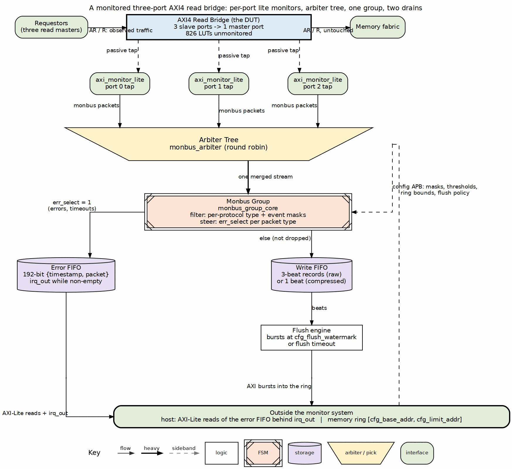

Every SoC debug story starts the same way: something is wrong on a bus, and
the moment you attach instrumentation, the bug moves. The instrument changed
the timing, or worse, it back-pressured the very traffic it was watching.

Ocelus — the monitor fabric in the RTL Design Sherpa project — takes the
hard line on this: **the observer must never stall the observed.** Its
workhorse is a "lite" monitor, about 1,100 LUTs per AMBA4 port, that tracks
transactions in per-ID linked lists and emits 128-bit event packets onto a
shared monitor bus. When its tracking table fills, it does not stretch the
bus's handshake — it counts the command it could not track and says so
later, in a packet, when the bus is free. Every event is delivered, counted
dropped, or pending. No fourth outcome, and that contract is verified
formally, not just simulated.

The fabric is sliced into five planes you can keep or drop independently at
build time: **protocol** (the passive taps), **error** (errors, timeouts,
threshold crossings — the ones that assert an interrupt), **debug**
(completion and trace packets), **perf** (counter roll-ups), and
**output** (arbitration, filtering, optional compression, and the drain to
memory). A bring-up build keeps protocol + error and catches SLVERRs and
hangs; a silicon-perf build keeps protocol + perf and measures utilization
for hours; a field-debug build adds the capture CAM and drains through a
low-pin-count port.

The result is that per-port instrumentation stops being a judgment call. At
roughly a sixth of the area of the full monitor — and meeting 150 MHz on a
Kintex-7 with margin where the full monitor misses — the default becomes
"monitor every port," and the interesting question moves up a level: not
whether you can afford to watch, but what you want the fabric to tell you.

*The design, the measured numbers, and the Nexus comparison are in the
[Ocelus White Paper](https://github.com/sean-galloway/RTLDesignSherpa/blob/main/docs/pdfs/Ocelus_White_Paper.pdf).*
