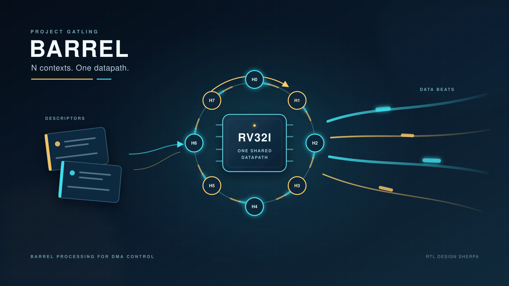
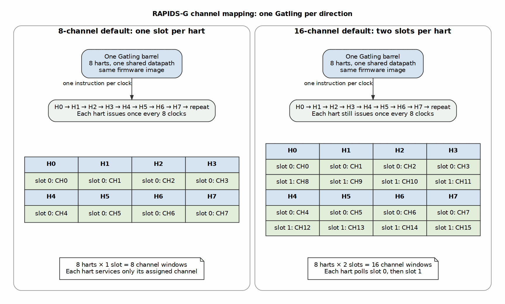

I had read about barrel processors and thought they might be useful for a future project. I turned notes from Hennessy and Patterson, and Harris and Harris, into requirements. Kimi helped with coding and validation. A very lean, N-Barrel RV32i, referred to as Gatling, was ready sooner than the intended project needed. So, I tried to use it in another way.

I name my projects to make them easier to talk about. I called it Gatling. Once it worked, I remembered someone’s suggestion: put a processor into a high-performance DMA.

I’ve long preferred microcontrollers for power management and training/calibration control. I was curious whether DMA FSMs could offer the same flexibility.

The idea was to replace scheduler FSMs with small processors: not a host CPU, and not a processor moving every beat. An RV32I core rotates N hardware contexts through one shared datapath, one context per cycle. Descriptor policy becomes firmware; the engine-rate datapath stays hardware.

The surprising part wasn’t that it worked. It was how badly it lost in one test, and how close it came in another:

| Scheduler-only simulation | FSM cycles | Barrel-RV32I cycles |
|---|---:|---:|
| 16 one-beat descriptors, one channel | 131 | 2,371 |
| Two 1 MB descriptors on every channel | 84,277 | 84,443 |

The first is **18.1×** slower. The second is **0.2%** slower. That gap is the cost/benefit question: how much control work does each descriptor need, and what useful data movement can hide it?

I used [RAPIDS and rapids-g](https://github.com/sean-galloway/RTLDesignSherpa/blob/main/projects/components/dma-ip/rapids/docs/rapids_mas/ch05_rapids_g/01_overview.md) to find out: an 8-channel, 256-bit DMA running at 100 MHz with a 3,200 MB/s peak in each direction. The two implementations share the datapath, descriptor format, register map, and host software. That gave me an unusually controlled comparison.

## Replace the policy, not the datapath

Firmware takes and validates descriptors, follows chains, commands channel-state transitions, and calculates EXT run bases. It also validates the next descriptor while the current one transfers.

Hardware still advances addresses within a run, decrements engine counters, enforces timeouts, records sticky errors, emits monitor packets, and moves data. A channel reset forces `CH_IDLE`; a fatal fault forces `CH_ERROR` immediately. Those interlocks don’t wait for a firmware polling pass.

So “replace the FSMs with processors” is useful shorthand, but it’s inaccurate if you take it literally. The processors replace *policy sequencers*. They don’t replace machinery that has to respond on the next clock.

## What a barrel processor buys

A barrel core is fine-grained multithreading in its simplest form. With N contexts, the core rotates through them and can issue one instruction each cycle in aggregate. Each context, called a hart, issues at most once every N cycles. These are hardware threads, not N complete processors. One instruction per cycle sounds great until you’re the hart waiting for your next turn.

This organization has a long history, including the CDC 6600’s rotating peripheral processors and later fine-grained multithreaded machines. The [Gatling documentation and references](https://github.com/sean-galloway/RTLDesignSherpa/blob/main/projects/components/riscv-ip/gatling-rv32i/docs/gatling_has/ch01_introduction/01_introduction.md) place our implementation in that lineage; the technique isn’t new.

For DMA control, I cared about four things:

- **Policy and descriptor checks become programmable.** I can add descriptor quality checks on the fly in a writable build, then commit the firmware to ROM.
- **Work can be moved ahead.** Pre-validation and pre-arming let hardware start a chained descriptor as soon as its predecessor completes.
- **New debug and error messages are free.** I can send new messages by changing firmware, not by changing an FSM state or message path. Existing monitor machinery carries them. Verification still costs effort, but there’s no new message RTL.
- **One datapath serves many channels.** At 4 and 8 channels, the default is one hart per channel. At 16 channels, eight harts each serve two slots.

Both RAPIDS-G builds instantiate **one Gatling per direction**, two in total. At 16 channels, FSM LUTs grow from 69,184 to 126,820 and firmware LUTs from 77,975 to 141,067. The extra state is channel windows, base queues, and other per-channel logic, so firmware overhead stays in the 11–13% range.

Why not use 16 harts? Each channel would get its own hart, but each hart would wait 16 clocks between instructions. The two-slot build wins the lone-channel short-descriptor test, **3,131 cycles to 4,731**; the 16-hart build wins with every channel busy, **4,620 to 5,383**. The 1 MB results are effectively tied. The eight-hart build keeps half the hart state and stays within 0.6% of the best EXT result. Two 8-hart Gatlings per direction could avoid slot sharing without the longer rotation, but would duplicate core resources. I haven’t built or measured that option.

One example shows the benefit: the firmware build supports next-address selector 1, a Z-order algorithm that the FSM build refuses. That doesn’t mean every feature is cheaper in software. The EXT measurements show the opposite for address arithmetic, but it’s still valuable to have a place to put a new algorithm.

## The implementation bill

The out-of-context Kintex-7 comparison:

| Metric | rapids-8ch | rapids-g-8ch | rapids-16ch | rapids-g-16ch |
|---|---:|---:|---:|---:|
| LUTs | 69,184 | 77,975 | 126,820 | 141,067 |
| Registers | 56,105 | 58,837 | 101,808 | 104,738 |
| BRAM tiles | 64 | 70 | 128 | 134 |
| DSPs | 64 | 0 | 128 | 0 |
| Worst-negative slack at 100 MHz | +0.684 ns | +0.533 ns | +0.079 ns | +0.050 ns |

Firmware costs **12.7% more LUTs at 8 channels** and **11.2% at 16**, plus six BRAM tiles. Timing still closes, with less margin. In exchange, all 64 DSPs at 8 channels and 128 at 16 disappear: firmware repeated addition replaces the hardware index-by-stride multipliers.

These FPGA implementation results are not ASIC area or power measurements. Utilization tables don’t measure programmability or maintainability.

## Context count is a latency/throughput knob

I ran every scheduler-limit scenario with 4 and 8 contexts on the same 8-channel build and the same committed firmware. Four contexts mean two channel slots per hart; eight mean one. The current RTL doesn’t support two contexts.

| Scenario | FSM cycles | 4-context cycles | 8-context cycles |
|---|---:|---:|---:|
| 16 one-beat descriptors, one channel | 131 | 1,571 | 2,371 |
| 16 one-beat descriptors, every channel | 131 | 2,699 | 2,316 |
| 16 64-beat descriptors, every channel | 1,255 | 2,777 | 2,389 |
| Four 64 KB descriptors, every channel | 9,248 | 9,415 | 9,412 |
| Two 1 MB descriptors, every channel | 84,277 | 84,444 | 84,443 |
| EXT, runs of four, 64 beats | 407 | 39,002 | 39,201 |
| EXT, per beat, 64 beats | 1,043 | 128,922 | 130,086 |
| EXT, runs of 256, 1 MB | 29,574 | 70,253 | 70,641 |

With one busy channel, 4 contexts are **34% faster** than 8: the active hart gets an issue slot every four cycles rather than every eight. Turn on every channel and the answer flips. Now 4 contexts are **17% slower** because each hart must walk two slots. At 64 beats, it’s 16% slower. At 1 MB, the difference is one cycle.

The EXT rows expose a different wall. A base costs firmware about **15–35 instructions**, each taking N cycles for that context, while the hardware generator produces one in a cycle. In the per-beat EXT scheduler test, 8 contexts take **125×** the FSM’s cycles. A bigger transfer won’t fix an operation that has to be produced at engine rate. That needs hardware assistance, not just more contexts.

## Firmware tricks that hide the latency

The first working image wasn’t fast. We gained performance by changing *where* and *when* the firmware did its work.

**Pre-validate and pre-arm.** The descriptor engine pre-fetches up to four descriptors ahead when the chain and FIFO space allow. `STAGE_ARM` stages and arms the next descriptor before its predecessor finishes. Without it, arming during the active descriptor takes about 25 instructions: 200 cycles at 8 contexts. The 64-beat sink-chain case drops from 672 clocks per descriptor to about 90 with the fast paths.

**Put the chained-head fast path in the poll.** The one-slot loop tests `HEAD_SUM` first. The value 13 means an open, valid, chained head that isn’t last, so firmware writes `STAGE | STAGE_ARM | STAGE_ARM_NEXT` immediately. Four instructions cover the read and command. This tight loop reduced the same chained-descriptor cost from about 288 clocks to about 90.

**Close the read race.** A head can arrive between the `HEAD_SUM` and `SUMMARY` reads. Re-reading `HEAD_SUM` after `SUMMARY` shows attention ensures it’s judged inline rather than falling into the slower service path. This is a correctness fix that also prevents an avoidable latency cliff. Don’t optimize the check away.

**Make idle cheap.** A seven-instruction one-slot idle pass recovered a 1–2% dip on short eight-channel, single-descriptor points. With two slots per hart, reading `SUMMARY` first makes the idle pass two instructions.

**Specialize the two-slot loop.** The firmware unrolls both slots and puts the chain hook in each slot’s branch. The final ordering reads `SUMMARY` first, then handles each slot that needs attention. On the 16-channel build, where eight harts each serve two slots, this reduced chained cost from **184 to 103 clocks** and improved the corresponding board measurement from **1,122 to 2,008 MB/s**. An earlier HEAD_SUM-first version alternated between 36- and 156-clock waits: catching the head early was better, but missing it sent the pass back through the slow path.

**Use table dispatch, not a branch ladder.** After the poll, the `step` reads `STATUS` and indexes a 64-entry policy table with its six-bit state field. Four instructions reach any state’s row. A handler makes one or two command writes and returns without re-reading `STATUS` or dispatching itself, so no handler holds a hart for several descriptors. The table links below 2 KB, eliminating a base register for its jump; the firmware generator rejects larger images. Every saved instruction saves N cycles for that channel.

**Keep handlers run-to-completion.** Each poll gives at most one handler a slot. There’s no preemption, stack, or handler loop. That makes latency predictable and lets the other harts continue issuing.

These techniques hide control behind the in-flight descriptor and behind other channels. They don’t make an individual context issue faster than once per N cycles. Custom DMA instructions could provide a future EXT assist, but I’m not claiming a measured benefit for them here.

## Where the crossover lands

After all that, where does firmware catch the FSM? The chart plots **FSM cycles divided by rapids-g cycles**, so 1.00 is parity and lower values are slower. All data are scheduler simulations with 32-byte beats.

The thresholds tell the practical story:

| Shape | Busy channels | Within 5% of FSM | Within 1% of FSM |
|---|---:|---:|---:|
| Single descriptor, sink | 1 of 8 | 128 KB | 512 KB |
| Single descriptor, sink | 8 of 8 | 16 KB | 64 KB |
| Single descriptor, source | 8 of 8 | 16 KB | 128 KB |
| 16-descriptor chain, sink | 1 of 8 | 4 KB | 16 KB |
| 16-descriptor chain, interleaved sink | 8 of 8 | 512 B | 4 KB |

These are **bytes per descriptor**, not per run. Chains overlap the next head with the active transfer, and multiple channels provide data movement behind which firmware can work. A lone descriptor has neither advantage, so fixed firmware cost dominates longer.

That’s why “near parity on 1 MB” and “18× slower on one beat” aren’t contradictory. They’re opposite ends of the same amortization curve.

## Verification is part of the price

Moving policy into firmware doesn’t eliminate verification; it changes what you have to verify. The firmware image is part of the hardware deliverable.

Rapids-g runs side-by-side equivalence tests against the FSM scheduler, comparing commands, monitor packets, and state transitions. It reuses the existing RAPIDS test suites, adds mutation tests for both firmware and RTL, and checks board runs against simulation cycle by cycle. The comparison also exposed and fixed two bugs in the original FSM implementation. I’ll happily take that result, but it’s evidence that a second implementation was useful, not proof that firmware is inherently easier to verify.

A barrel is phase-sensitive: when a faster scenario changes the starting phase of the next one, an A/B comparison can move without a code change. Isolated runs from the same cycle settle that question.

## When I would choose each

I’d choose barrel-RV32I sequencing when descriptors or chains are large enough to amortize control work, several channels can keep the engines busy, and policy is expected to evolve. The deciding question is whether DSP removal and programmability justify more LUTs, BRAM, and firmware verification.

I’d keep an FSM, or add targeted hardware assist, when tiny descriptors dominate, lone-channel launch latency is a hard requirement, or an address pattern needs new bases at engine rate. The firmware toolchain and verification burden are real design costs, not secondary details.

The useful question isn’t “is a processor better than an FSM?” It’s **how much control work does each descriptor need, how quickly must that work finish, and what can hide it?** Sometimes the measured answer is firmware. Sometimes it’s an FSM. Often, it’s a deliberate split between the two.

## References

1. D. A. Patterson and J. L. Hennessy, *Computer Organization and Design, RISC-V Edition*, 2nd ed., Morgan Kaufmann, 2021. Section 6.4, “Hardware Multithreading.”
2. S. L. Harris and D. M. Harris, *Digital Design and Computer Architecture, RISC-V Edition*, Morgan Kaufmann, 2022. Section 7.7.7, “Multithreading.”
3. J. E. Thornton, “Parallel Operation in the Control Data 6600,” *Proceedings of the AFIPS Fall Joint Computer Conference, Part II*, 1964, pp. 33–40. The strict-rotation ancestor of the barrel organization.
4. B. J. Smith, “A Pipelined, Shared Resource MIMD Computer,” *Proceedings of the International Conference on Parallel Processing*, 1978, pp. 6–8. The Denelcor HEP and fine-grained interleaving.
5. H. F. Jordan, “Performance Measurements on HEP - A Pipelined MIMD Computer,” *Proceedings of the 10th International Symposium on Computer Architecture*, 1983, pp. 207–212. The single-thread latency versus aggregate-throughput trade.
6. G. Alverson, R. Alverson, D. Callahan, B. Koblenz, A. Porterfield, and B. Smith, “Exploiting Heterogeneous Parallelism on a Multithreaded Multiprocessor,” *Proceedings of Supercomputing ’92*, 1992, pp. 188–197. The Tera MTA and high-context-count latency hiding.
7. P. Kongetira, K. Aingaran, and K. Olukotun, “Niagara: A 32-Way Multithreaded Sparc Processor,” *IEEE Micro*, 25(2), March–April 2005, pp. 21–29. A modern fine-grained implementation with stalled-thread skipping.
8. RTL Design Sherpa, [RAPIDS-G architecture](https://github.com/sean-galloway/RTLDesignSherpa/blob/main/projects/components/dma-ip/rapids/docs/rapids_mas/ch05_rapids_g/01_overview.md), [sequencer and firmware](https://github.com/sean-galloway/RTLDesignSherpa/blob/main/projects/components/dma-ip/rapids/docs/rapids_mas/ch05_rapids_g/03_sequencer_and_firmware.md), and [verification and measurements](https://github.com/sean-galloway/RTLDesignSherpa/blob/main/projects/components/dma-ip/rapids/docs/rapids_mas/ch05_rapids_g/05_verification_and_measurements.md). The implementation and all RAPIDS measurements used in this article.
9. RTL Design Sherpa, [Gatling barrel model](https://github.com/sean-galloway/RTLDesignSherpa/blob/main/projects/components/riscv-ip/gatling-rv32i/docs/barrel_model/barrel_model.md), and [curated microarchitecture references](https://github.com/sean-galloway/RTLDesignSherpa/blob/main/projects/components/riscv-ip/references/microarchitecture-papers.md). Gatling’s design trade-offs and the historical sources above.
