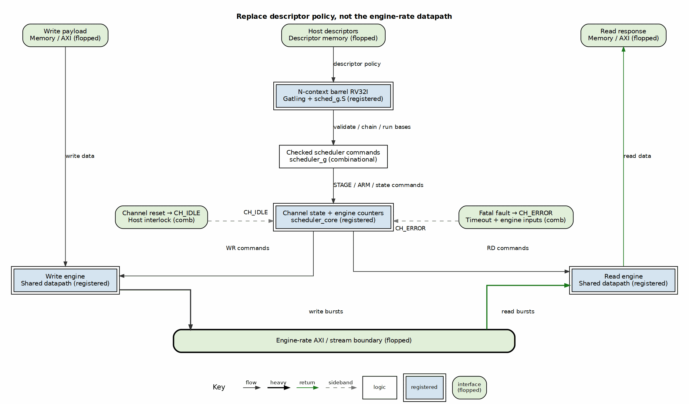
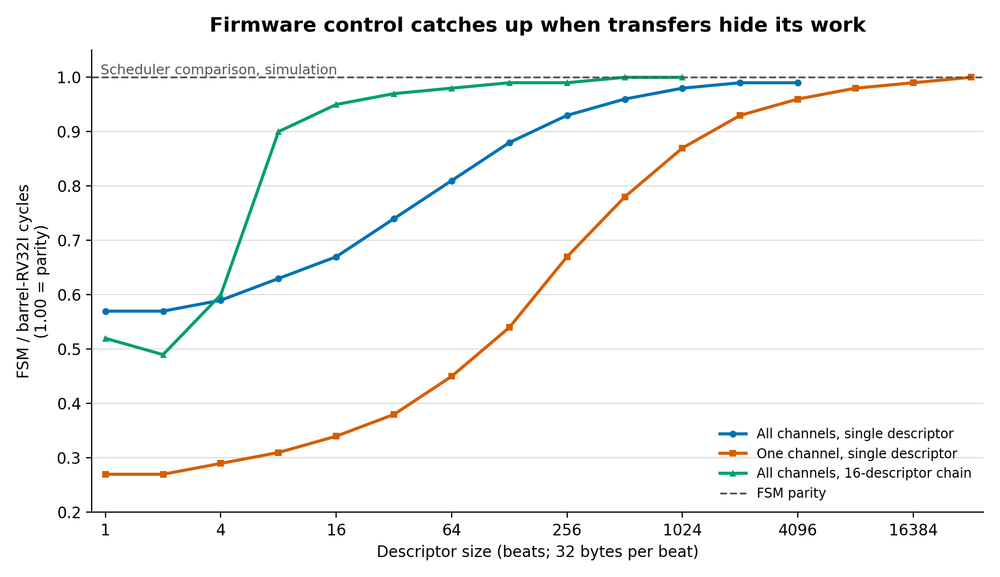

I made notes from *Computer Organization and Design* by Patterson and Hennessy. This was for a future project, but I wanted to try this out.

The idea was to replace the scheduler state machines in a high-performance DMA with small processors. Not a host CPU, and not a processor that moves every beat: an RV32I core with N hardware contexts, rotating one context through one shared datapath each cycle. Descriptor policy would become firmware; the engine-rate datapath would stay hardware.

The surprising part is not that it worked. It is that two measurements can both be true:

| Scheduler-only simulation | FSM cycles | Barrel-RV32I cycles |
|---|---:|---:|
| 16 one-beat descriptors, one channel | 131 | 2,371 |
| Two 1 MB descriptors on every channel | 84,277 | 84,443 |

The first is **18.1×** slower. The second is **0.2%** slower. The difference is the central cost/benefit question: how much control work does each descriptor require, and what useful data movement can hide it?

My test case is [RAPIDS and rapids-g](https://github.com/sean-galloway/RTLDesignSherpa/blob/main/projects/components/dma-ip/rapids/docs/rapids_mas/ch05_rapids_g/01_overview.md), an 8-channel, 256-bit DMA running at 100 MHz with a 3,200 MB/s peak in each direction. The two implementations share the datapath, descriptor format, register map, and host software. That gives us an unusually controlled comparison.

## Replace the policy, not the datapath

The firmware takes and validates descriptors, follows chains, commands channel-state transitions, and calculates EXT run bases. It also validates the next descriptor while the current one transfers.

The hardware still advances addresses within a run, decrements engine counters, enforces timeouts, records sticky errors, emits monitor packets, and moves data. A channel reset forces `CH_IDLE`; a fatal fault forces `CH_ERROR` immediately. Those interlocks do not wait for a firmware polling pass.

So “replace the FSMs with processors” is useful shorthand, but inaccurate if taken literally. The processors replace *policy sequencers*. They do not replace the machinery that must respond on the next clock.

## What a barrel processor buys

A barrel core is fine-grained multithreading in its simplest form. With N contexts, the core rotates through them and can issue one instruction each cycle in aggregate. Each context issues at most once every N cycles. The contexts—called harts—are hardware threads, not N complete processors.

This organization has a long history, including the CDC 6600’s rotating peripheral processors and later fine-grained multithreaded machines. The [Gatling documentation and references](https://github.com/sean-galloway/RTLDesignSherpa/blob/main/projects/components/riscv-ip/gatling-rv32i/docs/gatling_has/ch01_introduction/01_introduction.md) place our implementation in that lineage; the technique is not new.

For DMA control, the arrangement has three attractions:

- **Policy becomes programmable.** Firmware can be loaded into a writable build for live experiments, then committed to ROM.
- **Work can be moved ahead.** Pre-validation and pre-arming let the hardware start a chained descriptor as soon as its predecessor completes.
- **One datapath serves many channels.** At 4 and 8 channels, the default is one hart per channel. At 16 channels, eight harts each serve two slots.

That last point needs a qualifier. Both the 8- and 16-channel RAPIDS-G builds instantiate **one Gatling per direction**, two in total. The 16-channel example demonstrates slot sharing and area scaling, not a linearly increasing number of processor instances. Doubling from 8 to 16 channels grows the FSM design from 69,184 to 126,820 LUTs and the firmware design from 77,975 to 141,067. The processor count does not double; channel windows, base queues, and other per-channel state do. That is why the firmware overhead remains in the same 11–13% range.

There is also a concrete example of policy changing without another FSM redesign: the firmware build supports next-address selector 1, a Z-order algorithm that the FSM build refuses. This is not evidence that every feature is cheaper in software—the EXT measurements show the opposite for address arithmetic—but it shows the value of having a place to put a new algorithm.

## The implementation bill

The out-of-context Kintex-7 comparison is refreshingly concrete:

| Metric | rapids-8ch | rapids-g-8ch | rapids-16ch | rapids-g-16ch |
|---|---:|---:|---:|---:|
| LUTs | 69,184 | 77,975 | 126,820 | 141,067 |
| Registers | 56,105 | 58,837 | 101,808 | 104,738 |
| BRAM tiles | 64 | 70 | 128 | 134 |
| DSPs | 64 | 0 | 128 | 0 |
| Worst-negative slack at 100 MHz | +0.684 ns | +0.533 ns | +0.079 ns | +0.050 ns |

Firmware costs **12.7% more LUTs at 8 channels** and **11.2% at 16**, plus six BRAM tiles. Timing still closes, with less margin. In exchange, all 64 DSPs at 8 channels and 128 at 16 disappear: firmware repeated addition replaces the hardware index-by-stride multipliers.

These are FPGA implementation results, not ASIC area or power measurements. Programmability and maintainability are potential engineering benefits, not quantities in this table.

## Context count is a latency/throughput knob

I also ran every scheduler-limit scenario with 4 and 8 contexts on the same 8-channel build and the same committed firmware. Four contexts mean two channel slots per hart; eight mean one. Two contexts is not supported by the current RTL.

| Scenario | FSM cycles | 4-context cycles | 8-context cycles |
|---|---:|---:|---:|
| 16 one-beat descriptors, one channel | 131 | 1,571 | 2,371 |
| 16 one-beat descriptors, every channel | 131 | 2,699 | 2,316 |
| 16 64-beat descriptors, every channel | 1,255 | 2,777 | 2,389 |
| Four 64 KB descriptors, every channel | 9,248 | 9,415 | 9,412 |
| Two 1 MB descriptors, every channel | 84,277 | 84,444 | 84,443 |
| EXT, runs of four, 64 beats | 407 | 39,002 | 39,201 |
| EXT, per beat, 64 beats | 1,043 | 128,922 | 130,086 |
| EXT, runs of 256, 1 MB | 29,574 | 70,253 | 70,641 |

With one busy channel, 4 contexts are **34% faster** than 8: the active hart gets an issue slot every four cycles rather than every eight. With every channel busy, the same configuration is **17% slower** because each hart must walk two slots. At 64 beats, it is 16% slower. At 1 MB, the difference is one cycle.

The EXT rows expose a different wall. A base costs the firmware about **15–35 instructions**, each taking N cycles for that context, while the hardware generator produces one in a cycle. In the per-beat EXT scheduler test, 8 contexts take **125×** the FSM’s cycles. A bigger transfer does not fix an operation that must be produced at the engine rate; it needs hardware assistance, not just more contexts.

## Firmware tricks that hide the latency

The performance did not come free with the first working image. Most of the useful gains came from changing *where* and *when* the firmware did its work.

**Pre-validate and pre-arm.** `STAGE_ARM` combines staging and arming the next descriptor before its predecessor finishes. Without it, arming inside the active descriptor takes a roughly 25-instruction path—200 cycles at 8 contexts. Before this optimization, the 64-beat sink-chain case cost 672 clocks per descriptor. Together with the later fast paths, it is about 90.

**Put the chained-head fast path in the poll.** The one-slot loop tests `HEAD_SUM` first. The value 13 means an open, valid, chained head that is not last, so firmware writes `STAGE | STAGE_ARM | STAGE_ARM_NEXT` immediately. Four instructions cover the read and command. This tight loop reduced the same chained-descriptor cost from about 288 clocks to about 90.

**Close the read race.** A head can arrive between the `HEAD_SUM` and `SUMMARY` reads. Re-reading `HEAD_SUM` after `SUMMARY` shows attention ensures it is judged inline rather than falling into the slower service path. This is a correctness fix that also prevents an avoidable latency cliff; it is not a check to optimize away.

**Make idle cheap.** A seven-instruction one-slot idle pass recovered a 1–2% dip on short eight-channel, single-descriptor points. With two slots per hart, reading `SUMMARY` first makes the idle pass two instructions.

**Specialize the two-slot loop.** The firmware unrolls both slots and puts the chain hook in each slot’s branch. The final ordering reads `SUMMARY` first, then handles each slot that needs attention. On the 16-channel build, where eight harts each serve two slots, this reduced chained cost from **184 to 103 clocks** and improved the corresponding board measurement from **1,122 to 2,008 MB/s**. An earlier HEAD_SUM-first version alternated between 36- and 156-clock waits: catching the head early was better, but missing it sent the pass back through the slow path.

**Use table dispatch, not a branch ladder.** After the poll, `step` reads `STATUS` and uses the six-bit state field to index a 64-entry policy table. Four instructions get from the status read to that state’s row; every possible field value stays inside the table. A handler performs one or two command writes and returns rather than re-reading `STATUS` or dispatching itself. This executive/policy-table split prevents a handler from keeping a hart for several descriptors. The table is linked below 2 KB so its jump needs no base register, and the firmware generator rejects an image that outgrows that layout. These are small code-layout choices, but every saved instruction saves N cycles for that channel.

**Keep handlers run-to-completion.** Each poll gives a slot at most one handler. There is no preemption, stack, or handler loop. That makes latency predictable and lets the other harts continue issuing.

These techniques hide control behind the descriptor in flight and behind other channels. They do not make an individual context issue faster than once per N cycles. Custom DMA instructions are a possible future EXT assist, but I am not claiming a measured benefit for them here.

## Where the crossover lands

The chart plots **FSM cycles divided by rapids-g cycles**, so 1.00 is parity and lower values are slower. All data are scheduler simulations with 32-byte beats.

The corresponding thresholds tell the practical story:

| Shape | Busy channels | Within 5% of FSM | Within 1% of FSM |
|---|---:|---:|---:|
| Single descriptor, sink | 1 of 8 | 128 KB | 512 KB |
| Single descriptor, sink | 8 of 8 | 16 KB | 64 KB |
| Single descriptor, source | 8 of 8 | 16 KB | 128 KB |
| 16-descriptor chain, sink | 1 of 8 | 4 KB | 16 KB |
| 16-descriptor chain, interleaved sink | 8 of 8 | 512 B | 4 KB |

These are **bytes per descriptor**, not bytes for the whole run. Chains overlap the next head with the active transfer. Multiple active channels provide independent data movement behind which firmware can work. A lone, single descriptor has neither advantage, so its fixed firmware cost dominates for much longer.

This is why “near parity on 1 MB” and “18× slower on one beat” are not contradictory. They are opposite ends of the same amortization curve.

## Verification is part of the price

Moving policy into firmware does not eliminate verification; it changes what must be verified. The firmware image is part of the hardware deliverable.

Rapids-g runs side-by-side equivalence tests against the FSM scheduler, comparing commands, monitor packets, and state transitions. It reuses the existing RAPIDS test suites, adds mutation tests for both firmware and RTL, and checks board runs against simulation cycle by cycle. The comparison also exposed and fixed two bugs in the original FSM implementation. That is evidence that the second implementation was useful, not proof that firmware is inherently easier to verify.

Performance tests need equal care. A barrel is phase-sensitive: when a faster scenario changes the starting phase of the next one, an A/B comparison can move without a code change. Isolated runs from the same cycle settle that question.

## When I would choose each

I would choose barrel-RV32I sequencing when descriptors or chains are large enough to amortize control work, several channels can keep the engines busy, policy is expected to evolve, and DSP removal plus programmability justifies more LUTs, BRAM, and firmware verification.

I would keep an FSM—or add targeted hardware assist—when tiny descriptors dominate, lone-channel launch latency is a hard requirement, or an address pattern needs new bases at the engine rate. The firmware toolchain and verification burden are real design costs, not secondary details.

The useful question is not “is a processor better than an FSM?” It is **how much control work does each descriptor need, how quickly must that work finish, and what can hide it?** The measured answer can be firmware, an FSM, or a deliberate split between the two.

*All measurements and the firmware discussion are from the [RAPIDS-G verification and measurements chapter](https://github.com/sean-galloway/RTLDesignSherpa/blob/main/projects/components/dma-ip/rapids/docs/rapids_mas/ch05_rapids_g/05_verification_and_measurements.md) and [sequencer/firmware documentation](https://github.com/sean-galloway/RTLDesignSherpa/blob/main/projects/components/dma-ip/rapids/docs/rapids_mas/ch05_rapids_g/03_sequencer_and_firmware.md).*
