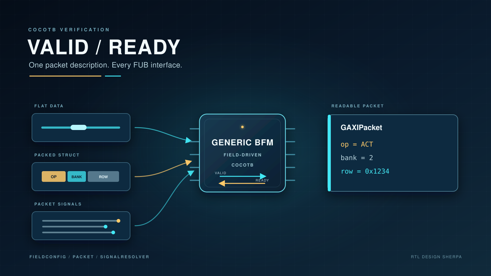
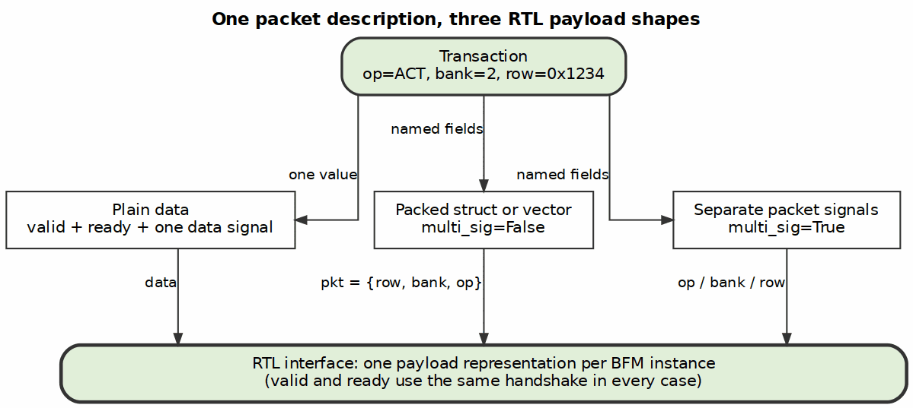
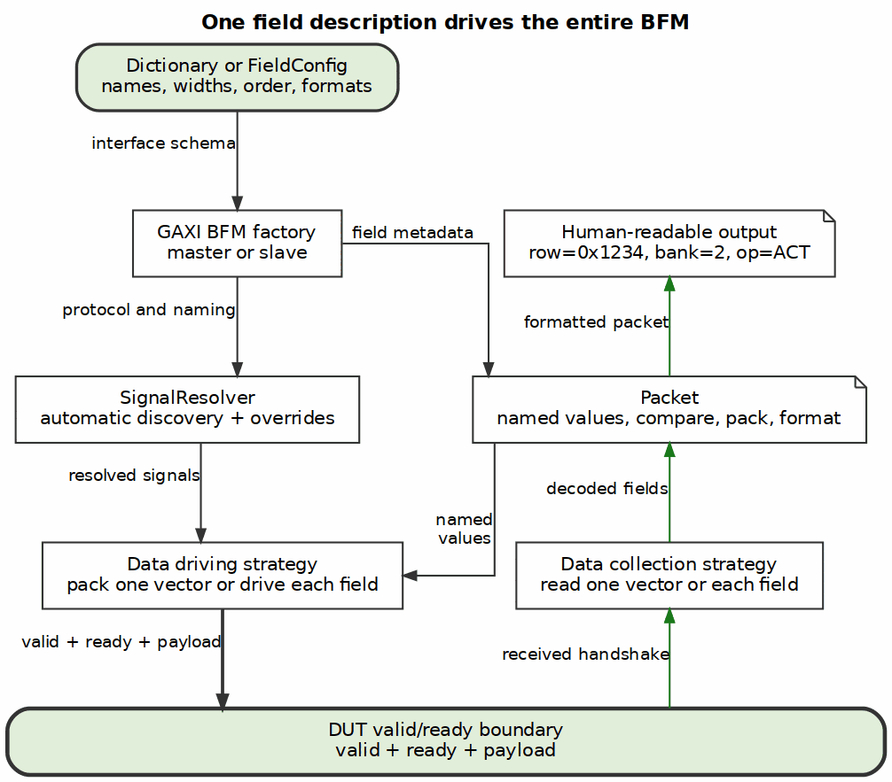

When I started coding RTL on GitHub, I needed to use CocoTB, as it is open source, and I wanted to test each module at the functional unit block, or FUB, level while the design was still fresh in my mind. Write the FUB, wrap a small testbench around it, and find the interface and control bugs right there. I didn't want to wait until the whole component came together, possibly months later, and then hunt for a bug across several integrated blocks.



I also didn't want to keep rewriting the same testbench collateral. Many FUB interfaces are just valid, ready, and a payload, but the payload takes different forms. Sometimes it is one data signal. Sometimes it is a packed struct or a flat vector containing several fields. Sometimes every packet field has its own signal. Hand-connecting each bus functional model, or BFM, was error-prone. The wiring also became one more thing to maintain as the RTL changed.

I initially asked LLMs for help with the implementation. That didn't go well. When I was coding, the context for the FieldConfig, Packet, and Signal Resolver classes alone was too large, even when I tried to pass in the API's through Markdown files. Nearly all of the original code is hand-crafted. The useful abstractions came from working through real testbench problems: field layout, signal discovery, handshake ownership, and readable diagnostics. The result is a generic valid/ready BFM whose interface can be described by a class or a dictionary.

## One handshake, several payload shapes

A valid/ready transfer has a simple rule: a transaction moves when both sides are ready for it. The BFM should own that rule and the payload. A BFM that drives valid while the test still pokes data signals only solves half the problem.

The payload representation should not dictate the test API. I wanted to write this:

```python
await cmd.send(cmd.create_packet(op=ACT, bank=2, row=0x234))
```

Whether `op`, `bank`, and `row` travel in one packed `cmd_pkt` signal or on three separate signals is a property of the RTL connection. It should not change how the test describes the transaction.



Making that work required three pieces of collateral: `FieldConfig`, `Packet`, and `SignalResolver`.

## FieldConfig describes the transaction

`FieldConfig` is the schema. It records each field's name and width, along with the information needed to interpret and display it: ordering, bit positions, defaults, number format, descriptions, and optional symbolic encodings.

A command interface can start as an ordinary dictionary:

```python
COMMAND_FIELDS = {
    "op": {
        "bits": 4,
        "format": "hex",
        "encoding": {0x1: "ACT", 0x3: "RD", 0x4: "WR"},
    },
    "bank": {"bits": 3, "format": "dec"},
    "row": {"bits": 14, "format": "hex"},
}
```

The BFM factories accept that dictionary and normalize it into a `FieldConfig`. Code that prefers the class interface can construct the `FieldConfig` directly and pass that instead. A plain data-only interface does not even need a custom schema; `FieldConfig.create_data_only(width)` supplies the default.

For a packed interface, field order and width are part of the wire contract. They determine the bit ranges used to pack and unpack the vector. This is not display metadata bolted onto a BFM. It is the shared description used by the driver, collector, packet, and diagnostics.

## Packet gives the fields a useful representation

`Packet` stores values by field name. A test can set `packet.bank`, compare two packets field by field, pack the values into an integer, or unpack a received vector back into named fields. Width masking keeps a field inside its declared size.

The same metadata makes received traffic readable. Number formats can present addresses in hexadecimal and pad them to their declared display width, while symbolic encodings can decode opcodes without hiding their raw values. For example, the 14-bit row address above is padded to four hexadecimal digits, and `ACT` appears alongside its encoded value:

```text
GAXIPacket(row=0x0234, bank=2, op=ACT (0x1))
```

That's much easier to debug than one long hexadecimal word and a round of mental shift-and-mask. A field such as `bank` can remain decimal, while descriptions and number formats make the detailed output useful too.

The field description can also represent implied low-order address bits. If only `addr[31:5]` is stored, expanding the field appends five zero bits on the right; for example, `0x80` becomes the full byte address `0x00001000`. Packed and multi-signal inputs produce the same kind of packet, so the diagnostic doesn't depend on how the RTL exposed the payload.

That also improves scoreboards and failure messages. A mismatch can name the field that differs instead of reporting only that two large integers were unequal.

There's a conceptual echo of Knuth's literate programming here: the human explanation and the executable behavior come from the same field description. The BFM isn't itself a literate program, but its diagnostics follow the same human-first priority.

## FieldConfig links the BFM to the RTL

`FieldConfig` is the link between the RTL and the BFMs. It describes the packet fields that the BFM presents to the test, while `SignalResolver` matches that description to the actual top-level DUT signals. I did not want to manually bind every signal, especially while port names and interface shapes were still changing.

`SignalResolver` follows a set of common naming heuristics. It uses the protocol side, prefixes, bus name, packet prefix, and payload mode to match the packet to the RTL ports. For a conventional `cmd_` interface, it can discover names such as `cmd_valid`, `cmd_ready`, and `cmd_pkt`. In multi-signal mode, it looks for individual field names such as `cmd_op`, `cmd_bank`, and `cmd_row`. If the heuristics cannot resolve a required signal, the resolver throws an error rather than leaving the BFM silently disconnected.

When the RTL does not follow the common conventions, a `signal_map` provides an override mechanism:

```python
signal_map = {
    "valid": "cmd_valid_i",
    "ready": "cmd_ready_o",
    "data": "cmd_payload_i",
}
```

The map may be partial. Explicit entries bind first, and the common heuristics resolve the rest. This keeps automatic connection convenient without forcing unusual RTL names to fit the default patterns.

The resolved signal handles are then shared with the data-driving and data-collection strategies. They do not repeat the discovery work or maintain a second interpretation of the interface.

## One description becomes three BFMs

Here is the factory-level view of the packed command example:

```python
from CocoTBFramework.components.gaxi.gaxi_factories import create_gaxi_master

cmd = create_gaxi_master(
    dut,
    "cmd",
    "",
    dut.aclk,
    field_config=COMMAND_FIELDS,
    bus_name="cmd_",
)

await cmd.send(cmd.create_packet(op=0x1, bank=2, row=0x234))
```

With `multi_sig=False`, the data strategy packs the fields and drives one combined payload signal. With `multi_sig=True`, the resolver looks for separate field signals and the driver writes each field directly:

```python
cmd = create_gaxi_master(
    dut,
    "cmd",
    "",
    dut.aclk,
    field_config=COMMAND_FIELDS,
    bus_name="cmd_",
    multi_sig=True,
)
```

For a simple data-only interface, the same pattern becomes:

```python
from CocoTBFramework.components.shared.field_config import FieldConfig

read_data = create_gaxi_master(
    dut,
    "read_data",
    "",
    dut.aclk,
    field_config=FieldConfig.create_data_only(128),
    bus_name="dfi_rd_",
)
```

The master BFM drives valid and payload while honoring ready. The slave BFM drives ready and captures valid and payload. Timing profiles can introduce valid delays or backpressure without changing the packet definition or the test's transaction API.

The reuse goes beyond putting three constructors behind one function name. The same field description flows through the whole path:



That's the difference between reusable BFM collateral and yet another protocol driver.

I didn't set out to implement patterns from a catalog, but several familiar software ideas describe what emerged. `FieldConfig` is a table-driven description of behavior. `Packet` is a canonical transaction model that hides individual signal formats. The resolver and payload paths act as adapters, with packed and multi-signal implementations providing strategy variants. Automatic naming with explicit exceptions is convention over configuration.

## The unexpected result: design moved faster

I expected to write less testbench code. I didn't expect the immediate FUB tests to speed up design cleanup as much as they did.

A small FUB test can exercise a boundary as soon as it is written. It can apply backpressure, inspect the accepted transaction, and compare named fields without the rest of the component obscuring the result. You still remember why the logic looks the way it does, and the failing interface is usually small enough to reason about directly.

These tests found real control mistakes early: readiness logic sampling current state instead of next state, a grant based on a registered decision rather than an accepted handshake, and bookkeeping that disagreed with state at a FUB boundary. Fixing those problems at the FUB level was much cheaper than discovering them after integration, when several modules could plausibly be at fault.

There's another, less obvious benefit. Because the BFM owns both handshake and payload, the testbench stops encoding accidental assumptions through hand-poked signals. The test states what transaction should happen. The collateral handles how it crosses the interface.

Generic doesn't mean universal. A valid-only strobe with no ready isn't a valid/ready interface, so it needs a different driver. Nonstandard port names need discovery patterns or a `signal_map`. A packed struct still needs a field layout that matches the RTL. The abstraction removes repetitive work; it doesn't remove the need to define the contract correctly.

The payoff is that you no longer need a new collection of handshake drivers, packing functions, monitors, and formatting code for each new FUB interface. Define the fields, choose the payload form, connect the BFM, and start testing the design. The earlier you run that loop, the sooner the design gets clean.

## References

1. Donald E. Knuth, "Literate Programming," *The Computer Journal* 27(2), 1984, pp. 97–111. [DOI](https://doi.org/10.1093/comjnl/27.2.97); [archived PDF](https://github.com/sean-galloway/RTLDesignSherpa/blob/main/articles/references/LiterateProgramming__Knuth1984.pdf). Human-first explanation and the conceptual analogy for readable packet diagnostics, not a claim that the BFM uses literate programming.
2. Steve McConnell, *Code Complete*, 2nd ed., Microsoft Press, 2004, [Chapter 18, "Table-Driven Methods"](https://www.oreilly.com/library/view/code-complete-2nd/0735619670/ch18.html). The general technique behind letting `FieldConfig` descriptions drive behavior instead of writing per-interface logic.
3. Erich Gamma, Richard Helm, Ralph Johnson, and John Vlissides, *Design Patterns: Elements of Reusable Object-Oriented Software*, Addison-Wesley, 1995. [Publisher](https://www.informit.com/store/design-patterns-elements-of-reusable-object-oriented-9780201633610); [Adapter excerpt](https://www.informit.com/articles/article.aspx?p=1398600). Adapter for reconciling the packet API with different RTL interfaces, and Strategy for interchangeable packed and multi-signal payload paths.
4. Gregor Hohpe and Bobby Woolf, *Enterprise Integration Patterns*, Addison-Wesley, 2003, ["Canonical Data Model"](https://www.enterpriseintegrationpatterns.com/patterns/messaging/CanonicalDataModel.html). The precedent for `Packet` as a common transaction representation independent of each RTL payload format.
5. David Heinemeier Hansson, ["The Ruby on Rails Doctrine: Convention over Configuration"](https://rubyonrails.org/doctrine). A clear statement of the principle behind common naming heuristics by default and explicit `signal_map` overrides for exceptions.
6. RTL Design Sherpa, [FUB valid/ready BFM wrappers](https://github.com/sean-galloway/RTLDesignSherpa/blob/main/bin/TBClasses/fub_bfm.py). Producer and consumer helpers, explicit signal mapping, timing profiles, and the valid-only boundary.
7. RTL Design Sherpa DV, [FieldConfig and FieldDefinition](https://github.com/sean-galloway/RTLDesignSherpa-DV/blob/main/src/CocoTBFramework/components/shared/field_config.py). Field schemas, widths, ordering, formats, encodings, and dictionary conversion.
8. RTL Design Sherpa DV, [Packet](https://github.com/sean-galloway/RTLDesignSherpa-DV/blob/main/src/CocoTBFramework/components/shared/packet.py) and [GAXIPacket](https://github.com/sean-galloway/RTLDesignSherpa-DV/blob/main/src/CocoTBFramework/components/gaxi/gaxi_packet.py). Named values, packing, comparison, and human-readable output.
9. RTL Design Sherpa DV, [SignalResolver](https://github.com/sean-galloway/RTLDesignSherpa-DV/blob/main/src/CocoTBFramework/components/shared/signal_mapping_helper.py). Automatic signal discovery, partial overrides, and required-signal validation.
10. RTL Design Sherpa DV, [GAXI component base](https://github.com/sean-galloway/RTLDesignSherpa-DV/blob/main/src/CocoTBFramework/components/gaxi/gaxi_component_base.py) and [data strategies](https://github.com/sean-galloway/RTLDesignSherpa-DV/blob/main/src/CocoTBFramework/components/shared/data_strategies.py). How the field configuration, resolver, packets, and BFMs fit together.
