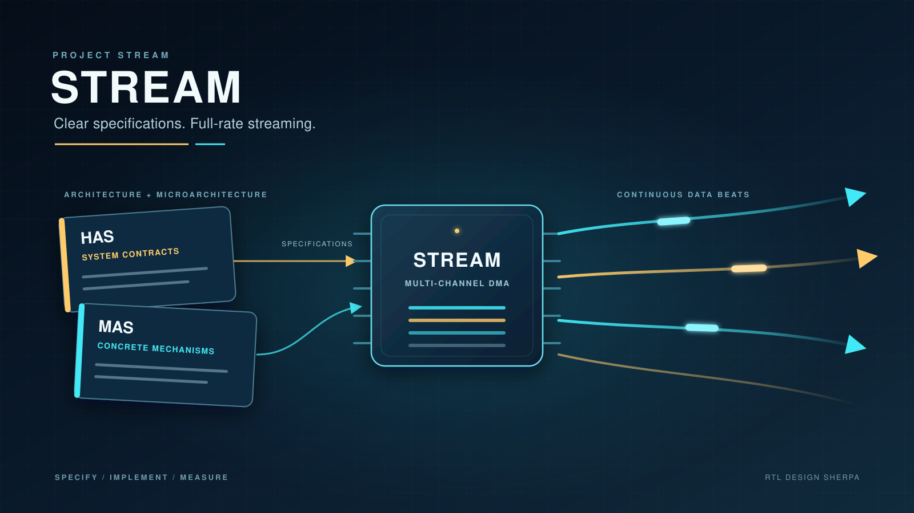
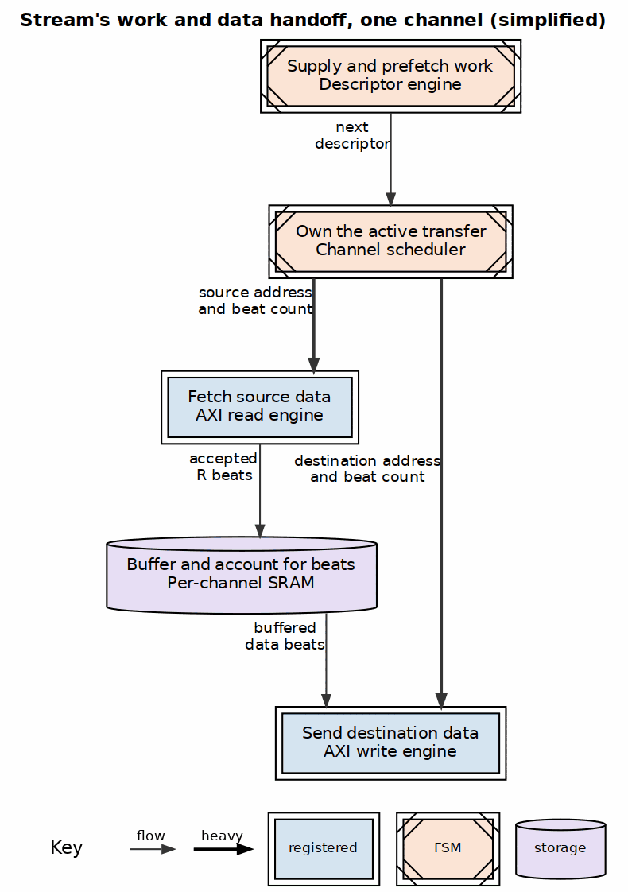
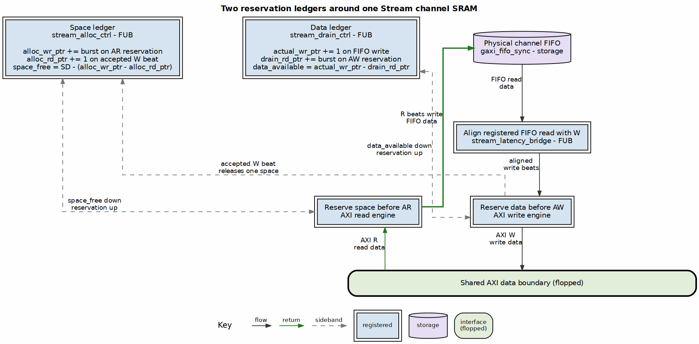

I used Claude to help me implement Stream, a high-performance, multi-channel DMA. The first working version arrived quickly, but its AXI utilization did not. Getting from a working design to one that streams at line rate turned out to be a useful lesson in what an LLM can infer, and what a designer still needs to specify.



Is Stream any good? The current FPGA measurements say yes, within its documented operating envelope. But the result wasn't a one-week AI success story. The control architecture worked early because I described it in detail. The AXI engines needed a second attempt because I initially gave them a performance goal instead of a microarchitecture. Months of FPGA work then turned "it passes" into evidence I could trust.

## The thoughts behind Stream

The architectural thought was to separate ownership of work, movement, and storage. I use the word *engine* for a block that works on its own after receiving an input; give it more work, and it knows how to make progress. I specified the scheduler, descriptor engine, and SRAM control in detail because they own the contracts that make concurrent streaming possible. For the AXI read and write engines, I initially specified only those external contracts and asked for maximum utilization. That left the most important internal decisions open.

The **scheduler** owns one channel's active transfer. It accepts descriptors, presents source work to the read engine and destination work to the write engine, and tracks the beats in each direction. It does not need to know how either engine packs work into AXI bursts. Its job is to keep both sides moving and to distinguish issued writes from writes that have actually committed.

The **descriptor engine** keeps the scheduler supplied with work. It fetches descriptors, validates their addresses, follows chains, and prefetches future descriptors into a FIFO while the current transfer continues. Descriptor traffic and data traffic can therefore make progress independently, rather than taking turns.

The **SRAM control** connects the two data engines without requiring a descriptor to fit in the buffer. It reserves space before read bursts and reserves data before write bursts. The read engine can fill while the write engine drains, with backpressure applying only when the corresponding ledger says that continuing would be unsafe.



## The scheduler tracks two different kinds of completion

Each channel scheduler has a conventional control sequence:

```text
CH_IDLE -> CH_FETCH_DESC -> CH_XFER_DATA -> CH_COMPLETE
```

Chained transfers continue through `CH_NEXT_DESC`, while errors enter a sticky `CH_ERROR` state until the channel is reset. In `CH_XFER_DATA`, the scheduler presents independent read and write requests to the two engines. Each request carries an address and beat count. Done strobes and beat counts come back, so the scheduler can advance without knowing how either engine organizes its internal bursts.

The subtle part is completion. Three counters separate work that has been issued from work that is actually finished:

- Read beats remaining tracks the source side.
- Write beats remaining tracks write issue.
- Write beats to commit tracks AXI `B` responses still owed.

A descriptor can advance when its reads are done, and its writes have been issued. The channel cannot report completion until all its writes have committed. Treating an accepted `AW` command as completed data movement would be a protocol bug, not an optimization.

Current Stream also lets the read side peek at the next chained descriptor without removing it from the FIFO. The read engine starts filling the SRAM with descriptor N+1 while the write side drains descriptor N. When the write side catches up, it loads the same descriptor and pops the FIFO entry. The in-order SRAM keeps the two streams separated by their beat counts. On silicon, this read-ahead path raised datapath utilization for a **16-descriptor chain of 64-beat transfers** from **76.1% to 95.3%**.

## The descriptor engine keeps work ahead of the datapath

A Stream descriptor describes a source, a destination, a length in beats, and the next descriptor in a chain. The basic fetch sequence is short:

```text
RD_IDLE -> RD_ISSUE_ADDR -> RD_WAIT_DATA -> RD_COMPLETE
```

The engine validates the descriptor address, issues the AXI read, accepts the returned descriptor, and puts it in a FIFO for the scheduler. An error path discards a bad fetch instead of quietly launching it. The current implementation also has a second fetch state pair for EXT descriptors, which need another 32-byte chunk.

Fetching only on demand would leave the scheduler waiting at every chain boundary. The descriptor engine therefore follows the chain autonomously and buffers descriptors ahead of use. A runtime threshold limits how far it runs ahead; with prefetch disabled, it still keeps roughly one descriptor available rather than stopping completely. In the default shared-engine build, one fetch engine round-robins across channels, and the AXI response ID routes each descriptor back to the right channel FIFO.

That separation gives the data engines something useful to do while descriptor traffic proceeds on another AXI master.

## The SRAM has two reservation ledgers

The per-channel SRAM control is my favorite part of the architecture. It makes high-rate streaming a bookkeeping problem with explicit invariants, rather than a collection of hopes about AXI timing.

There are two virtual FIFOs alongside the physical data FIFO, so there are **four accounting pointers**, not one write pointer with several names. The RTL calls the two pointers inside each controller `r_wr_ptr_bin` and `r_rd_ptr_bin`; the controller name is what disambiguates them. These are event counters, not physical RAM addresses.

```text
Space ledger: stream_alloc_ctrl
  alloc_wr_ptr  += burst size when an AR burst reserves space
  alloc_rd_ptr  += 1 when an accepted W beat releases space
  space_free     = SRAM_DEPTH - (alloc_wr_ptr - alloc_rd_ptr)

Data ledger: stream_drain_ctrl
  actual_wr_ptr += 1 when an actual R beat enters the physical FIFO
  drain_rd_ptr  += burst size when an AW burst reserves data
  data_available = actual_wr_ptr - drain_rd_ptr
```

The **allocation write pointer**, `alloc_wr_ptr`, records promises to supply future read data. The **actual write pointer**, `actual_wr_ptr`, records data that has really arrived. An `AR` reservation moves only the first. An accepted `R` beat moves only the second. That distinction is what lets the controller represent several outstanding reads whose data has not arrived yet.

The two read pointers also have different jobs. `drain_rd_ptr` reserves existing data for an `AW` burst, removing it from the pool available to other write requests. `alloc_rd_ptr` releases space only when a `W` beat is actually accepted. Reserving data for a future write does not free its space; transmitting that data does.

This lets the read engine issue `AR` bursts aggressively whenever enough unreserved space remains. It does **not** issue one read, wait for all its data to return, and only then consider the next read. Multiple bursts can be outstanding, each with its full data space already reserved. Returning `R` beats stream into storage that was guaranteed before the corresponding command left the engine.

For a 16-beat example, the four events are independent:

1. The read engine reserves a burst: `alloc_wr_ptr += 16`. No data has arrived, so `actual_wr_ptr` does not move.
2. Sixteen `R` beats enter the FIFO: `actual_wr_ptr` advances 16 times. Space was already reserved, so `alloc_wr_ptr` does not move.
3. The write engine reserves those beats for `AW`: `drain_rd_ptr += 16`. The beats are still in the SRAM, so `alloc_rd_ptr` does not move.
4. Sixteen `W` beats are accepted: `alloc_rd_ptr` advances 16 times, releasing their space. Neither write pointer changes during this step.

Reserved beats no longer count as available to another request, even if they still sit in the FIFO or latency bridge. Neither engine needs to predict the other’s response latency.



The latency bridge aligns the FIFO’s registered read timing with the write interface. Its occupancy must not be added to `data_available`, because those beats are already included in the drain ledger. The drain ledger also has extra accounting depth so beats in the bridge cannot disappear from the count at a full-FIFO boundary. Neither detail is glamorous. Both separate clean streaming from a channel that eventually wedges.

This structure is also why small and large descriptors use the same control. Pointer increments change size, but the rules do not. Reads and writes continue simultaneously, backpressure stops the side that cannot proceed, and a descriptor larger than the SRAM still streams through it.

## "Maximize utilization" was not a microarchitecture

Claude produced the descriptor engine, scheduler, and SRAM controls successfully from the detailed definitions. The AXI engines also passed our tests within about a week. When I asked for utilization, the early result I remember was around **65%**.

The October 2025 design package provides useful context for that stage. Its analytical low-performance mode reports **65.8%** efficiency with one outstanding transaction in each AXI direction, and its requirements call for greater than **80%** of theoretical AXI bandwidth. My development history is that the implementation reached about **80%** and stalled there. The raw early simulation reports are no longer in the repository, so I treat those implementation numbers as project history, not as results a reader can reproduce today.

I let Claude keep working on the engines for another week with general performance nudges. At roughly 80%, it told me this was the industry-standard maximum.

No universal industry-standard maximum stops a well-fed AXI interface at 80%. More importantly, the answer didn’t identify the mechanism preventing the next beat. I stopped optimizing by encouragement.

I asked Claude to clean-slate the engines, then gave it a specific V2 microarchitecture. The October 28 design note records the important changes:

- Increase from one blocking transaction up to **eight outstanding transactions**, as a parameter.
- Queue commands so address issue no longer waits for earlier data and responses.
- Decouple `AW`, `W`, and `B` on the write side instead of serializing `AW -> W -> B -> next AW`.
- Give the W channel its own drain machinery, preserving command order.
- Track `B` responses asynchronously and route them by ID.
- Carry per-command SRAM base and current-pointer state instead of assuming one active transaction.
- Keep the scheduler and SRAM interfaces unchanged.

The new coding took about a day, and the engines reached full utilization in our development setup. The architecture had changed, not the motivational wording in the prompt.

## Passing quickly is not the same as being finished

The rest of the story matters because the first version was not literally bug-free. Later simulation and FPGA work found real corner cases:

- **Completion came too early.** The channel initially reported done after issuing write commands rather than after all B responses committed.
- **A lost WLAST beat could deadlock a channel.** SRAM could pop a beat that the AXI W channel did not transmit under a particular backpressure and registered-valid alignment. The fix was to pop only on the actual `WVALID && WREADY` handshake.
- **Registered space and data counts went stale.** New allocations or drains could still be crossing pipeline registers while the next arbitration decision used the old count. The engines now subtract in-flight updates before issuing another command.
- **A stale grant could duplicate AW.** In non-pipelined operation, one channel could load a second write command while the first was outstanding. Command acceptance now uses the live arbitration request.
- **A 256-beat request wrapped to zero.** `AxLEN + 1` was evaluated in eight bits. Configuration is now clamped to the buffer capacity and the representable transfer-size range.

These weren't all part of the one-day V2 rewrite. They came from the months of verification that followed. That is precisely why I don't equate a clean first regression with a finished DMA.

There was also a later measurement lesson. An archived FPGA report showed roughly **94%** before reaching **100%**. Part of the gap came from the synthetic test slave inserting a dead cycle between bursts, and part came from charging one-time pipeline fill and drain to starvation. The DUT was gapless between its first and last beat once those harness and measurement issues were corrected. This later 94% correction is separate from my early 65% to 80% development story.

## What the current measurements support

The [current Stream performance report](https://github.com/sean-galloway/RTLDesignSherpa/blob/main/projects/fpga-systems/Genesys2/dma-ip/stream/reports/perf/README.md) now includes board sweeps, raw JSON, CRC checking, on-chip bus meters, memory-latency tests, and transaction-size sweeps.

On Genesys 2, an eight-channel, 128-bit build running at 100 MHz passed all **40 configurations** with both shared and per-channel descriptor engines. Each 40-point sweep varied active channels and descriptor-chain length, moved 1 MiB per descriptor per channel, and used no added memory latency. Both builds moved data at **1525.9 MiB/s** from first beat to last, the full rate available from 16 bytes per cycle at 100 MHz. Sharing the descriptor engine did not cost throughput.

That 100% claim is specifically **datapath utilization while data is owed**. It doesn't mean every possible transfer has zero end-to-end overhead. Startup, descriptor handling, and trailing completion still cost cycles. One- and two-beat bursts cannot keep the in-flight window full, and enough memory latency will expose the bandwidth-delay limit. The performance report makes those boundaries explicit rather than hiding them behind the headline.

The FPGA work also standardized the harnesses and added the capabilities needed to trust a result: reusable bus functional models, per-channel timing skew, backpressure profiles, CRC end-to-end checks, on-chip utilization counters, host-driven sweeps, and archived raw results. This took much longer than generating the RTL. It also changed the conversation from "the model says it is fast" to "here is the workload, the measurement window, and the data."

## What I would do the same way

Stream is good because its control contracts are explicit, its buffer accounting has closed invariants, and its performance has now been measured on hardware. Claude accelerated the implementation considerably. It did not replace the architectural decisions that made the implementation converge.

If I repeated the project, I would still give an LLM the detailed FSMs, flows, and interfaces. I would not give any engine only a bandwidth target. I would specify outstanding-transaction behavior, command-and-response ordering, reservation timing, completion semantics, and the exact events that update every counter.

The useful division of labor wasn't human architecture versus machine verification. I needed both throughout. It was more concrete: **I specified the mechanisms that determine correctness and throughput; Claude helped turn those mechanisms into RTL and tests.** When the specification was vague, the implementation stayed vague. When the mechanism was clear, the code followed quickly.

## Final takeaway

I always set very clear criteria for my projects on GitHub. Stream reinforces my reasoning for always writing an architecture specification and a microarchitecture specification before any coding starts. Clear specifications made the difference between RTL that merely worked and a design that met its performance goals.

## References

The published work below records architectural precedents for ideas that also appear in Stream. It is not a claim that Stream's implementation copied these sources.

1. Li-Shiuan Peh and William J. Dally, ["Flit-Reservation Flow Control"](https://cva.stanford.edu/publications/1999/flit_rsvn.pdf), *HPCA 2000*, DOI [10.1109/HPCA.2000.824340](https://doi.org/10.1109/HPCA.2000.824340). Control flits reserve buffers and bandwidth ahead of data, a close precedent for reserving SRAM before `AR` data arrives.
2. H. T. Kung, Trevor Blackwell, and Alan Chapman, ["Credit-Based Flow Control for ATM Networks"](https://www.eecs.harvard.edu/~htk/publication/1994-sigcomm-kung-blackwell-chapman.pdf), *SIGCOMM 1994*, DOI [10.1145/190314.190324](https://doi.org/10.1145/190314.190324). Credit accounting, subtracting in-flight data, per-flow buffer allocation, and sizing credits based on bandwidth and round-trip latency.
3. James E. Smith, ["Decoupled Access/Execute Computer Architectures"](https://doi.org/10.1145/357401.357403), *ACM Transactions on Computer Systems* 2(4), 1984. Autonomous producers and consumers connected by queues, the broader precedent for Stream's decoupled engines.
4. Tao Chen and G. Edward Suh, ["Efficient Data Supply for Hardware Accelerators with Prefetching and Access/Execute Decoupling"](https://www.csl.cornell.edu/~tchen/abstract/accelmem-micro16/), *MICRO 2016*, DOI [10.1109/MICRO.2016.7783749](https://doi.org/10.1109/MICRO.2016.7783749). Prefetching and decoupling to tolerate long, variable memory latency.
5. Luca P. Carloni, Kenneth L. McMillan, and Alberto L. Sangiovanni-Vincentelli, ["Theory of Latency-Insensitive Design"](http://webcluster.cs.columbia.edu/~luca/research/lipTransactions.pdf), *IEEE Transactions on Computer-Aided Design* 20(9), 2001, DOI [10.1109/43.945302](https://doi.org/10.1109/43.945302). Stallable modules, backpressure, and latency bridging between decoupled components.
6. Daniel Lenoski et al., ["The DASH Prototype: Implementation and Performance"](https://doi.org/10.1145/146628.139706), *ISCA 1992*. Tagged split transactions with independently outstanding requests and responses, a precedent for Stream's V2 command and response tracking.
7. John D. C. Little, ["A Proof for the Queuing Formula: L = λW"](https://www2.isye.gatech.edu/~spyros/courses/IE7201/Fall-13/Little-OR-paper.pdf), *Operations Research* 9(3), 1961, DOI [10.1287/opre.9.3.383](https://doi.org/10.1287/opre.9.3.383). The relationship among in-flight work, throughput, and latency behind the bandwidth-delay limit.
8. AMD/Xilinx, [*AXI MCDMA Product Guide PG288*](https://docs.amd.com/api/khub/documents/pYERDdVbLWxnOwYMeCp9_Q/content), 2017. A commercial comparison for multiple channels, per-channel descriptor queues, independent descriptor fetching and data movement, and independent MM2S and S2MM paths.
9. ARM, [*AMBA AXI and ACE Protocol Specification*](https://developer.arm.com/documentation/ihi0022/latest). The `AR`, `R`, `AW`, `W`, and `B` channel rules, transaction IDs, and write-response semantics used by Stream.
10. RTL Design Sherpa, [Stream descriptor engine](https://github.com/sean-galloway/RTLDesignSherpa/blob/main/projects/components/dma-ip/stream/docs/stream_mas/ch02_blocks/05_descriptor_engine.md), and [channel scheduler](https://github.com/sean-galloway/RTLDesignSherpa/blob/main/projects/components/dma-ip/stream/docs/stream_mas/ch02_blocks/04_scheduler.md). Descriptor prefetch, engine signaling, read-ahead, and commit-gated completion.
11. RTL Design Sherpa, [Stream allocation controller](https://github.com/sean-galloway/RTLDesignSherpa/blob/main/projects/components/dma-ip/stream/docs/stream_mas/ch02_blocks/07_stream_alloc_ctrl.md), [drain controller](https://github.com/sean-galloway/RTLDesignSherpa/blob/main/projects/components/dma-ip/stream/docs/stream_mas/ch02_blocks/11_stream_drain_ctrl.md), and [SRAM controller unit RTL](https://github.com/sean-galloway/RTLDesignSherpa/blob/main/projects/components/dma-ip/stream/rtl/fub/sram_controller_unit.sv). The two reservation ledgers and latency-bridge accounting.
12. RTL Design Sherpa, [October 2025 AXI Engine V2 design note](https://github.com/sean-galloway/RTLDesignSherpa/blob/a087c4c25/projects/components/stream/docs/AXI_ENGINE_V2_DESIGN.md). The command-pipelined engine rework described in this article.
13. RTL Design Sherpa, [Stream throughput measurements](https://github.com/sean-galloway/RTLDesignSherpa/blob/main/projects/components/dma-ip/stream/docs/stream_has/ch05_performance/01_throughput.md) and [current FPGA performance characterization](https://github.com/sean-galloway/RTLDesignSherpa/blob/main/projects/fpga-systems/Genesys2/dma-ip/stream/reports/perf/README.md). Board configuration, measurement definitions, operating limits, and raw-result locations.
14. RTL Design Sherpa, [WLAST/drain resolution](https://github.com/sean-galloway/RTLDesignSherpa/blob/main/projects/components/dma-ip/stream/known_issues/resolved/axi_write_engine_wlast_drain.md) and closed Stream bugs [BUG-012](https://github.com/sean-galloway/RTLDesignSherpa/blob/main/vault/tracking/projects/components/dma-ip/stream/bug/closed/BUG-012.md), [BUG-013](https://github.com/sean-galloway/RTLDesignSherpa/blob/main/vault/tracking/projects/components/dma-ip/stream/bug/closed/BUG-013.md), and [BUG-018](https://github.com/sean-galloway/RTLDesignSherpa/blob/main/vault/tracking/projects/components/dma-ip/stream/bug/closed/BUG-018.md). Later engine corner cases and their fixes.
