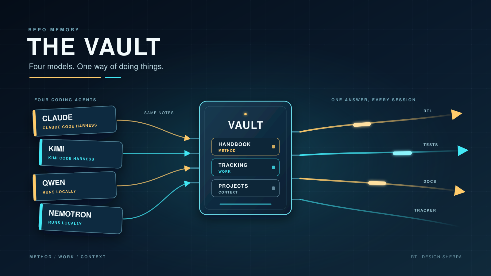
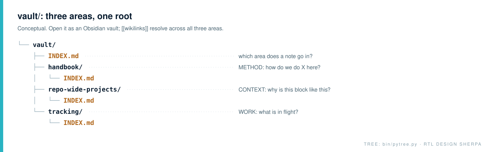
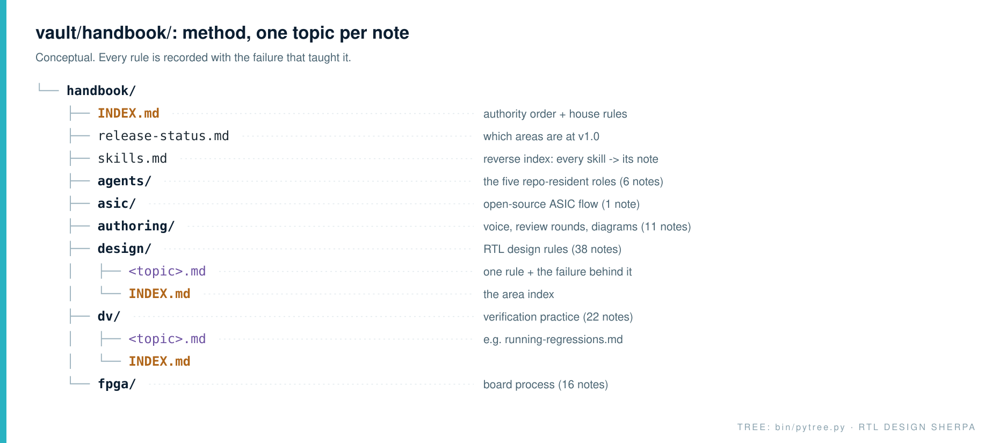
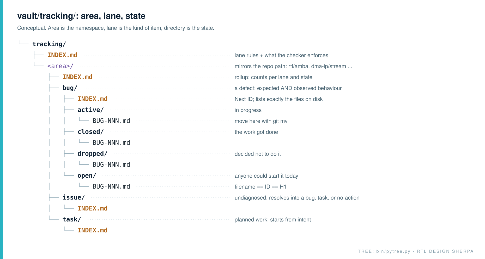
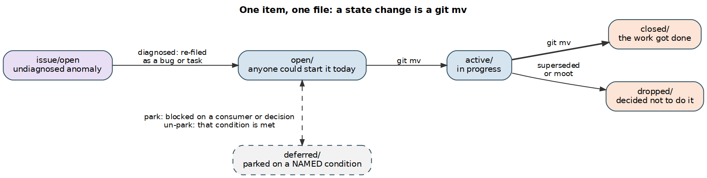
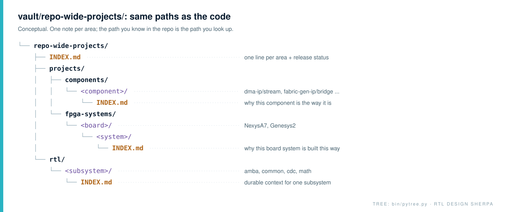
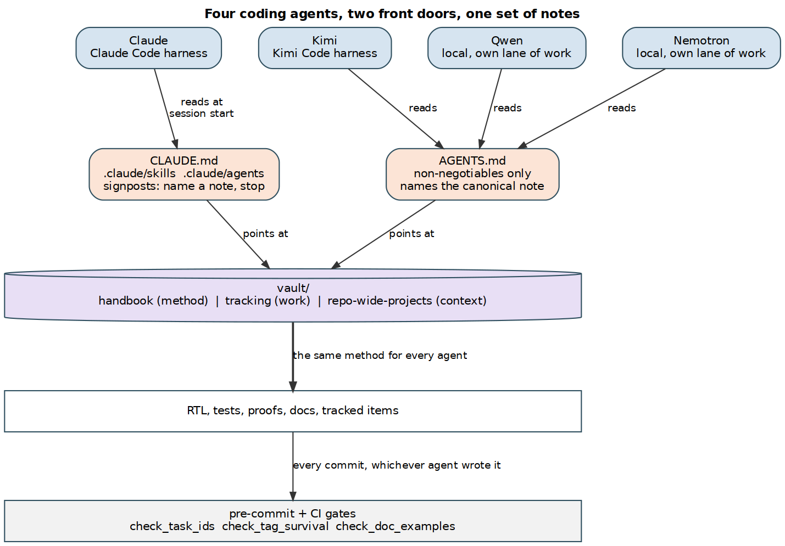

Four different models write code in this repository: Claude, Kimi, Qwen and Nemotron. They aren't interchangeable, and I don't use them that way. Each one gets the jobs it's good at. Claude runs most of the day-to-day RTL, testbench and formal work. Kimi has built whole blocks of its own (a mesh-router cell, an fp32 square root and divider, a riscv-formal proof flow) and also runs the documentation review rounds. Qwen and Nemotron run locally on my own hardware, with their own lanes of work.

None of them remembers anything between sessions. Each one starts cold, and each one will happily invent a convention if nobody hands it the real one. So the question I kept running into wasn't "which model is best?" It was "how do I get four forgetful collaborators to do things the same way, every time?"



My answer is a directory called `vault/`. It holds everything the repo knows that isn't code: how we do things, what's in flight, and why a particular block looks the way it does. It's plain Markdown, it opens as an Obsidian vault, and it's the one place every model is pointed at.

## Three areas, three questions

The vault splits into three areas, and each answers a different question.



- **handbook/** answers *how do we do X here?* It's method: design rules, verification practice, FPGA process, documentation practice.
- **tracking/** answers *what's in flight?* It's work: tasks, bugs and issues, each with a lifecycle.
- **repo-wide-projects/** answers *why is this block like this?* It's durable context about one area that doesn't generalize.

Keeping those apart matters more than it sounds. A rule that applies everywhere (reset naming, how to run a regression) goes in the handbook. A thing to do, with a beginning and an end, is a tracked item. Why pumice's arbiter guards a bank for two cycles belongs to pumice and nowhere else. Put a note in the wrong area and it stops being found, which for an LLM means it stops existing.

One rule sits above all of it. `GLOBAL_REQUIREMENTS.md` at the repo root is the enforcement authority and wins any conflict. The vault records practice and the reasons behind it. It doesn't override requirements.

## The handbook: every rule comes with its scar

The handbook is the repo's working memory. It's about 110 atomic notes, one topic each, linked with `[[wikilinks]]`.



The house rule that makes it useful is this: **a lesson earned by a real failure names the failure.** The case study is the part a future reader trusts, and it's the part a model can't argue with.

Take `dv/running-regressions.md`. It doesn't just say "run `make clean-all` first." It says why. Verilator reuses an existing `sim_build` directory, so if the RTL changed and the binary didn't rebuild, the test passes against the old design. A green run that proves nothing. The note puts it bluntly: *the run gets more optimistic than the code deserves.* An LLM that reads "always clean first" will skip it the moment it's in a hurry. An LLM that reads "a sub-second pass is a stale build" has a reason to stop and check.

`design/signal-prefixes.md` works the same way. `r_` means the signal comes out of a flop, `w_` means it settles this cycle. That sounds cosmetic until the note points at a live `w_rd_data` in a FIFO read path that is actually a flop, in exactly the spot where a reader is counting latency. A wrong prefix is a false timing claim in the one place people trust by default.

### Skills are signposts, not copies

Claude Code discovers skills in `.claude/skills/` automatically, and it's tempting to put the method right there. I don't. Every skill names its canonical handbook note and stops. Here's the start of the `signal-prefixes` skill:

```text
READ FIRST: vault/handbook/INDEX.md (the handbook is the repo's memory; this skill is the
signpost). Canonical: vault/handbook/design/signal-prefixes.md.
```

The same split applies to the five agent roles in `.claude/agents/`. The stub carries only the non-negotiables; the method is in `vault/handbook/agents/`. And `handbook/skills.md` is the reverse index, from each skill back to the note it points at.

Why the fuss? Because **a second copy is how documentation rots.** The copy nobody edits is the one the next session reads. If the regression rule lives in the handbook and also in a skill, someone fixes one, and six weeks later Claude follows the stale one with total confidence. One copy, many pointers. That's the whole trick.

The one exception is tool mechanics. A file like `bin/DOC_GENERATION.md` can sit beside the tool because it carries the flags and the stand-up steps a reader of that directory needs. The *why* still lives in the handbook.

## Tracking: area, lane, state

Here's where most repos give up and grow a `TODO.md` next to every module. This one doesn't allow it. Tasks, bugs and issues live under `vault/tracking/`, and the directory layout mirrors the code tree: `rtl/amba` in the repo is `rtl/amba` in the tracker.



Three ideas carry the design.

**The area is the namespace.** A pumice bug lives in pumice's directory, not in whichever area the person filing it had open. `BUG-001` in pumice and `BUG-001` in amba are different bugs, and that's expected. I learned this one the hard way: a converter defect, `CONV-001`, sat in amba's open list where nobody working on the converters would ever see it. It was an open RTL bug, invisible to the only people who could fix it.

**The lane is the kind of item.** Everything used to be a "task," which made the list useless for the one question people actually ask: *is this broken, or is this work we chose?* So there are three lanes now. A **task** starts from intent; nothing's wrong, we just want something different. A **bug** has a reproduction, and you have to be able to state both the expected and the observed behaviour. If you can't say what correct looks like, it isn't a bug yet. An **issue** is something undiagnosed, and it has to resolve into a bug, a task or a recorded no-action.

**The directory is the state.** Each lane has `open/`, `active/`, `closed/` and `dropped/`, and each item is its own file. Moving an item is a `git mv`:

```text
git mv open/BUG-001.md active/BUG-001.md
```



That makes "an item is in exactly one state" true by construction instead of by discipline. The old way (a page per state, cut the block from one page and paste it into the next) depended on nobody ever copying instead of cutting. Models copy. They're very good at copying.

`closed` and `dropped` are both terminal, but they aren't the same thing. Closed means the work got done; dropped means we decided not to do it. Keeping them apart is what keeps the history honest, so a dropped task never reads as an accomplishment. `deferred` is the parking lot, and it comes with a condition: a deferred item has to name what un-parks it. Otherwise "deferred" is just a polite word for forgotten.

Right now the tracker holds about 690 real items across those lanes: 404 tasks, 224 bugs and 59 issues, most of them closed. That history earns its keep. A closed bug like pumice `BUG-009` records the race (dozens of parallel Verilator compiles trashing one shared build directory), the measured damage (48 and 31 spurious failures on two clean runs), and the fix. The next model that sees a suspicious wave of PCH errors can find all of that in one file.

### The checker is the part that actually holds

Rules in prose are suggestions. `bin/check_task_ids.py` runs from the pre-commit hook whenever a tracking file is staged, and it blocks on the failures that bit us:

- **The filename is the ID, and the H1 has to agree.** Two names for one item is how a half-finished rename starts lying.
- **IDs are never recycled.** `PUMICE-010` and `PUMICE-011` once each named two unrelated tasks. A task ID is a permanent handle, cited in commit messages, handbook notes and session memory, and it has to mean one thing five months later.
- **The lane INDEX must list exactly the files on disk,** checked both ways. An index nobody reconciles is the copy the next session trusts.
- **`-000` is a reserved dummy in every lane.** An empty page and a page the checker can't parse look identical in a passing run, and this repo has shipped that failure more than once.

That last point generalizes, and it's worth saying plainly: a checker you can address incorrectly without being told is a checker that certifies nothing. `--area` with a typo used to report "passed (0 areas)" with exit code 0. It exits 2 now.

## Repo-wide projects: the why behind one block

The third area is the smallest, at 24 notes, and the most specific.



It's one note per RTL subsystem and per project, laid out to mirror the repo so the path you know in the code is the path you look up here. This is where area-specific history goes: what bit someone on the RAPIDS beats rework, which STREAM sub-areas reached v1.0 and on what date, why a particular arbiter has the shape it has. None of that belongs in the handbook, because none of it applies anywhere else. And none of it belongs in a tracked item, because it isn't work. It's context.

## How this keeps four models in step

So how does one Markdown directory keep Claude, Kimi, Qwen and Nemotron behaving like one team? They don't run in the same harness, so they don't read the same front door. But every door points at the same notes, and every route back in passes the same gates.



**Claude** runs in Claude Code, so it reads `CLAUDE.md` at session start, and that file opens by saying the handbook is the single source of truth. Skills and agent stubs point into the handbook too. When Claude learns something durable, the instruction is to add it to the handbook note, not to a skill or a CLAUDE.md. That's how the repo gets smarter instead of just older.

**Kimi, Qwen and Nemotron** run in harnesses that read `AGENTS.md` instead. That file follows the same signpost rule. It sends them to the handbook index first, then `GLOBAL_REQUIREMENTS.md`, then `CLAUDE.md` (named for one tool, written for all of them). It tells them the skill files are plain Markdown they can read too. And it lists the non-negotiables, each with the note that explains it: no attribution trailers, never branch or amend in the shared tree, clean before every regression, never hand-edit generated code. It doesn't restate the method. A model that comes in through `AGENTS.md` ends up reading the same note Claude reads through a skill. Two front doors, one room.

That's the important part. Each model has its own lane, but they all work from the same reset conventions, the same regression recipe, the same tracker and the same filelist rules. A testbench Qwen writes and one Claude writes should look like they came from the same team, because as far as the method goes, they did.

The repo-resident roles add one more rule, whichever model fills them: each role has a fixed write scope (the RTL designer writes `rtl/**`, the reviewer writes nothing), and **a role that may write is never the role that judges that write.** A reviewer that reviews its own output confirms its own assumptions. Having four different models makes that easy to honour. The model that wrote a block doesn't have to be the one that signs it off.

### The same split, applied to documentation

Documentation gets the strictest version of that split, because prose is where a model is most tempted to "improve" something it doesn't understand.

In Kimi's review rounds, Kimi never sees the repo directly. It gets a bundle. In a `qc` round it receives the docs and the RTL and answers one question: is this doc *true*? In a `humanize` round it receives the docs only, plus `docs/kimi_humanization_style_guide.md` loaded verbatim as its system brief. (Withholding the RTL is deliberate. Hand a model ground truth and ask for a rewrite, and you get a critique back instead of a draft.) The fourteen rules for running those rounds live in `handbook/authoring/kimi-review-rounds.md`, and every one of them is there because ignoring it cost a review pass, a lost round, or a unit that truncated silently.

The copy-edit flow in `bin/run_structured_flow.py` puts Qwen and Nemotron on opposite sides of the table. Qwen is told to be a conservative copy editor and return JSON edit operations, each one an exact, unique excerpt and its replacement. It isn't allowed to touch code, headings, tables, links or front matter. Nemotron then reviews every proposed edit independently and returns APPROVE or DISAPPROVE, exactly one verdict per edit ID. If it skips one, the run fails. Only approved edits get applied.

Notice the pattern again: the model that writes is never the model that judges.

### Why the gates matter more than the prompts

Here's the part that gets everyone. A prompt is a request. A checker is a fact.

The humanization style guide opens with a rule about never rewriting a code block. It's there because two humanize rounds rewrote the instantiation of `bin_to_bcd` into ports the module doesn't have (`.data`, `.tx`, `.busy`; the real ones are `clk`, `rst_n`, `start`, `binary`, `bcd` and `done`). Twenty-eight pages ended up with examples a reader would copy and find won't compile. The prompt said "prose only" the whole time. What stopped it was `bin/check_doc_examples.py` in CI and pre-commit, along with `check_tag_survival.py`, which rejects a round that drops the caption encoding the PDF pipeline depends on, or introduces a single emoji.

The same is true on the tracking side. "Keep the index in sync" was a rule for months. "The checker compares the index with the files on disk and fails on a mismatch" is the version that actually worked.

So the vault does two jobs. It gives every model the same answer to *how do we do this here?*, with the failure that taught it attached. And it gives me somewhere to put a checker, so the answer stays true after four models have each had a turn.

## Final takeaway

LLMs don't share memory with each other, and they don't share it with yesterday's version of themselves either. They share whatever you put in front of them. If that's three slightly different copies of a rule, you get three slightly different behaviours, each delivered with full confidence.

One copy of the method, one file per work item, one note per area, and a gate on every write. That's what keeps four models on the same page. It's also, not by accident, what keeps me on it.

## References

1. RTL Design Sherpa, [vault index](https://github.com/sean-galloway/RTLDesignSherpa/blob/main/vault/INDEX.md). The three areas and the rule for which one a note belongs in.
2. RTL Design Sherpa, [handbook index](https://github.com/sean-galloway/RTLDesignSherpa/blob/main/vault/handbook/INDEX.md) and [skills reverse index](https://github.com/sean-galloway/RTLDesignSherpa/blob/main/vault/handbook/skills.md). Authority order, house rules, and every skill mapped to its note.
3. RTL Design Sherpa, [tracking index](https://github.com/sean-galloway/RTLDesignSherpa/blob/main/vault/tracking/INDEX.md). Lanes, states, ID rules and what `check_task_ids.py` enforces.
4. RTL Design Sherpa, [agent roles](https://github.com/sean-galloway/RTLDesignSherpa/blob/main/vault/handbook/agents/INDEX.md). The five repo-resident roles, their write scopes and their definitions of done.
5. RTL Design Sherpa, [Kimi review rounds](https://github.com/sean-galloway/RTLDesignSherpa/blob/main/vault/handbook/authoring/kimi-review-rounds.md) and [humanization voice](https://github.com/sean-galloway/RTLDesignSherpa/blob/main/vault/handbook/authoring/humanization-voice.md). The external review pipeline and the contract around the style guide.
6. RTL Design Sherpa, [running regressions](https://github.com/sean-galloway/RTLDesignSherpa/blob/main/vault/handbook/dv/running-regressions.md) and [signal prefixes](https://github.com/sean-galloway/RTLDesignSherpa/blob/main/vault/handbook/design/signal-prefixes.md). The two handbook notes used as examples above.
7. RTL Design Sherpa, [pumice BUG-009](https://github.com/sean-galloway/RTLDesignSherpa/blob/main/vault/tracking/projects/components/mem-ctrl-ip/research-ip/pumice-ddr2-lpddr2/bug/closed/BUG-009.md). The shared `sim_build` race used as the tracking example.
