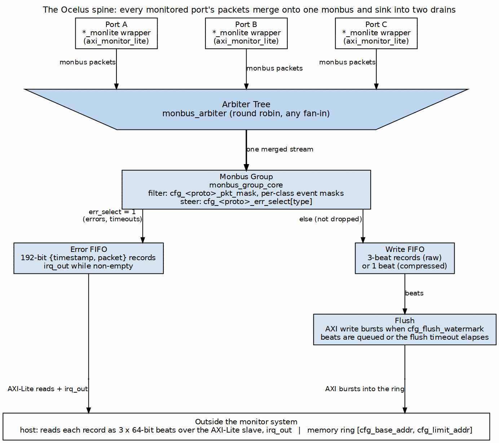

<!-- RTL Design Sherpa Documentation Header -->
<table>
<tr>
<td width="80">
  
</td>
<td>
  <strong>RTL Design Sherpa</strong> · <em>Learning Hardware Design Through Practice</em> 
  
    <a href="https://github.com/sean-galloway/RTLDesignSherpa">GitHub</a> ·
    <a href="https://github.com/sean-galloway/RTLDesignSherpa/blob/main/docs/DOCUMENTATION_INDEX.md">Documentation Index</a> ·
    <a href="https://github.com/sean-galloway/RTLDesignSherpa/blob/main/LICENSE">MIT License</a>
  
</td>
</tr>
</table>

---

<!-- End Header -->

# The spine

Every monitored port emits 128-bit packets onto a monitor bus (monbus). An
arbiter tree merges the ports of a block into one stream, and a monbus group
sinks that stream into two paths: an error FIFO the host reads over
AXI-Lite behind an interrupt, and a write FIFO the group flushes as AXI
bursts into a memory ring. Filtering happens at the group, per protocol and
per packet type. The packet layout is fixed
([monitor_package_spec.md](../../rtl-amba/includes/ocelus_package_spec.md)); everything
else on this page is a knob.

## References

The Ocelus is an original design of this repository. The papers and standards below are related work for comparison, not sources of the design; protocol specifications define the rules the monitor observes.

- Ciordas, C., Basten, T., Rădulescu, A., Goossens, K., van Meerbergen, J. "An Event-Based Monitoring Service for Networks on Chip." *ACM Trans. Design Automation of Electronic Systems*, 10(4):702-723, Oct. 2005. DOI: [10.1145/1109118.1109126](https://doi.org/10.1145/1109118.1109126). -- related work: probes, events and monitoring traffic on the interconnect.
- Goossens, K., Vermeulen, B., van Steeden, R., Bennebroek, M. "Transaction-Based Communication-Centric Debug." *Proc. 1st Int. Symp. Networks-on-Chip (NOCS 2007)*, pp. 95-106, May 2007. DOI: [10.1109/NOCS.2007.46](https://doi.org/10.1109/NOCS.2007.46). -- related work: monitors plus a dedicated event-distribution interconnect.
- Fiorin, L., Palermo, G., Silvano, C. "MPSoCs Run-Time Monitoring through Networks-on-Chip." *Proc. Design, Automation & Test in Europe (DATE 2009)*, pp. 558-561, Apr. 2009. DOI: [10.1109/DATE.2009.5090726](https://doi.org/10.1109/DATE.2009.5090726). -- related work: probes in the network interfaces feeding a central collector.
- IEEE-ISTO 5001-2003. *The Nexus 5001 Forum Standard for a Global Embedded Processor Debug Interface*, Version 2.0, IEEE Industry Standards and Technology Organization, Dec. 2003 (defining non-peer standard). -- for comparison: a message-based trace standard (typed messages, source IDs, timestamps).
- Indexed in `rtl/amba/references/README.md` (local PDF: `DebugTraceInterfaceStandard__IeeeIsto2003.pdf`)
