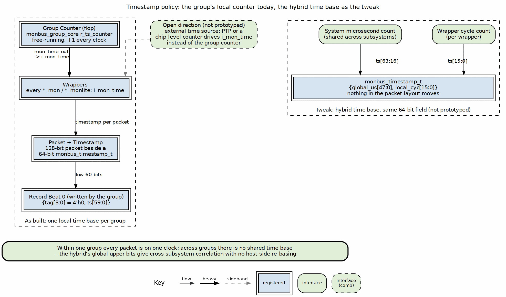

<!-- RTL Design Sherpa Documentation Header -->
<table>
<tr>
<td width="80">
  
</td>
<td>
  <strong>RTL Design Sherpa</strong> · <em>Learning Hardware Design Through Practice</em> 
  
    <a href="https://github.com/sean-galloway/RTLDesignSherpa">GitHub</a> ·
    <a href="https://github.com/sean-galloway/RTLDesignSherpa/blob/main/docs/DOCUMENTATION_INDEX.md">Documentation Index</a> ·
    <a href="https://github.com/sean-galloway/RTLDesignSherpa/blob/main/LICENSE">MIT License</a>
  
</td>
</tr>
</table>

---

<!-- End Header -->

# Timestamp policy

An ordered error history is only as useful as its clock. If the bridge, DMA,
and stream in the opening incident each count from a different reset, their
timestamps cannot establish which fault came first. Software is left with
three local sequences and no trustworthy way to interleave them.

A 64-bit timestamp rides beside every packet (`monbus_timestamp_t`). Today
it is the monbus group family's local free-running counter (`mon_time_out`),
distributed to the wrappers as `i_mon_time`, and the group writes its low 60
bits into the first beat of every three-beat record. Within one group every
packet is on one clock; across groups there is no shared time base.

Two directions are open to the integrator:

- **Global usync time base** (the chosen direction, rtl/amba/monitors
  TASK-005): one system-wide microsecond counter — built on
  `counter_freq_invariant` so the tick rate survives clock-domain changes —
  sourced centrally and distributed on matched-depth arms (about twelve
  arms, two to four flop stages each; a consumer picked up nearby simply
  keeps spare stages in sync with the rest). Every monitor across the whole
  fabric — AMBA ports, STREAM, RAPIDS, bridge, delta — stamps packets from
  the same time base. Software can then merge error records from independent
  groups into one SoC-wide history without host-side re-basing. The local
  group counter stays as a parameter fallback.
- **External time source** (PTP or a chip-level counter): drive `i_mon_time`
  from it instead of the group's counter. The wrappers do not care where the
  value comes from.

Global time orders events with different ticks at microsecond resolution; two
events in the same tick remain tied. It also does not make drain order equal
to event order: arbitration and backpressure can delay a record after it was
stamped. Software should merge per-group histories by timestamp, use source
identity or another explicit policy for ties, and treat the resulting sequence
as evidence rather than proof of causality.

Neither global usync nor an external-time integration is in the tree yet. The
usync form is the one this paper recommends because it needs no new field, no
host-side re-basing, and one distribution tree serves every plane.

> **Plane framing:** The timestamp policy is set at the output plane's
> `monbus_group` family today and stamped onto every packet that has already
> passed through the protocol, error, debug and perf planes. A change here
> reaches every plane, so keep the time base consistent across a build. See
> [Ocelus plane map](../../rtl-amba/monitor/monitor_planes.md).

