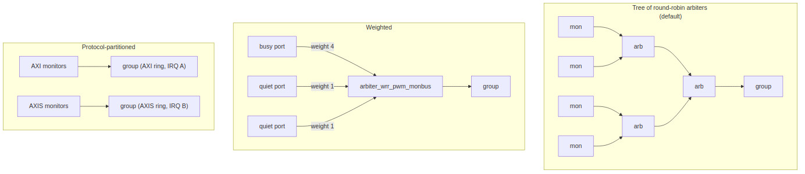

<!-- RTL Design Sherpa Documentation Header -->
<table>
<tr>
<td width="80">
  
</td>
<td>
  <strong>RTL Design Sherpa</strong> · <em>Learning Hardware Design Through Practice</em> 
  
    <a href="https://github.com/sean-galloway/RTLDesignSherpa">GitHub</a> ·
    <a href="https://github.com/sean-galloway/RTLDesignSherpa/blob/main/docs/DOCUMENTATION_INDEX.md">Documentation Index</a> ·
    <a href="https://github.com/sean-galloway/RTLDesignSherpa/blob/main/LICENSE">MIT License</a>
  
</td>
</tr>
</table>

---

<!-- End Header -->

# Aggregation topology

| Topology | Block | When |
|---|---|---|
| **Tree of round-robin arbiters** (default) | `monbus_arbiter`, any fan-in, ACK-mode grants | ports of similar rate; simplest, fair |
| **Weighted** | `arbiter_wrr_pwm_monbus` (weights per client, PWM flow control); `arbiter_rr_pwm_monbus` is the unweighted sibling | one port far busier than the others and you want its packets to win proportionally, not equally |
| **Protocol-partitioned groups** | one `monbus_group_core` per protocol family instead of the shared AXI / AXIS / CORE slots | the families need different rings, different interrupt handlers, or different flush policies |

The group core is shared by every wrapper family (AXI4, AXI5, AXI-Lite,
AXIS, Wishbone), so partitioning is a topology decision, not a new block.

## References

The Ocelus is an original design of this repository. The papers and standards below are related work for comparison, not sources of the design; protocol specifications define the rules the monitor observes.

- Gupta, P., McKeown, N. "Designing and Implementing a Fast Crossbar Scheduler." *IEEE Micro*, 19(1):20-28, Jan./Feb. 1999. DOI: [10.1109/40.748793](https://doi.org/10.1109/40.748793). -- the round-robin arbiter core (indexed in `rtl/common/references/README.md`).
- Katevenis, M., Sidiropoulos, S., Courcoubetis, C. "Weighted Round-Robin Cell Multiplexing in a General-Purpose ATM Switch Chip." *IEEE J. Selected Areas in Communications*, 9(8):1265-1279, Oct. 1991. DOI: [10.1109/49.105173](https://doi.org/10.1109/49.105173). -- interleaved weighted round robin, the weighted core.
- Dally, W.J., Towles, B. *Principles and Practices of Interconnection Networks*, Morgan Kaufmann, 2004, ch. 18 "Arbitration", §18.4.2 "Round-Robin Arbiter" and §18.4.4 "Weighted Round-Robin Arbiter". -- textbook treatment (secondary source).
- Indexed in `rtl/amba/references/README.md` (Monitor subsystem family; citation only)
