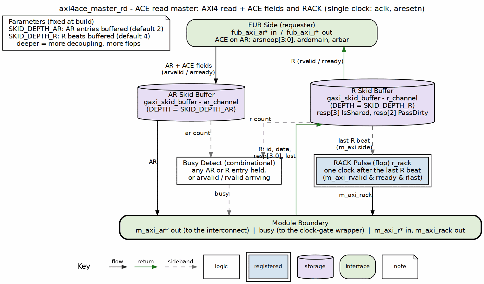

<!-- RTL Design Sherpa Documentation Header -->
<table>
<tr>
<td width="80">
  <a href="https://github.com/sean-galloway/RTLDesignSherpa">
    
  </a>
</td>
<td>
  <strong>RTL Design Sherpa</strong> · <em>Learning Hardware Design Through Practice</em><br>
  <sub>
    <a href="https://github.com/sean-galloway/RTLDesignSherpa">GitHub</a> ·
    <a href="https://github.com/sean-galloway/RTLDesignSherpa/blob/main/docs/DOCUMENTATION_INDEX.md">Documentation Index</a> ·
    <a href="https://github.com/sean-galloway/RTLDesignSherpa/blob/main/LICENSE">MIT License</a>
  </sub>
</td>
</tr>
</table>

---

<!-- End Header -->

# axi4ace_master_rd

An AXI4 + ACE read master module that buffers read address and data channels while carrying the ACE `ARSNOOP[3:0]`, `ARDOMAIN[1:0]` and `ARBAR[1:0]` address fields and the 4-bit ACE `RRESP`, and auto-pulsing the `RACK` acknowledge.

## Overview

The `axi4ace_master_rd` module is the ACE extension of `axi4_master_rd`. It provides the same dual skid-buffer architecture for the AR and R channels, adds `ARSNOOP[3:0]`, `ARDOMAIN[1:0]` and `ARBAR[1:0]` to the address-channel payload, widens `RRESP` to the 4 ACE bits on the data-channel payload, and generates a one-cycle `RACK` pulse after the last read data beat. It is a transport module: it does not interpret snoop encodings or maintain coherency state.

## Parameters

| Parameter | Type | Default | Description |
|-----------|------|---------|-------------|
| SKID_DEPTH_AR | int | 2 | Address channel skid buffer depth in entries (2..8 inclusive) |
| SKID_DEPTH_R | int | 4 | Read data channel skid buffer depth in entries (2..8 inclusive) |
| AXI_ID_WIDTH | int | 8 | AXI transaction ID width |
| AXI_ADDR_WIDTH | int | 32 | AXI address bus width |
| AXI_DATA_WIDTH | int | 32 | AXI data bus width |
| AXI_USER_WIDTH | int | 1 | AXI user signal width |
| AW | int | AXI_ADDR_WIDTH | Short alias for address width |
| DW | int | AXI_DATA_WIDTH | Short alias for data width |
| IW | int | AXI_ID_WIDTH | Short alias for ID width |
| UW | int | AXI_USER_WIDTH | Short alias for user width |
| ARSize | int | IW+AW+8+3+2+1+4+3+4+4+UW+4+2+2 | Packed AR skid payload width |
| RSize | int | IW+DW+4+1+UW | Packed R skid payload width |

## Ports

### Module Declaration

```systemverilog
module axi4ace_master_rd #(
    parameter int SKID_DEPTH_AR     = 2,
    parameter int SKID_DEPTH_R      = 4,

    parameter int AXI_ID_WIDTH      = 8,
    parameter int AXI_ADDR_WIDTH    = 32,
    parameter int AXI_DATA_WIDTH    = 32,
    parameter int AXI_USER_WIDTH    = 1,
    // Short and calculated params
    parameter int AW       = AXI_ADDR_WIDTH,
    parameter int DW       = AXI_DATA_WIDTH,
    parameter int IW       = AXI_ID_WIDTH,
    parameter int UW       = AXI_USER_WIDTH,
    parameter int ARSize   = IW+AW+8+3+2+1+4+3+4+4+UW+4+2+2,
    parameter int RSize    = IW+DW+4+1+UW
)
(
    // Global Clock and Reset
    input  logic                       aclk,
    input  logic                       aresetn,

    // Slave AXI Interface (Input Side)
    // Read address channel (AR)
    input  logic [IW-1:0]              fub_axi_arid,
    input  logic [AW-1:0]              fub_axi_araddr,
    input  logic [7:0]                 fub_axi_arlen,
    input  logic [2:0]                 fub_axi_arsize,
    input  logic [1:0]                 fub_axi_arburst,
    input  logic                       fub_axi_arlock,
    input  logic [3:0]                 fub_axi_arcache,
    input  logic [2:0]                 fub_axi_arprot,
    input  logic [3:0]                 fub_axi_arqos,
    input  logic [3:0]                 fub_axi_arregion,
    input  logic [UW-1:0]              fub_axi_aruser,
    input  logic [3:0]                 fub_axi_arsnoop,
    input  logic [1:0]                 fub_axi_ardomain,
    input  logic [1:0]                 fub_axi_arbar,
    input  logic                       fub_axi_arvalid,
    output logic                       fub_axi_arready,

    // Read data channel (R)
    output logic [IW-1:0]              fub_axi_rid,
    output logic [DW-1:0]              fub_axi_rdata,
    output logic [3:0]                 fub_axi_rresp,       // [3]=IsShared [2]=PassDirty (IHI 0022H D2.1.3)
    output logic                       fub_axi_rlast,
    output logic [UW-1:0]              fub_axi_ruser,
    output logic                       fub_axi_rvalid,
    input  logic                       fub_axi_rready,

    // Master AXI Interface (Output Side)
    // Read address channel (AR)
    output logic [IW-1:0]              m_axi_arid,
    output logic [AW-1:0]              m_axi_araddr,
    output logic [7:0]                 m_axi_arlen,
    output logic [2:0]                 m_axi_arsize,
    output logic [1:0]                 m_axi_arburst,
    output logic                       m_axi_arlock,
    output logic [3:0]                 m_axi_arcache,
    output logic [2:0]                 m_axi_arprot,
    output logic [3:0]                 m_axi_arqos,
    output logic [3:0]                 m_axi_arregion,
    output logic [UW-1:0]              m_axi_aruser,
    output logic [3:0]                 m_axi_arsnoop,
    output logic [1:0]                 m_axi_ardomain,
    output logic [1:0]                 m_axi_arbar,
    output logic                       m_axi_arvalid,
    input  logic                       m_axi_arready,

    // Read data channel (R)
    input  logic [IW-1:0]              m_axi_rid,
    input  logic [DW-1:0]              m_axi_rdata,
    input  logic [3:0]                 m_axi_rresp,       // [3]=IsShared [2]=PassDirty (IHI 0022H D2.1.3)
    input  logic                       m_axi_rlast,
    input  logic [UW-1:0]              m_axi_ruser,
    input  logic                       m_axi_rvalid,
    output logic                       m_axi_rready,

    // ACE read acknowledge
    output logic                       m_axi_rack,

    // Status outputs for clock gating
    output logic                       busy
);
```

### Clock and Reset

| Port | Width | Direction | Description |
|------|-------|-----------|-------------|
| aclk | 1 | Input | AXI clock |
| aresetn | 1 | Input | AXI active-low reset |

### Slave AXI Interface (Input Side - FUB)

#### Read Address Channel (AR)
| Port | Width | Direction | Description |
|------|-------|-----------|-------------|
| fub_axi_arid | AXI_ID_WIDTH | Input | Read address ID |
| fub_axi_araddr | AXI_ADDR_WIDTH | Input | Read address |
| fub_axi_arlen | 8 | Input | Burst length, AXI-encoded: beats - 1 |
| fub_axi_arsize | 3 | Input | Transfer size (bytes per beat) |
| fub_axi_arburst | 2 | Input | Burst type (FIXED, INCR, WRAP) |
| fub_axi_arlock | 1 | Input | Lock type (atomic access) |
| fub_axi_arcache | 4 | Input | Cache attributes |
| fub_axi_arprot | 3 | Input | Protection attributes |
| fub_axi_arqos | 4 | Input | Quality of Service |
| fub_axi_arregion | 4 | Input | Region identifier |
| fub_axi_aruser | AXI_USER_WIDTH | Input | User-defined signals |
| fub_axi_arsnoop | 4 | Input | ACE read transaction type |
| fub_axi_ardomain | 2 | Input | ACE shareability domain (ARDOMAIN): 00 Non-shareable, 01 Inner, 10 Outer, 11 System |
| fub_axi_arbar | 2 | Input | ACE barrier type (ARBAR): 00 normal, 01 memory barrier, 10 normal ignoring barriers, 11 synchronization barrier |
| fub_axi_arvalid | 1 | Input | Read address valid |
| fub_axi_arready | 1 | Output | Read address ready |

#### Read Data Channel (R)
| Port | Width | Direction | Description |
|------|-------|-----------|-------------|
| fub_axi_rid | AXI_ID_WIDTH | Output | Read data ID |
| fub_axi_rdata | AXI_DATA_WIDTH | Output | Read data |
| fub_axi_rresp | 4 | Output | ACE read response: [1:0] OKAY/EXOKAY/SLVERR/DECERR, [2] PassDirty, [3] IsShared |
| fub_axi_rlast | 1 | Output | Last read transfer in burst |
| fub_axi_ruser | AXI_USER_WIDTH | Output | User-defined signals |
| fub_axi_rvalid | 1 | Output | Read data valid |
| fub_axi_rready | 1 | Input | Read data ready |

### Master AXI Interface (Output Side)

#### Read Address Channel (AR)
| Port | Width | Direction | Description |
|------|-------|-----------|-------------|
| m_axi_arid | AXI_ID_WIDTH | Output | Read address ID |
| m_axi_araddr | AXI_ADDR_WIDTH | Output | Read address |
| m_axi_arlen | 8 | Output | Burst length, AXI-encoded: beats - 1 |
| m_axi_arsize | 3 | Output | Transfer size (bytes per beat) |
| m_axi_arburst | 2 | Output | Burst type (FIXED, INCR, WRAP) |
| m_axi_arlock | 1 | Output | Lock type (atomic access) |
| m_axi_arcache | 4 | Output | Cache attributes |
| m_axi_arprot | 3 | Output | Protection attributes |
| m_axi_arqos | 4 | Output | Quality of Service |
| m_axi_arregion | 4 | Output | Region identifier |
| m_axi_aruser | AXI_USER_WIDTH | Output | User-defined signals |
| m_axi_arsnoop | 4 | Output | ACE read transaction type |
| m_axi_ardomain | 2 | Output | ACE shareability domain (ARDOMAIN): 00 Non-shareable, 01 Inner, 10 Outer, 11 System |
| m_axi_arbar | 2 | Output | ACE barrier type (ARBAR): 00 normal, 01 memory barrier, 10 normal ignoring barriers, 11 synchronization barrier |
| m_axi_arvalid | 1 | Output | Read address valid |
| m_axi_arready | 1 | Input | Read address ready |

#### Read Data Channel (R)
| Port | Width | Direction | Description |
|------|-------|-----------|-------------|
| m_axi_rid | AXI_ID_WIDTH | Input | Read data ID |
| m_axi_rdata | AXI_DATA_WIDTH | Input | Read data |
| m_axi_rresp | 4 | Input | ACE read response: [1:0] OKAY/EXOKAY/SLVERR/DECERR, [2] PassDirty, [3] IsShared |
| m_axi_rlast | 1 | Input | Last read transfer in burst |
| m_axi_ruser | AXI_USER_WIDTH | Input | User-defined signals |
| m_axi_rvalid | 1 | Input | Read data valid |
| m_axi_rready | 1 | Output | Read data ready |

### ACE Acknowledge

| Port | Width | Direction | Description |
|------|-------|-----------|-------------|
| m_axi_rack | 1 | Output | One-cycle pulse one cycle after the last read data beat handshake |

### Status Interface

| Port | Width | Direction | Description |
|------|-------|-----------|-------------|
| busy | 1 | Output | Module activity indicator for clock gating |

## Functional Description

### Block diagram



The axi4 read master's layout (see `axi4_master_rd`) plus what ACE adds. AR drops down the left through its skid buffer, carrying `arsnoop`, `ardomain` and `arbar` with the AXI4 fields. R climbs the right through its skid buffer with the 4-bit `rresp`, where bit 3 is IsShared and bit 2 is PassDirty. The RACK flop pulses `m_axi_rack` for one clock after the last R beat is accepted on the `m_axi` side. Busy detect feeds the clock-gate wrapper.

### Dual Buffer Design

The module employs the same dual skid buffer architecture as `axi4_master_rd`:

1. **AR Channel Buffer**: Buffers read address transactions, including `ARSNOOP`, `ARDOMAIN` and `ARBAR`
2. **R Channel Buffer**: Buffers read data responses, including all four `RRESP` bits

### RACK Generation

The ACE read acknowledge is auto-pulsed by the module:

```systemverilog
assign m_axi_rack = r_rack;
// r_rack <= m_axi_rvalid && m_axi_rready && m_axi_rlast;
```

A one-cycle pulse is emitted one cycle after the last read data beat handshake. The current subset does not rely on `RACK` for ordering; downstream consumers that need ordering semantics must implement them externally.

### Busy Signal Generation

```systemverilog
assign busy = (int_ar_count > 0) || (int_r_count > 0) ||
                fub_axi_arvalid || m_axi_rvalid;
```

## ACE Notes

- `ARSNOOP[3:0]`, `ARDOMAIN[1:0]` and `ARBAR[1:0]` are straight payload pass-throughs; the module does not decode them or check that the combination is one that Table D3-7 permits
- `RRESP[3:2]` (IsShared, PassDirty) rides the R skid with `RRESP[1:0]`; the module does not interpret it. A consumer that ignores it must make sure its manager never sends a response it cannot honour (see Table D3-15)
- `RACK` is generated locally; do not drive `m_axi_rack` from outside
- IDs (`ARID`/`RID`) are carried end-to-end; the module performs no ID matching or reordering
- The module is part of the ACE-shaped port contract for the `cache-ip` family; see the contract doc for transaction-type semantics

## Related Modules

- **axi4ace_master_rd_monlite**: Lite-monitor wrapper for this core
- **axi4ace_slave_rd**: Complementary ACE read slave
- **axi4_master_rd**: AXI4-only base module
- **gaxi_skid_buffer**: Underlying buffer infrastructure

## References

- Arm. *AMBA AXI and ACE Protocol Specification*, ARM IHI 0022H.c, Jan. 2021, Part D "AMBA ACE and ACE-Lite Protocol Specification". [developer.arm.com/documentation/ihi0022/h](https://developer.arm.com/documentation/ihi0022/h/) -- §D2.1 "Changes to existing AXI channels" (`ARSNOOP`, `ARDOMAIN`, `ARBAR`, the 4-bit `RRESP`), §D3.1 Tables D3-2, D3-5 and D3-7 (domain and barrier encodings and their permitted combinations), §D3.2 read data channel signaling (Table D3-14, `RRESP[3:2]` = IsShared, PassDirty), §D3.3 "Read acknowledge signaling" (`RACK`). The base valid/ready handshake is Part A §A3.2. Citation only.
- Carloni, L.P., McMillan, K.L., Sangiovanni-Vincentelli, A.L. "Theory of Latency-Insensitive Design." *IEEE Trans. Computer-Aided Design of Integrated Circuits and Systems*, 20(9), Sept. 2001. DOI: [10.1109/43.945302](https://doi.org/10.1109/43.945302) -- the valid/ready channel discipline behind the `gaxi_skid_buffer` queues: a buffered stage may stall or add latency without changing what the endpoints compute.
- Maaref, M. *Architecting and Building High-Speed SoCs*, Packt, 2022, ch. 3 "Basic and Advanced On-Chip Busses and Interconnects", sections "ARM AMBA interconnect protocols suite" (ACE) and "Data sharing and coherency challenges" -- textbook treatment (secondary source).
- Indexed in `rtl/amba/references/README.md` (local PDF: `LatencyInsensitiveDesign__Carloni2001.pdf`)

---

## Navigation

- **[← Back to ACE Index](README.md)**
- **[← Back to rtl-amba Index](../index.md)**
- **[← Back to Main Documentation Index](../../index.md)**
