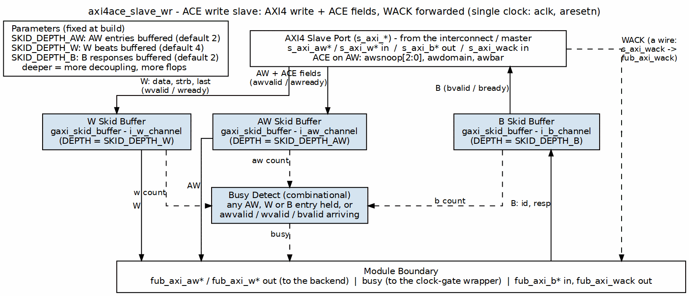

<!-- RTL Design Sherpa Documentation Header -->
<table>
<tr>
<td width="80">
  <a href="https://github.com/sean-galloway/RTLDesignSherpa">
    
  </a>
</td>
<td>
  <strong>RTL Design Sherpa</strong> · <em>Learning Hardware Design Through Practice</em><br>
  <sub>
    <a href="https://github.com/sean-galloway/RTLDesignSherpa">GitHub</a> ·
    <a href="https://github.com/sean-galloway/RTLDesignSherpa/blob/main/docs/DOCUMENTATION_INDEX.md">Documentation Index</a> ·
    <a href="https://github.com/sean-galloway/RTLDesignSherpa/blob/main/LICENSE">MIT License</a>
  </sub>
</td>
</tr>
</table>

---

<!-- End Header -->

# axi4ace_slave_wr

An AXI4 + ACE write slave module that buffers AW, W, and B channels while carrying the ACE `AWSNOOP[2:0]`, `AWDOMAIN[1:0]` and `AWBAR[1:0]` address fields from the slave interface to the backend, and the manager's `WACK` through to the backend.

## Overview

The `axi4ace_slave_wr` module is the ACE extension of `axi4_slave_wr`. It receives AXI4 write requests with the ACE `AWSNOOP[2:0]`, `AWDOMAIN[1:0]` and `AWBAR[1:0]` fields on the `s_axi_*` interface, buffers them, and presents them on the `fub_axi_*` backend interface. Responses from the backend are buffered back to the slave interface, and the `WACK` the manager drives on `s_axi_wack` is forwarded to `fub_axi_wack`. It is a transport module and does not interpret snoop encodings.

## Parameters

| Parameter | Type | Default | Description |
|-----------|------|---------|-------------|
| SKID_DEPTH_AW | int | 2 | Write address channel skid buffer depth in entries (2..8 inclusive) |
| SKID_DEPTH_W | int | 4 | Write data channel skid buffer depth in entries (2..8 inclusive) |
| SKID_DEPTH_B | int | 2 | Write response channel skid buffer depth in entries (2..8 inclusive) |
| AXI_ID_WIDTH | int | 8 | AXI transaction ID width |
| AXI_ADDR_WIDTH | int | 32 | AXI address bus width |
| AXI_DATA_WIDTH | int | 32 | AXI data bus width |
| AXI_USER_WIDTH | int | 1 | AXI user signal width |
| AXI_WSTRB_WIDTH | int | AXI_DATA_WIDTH/8 | AXI write strobe width (calculated) |
| AW | int | AXI_ADDR_WIDTH | Short alias for address width |
| DW | int | AXI_DATA_WIDTH | Short alias for data width |
| IW | int | AXI_ID_WIDTH | Short alias for ID width |
| SW | int | AXI_WSTRB_WIDTH | Short alias for strobe width |
| UW | int | AXI_USER_WIDTH | Short alias for user width |
| AWSize | int | IW+AW+8+3+2+1+4+3+4+4+UW+3+2+2 | Packed AW skid payload width |
| WSize | int | DW+SW+1+UW | Packed W skid payload width |
| BSize | int | IW+2+UW | Packed B skid payload width |

## Ports

### Module Declaration

```systemverilog
module axi4ace_slave_wr #(
    parameter int SKID_DEPTH_AW     = 2,
    parameter int SKID_DEPTH_W      = 4,
    parameter int SKID_DEPTH_B      = 2,
    parameter int AXI_ID_WIDTH      = 8,
    parameter int AXI_ADDR_WIDTH    = 32,
    parameter int AXI_DATA_WIDTH    = 32,
    parameter int AXI_USER_WIDTH    = 1,
    parameter int AXI_WSTRB_WIDTH   = AXI_DATA_WIDTH / 8,
    // Short params and calculations
    parameter int AW       = AXI_ADDR_WIDTH,
    parameter int DW       = AXI_DATA_WIDTH,
    parameter int IW       = AXI_ID_WIDTH,
    parameter int SW       = AXI_WSTRB_WIDTH,
    parameter int UW       = AXI_USER_WIDTH,
    parameter int AWSize   = IW+AW+8+3+2+1+4+3+4+4+UW+3+2+2,
    parameter int WSize    = DW+SW+1+UW,
    parameter int BSize    = IW+2+UW
)
(
    // Global Clock and Reset
    input  logic aclk,
    input  logic aresetn,

    // Slave AXI Interface (Input Side)
    // Write address channel (AW)
    input  logic [IW-1:0]               s_axi_awid,
    input  logic [AW-1:0]               s_axi_awaddr,
    input  logic [7:0]                  s_axi_awlen,
    input  logic [2:0]                  s_axi_awsize,
    input  logic [1:0]                  s_axi_awburst,
    input  logic                        s_axi_awlock,
    input  logic [3:0]                  s_axi_awcache,
    input  logic [2:0]                  s_axi_awprot,
    input  logic [3:0]                  s_axi_awqos,
    input  logic [3:0]                  s_axi_awregion,
    input  logic [UW-1:0]               s_axi_awuser,
    input  logic [2:0]                  s_axi_awsnoop,
    input  logic [1:0]                  s_axi_awdomain,
    input  logic [1:0]                  s_axi_awbar,
    input  logic                        s_axi_awvalid,
    output logic                        s_axi_awready,

    // Write data channel (W)
    input  logic [DW-1:0]               s_axi_wdata,
    input  logic [SW-1:0]               s_axi_wstrb,
    input  logic                        s_axi_wlast,
    input  logic [UW-1:0]               s_axi_wuser,
    input  logic                        s_axi_wvalid,
    output logic                        s_axi_wready,

    // Write response channel (B)
    output logic [IW-1:0]               s_axi_bid,
    output logic [1:0]                  s_axi_bresp,
    output logic [UW-1:0]               s_axi_buser,
    output logic                        s_axi_bvalid,
    input  logic                        s_axi_bready,

    // ACE write acknowledge (IHI 0022H D2.3.2): driven by the manager after
    // it accepts each B response, passed through to the backend
    input  logic                        s_axi_wack,

    // Master AXI Interface (Output Side to memory or backend)
    // Write address channel (AW)
    output logic [IW-1:0]              fub_axi_awid,
    output logic [AW-1:0]              fub_axi_awaddr,
    output logic [7:0]                 fub_axi_awlen,
    output logic [2:0]                 fub_axi_awsize,
    output logic [1:0]                 fub_axi_awburst,
    output logic                       fub_axi_awlock,
    output logic [3:0]                 fub_axi_awcache,
    output logic [2:0]                 fub_axi_awprot,
    output logic [3:0]                 fub_axi_awqos,
    output logic [3:0]                 fub_axi_awregion,
    output logic [UW-1:0]              fub_axi_awuser,
    output logic [2:0]                 fub_axi_awsnoop,
    output logic [1:0]                 fub_axi_awdomain,
    output logic [1:0]                 fub_axi_awbar,
    output logic                       fub_axi_awvalid,
    input  logic                       fub_axi_awready,

    // Write data channel (W)
    output logic [DW-1:0]              fub_axi_wdata,
    output logic [SW-1:0]              fub_axi_wstrb,
    output logic                       fub_axi_wlast,
    output logic [UW-1:0]              fub_axi_wuser,
    output logic                       fub_axi_wvalid,
    input  logic                       fub_axi_wready,

    // Write response channel (B)
    input  logic [IW-1:0]              fub_axi_bid,
    input  logic [1:0]                 fub_axi_bresp,
    input  logic [UW-1:0]              fub_axi_buser,
    input  logic                       fub_axi_bvalid,
    output logic                       fub_axi_bready,

    // ACE write acknowledge, forwarded from s_axi_wack
    output logic                       fub_axi_wack,

    // Status outputs for clock gating
    output logic                       busy
);
```

### Clock and Reset

| Port | Width | Direction | Description |
|------|-------|-----------|-------------|
| aclk | 1 | Input | AXI clock |
| aresetn | 1 | Input | AXI active-low reset |

### Slave AXI Interface (Input Side)

#### Write Address Channel (AW)
| Port | Width | Direction | Description |
|------|-------|-----------|-------------|
| s_axi_awid | AXI_ID_WIDTH | Input | Write address ID |
| s_axi_awaddr | AXI_ADDR_WIDTH | Input | Write address |
| s_axi_awlen | 8 | Input | Burst length, AXI-encoded: beats - 1 |
| s_axi_awsize | 3 | Input | Transfer size (bytes per beat) |
| s_axi_awburst | 2 | Input | Burst type (FIXED, INCR, WRAP) |
| s_axi_awlock | 1 | Input | Lock type (atomic access) |
| s_axi_awcache | 4 | Input | Cache attributes |
| s_axi_awprot | 3 | Input | Protection attributes |
| s_axi_awqos | 4 | Input | Quality of Service |
| s_axi_awregion | 4 | Input | Region identifier |
| s_axi_awuser | AXI_USER_WIDTH | Input | User-defined signals |
| s_axi_awsnoop | 3 | Input | ACE write transaction type |
| s_axi_awdomain | 2 | Input | ACE shareability domain (AWDOMAIN): 00 Non-shareable, 01 Inner, 10 Outer, 11 System |
| s_axi_awbar | 2 | Input | ACE barrier type (AWBAR): 00 normal, 01 memory barrier, 10 normal ignoring barriers, 11 synchronization barrier |
| s_axi_awvalid | 1 | Input | Write address valid |
| s_axi_awready | 1 | Output | Write address ready |

#### Write Data Channel (W)
| Port | Width | Direction | Description |
|------|-------|-----------|-------------|
| s_axi_wdata | AXI_DATA_WIDTH | Input | Write data |
| s_axi_wstrb | AXI_WSTRB_WIDTH | Input | Write strobes |
| s_axi_wlast | 1 | Input | Last write transfer in burst |
| s_axi_wuser | AXI_USER_WIDTH | Input | User-defined signals |
| s_axi_wvalid | 1 | Input | Write data valid |
| s_axi_wready | 1 | Output | Write data ready |

#### Write Response Channel (B)
| Port | Width | Direction | Description |
|------|-------|-----------|-------------|
| s_axi_bid | AXI_ID_WIDTH | Output | Write response ID |
| s_axi_bresp | 2 | Output | Write response (OKAY, EXOKAY, SLVERR, DECERR) |
| s_axi_buser | AXI_USER_WIDTH | Output | User-defined signals |
| s_axi_bvalid | 1 | Output | Write response valid |
| s_axi_bready | 1 | Input | Write response ready |

### Master AXI Interface (Output Side - FUB)

#### Write Address Channel (AW)
| Port | Width | Direction | Description |
|------|-------|-----------|-------------|
| fub_axi_awid | AXI_ID_WIDTH | Output | Write address ID |
| fub_axi_awaddr | AXI_ADDR_WIDTH | Output | Write address |
| fub_axi_awlen | 8 | Output | Burst length, AXI-encoded: beats - 1 |
| fub_axi_awsize | 3 | Output | Transfer size (bytes per beat) |
| fub_axi_awburst | 2 | Output | Burst type (FIXED, INCR, WRAP) |
| fub_axi_awlock | 1 | Output | Lock type (atomic access) |
| fub_axi_awcache | 4 | Output | Cache attributes |
| fub_axi_awprot | 3 | Output | Protection attributes |
| fub_axi_awqos | 4 | Output | Quality of Service |
| fub_axi_awregion | 4 | Output | Region identifier |
| fub_axi_awuser | AXI_USER_WIDTH | Output | User-defined signals |
| fub_axi_awsnoop | 3 | Output | ACE write transaction type |
| fub_axi_awdomain | 2 | Output | ACE shareability domain (AWDOMAIN): 00 Non-shareable, 01 Inner, 10 Outer, 11 System |
| fub_axi_awbar | 2 | Output | ACE barrier type (AWBAR): 00 normal, 01 memory barrier, 10 normal ignoring barriers, 11 synchronization barrier |
| fub_axi_awvalid | 1 | Output | Write address valid |
| fub_axi_awready | 1 | Input | Write address ready |

#### Write Data Channel (W)
| Port | Width | Direction | Description |
|------|-------|-----------|-------------|
| fub_axi_wdata | AXI_DATA_WIDTH | Output | Write data |
| fub_axi_wstrb | AXI_WSTRB_WIDTH | Output | Write strobes |
| fub_axi_wlast | 1 | Output | Last write transfer in burst |
| fub_axi_wuser | AXI_USER_WIDTH | Output | User-defined signals |
| fub_axi_wvalid | 1 | Output | Write data valid |
| fub_axi_wready | 1 | Input | Write data ready |

#### Write Response Channel (B)
| Port | Width | Direction | Description |
|------|-------|-----------|-------------|
| fub_axi_bid | AXI_ID_WIDTH | Input | Write response ID |
| fub_axi_bresp | 2 | Input | Write response (OKAY, EXOKAY, SLVERR, DECERR) |
| fub_axi_buser | AXI_USER_WIDTH | Input | User-defined signals |
| fub_axi_bvalid | 1 | Input | Write response valid |
| fub_axi_bready | 1 | Output | Write response ready |

### ACE Acknowledge

| Port | Width | Direction | Description |
|------|-------|-----------|-------------|
| s_axi_wack | 1 | Input | WACK from the upstream manager: a one-cycle pulse after the write response (B) handshake |
| fub_axi_wack | 1 | Output | `s_axi_wack` forwarded to the backend unchanged |

### Status Interface

| Port | Width | Direction | Description |
|------|-------|-----------|-------------|
| busy | 1 | Output | Module activity indicator for clock gating |

## Functional Description

### Block diagram



The axi4 write slave's layout (see `axi4_slave_wr`) plus what ACE adds. W and AW, with `awsnoop`, `awdomain` and `awbar`, drop down through their skid buffers to the backend, and B climbs the right lane. WACK is a wire from `s_axi_wack` to `fub_axi_wack`, drawn dashed down the far right.

### Triple Buffer Design

The module buffers all three write channels:

1. **AW Channel Buffer**: Receives `s_axi_aw*` and presents `fub_axi_aw*`, including `AWSNOOP`
2. **W Channel Buffer**: Receives `s_axi_w*` and presents `fub_axi_w*`
3. **B Channel Buffer**: Receives `fub_axi_b*` and presents `s_axi_b*`

### Busy Signal Generation

```systemverilog
assign busy = (int_aw_count > 0) || (int_w_count > 0) || (int_b_count > 0) ||
                s_axi_awvalid || s_axi_wvalid || fub_axi_bvalid;
```

## ACE Notes

- `AWSNOOP[2:0]`, `AWDOMAIN[1:0]` and `AWBAR[1:0]` are carried straight through from `s_axi_aw*` to `fub_axi_aw*`
- The module does not generate `WACK`; the upstream manager drives `s_axi_wack`, and the module forwards it to `fub_axi_wack` as a wire (`assign fub_axi_wack = s_axi_wack;`). The manager raises it only after the B response has left the B skid, so the backend sees it after it handed that response over (IHI 0022H §D3.5)
- `AWUNIQUE` is not carried; it is needed only by a component that supports WriteEvict (IHI 0022H Table D2-2)
- IDs (`AWID`/`BID`) are carried end-to-end; the module performs no ID matching
- Write data beats are not reordered; they pass through the W skid buffer in order

## Related Modules

- **axi4ace_slave_wr_monlite**: Lite-monitor wrapper for this core
- **axi4ace_master_wr**: Complementary ACE write master
- **axi4_slave_wr**: AXI4-only base module
- **gaxi_skid_buffer**: Underlying buffer infrastructure

## References

- Arm. *AMBA AXI and ACE Protocol Specification*, ARM IHI 0022H.c, Jan. 2021, Part D "AMBA ACE and ACE-Lite Protocol Specification". [developer.arm.com/documentation/ihi0022/h](https://developer.arm.com/documentation/ihi0022/h/) -- §D2.1 "Changes to existing AXI channels" (`AWSNOOP`, `AWDOMAIN`, `AWBAR`), §D3.1 Tables D3-2, D3-5 and D3-8 (domain and barrier encodings and their permitted combinations), §D3.4 write response channel signaling, §D3.5 "Write Acknowledge signaling" (`WACK`). The optional `AWUNIQUE` (required only by a component that supports WriteEvict, Table D2-2) is not carried. The base valid/ready handshake is Part A §A3.2. Citation only.
- Carloni, L.P., McMillan, K.L., Sangiovanni-Vincentelli, A.L. "Theory of Latency-Insensitive Design." *IEEE Trans. Computer-Aided Design of Integrated Circuits and Systems*, 20(9), Sept. 2001. DOI: [10.1109/43.945302](https://doi.org/10.1109/43.945302) -- the valid/ready channel discipline behind the `gaxi_skid_buffer` queues: a buffered stage may stall or add latency without changing what the endpoints compute.
- Maaref, M. *Architecting and Building High-Speed SoCs*, Packt, 2022, ch. 3 "Basic and Advanced On-Chip Busses and Interconnects", sections "ARM AMBA interconnect protocols suite" (ACE) and "Data sharing and coherency challenges" -- textbook treatment (secondary source).
- Indexed in `rtl/amba/references/README.md` (local PDF: `LatencyInsensitiveDesign__Carloni2001.pdf`)

---

## Navigation

- **[← Back to ACE Index](README.md)**
- **[← Back to rtl-amba Index](../index.md)**
- **[← Back to Main Documentation Index](../../index.md)**
