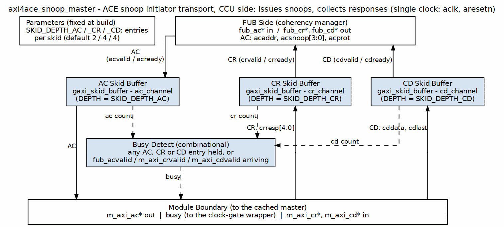

<!-- RTL Design Sherpa Documentation Header -->
<table>
<tr>
<td width="80">
  <a href="https://github.com/sean-galloway/RTLDesignSherpa">
    
  </a>
</td>
<td>
  <strong>RTL Design Sherpa</strong> · <em>Learning Hardware Design Through Practice</em><br>
  <sub>
    <a href="https://github.com/sean-galloway/RTLDesignSherpa">GitHub</a> ·
    <a href="https://github.com/sean-galloway/RTLDesignSherpa/blob/main/docs/DOCUMENTATION_INDEX.md">Documentation Index</a> ·
    <a href="https://github.com/sean-galloway/RTLDesignSherpa/blob/main/LICENSE">MIT License</a>
  </sub>
</td>
</tr>
</table>

---

<!-- End Header -->

# axi4ace_snoop_master

ACE snoop-channel initiator transport on the coherency manager (CCU) side: AC out to a peer cache, CR/CD in from that cache.

## Overview

The `axi4ace_snoop_master` module sits between the CCU logic (onyx) and a peer cache responder (amber/jet). It receives a snoop command from the CCU on the FUB-side AC channel, buffers it, and drives it to the cache on the `m_axi_*` interface. The cache's CR and CD responses are buffered back to the CCU. It is a transport module and does not generate snoop commands or interpret responses.

## Parameters

| Parameter | Type | Default | Description |
|-----------|------|---------|-------------|
| SKID_DEPTH_AC | int | 2 | Snoop address channel skid buffer depth in entries (2..8 inclusive) |
| SKID_DEPTH_CR | int | 4 | Snoop response channel skid buffer depth in entries (2..8 inclusive) |
| SKID_DEPTH_CD | int | 4 | Snoop data channel skid buffer depth in entries (2..8 inclusive) |
| ADDR_WIDTH | int | 32 | Snoop address width |
| DATA_WIDTH | int | 32 | Snoop data width |
| AW | int | ADDR_WIDTH | Short alias for address width |
| DW | int | DATA_WIDTH | Short alias for data width |
| ACSize | int | AW + 4 + 3 | Packed AC skid payload width |
| CRSize | int | 5 | Packed CR skid payload width |
| CDSize | int | DW + 1 | Packed CD skid payload width |

## Ports

### Module Declaration

```systemverilog
module axi4ace_snoop_master #(
    parameter int SKID_DEPTH_AC = 2,
    parameter int SKID_DEPTH_CR = 4,
    parameter int SKID_DEPTH_CD = 4,
    parameter int ADDR_WIDTH    = 32,
    parameter int DATA_WIDTH    = 32,
    parameter int AW            = ADDR_WIDTH,
    parameter int DW            = DATA_WIDTH,
    parameter int ACSize        = AW + 4 + 3,
    parameter int CRSize        = 5,
    parameter int CDSize        = DW + 1
) (
    // Global Clock and Reset
    input  logic                       aclk,
    input  logic                       aresetn,

    // Slave AXI Interface (Input Side) -- upstream CCU logic
    // Snoop address channel (AC)
    input  logic [AW-1:0]              fub_acaddr,
    input  logic [3:0]                 fub_acsnoop,
    input  logic [2:0]                 fub_acprot,
    input  logic                       fub_acvalid,
    output logic                       fub_acready,

    // Snoop response channel (CR)
    output logic [4:0]                 fub_crresp,
    output logic                       fub_crvalid,
    input  logic                       fub_crready,

    // Snoop data channel (CD)
    output logic [DW-1:0]              fub_cddata,
    output logic                       fub_cdlast,
    output logic                       fub_cdvalid,
    input  logic                       fub_cdready,

    // Master AXI Interface (Output Side) -- peer cache responder
    // Snoop address channel (AC)
    output logic [AW-1:0]              m_axi_acaddr,
    output logic [3:0]                 m_axi_acsnoop,
    output logic [2:0]                 m_axi_acprot,
    output logic                       m_axi_acvalid,
    input  logic                       m_axi_acready,

    // Snoop response channel (CR)
    input  logic [4:0]                 m_axi_crresp,
    input  logic                       m_axi_crvalid,
    output logic                       m_axi_crready,

    // Snoop data channel (CD)
    input  logic [DW-1:0]              m_axi_cddata,
    input  logic                       m_axi_cdlast,
    input  logic                       m_axi_cdvalid,
    output logic                       m_axi_cdready,

    // Status outputs for clock gating
    output logic                       busy
);
```

### Clock and Reset

| Port | Width | Direction | Description |
|------|-------|-----------|-------------|
| aclk | 1 | Input | AXI clock |
| aresetn | 1 | Input | AXI active-low reset |

### CCU Interface (Input Side - FUB)

#### Snoop Address Channel (AC)
| Port | Width | Direction | Description |
|------|-------|-----------|-------------|
| fub_acaddr | ADDR_WIDTH | Input | Snoop address |
| fub_acsnoop | 4 | Input | Snoop transaction type |
| fub_acprot | 3 | Input | Protection attributes |
| fub_acvalid | 1 | Input | Snoop address valid |
| fub_acready | 1 | Output | Snoop address ready |

#### Snoop Response Channel (CR)
| Port | Width | Direction | Description |
|------|-------|-----------|-------------|
| fub_crresp | 5 | Output | Snoop response |
| fub_crvalid | 1 | Output | Snoop response valid |
| fub_crready | 1 | Input | Snoop response ready |

#### Snoop Data Channel (CD)
| Port | Width | Direction | Description |
|------|-------|-----------|-------------|
| fub_cddata | DATA_WIDTH | Output | Snoop data |
| fub_cdlast | 1 | Output | Last snoop data beat |
| fub_cdvalid | 1 | Output | Snoop data valid |
| fub_cdready | 1 | Input | Snoop data ready |

### Cache Responder Interface (Output Side - AXI)

#### Snoop Address Channel (AC)
| Port | Width | Direction | Description |
|------|-------|-----------|-------------|
| m_axi_acaddr | ADDR_WIDTH | Output | Snoop address |
| m_axi_acsnoop | 4 | Output | Snoop transaction type |
| m_axi_acprot | 3 | Output | Protection attributes |
| m_axi_acvalid | 1 | Output | Snoop address valid |
| m_axi_acready | 1 | Input | Snoop address ready |

#### Snoop Response Channel (CR)
| Port | Width | Direction | Description |
|------|-------|-----------|-------------|
| m_axi_crresp | 5 | Input | Snoop response |
| m_axi_crvalid | 1 | Input | Snoop response valid |
| m_axi_crready | 1 | Output | Snoop response ready |

#### Snoop Data Channel (CD)
| Port | Width | Direction | Description |
|------|-------|-----------|-------------|
| m_axi_cddata | DATA_WIDTH | Input | Snoop data |
| m_axi_cdlast | 1 | Input | Last snoop data beat |
| m_axi_cdvalid | 1 | Input | Snoop data valid |
| m_axi_cdready | 1 | Output | Snoop data ready |

### Status Interface

| Port | Width | Direction | Description |
|------|-------|-----------|-------------|
| busy | 1 | Output | Module activity indicator for clock gating |

## Functional Description

### Block diagram



The snoop-channel initiator, on the CCU / coherency-manager side. The snoop request (AC: `acaddr`, `acsnoop`, `acprot`) drops down the left lane through its skid buffer to the cached master. The snoop response (CR, `crresp[4:0]`) and snoop data (CD, `cddata`, `cdlast`) climb their own lanes on the right through their own skid buffers. It is pure transport: no snoop decode and no ordering logic.

### Triple Buffer Design

The module buffers all three snoop channels independently:

1. **AC Channel Buffer**: CCU → peer cache
2. **CR Channel Buffer**: Peer cache → CCU
3. **CD Channel Buffer**: Peer cache → CCU

### Busy Signal Generation

```systemverilog
assign busy = (int_ac_count > 0) || (int_cr_count > 0) || (int_cd_count > 0) ||
                fub_acvalid || m_axi_crvalid || m_axi_cdvalid;
```

## ACE Notes

- Snoop channels have no transaction ID; ordering is by channel only
- ACE requires CR and CD responses after the AC handshake, and both CR and CD must be returned in the same order as the AC addresses
- The module is a transport; it does not arbitrate or serialize snoops across multiple peer caches
- `CRRESP` bit semantics follow ACE: DataTransfer[0], Error[1], PassDirty[2], IsShared[3], WasUnique[4]

## Related Modules

- **axi4ace_snoop_master_monlite**: Lite-monitor wrapper for this core
- **axi4ace_snoop_slave**: Complementary cache-side snoop responder
- **axi4ace_snoop_monitor_lite**: ACE-aware monitor core for the snoop channels
- **gaxi_skid_buffer**: Underlying buffer infrastructure

## References

- Arm. *AMBA AXI and ACE Protocol Specification*, ARM IHI 0022H.c, Jan. 2021, Part D "AMBA ACE and ACE-Lite Protocol Specification". [developer.arm.com/documentation/ihi0022/h](https://developer.arm.com/documentation/ihi0022/h/) -- §D2.2 "Additional channels defined by ACE", §D3.6 snoop address (AC), §D3.7 snoop response (CR, `CRRESP`), §D3.8 snoop data (CD) channel signaling, §D3.9 "Snoop channel dependencies", ch. D5 "Snoop Transactions". The base valid/ready handshake is Part A §A3.2. Citation only.
- Carloni, L.P., McMillan, K.L., Sangiovanni-Vincentelli, A.L. "Theory of Latency-Insensitive Design." *IEEE Trans. Computer-Aided Design of Integrated Circuits and Systems*, 20(9), Sept. 2001. DOI: [10.1109/43.945302](https://doi.org/10.1109/43.945302) -- the valid/ready channel discipline behind the `gaxi_skid_buffer` queues: a buffered stage may stall or add latency without changing what the endpoints compute.
- Papamarcos, M.S., Patel, J.H. "A Low-Overhead Coherence Solution for Multiprocessors with Private Cache Memories." *Proc. 11th Int. Symp. Computer Architecture (ISCA)*, 1984, pp. 348-354. DOI: [10.1145/800015.808204](https://doi.org/10.1145/800015.808204) -- the snoopy write-back protocol with an exclusive-clean state (MESI) that the snoop channels serve; background only, since this module holds no coherence state.
- Sweazey, P., Smith, A.J. "A Class of Compatible Cache Consistency Protocols and their Support by the IEEE Futurebus." *Proc. 13th ISCA*, 1986; *ACM SIGARCH Computer Architecture News*, 14(2), May 1986, pp. 414-423. DOI: [10.1145/17356.17404](https://doi.org/10.1145/17356.17404) -- the MOESI state class (the Owned state, `PassDirty` ownership transfer); background only.
- Nagarajan, V., Sorin, D.J., Hill, M.D., Wood, D.A. *A Primer on Memory Consistency and Cache Coherence*, 2nd ed. Synthesis Lectures on Computer Architecture, Morgan & Claypool, 2020. DOI: [10.1007/978-3-031-01764-3](https://doi.org/10.1007/978-3-031-01764-3) -- ch. 7 "Snooping Coherence Protocols" (§7.3 Exclusive state, §7.4 Owned state, §7.5 non-atomic bus): what a snoop request and response mean to the caches at each end.
- Maaref, M. *Architecting and Building High-Speed SoCs*, Packt, 2022, ch. 3 "Basic and Advanced On-Chip Busses and Interconnects", sections "ARM AMBA interconnect protocols suite" (ACE) and "Data sharing and coherency challenges" -- textbook treatment (secondary source).
- Handy, J. *The Cache Memory Book*, 2nd ed., 1998, ch. 4 "Maintaining Coherency in Cached Systems", §4.3.1 "The MESI Protocol" and §4.3.3 "The MOESI Protocol" -- textbook treatment (secondary source).
- Hennessy, J.L., Patterson, D.A. *Computer Architecture: A Quantitative Approach*, 6th ed., Morgan Kaufmann, 2019, ch. 5 "Thread-Level Parallelism", §5.2 "Centralized Shared-Memory Architectures" -- snooping coherence and the MESI/MOESI extensions (secondary source).
- Indexed in `rtl/amba/references/README.md` (local PDF: `LatencyInsensitiveDesign__Carloni2001.pdf`, `MoesiCoherenceClass__Sweazey1986.pdf`, `projects/components/cache-ip/References/Papamarcos_Patel_1984_ISCA_Snoopy_Coherence.pdf`, `projects/components/cache-ip/References/Sorin_Hill_Wood_2020_Primer_Memory_Consistency_Cache_Coherence_2ed.pdf`)

---

## Navigation

- **[← Back to ACE Index](README.md)**
- **[← Back to rtl-amba Index](../index.md)**
- **[← Back to Main Documentation Index](../../index.md)**
