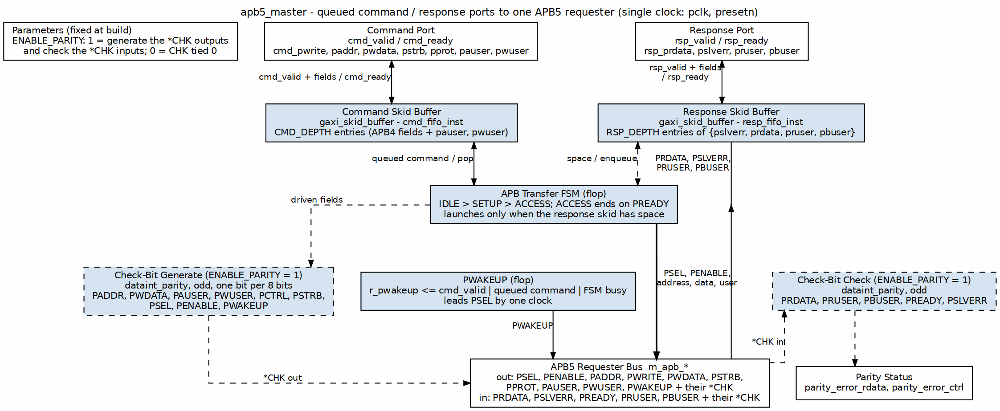

<!-- RTL Design Sherpa Documentation Header -->
<table>
<tr>
<td width="80">
  <a href="https://github.com/sean-galloway/RTLDesignSherpa">
    
  </a>
</td>
<td>
  <strong>RTL Design Sherpa</strong> · <em>Learning Hardware Design Through Practice</em><br>
  <sub>
    <a href="https://github.com/sean-galloway/RTLDesignSherpa">GitHub</a> ·
    <a href="https://github.com/sean-galloway/RTLDesignSherpa/blob/main/docs/DOCUMENTATION_INDEX.md">Documentation Index</a> ·
    <a href="https://github.com/sean-galloway/RTLDesignSherpa/blob/main/LICENSE">MIT License</a>
  </sub>
</td>
</tr>
</table>

---

<!-- End Header -->

# APB5 Master

**Module:** `apb5_master.sv`
**Location:** `rtl/amba/apb5/`
**Status:** Production Ready

---

## Overview

The APB5 Master module implements a complete AMBA APB5 master interface with all APB5 extensions including user-defined signals, wake-up support, and optional parity for data integrity. It provides command/response buffering for improved system performance.

### Key Features

- Full AMBA APB5 protocol compliance
- PAUSER: User-defined request attributes
- PWUSER: User-defined write data attributes
- PRUSER/PBUSER: User-defined response attributes from slave
- PWAKEUP: Requester wake-up output (IHI 0024E §3.7.2), with PWAKEUPCHK
- Optional IHI 0024E ch. 5 interface parity (`*CHK` signals, odd parity)
- Command and response FIFO buffering
- Configurable FIFO depths

---

## Parameters

| Parameter | Type | Default | Description |
|-----------|------|---------|-------------|
| ADDR_WIDTH | int | 32 | APB address bus width |
| DATA_WIDTH | int | 32 | APB data bus width |
| PROT_WIDTH | int | 3 | Protection signal width |
| AUSER_WIDTH | int | 4 | Address/request user signal width |
| WUSER_WIDTH | int | 4 | Write data user signal width |
| RUSER_WIDTH | int | 4 | Read data user signal width |
| BUSER_WIDTH | int | 4 | Response user signal width |
| CMD_DEPTH | int | 6 | Command skid-buffer depth in entries; must be 2..8 inclusive (any integer) |
| RSP_DEPTH | int | 6 | Response skid-buffer depth in entries; must be 2..8 inclusive (any integer) |
| ENABLE_PARITY | bit | 0 | Enable parity generation and checking |
| STRB_WIDTH | int | DATA_WIDTH/8 | Write strobe width (calculated) |

`CMD_DEPTH` and `RSP_DEPTH` are passed straight through to `gaxi_skid_buffer`,
whose `DEPTH` is a literal entry count -- not a log2 exponent. The default of 6
means six buffered entries.

### Derived Parameters (do not override)

These are declared as `parameter` so the elaborator can compute them, not so callers can set them. Each defaults to an expression over the parameters above; overriding one desynchronises it from its source and the design fails to elaborate or silently mis-sizes a bus. Set the parameters they are derived FROM and leave these alone.

| Derived parameter | Default expression |
|---|---|
| `AW` | `ADDR_WIDTH` |
| `DW` | `DATA_WIDTH` |
| `SW` | `STRB_WIDTH` |
| `PW` | `PROT_WIDTH` |
| `AUW` | `AUSER_WIDTH` |
| `WUW` | `WUSER_WIDTH` |
| `RUW` | `RUSER_WIDTH` |
| `BUW` | `BUSER_WIDTH` |
| `CPW` | `ADDR_WIDTH + DATA_WIDTH + STRB_WIDTH + PROT_WIDTH + AUSER_WIDTH + WUSER_WIDTH + 1` |
| `RPW` | `DATA_WIDTH + RUSER_WIDTH + BUSER_WIDTH + 2` |

Two further computed parameters, `CPW` and `RPW`, are exposed for reference and
should not be overridden either; with the default widths they evaluate to 80
and 42 respectively.

---

## Ports

### Clock and Reset

| Port | Width | Direction | Description |
|------|-------|-----------|-------------|
| pclk | 1 | Input | APB clock |
| presetn | 1 | Input | APB active-low reset |

### APB5 Master Interface

| Port | Width | Direction | Description |
|------|-------|-----------|-------------|
| m_apb_PSEL | 1 | Output | APB select signal |
| m_apb_PENABLE | 1 | Output | APB enable signal |
| m_apb_PADDR | ADDR_WIDTH | Output | APB address |
| m_apb_PWRITE | 1 | Output | Write/read indicator (1=write) |
| m_apb_PWDATA | DATA_WIDTH | Output | Write data |
| m_apb_PSTRB | STRB_WIDTH | Output | Write byte strobes |
| m_apb_PPROT | PROT_WIDTH | Output | Protection attributes |
| m_apb_PAUSER | AUSER_WIDTH | Output | User-defined request attributes |
| m_apb_PWUSER | WUSER_WIDTH | Output | User-defined write data attributes |
| m_apb_PRDATA | DATA_WIDTH | Input | Read data from slave |
| m_apb_PSLVERR | 1 | Input | Slave error response |
| m_apb_PREADY | 1 | Input | Slave ready |
| m_apb_PWAKEUP | 1 | Output | Requester wake-up (IHI 0024E §3.7.2): HIGH while a request is pending or a transfer is in flight |
| m_apb_PRUSER | RUSER_WIDTH | Input | User-defined read data attributes |
| m_apb_PBUSER | BUSER_WIDTH | Input | User-defined response attributes |

### Parity Signals (Optional)

| Port | Width | Direction | Description |
|------|-------|-----------|-------------|
| m_apb_PADDRCHK | ceil(ADDR_WIDTH/8) | Output | Odd parity over PADDR, one bit per 8 bits |
| m_apb_PCTRLCHK | 1 | Output | Odd parity over PPROT and PWRITE (PNSE not carried) |
| m_apb_PSELCHK | 1 | Output | Odd parity over PSEL (the spec's PSELxCHK) |
| m_apb_PENABLECHK | 1 | Output | Odd parity over PENABLE |
| m_apb_PWDATACHK | DATA_WIDTH/8 | Output | Odd parity over PWDATA, one bit per byte lane |
| m_apb_PSTRBCHK | 1 | Output | Odd parity over all of PSTRB |
| m_apb_PAUSERCHK | ceil(AUSER_WIDTH/8) | Output | Odd parity over PAUSER, one bit per 8 bits |
| m_apb_PWUSERCHK | ceil(WUSER_WIDTH/8) | Output | Odd parity over PWUSER, one bit per 8 bits |
| m_apb_PRDATACHK | DATA_WIDTH/8 | Input | Odd parity over PRDATA, one bit per byte lane |
| m_apb_PREADYCHK | 1 | Input | Odd parity over PREADY |
| m_apb_PSLVERRCHK | 1 | Input | Odd parity over PSLVERR |
| m_apb_PWAKEUPCHK | 1 | Output | Odd parity over PWAKEUP |
| m_apb_PRUSERCHK | ceil(RUSER_WIDTH/8) | Input | Odd parity over PRUSER, one bit per 8 bits |
| m_apb_PBUSERCHK | ceil(BUSER_WIDTH/8) | Input | Odd parity over PBUSER, one bit per 8 bits |

### Command Interface

| Port | Width | Direction | Description |
|------|-------|-----------|-------------|
| cmd_valid | 1 | Input | Command valid |
| cmd_ready | 1 | Output | Command ready (FIFO not full) |
| cmd_pwrite | 1 | Input | Command write/read |
| cmd_paddr | ADDR_WIDTH | Input | Command address |
| cmd_pwdata | DATA_WIDTH | Input | Command write data |
| cmd_pstrb | STRB_WIDTH | Input | Command write strobes |
| cmd_pprot | PROT_WIDTH | Input | Command protection attributes |
| cmd_pauser | AUSER_WIDTH | Input | Command user attributes |
| cmd_pwuser | WUSER_WIDTH | Input | Command write user attributes |

### Response Interface

| Port | Width | Direction | Description |
|------|-------|-----------|-------------|
| rsp_valid | 1 | Output | Response valid |
| rsp_ready | 1 | Input | Response ready |
| rsp_prdata | DATA_WIDTH | Output | Response read data |
| rsp_pslverr | 1 | Output | Response error status |
| rsp_pruser | RUSER_WIDTH | Output | Response read user attributes |
| rsp_pbuser | BUSER_WIDTH | Output | Response user attributes |

### Status Outputs

| Port | Width | Direction | Description |
|------|-------|-----------|-------------|
| parity_error_rdata | 1 | Output | PRDATACHK or PRUSERCHK mismatch on a read completion (tied to 0 when ENABLE_PARITY=0) |
| parity_error_ctrl | 1 | Output | PREADYCHK, PSLVERRCHK or PBUSERCHK mismatch (tied to 0 when ENABLE_PARITY=0) |

---

## Functional Description

### Block diagram



Same command / response lanes as `apb4_master`, plus what APB5 adds. The user
fields (PAUSER, PWUSER out; PRUSER, PBUSER back) ride through both skids. A PWAKEUP
flop rises on `cmd_valid`, a queued command or a busy FSM, so it leads PSEL by one
clock. With `ENABLE_PARITY = 1`, `dataint_parity` generates an odd check bit per 8
bits on every driven field and checks the returning *CHK inputs, reporting
`parity_error_rdata` and `parity_error_ctrl`; with 0 the CHK outputs are tied low.

### APB5 Protocol State Machine

```mermaid
stateDiagram-v2
    [*] --> IDLE

    IDLE --> SETUP : cmd_fifo_valid
    SETUP --> ACCESS : always
    ACCESS --> IDLE : PREADY & cmd_fifo_empty
    ACCESS --> SETUP : PREADY & !cmd_fifo_empty

    state IDLE {
        note right of IDLE : PSEL=0, PENABLE=0
    }
    state SETUP {
        note right of SETUP : PSEL=1, PENABLE=0
    }
    state ACCESS {
        note right of ACCESS : PSEL=1, PENABLE=1
    }
```

### APB5 Extensions

**User Signals:**
- **PAUSER**: Carries user-defined attributes with the address/control phase
- **PWUSER**: Carries user-defined attributes with write data
- **PRUSER**: Returns user-defined attributes with read data
- **PBUSER**: Returns user-defined attributes with the response

**Wake-up Support (IHI 0024E §3.7.2):**
- **PWAKEUP is a Requester output.** The master drives `m_apb_PWAKEUP` from a
  flop (glitch-free), HIGH while a command is pending (`cmd_valid` at the fub
  port or a command queued in the command skid) or a transfer is in flight.
- A command arriving on an idle bus raises PWAKEUP on the next edge, one cycle
  before PSEL, as §3.7.2 recommends.
- Once PWAKEUP and PSEL are HIGH together, PWAKEUP stays HIGH through the PREADY
  cycle, as §3.7.2 requires; it drops once nothing further is pending.
- A Completer may wait for PWAKEUP before PREADY, so a pending request never
  leaves it low. The terms are this side's pending work only, never the peer's
  PREADY.

**Parity Protection:**
- Optional IHI 0024E chapter 5 interface parity: `*CHK` signals, odd parity,
  one check bit per 8 payload bits
- Detects a single-bit error in any covered byte or control signal

See [Parity Implementation](#parity-implementation) for the exact coverage of
each check signal.

---

## Timing Characteristics

### Basic Write Transaction

<!-- TODO: Add wavedrom timing diagram for APB5 write transaction -->
> **Timing diagram pending.** The signals and sequence this scenario
> exercises:
>
> - PCLK
> - PSEL
> - PENABLE
> - PADDR
> - PWRITE (high)
> - PWDATA
> - PSTRB
> - PAUSER
> - PWUSER
> - PREADY
> - PSLVERR

### Basic Read Transaction

<!-- TODO: Add wavedrom timing diagram for APB5 read transaction -->
> **Timing diagram pending.** The signals and sequence this scenario
> exercises:
>
> - PCLK
> - PSEL
> - PENABLE
> - PADDR
> - PWRITE (low)
> - PAUSER
> - PREADY
> - PRDATA
> - PRUSER
> - PSLVERR

### Wake-up Signal Handling

<!-- TODO: Add wavedrom timing diagram for wake-up scenario -->
> **Timing diagram pending.** The signals and sequence this scenario
> exercises:
>
> - PCLK
> - cmd_valid on an idle bus
> - PWAKEUP rising one cycle before PSEL
> - PWAKEUP held through the PREADY cycle, then dropped when idle

---

## Usage Examples

```systemverilog
apb5_master #(
    .ADDR_WIDTH     (32),
    .DATA_WIDTH     (32),
    .AUSER_WIDTH    (4),
    .WUSER_WIDTH    (4),
    .RUSER_WIDTH    (4),
    .BUSER_WIDTH    (4),
    .CMD_DEPTH      (4),
    .RSP_DEPTH      (4),
    .ENABLE_PARITY  (0)
) u_apb5_master (
    .pclk           (apb_clk),
    .presetn        (apb_rst_n),

    // APB5 master interface
    .m_apb_PSEL     (m_apb_psel),
    .m_apb_PENABLE  (m_apb_penable),
    .m_apb_PADDR    (m_apb_paddr),
    .m_apb_PWRITE   (m_apb_pwrite),
    .m_apb_PWDATA   (m_apb_pwdata),
    .m_apb_PSTRB    (m_apb_pstrb),
    .m_apb_PPROT    (m_apb_pprot),
    .m_apb_PAUSER   (m_apb_pauser),
    .m_apb_PWUSER   (m_apb_pwuser),
    .m_apb_PRDATA   (m_apb_prdata),
    .m_apb_PSLVERR  (m_apb_pslverr),
    .m_apb_PREADY   (m_apb_pready),
    .m_apb_PWAKEUP  (m_apb_pwakeup),   // output: Requester wake-up
    .m_apb_PRUSER   (m_apb_pruser),
    .m_apb_PBUSER   (m_apb_pbuser),

    // Command interface
    .cmd_valid      (cmd_valid),
    .cmd_ready      (cmd_ready),
    .cmd_pwrite     (cmd_write),
    .cmd_paddr      (cmd_addr),
    .cmd_pwdata     (cmd_wdata),
    .cmd_pstrb      (cmd_strb),
    .cmd_pprot      (cmd_prot),
    .cmd_pauser     (cmd_auser),
    .cmd_pwuser     (cmd_wuser),

    // Response interface
    .rsp_valid      (rsp_valid),
    .rsp_ready      (rsp_ready),
    .rsp_prdata     (rsp_rdata),
    .rsp_pslverr    (rsp_error),
    .rsp_pruser     (rsp_ruser),
    .rsp_pbuser     (rsp_buser),

    // Parity interface (unused here because ENABLE_PARITY=0)
    .m_apb_PADDRCHK      (),
    .m_apb_PCTRLCHK      (),
    .m_apb_PSELCHK       (),
    .m_apb_PENABLECHK    (),
    .m_apb_PWDATACHK     (),
    .m_apb_PSTRBCHK      (),
    .m_apb_PAUSERCHK     (),
    .m_apb_PWUSERCHK     (),
    .m_apb_PRDATACHK     ('0),
    .m_apb_PREADYCHK     (1'b0),
    .m_apb_PSLVERRCHK    (1'b0),
    .m_apb_PWAKEUPCHK    (),
    .m_apb_PRUSERCHK     ('0),
    .m_apb_PBUSERCHK     ('0),
    .parity_error_rdata  (),
    .parity_error_ctrl   ()
);
```

---

## Design Notes

### APB5 vs APB4 Differences

| Feature | APB4 | APB5 | Implemented here |
|---------|------|------|------------------|
| User signals | None | PAUSER, PWUSER, PRUSER, PBUSER | Yes |
| Wake-up | None | PWAKEUP | Yes (master output, §3.7.2) |
| Parity | None | Optional signal parity | Yes (`ENABLE_PARITY`) |
| Non-secure extension | None | PNSE | No -- no port |
| Exclusive access | None | PEXCL, PEXOKAY | No -- no ports |

### FIFO Sizing

- Command depth should match the expected command burst length
- Response depth should match to prevent backpressure
- `CMD_DEPTH` / `RSP_DEPTH` are entry counts, restricted to 2..8 inclusive by the
  underlying `gaxi_skid_buffer`

### Parity Implementation

When `ENABLE_PARITY=1` the master drives the requester check signals
(`PADDRCHK` to `PWUSERCHK` below) and checks the completer ones. With
`ENABLE_PARITY=0` the outputs are tied LOW and the inputs are ignored.

Parity follows AMBA APB IHI 0024E chapter 5 (§5.3, Table 5-1):

- **Odd parity.** A payload slice plus its check bit always hold an odd number
  of ones. On a single-bit critical control the check bit is therefore the
  inversion of the signal.
- **One check bit per 8 payload bits.** Bit `[n]` of a multi-bit check signal
  covers payload bits `[8n+7:8n]`; when the payload is not a whole number of
  bytes, the top check bit covers the bits that remain. `PADDRCHK` on a 12-bit
  address is therefore 2 bits: `[7:0]` and `[11:8]`.
- **Coverage sets.** `PCTRLCHK` covers `PPROT` and `PWRITE` (and `PNSE`, which
  this module does not carry, so it counts as LOW). `PSTRB` has its own single
  `PSTRBCHK`.
- Each check bit is computed by an `rtl/common/dataint_parity` instance with
  `CHUNKS = 1` and `parity_type = 0` (odd), one instance per spec byte, so the
  spec's short final byte comes out at any width.

| Check signal | Covers | Width | Check Enable (Table 5-1) |
|--------------|--------|-------|--------------------------|
| PADDRCHK | PADDR | ceil(ADDR_WIDTH/8) | PSEL |
| PCTRLCHK | PPROT, PWRITE | 1 | PSEL |
| PSELCHK | PSEL (spec PSELxCHK) | 1 | PRESETn |
| PENABLECHK | PENABLE | 1 | PSEL |
| PWDATACHK | PWDATA | DATA_WIDTH/8 | PSEL & PWRITE |
| PSTRBCHK | PSTRB | 1 | PSEL & PWRITE |
| PAUSERCHK | PAUSER | ceil(AUSER_WIDTH/8) | PSEL |
| PWUSERCHK | PWUSER | ceil(WUSER_WIDTH/8) | PSEL & PWRITE |
| PRDATACHK | PRDATA | DATA_WIDTH/8 | PSEL & PENABLE & PREADY & !PWRITE |
| PREADYCHK | PREADY | 1 | PSEL & PENABLE |
| PSLVERRCHK | PSLVERR | 1 | PSEL & PENABLE & PREADY |
| PWAKEUPCHK | PWAKEUP | 1 | PRESETn |
| PRUSERCHK | PRUSER | ceil(RUSER_WIDTH/8) | PSEL & PENABLE & PREADY & !PWRITE |
| PBUSERCHK | PBUSER | ceil(BUSER_WIDTH/8) | PSEL & PENABLE & PREADY |

`PWAKEUPCHK` travels with `PWAKEUP`: both are Requester outputs (IHI 0024E
§3.7.2, Table 3-7), generated by the master and checked by the slave.

The error flags are combinational and assert only while the failing check's
Check Enable term holds:

- `parity_error_rdata`: `PRDATACHK` or `PRUSERCHK` wrong on a read completion.
- `parity_error_ctrl`: `PREADYCHK`, `PSLVERRCHK` or `PBUSERCHK` wrong.
- `PWAKEUPCHK` is generated here, so the master does not check it.

The master reports a mismatch but does not abort or retry the transfer; the
spec leaves that policy to the system (§5.4). Parity adds combinational logic
but no pipeline stages, so it costs no latency.

---

## Related Modules

- **[APB5 Slave](apb5_slave.md)** - APB5 slave interface
- **[APB5 Master CG](apb5_master_cg.md)** - Clock-gated variant
- **[APB5 Monitor](../apb5/apb5_monitor.md)** - Protocol monitor
- **[APB4 Master](../apb4/apb4_master.md)** - APB4 version for comparison

---

## Testing

`val/amba/test_apb5_master.py` exercises this module. It collects 5 parameter cases at the default `REG_LEVEL`; the two `ENABLE_PARITY=1` cases also run `cocotb_test_apb5_master_parity`, a directed IHI 0024E ch. 5 check (generated `*CHK` values, flag-per-check error injection, Check Enable gating). The `formal/amba/apb5_master` proof checks the same parity rules with `ENABLE_PARITY=1`.

```bash
source env_python
pytest val/amba/test_apb5_master.py -v
```

## References

- Arm. *AMBA APB Protocol Specification*, ARM IHI 0024E, Feb. 2023 (APB5 first published in Issue D, Apr. 2021). [developer.arm.com/documentation/ihi0024/e](https://developer.arm.com/documentation/ihi0024/e/) -- §3.7 "Wake-up signaling" (`PWAKEUP`), §3.8 "User signaling" (`PAUSER`/`PWUSER`/`PRUSER`/`PBUSER`), ch. 5 "Interface parity protection" (`ENABLE_PARITY`); transfers and operating states (ch. 3-4) are as in APB4. The `*CHK` signals follow §5.3 and Table 5-1: odd parity, one check bit per 8 payload bits, `PCTRLCHK` over `PPROT`/`PWRITE` and a separate `PSTRBCHK` (issue #102 item 1). Citation only.
- Carloni, L.P., McMillan, K.L., Sangiovanni-Vincentelli, A.L. "Theory of Latency-Insensitive Design." *IEEE Trans. Computer-Aided Design of Integrated Circuits and Systems*, 20(9), Sept. 2001. DOI: [10.1109/43.945302](https://doi.org/10.1109/43.945302) -- the valid/ready channel discipline behind the `gaxi_skid_buffer` queues: a buffered stage may stall or add latency without changing what the endpoints compute.
- Maaref, M. *Architecting and Building High-Speed SoCs*, Packt, 2022, ch. 3 "Basic and Advanced On-Chip Busses and Interconnects", section "ARM AMBA interconnect protocols suite" (APB bus protocol overview) -- textbook treatment (secondary source).
- Chipressian. *Crack the Hardware Interview - from RTL Designers' Perspective*, Part 2 ch. 2 "Handshake Protocols" (valid-ready protocol and valid-ready slices) -- textbook treatment of the skid buffer (secondary source).
- Indexed in `rtl/amba/references/README.md` (local PDF: `LatencyInsensitiveDesign__Carloni2001.pdf`)

---

## Navigation

- **[← Back to APB5 Index](README.md)**
- **[← Back to rtl-amba Index](../index.md)**
- **[← Back to Main Documentation Index](../../index.md)**
