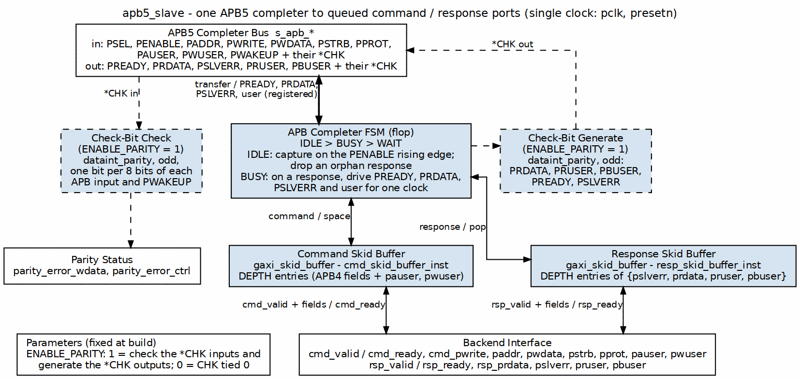
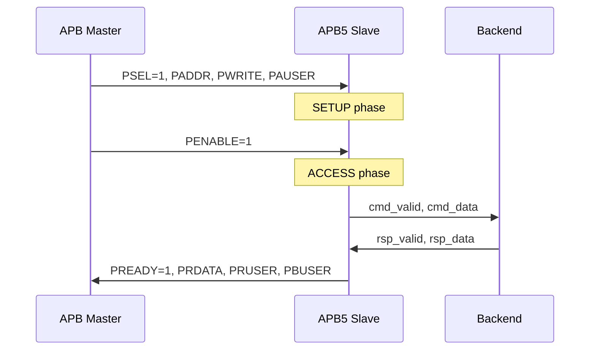

<!-- RTL Design Sherpa Documentation Header -->
<table>
<tr>
<td width="80">
  <a href="https://github.com/sean-galloway/RTLDesignSherpa">
    
  </a>
</td>
<td>
  <strong>RTL Design Sherpa</strong> · <em>Learning Hardware Design Through Practice</em><br>
  <sub>
    <a href="https://github.com/sean-galloway/RTLDesignSherpa">GitHub</a> ·
    <a href="https://github.com/sean-galloway/RTLDesignSherpa/blob/main/docs/DOCUMENTATION_INDEX.md">Documentation Index</a> ·
    <a href="https://github.com/sean-galloway/RTLDesignSherpa/blob/main/LICENSE">MIT License</a>
  </sub>
</td>
</tr>
</table>

---

<!-- End Header -->

# APB5 Slave

**Module:** `apb5_slave.sv`
**Location:** `rtl/amba/apb5/`
**Status:** Production Ready

---

## Overview

The APB5 Slave module implements a complete AMBA APB5 slave interface with all APB5 extensions. It receives APB transactions from the bus and provides a command/response interface for backend logic, supporting user-defined signals, the Requester's wake-up input, and optional parity.

### Key Features

- Full AMBA APB5 protocol compliance
- Receives PAUSER/PWUSER from master
- Generates PRUSER/PBUSER responses
- PWAKEUP input from the Requester (IHI 0024E §3.7.2), with PWAKEUPCHK checking
- Optional IHI 0024E ch. 5 interface parity (`*CHK` signals, odd parity)
- Command/response FIFO buffering
- Configurable buffer depth

---

## Parameters

| Parameter | Type | Default | Description |
|-----------|------|---------|-------------|
| ADDR_WIDTH | int | 32 | APB address bus width |
| DATA_WIDTH | int | 32 | APB data bus width |
| PROT_WIDTH | int | 3 | Protection signal width |
| AUSER_WIDTH | int | 4 | Address/request user signal width |
| WUSER_WIDTH | int | 4 | Write data user signal width |
| RUSER_WIDTH | int | 4 | Read data user signal width |
| BUSER_WIDTH | int | 4 | Response user signal width |
| DEPTH | int | 2 | Skid-buffer depth in entries; must be 2..8 inclusive (any integer) |
| ENABLE_PARITY | bit | 0 | Enable parity generation and checking |
| STRB_WIDTH | int | DATA_WIDTH/8 | Write strobe width (calculated) |

`DEPTH` sets both the command and the response `gaxi_skid_buffer` depth. It is a
literal entry count, not a log2 exponent.

### Derived Parameters (do not override)

These are declared as `parameter` so the elaborator can compute them, not so callers can set them. Each defaults to an expression over the parameters above; overriding one desynchronises it from its source and the design fails to elaborate or silently mis-sizes a bus. Set the parameters they are derived FROM and leave these alone.

| Derived parameter | Default expression |
|---|---|
| `DW` | `DATA_WIDTH` |
| `AW` | `ADDR_WIDTH` |
| `SW` | `STRB_WIDTH` |
| `PW` | `PROT_WIDTH` |
| `AUW` | `AUSER_WIDTH` |
| `WUW` | `WUSER_WIDTH` |
| `RUW` | `RUSER_WIDTH` |
| `BUW` | `BUSER_WIDTH` |
| `CPW` | `AW + DW + SW + PW + AUW + WUW + 1` |
| `RPW` | `DW + RUW + BUW + 1` |

---

## Ports

### Clock and Reset

| Port | Width | Direction | Description |
|------|-------|-----------|-------------|
| pclk | 1 | Input | APB clock |
| presetn | 1 | Input | APB active-low reset |

### APB5 Slave Interface

| Port | Width | Direction | Description |
|------|-------|-----------|-------------|
| s_apb_PSEL | 1 | Input | APB select signal |
| s_apb_PENABLE | 1 | Input | APB enable signal |
| s_apb_PREADY | 1 | Output | Slave ready response |
| s_apb_PADDR | ADDR_WIDTH | Input | APB address |
| s_apb_PWRITE | 1 | Input | Write/read indicator |
| s_apb_PWDATA | DATA_WIDTH | Input | Write data |
| s_apb_PSTRB | STRB_WIDTH | Input | Write byte strobes |
| s_apb_PPROT | PROT_WIDTH | Input | Protection attributes |
| s_apb_PAUSER | AUSER_WIDTH | Input | User-defined request attributes |
| s_apb_PWUSER | WUSER_WIDTH | Input | User-defined write data attributes |
| s_apb_PRDATA | DATA_WIDTH | Output | Read data to master |
| s_apb_PSLVERR | 1 | Output | Slave error response |
| s_apb_PWAKEUP | 1 | Input | Requester wake-up (IHI 0024E §3.7.2); checked by PWAKEUPCHK, not waited on before PREADY |
| s_apb_PRUSER | RUSER_WIDTH | Output | User-defined read data attributes |
| s_apb_PBUSER | BUSER_WIDTH | Output | User-defined response attributes |

### Parity Signals (Optional)

| Port | Width | Direction | Description |
|------|-------|-----------|-------------|
| s_apb_PADDRCHK | ceil(ADDR_WIDTH/8) | Input | Odd parity over PADDR, one bit per 8 bits |
| s_apb_PCTRLCHK | 1 | Input | Odd parity over PPROT and PWRITE (PNSE not carried) |
| s_apb_PSELCHK | 1 | Input | Odd parity over PSEL (the spec's PSELxCHK) |
| s_apb_PENABLECHK | 1 | Input | Odd parity over PENABLE |
| s_apb_PWDATACHK | DATA_WIDTH/8 | Input | Odd parity over PWDATA, one bit per byte lane |
| s_apb_PSTRBCHK | 1 | Input | Odd parity over all of PSTRB |
| s_apb_PAUSERCHK | ceil(AUSER_WIDTH/8) | Input | Odd parity over PAUSER, one bit per 8 bits |
| s_apb_PWUSERCHK | ceil(WUSER_WIDTH/8) | Input | Odd parity over PWUSER, one bit per 8 bits |
| s_apb_PRDATACHK | DATA_WIDTH/8 | Output | Odd parity over PRDATA, one bit per byte lane |
| s_apb_PREADYCHK | 1 | Output | Odd parity over PREADY |
| s_apb_PSLVERRCHK | 1 | Output | Odd parity over PSLVERR |
| s_apb_PWAKEUPCHK | 1 | Input | Odd parity over PWAKEUP |
| s_apb_PRUSERCHK | ceil(RUSER_WIDTH/8) | Output | Odd parity over PRUSER, one bit per 8 bits |
| s_apb_PBUSERCHK | ceil(BUSER_WIDTH/8) | Output | Odd parity over PBUSER, one bit per 8 bits |

### Command Interface (to backend)

| Port | Width | Direction | Description |
|------|-------|-----------|-------------|
| cmd_valid | 1 | Output | Command valid to backend |
| cmd_ready | 1 | Input | Backend ready |
| cmd_pwrite | 1 | Output | Command write/read |
| cmd_paddr | ADDR_WIDTH | Output | Command address |
| cmd_pwdata | DATA_WIDTH | Output | Command write data |
| cmd_pstrb | STRB_WIDTH | Output | Command write strobes |
| cmd_pprot | PROT_WIDTH | Output | Command protection |
| cmd_pauser | AUSER_WIDTH | Output | Command address user |
| cmd_pwuser | WUSER_WIDTH | Output | Command write user |

### Response Interface (from backend)

| Port | Width | Direction | Description |
|------|-------|-----------|-------------|
| rsp_valid | 1 | Input | Response valid from backend |
| rsp_ready | 1 | Output | Slave ready for response |
| rsp_prdata | DATA_WIDTH | Input | Response read data |
| rsp_pslverr | 1 | Input | Response error status |
| rsp_pruser | RUSER_WIDTH | Input | Response read user |
| rsp_pbuser | BUSER_WIDTH | Input | Response user |

### Status Outputs

| Port | Width | Direction | Description |
|------|-------|-----------|-------------|
| parity_error_wdata | 1 | Output | PWDATACHK, PSTRBCHK or PWUSERCHK mismatch (tied to 0 when ENABLE_PARITY=0) |
| parity_error_ctrl | 1 | Output | PADDRCHK, PCTRLCHK, PSELCHK, PENABLECHK, PAUSERCHK or PWAKEUPCHK mismatch (tied to 0 when ENABLE_PARITY=0) |

---

## Functional Description

### Block diagram



Same transfer / response lanes as `apb4_slave`, with the user fields carried
through both skids. With `ENABLE_PARITY = 1`, the check-bit check covers every APB
input (and PWAKEUP) and reports `parity_error_wdata` / `parity_error_ctrl`, while
the check-bit generate block drives the *CHK outputs for PRDATA, PRUSER, PBUSER,
PREADY and PSLVERR. PWAKEUP itself is only checked here; this completer does not
wait for it.

### APB5 Slave Protocol

The slave responds to APB transactions with proper timing:

1. **SETUP Phase**: PSEL=1, PENABLE=0 - Capture address and control
2. **ACCESS Phase**: PSEL=1, PENABLE=1 - Assert PREADY when response ready

### Response Timing



---

## Timing Characteristics

### Write Transaction with Wait States

<!-- TODO: Add wavedrom timing diagram for APB5 slave write with wait states -->
> **Timing diagram pending.** The signals and sequence this scenario
> exercises:
>
> - PCLK
> - PSEL
> - PENABLE
> - PADDR
> - PWRITE (high)
> - PWDATA
> - PAUSER, PWUSER
> - PREADY (with wait states)
> - PSLVERR
> - PBUSER

### Read Transaction

<!-- TODO: Add wavedrom timing diagram for APB5 slave read -->
> **Timing diagram pending.** The signals and sequence this scenario
> exercises:
>
> - PCLK
> - PSEL
> - PENABLE
> - PADDR
> - PWRITE (low)
> - PAUSER
> - PREADY
> - PRDATA
> - PRUSER, PBUSER

### Wake-up Signaling

<!-- TODO: Add wavedrom timing diagram for wake-up -->
> **Timing diagram pending.** The signals and sequence this scenario
> exercises:
>
> - PCLK
> - PWAKEUP (from the master) rising ahead of PSEL
> - PSEL/PENABLE/PREADY with PWAKEUP held through PREADY

---

## Usage Examples

```systemverilog
apb5_slave #(
    .ADDR_WIDTH     (32),
    .DATA_WIDTH     (32),
    .AUSER_WIDTH    (4),
    .WUSER_WIDTH    (4),
    .RUSER_WIDTH    (4),
    .BUSER_WIDTH    (4),
    .DEPTH          (2),
    .ENABLE_PARITY  (0)
) u_apb5_slave (
    .pclk           (apb_clk),
    .presetn        (apb_rst_n),

    // APB5 slave interface
    .s_apb_PSEL     (s_apb_psel),
    .s_apb_PENABLE  (s_apb_penable),
    .s_apb_PREADY   (s_apb_pready),
    .s_apb_PADDR    (s_apb_paddr),
    .s_apb_PWRITE   (s_apb_pwrite),
    .s_apb_PWDATA   (s_apb_pwdata),
    .s_apb_PSTRB    (s_apb_pstrb),
    .s_apb_PPROT    (s_apb_pprot),
    .s_apb_PAUSER   (s_apb_pauser),
    .s_apb_PWUSER   (s_apb_pwuser),
    .s_apb_PRDATA   (s_apb_prdata),
    .s_apb_PSLVERR  (s_apb_pslverr),
    .s_apb_PWAKEUP  (s_apb_pwakeup),   // input: from the Requester
    .s_apb_PRUSER   (s_apb_pruser),
    .s_apb_PBUSER   (s_apb_pbuser),

    // Backend command interface
    .cmd_valid      (backend_cmd_valid),
    .cmd_ready      (backend_cmd_ready),
    .cmd_pwrite     (backend_cmd_write),
    .cmd_paddr      (backend_cmd_addr),
    .cmd_pwdata     (backend_cmd_wdata),
    .cmd_pstrb      (backend_cmd_strb),
    .cmd_pprot      (backend_cmd_prot),
    .cmd_pauser     (backend_cmd_auser),
    .cmd_pwuser     (backend_cmd_wuser),

    // Backend response interface
    .rsp_valid      (backend_rsp_valid),
    .rsp_ready      (backend_rsp_ready),
    .rsp_prdata     (backend_rsp_rdata),
    .rsp_pslverr    (backend_rsp_error),
    .rsp_pruser     (backend_rsp_ruser),
    .rsp_pbuser     (backend_rsp_buser),


    // Parity interface (unused here because ENABLE_PARITY=0)
    .s_apb_PADDRCHK      ('0),
    .s_apb_PCTRLCHK      (1'b0),
    .s_apb_PSELCHK       (1'b0),
    .s_apb_PENABLECHK    (1'b0),
    .s_apb_PWDATACHK     ('0),
    .s_apb_PSTRBCHK      (1'b0),
    .s_apb_PAUSERCHK     ('0),
    .s_apb_PWUSERCHK     ('0),
    .s_apb_PRDATACHK     (),
    .s_apb_PREADYCHK     (),
    .s_apb_PSLVERRCHK    (),
    .s_apb_PWAKEUPCHK    (1'b0),
    .s_apb_PRUSERCHK     (),
    .s_apb_PBUSERCHK     (),
    .parity_error_wdata  (),
    .parity_error_ctrl   ()
);
```

---

## Design Notes

### Backpressure Handling

- If backend cannot accept commands (`cmd_ready=0`), slave inserts wait states
- PREADY held low until backend accepts command and provides response

### User Signal Propagation

- PAUSER/PWUSER captured during SETUP phase, forwarded to backend
- PRUSER/PBUSER from backend driven during ACCESS phase response

### Wake-up Input

`s_apb_PWAKEUP` is an input: IHI 0024E §3.7.2 (Table 3-7) makes PWAKEUP a
Requester signal. A Completer is permitted to wait for it before PREADY; this
one does not, so a Requester that never asserts PWAKEUP cannot deadlock it.
Inside `apb5_slave` PWAKEUP feeds only the `PWAKEUPCHK` parity check; the
`_cg` wrappers also use it as a clock-gate wake term. There is no longer a
backend `wakeup_request` port -- a Completer has no APB wake-up output.

### Parity Implementation

When `ENABLE_PARITY=1` the slave checks the requester check signals and drives
the completer ones (`PRDATACHK` to `PBUSERCHK` below). With `ENABLE_PARITY=0`
the outputs are tied LOW and the inputs are ignored.

Parity follows AMBA APB IHI 0024E chapter 5 (§5.3, Table 5-1):

- **Odd parity.** A payload slice plus its check bit always hold an odd number
  of ones. On a single-bit critical control the check bit is therefore the
  inversion of the signal.
- **One check bit per 8 payload bits.** Bit `[n]` of a multi-bit check signal
  covers payload bits `[8n+7:8n]`; when the payload is not a whole number of
  bytes, the top check bit covers the bits that remain. `PADDRCHK` on a 12-bit
  address is therefore 2 bits: `[7:0]` and `[11:8]`.
- **Coverage sets.** `PCTRLCHK` covers `PPROT` and `PWRITE` (and `PNSE`, which
  this module does not carry, so it counts as LOW). `PSTRB` has its own single
  `PSTRBCHK`.
- Each check bit is computed by an `rtl/common/dataint_parity` instance with
  `CHUNKS = 1` and `parity_type = 0` (odd), one instance per spec byte, so the
  spec's short final byte comes out at any width.

| Check signal | Covers | Width | Check Enable (Table 5-1) |
|--------------|--------|-------|--------------------------|
| PADDRCHK | PADDR | ceil(ADDR_WIDTH/8) | PSEL |
| PCTRLCHK | PPROT, PWRITE | 1 | PSEL |
| PSELCHK | PSEL (spec PSELxCHK) | 1 | PRESETn |
| PENABLECHK | PENABLE | 1 | PSEL |
| PWDATACHK | PWDATA | DATA_WIDTH/8 | PSEL & PWRITE |
| PSTRBCHK | PSTRB | 1 | PSEL & PWRITE |
| PAUSERCHK | PAUSER | ceil(AUSER_WIDTH/8) | PSEL |
| PWUSERCHK | PWUSER | ceil(WUSER_WIDTH/8) | PSEL & PWRITE |
| PRDATACHK | PRDATA | DATA_WIDTH/8 | PSEL & PENABLE & PREADY & !PWRITE |
| PREADYCHK | PREADY | 1 | PSEL & PENABLE |
| PSLVERRCHK | PSLVERR | 1 | PSEL & PENABLE & PREADY |
| PWAKEUPCHK | PWAKEUP | 1 | PRESETn |
| PRUSERCHK | PRUSER | ceil(RUSER_WIDTH/8) | PSEL & PENABLE & PREADY & !PWRITE |
| PBUSERCHK | PBUSER | ceil(BUSER_WIDTH/8) | PSEL & PENABLE & PREADY |

`PWAKEUPCHK` travels with `PWAKEUP`: both are Requester outputs (IHI 0024E
§3.7.2, Table 3-7), generated by the master and checked by the slave.

The error flags are combinational and assert only while the failing check's
Check Enable term holds:

- `parity_error_wdata`: `PWDATACHK`, `PSTRBCHK` or `PWUSERCHK` wrong during a
  write (`PSEL & PWRITE`).
- `parity_error_ctrl`: `PADDRCHK`, `PCTRLCHK`, `PENABLECHK` or `PAUSERCHK`
  wrong while `PSEL`, or `PSELCHK` or `PWAKEUPCHK` wrong at any time out of
  reset.

The slave reports mismatches but does not turn them into `PSLVERR`; the spec
leaves that policy to the system (§5.4).

---

## Related Modules

- **[APB5 Master](apb5_master.md)** - APB5 master interface
- **[APB5 Slave CG](apb5_slave_cg.md)** - Clock-gated variant
- **[APB5 Slave CDC](apb5_slave_cdc.md)** - Clock domain crossing variant
- **[APB4 Slave](../apb4/apb4_slave.md)** - APB4 version for comparison

---

## Testing

`val/amba/test_apb5_slave.py` exercises this module. It collects 5 parameter cases at the default `REG_LEVEL`; the two `ENABLE_PARITY=1` cases also run `cocotb_test_apb5_slave_parity`, a directed IHI 0024E ch. 5 check (generated `*CHK` values, flag-per-check error injection, Check Enable gating). The `formal/amba/apb5_slave` proof checks the same parity rules with `ENABLE_PARITY=1`.

```bash
source env_python
pytest val/amba/test_apb5_slave.py -v
```

## References

- Arm. *AMBA APB Protocol Specification*, ARM IHI 0024E, Feb. 2023 (APB5 first published in Issue D, Apr. 2021). [developer.arm.com/documentation/ihi0024/e](https://developer.arm.com/documentation/ihi0024/e/) -- §3.7 "Wake-up signaling" (`PWAKEUP`), §3.8 "User signaling" (`PAUSER`/`PWUSER`/`PRUSER`/`PBUSER`), ch. 5 "Interface parity protection" (`ENABLE_PARITY`); transfers and operating states (ch. 3-4) are as in APB4. The `*CHK` signals follow §5.3 and Table 5-1: odd parity, one check bit per 8 payload bits, `PCTRLCHK` over `PPROT`/`PWRITE` and a separate `PSTRBCHK` (issue #102 item 1). Citation only.
- Carloni, L.P., McMillan, K.L., Sangiovanni-Vincentelli, A.L. "Theory of Latency-Insensitive Design." *IEEE Trans. Computer-Aided Design of Integrated Circuits and Systems*, 20(9), Sept. 2001. DOI: [10.1109/43.945302](https://doi.org/10.1109/43.945302) -- the valid/ready channel discipline behind the `gaxi_skid_buffer` queues: a buffered stage may stall or add latency without changing what the endpoints compute.
- Maaref, M. *Architecting and Building High-Speed SoCs*, Packt, 2022, ch. 3 "Basic and Advanced On-Chip Busses and Interconnects", section "ARM AMBA interconnect protocols suite" (APB bus protocol overview) -- textbook treatment (secondary source).
- Chipressian. *Crack the Hardware Interview - from RTL Designers' Perspective*, Part 2 ch. 2 "Handshake Protocols" (valid-ready protocol and valid-ready slices) -- textbook treatment of the skid buffer (secondary source).
- Indexed in `rtl/amba/references/README.md` (local PDF: `LatencyInsensitiveDesign__Carloni2001.pdf`)

---

## Navigation

- **[← Back to APB5 Index](README.md)**
- **[← Back to rtl-amba Index](../index.md)**
- **[← Back to Main Documentation Index](../../index.md)**
