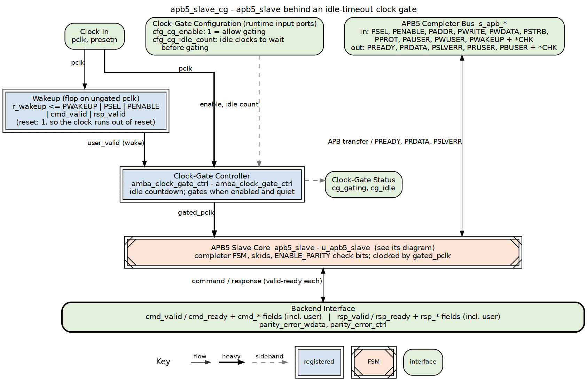

<!-- RTL Design Sherpa Documentation Header -->
<table>
<tr>
<td width="80">
  <a href="https://github.com/sean-galloway/RTLDesignSherpa">
    
  </a>
</td>
<td>
  <strong>RTL Design Sherpa</strong> · <em>Learning Hardware Design Through Practice</em><br>
  <sub>
    <a href="https://github.com/sean-galloway/RTLDesignSherpa">GitHub</a> ·
    <a href="https://github.com/sean-galloway/RTLDesignSherpa/blob/main/docs/DOCUMENTATION_INDEX.md">Documentation Index</a> ·
    <a href="https://github.com/sean-galloway/RTLDesignSherpa/blob/main/LICENSE">MIT License</a>
  </sub>
</td>
</tr>
</table>

---

<!-- End Header -->

# APB5 Slave (Clock-Gated)

**Module:** `apb5_slave_cg.sv`
**Location:** `rtl/amba/apb5/`
**Status:** Production Ready

---

## Overview

Clock-gated variant of the APB5 Slave module. Wraps the base `apb5_slave` with clock gating control logic to reduce dynamic power consumption when no transactions are active.

### Key Features

- All APB5 Slave features (see [apb5_slave](apb5_slave.md))
- Automatic clock gating during idle periods
- Registered wake-up on the Requester's PWAKEUP (ahead of PSEL) or on PSEL, through a glitch-free ICG cell
- Configurable idle threshold
- Gating status output

---

## Parameters

| Parameter | Type | Default | Description |
|-----------|------|---------|-------------|
| ADDR_WIDTH | int | 32 | APB address bus width |
| DATA_WIDTH | int | 32 | APB data bus width |
| PROT_WIDTH | int | 3 | Protection signal width |
| AUSER_WIDTH | int | 4 | Address/request user signal width |
| WUSER_WIDTH | int | 4 | Write data user signal width |
| RUSER_WIDTH | int | 4 | Read data user signal width |
| BUSER_WIDTH | int | 4 | Response user signal width |
| DEPTH | int | 2 | FIFO depth |
| ENABLE_PARITY | bit | 0 | Enable APB5 parity generation and checking |
| CG_IDLE_COUNT_WIDTH | int | 4 | Width of idle counter |

All other parameters are inherited from [apb5_slave](apb5_slave.md).

### Derived Parameters (do not override)

These are declared as `parameter` so the elaborator can compute them, not so callers can set them. Each defaults to an expression over the parameters above; overriding one desynchronises it from its source and the design fails to elaborate or silently mis-sizes a bus. Set the parameters they are derived FROM and leave these alone.

| Derived parameter | Default expression |
|---|---|
| `STRB_WIDTH` | `DATA_WIDTH / 8` |
| `DW` | `DATA_WIDTH` |
| `AW` | `ADDR_WIDTH` |
| `SW` | `STRB_WIDTH` |
| `PW` | `PROT_WIDTH` |
| `AUW` | `AUSER_WIDTH` |
| `WUW` | `WUSER_WIDTH` |
| `RUW` | `RUSER_WIDTH` |
| `BUW` | `BUSER_WIDTH` |
| `ICW` | `CG_IDLE_COUNT_WIDTH` |
| `CPW` | `AW + DW + SW + PW + AUW + WUW + 1` |
| `RPW` | `DW + RUW + BUW + 1` |

---

## Ports

### Clock and Reset

| Port | Width | Direction | Description |
|------|-------|-----------|-------------|
| pclk | 1 | Input | APB clock |
| presetn | 1 | Input | APB active-low reset |

### Clock Gating Configuration

| Port | Width | Direction | Description |
|------|-------|-----------|-------------|
| cfg_cg_enable | 1 | Input | Enable clock gating |
| cfg_cg_idle_count | CG_IDLE_COUNT_WIDTH | Input | Idle cycles before gating |

### Clock Gating Status

| Port | Width | Direction | Description |
|------|-------|-----------|-------------|
| cg_gating | 1 | Output | High while the internal clock is gated off |
| cg_idle | 1 | Output | Activity terms quiet (registered `~wakeup`). |

There is no cumulative gated-cycle counter port on this module. If a gated-cycle
total is needed, count `cg_gating` in the integrating logic on the
ungated `pclk`.

All ports of [apb5_slave](apb5_slave.md) -- including the parity signals,
`s_apb_PWAKEUP`, `parity_error_wdata` and `parity_error_ctrl` -- are present
unchanged and pass straight through to the wrapped core.

### APB5 Slave Interface

| Port | Width | Direction | Description |
|------|-------|-----------|-------------|
| s_apb_PSEL | 1 | Input | APB select signal |
| s_apb_PENABLE | 1 | Input | APB enable signal |
| s_apb_PREADY | 1 | Output | Slave ready response |
| s_apb_PADDR | AW | Input | APB address |
| s_apb_PWRITE | 1 | Input | Write/read indicator |
| s_apb_PWDATA | DW | Input | Write data |
| s_apb_PSTRB | SW | Input | Write byte strobes |
| s_apb_PPROT | PW | Input | Protection attributes |
| s_apb_PAUSER | AUW | Input | User-defined request attributes |
| s_apb_PWUSER | WUW | Input | User-defined write data attributes |
| s_apb_PRDATA | DW | Output | Read data to master |
| s_apb_PSLVERR | 1 | Output | Slave error response |
| s_apb_PWAKEUP | 1 | Input | Requester wake-up (IHI 0024E §3.7.2): a clock-gate wake term in this wrapper |
| s_apb_PRUSER | RUW | Output | User-defined read data attributes |
| s_apb_PBUSER | BUW | Output | User-defined response attributes |

### Parity Signals (Optional)

| Port | Width | Direction | Description |
|------|-------|-----------|-------------|
| s_apb_PADDRCHK | ceil(ADDR_WIDTH/8) | Input | Odd parity over PADDR, one bit per 8 bits |
| s_apb_PCTRLCHK | 1 | Input | Odd parity over PPROT and PWRITE (PNSE not carried) |
| s_apb_PSELCHK | 1 | Input | Odd parity over PSEL (the spec's PSELxCHK) |
| s_apb_PENABLECHK | 1 | Input | Odd parity over PENABLE |
| s_apb_PWDATACHK | DATA_WIDTH/8 | Input | Odd parity over PWDATA, one bit per byte lane |
| s_apb_PSTRBCHK | 1 | Input | Odd parity over all of PSTRB |
| s_apb_PAUSERCHK | ceil(AUSER_WIDTH/8) | Input | Odd parity over PAUSER, one bit per 8 bits |
| s_apb_PWUSERCHK | ceil(WUSER_WIDTH/8) | Input | Odd parity over PWUSER, one bit per 8 bits |
| s_apb_PRDATACHK | DATA_WIDTH/8 | Output | Odd parity over PRDATA, one bit per byte lane |
| s_apb_PREADYCHK | 1 | Output | Odd parity over PREADY |
| s_apb_PSLVERRCHK | 1 | Output | Odd parity over PSLVERR |
| s_apb_PWAKEUPCHK | 1 | Input | Odd parity over PWAKEUP |
| s_apb_PRUSERCHK | ceil(RUSER_WIDTH/8) | Output | Odd parity over PRUSER, one bit per 8 bits |
| s_apb_PBUSERCHK | ceil(BUSER_WIDTH/8) | Output | Odd parity over PBUSER, one bit per 8 bits |

### Command Interface (to backend)

| Port | Width | Direction | Description |
|------|-------|-----------|-------------|
| cmd_valid | 1 | Output | Command valid to backend |
| cmd_ready | 1 | Input | Backend ready |
| cmd_pwrite | 1 | Output | Command write/read |
| cmd_paddr | AW | Output | Command address |
| cmd_pwdata | DW | Output | Command write data |
| cmd_pstrb | SW | Output | Command write strobes |
| cmd_pprot | PW | Output | Command protection |
| cmd_pauser | AUW | Output | Command address user |
| cmd_pwuser | WUW | Output | Command write user |

### Response Interface (from backend)

| Port | Width | Direction | Description |
|------|-------|-----------|-------------|
| rsp_valid | 1 | Input | Response valid from backend |
| rsp_ready | 1 | Output | Slave ready for response |
| rsp_prdata | DW | Input | Response read data |
| rsp_pslverr | 1 | Input | Response error status |
| rsp_pruser | RUW | Input | Response read user |
| rsp_pbuser | BUW | Input | Response user |

### Status Outputs

| Port | Width | Direction | Description |
|------|-------|-----------|-------------|
| parity_error_wdata | 1 | Output | PWDATACHK, PSTRBCHK or PWUSERCHK mismatch (tied to 0 when ENABLE_PARITY=0) |
| parity_error_ctrl | 1 | Output | PADDRCHK, PCTRLCHK, PSELCHK, PENABLECHK, PAUSERCHK or PWAKEUPCHK mismatch (tied to 0 when ENABLE_PARITY=0) |

---

## Functional Description

### Block diagram



The wrapped `apb5_slave` is one box (see its diagram). The variant adds the clock
path (heavy): a wakeup flop on the ungated `pclk` watches PWAKEUP, PSEL, PENABLE,
`cmd_valid` and `rsp_valid`, and `amba_clock_gate_ctrl` stops the core's clock after
`cfg_cg_idle_count` quiet clocks when `cfg_cg_enable` is set.

### Clock Gating Behavior

#### Wake-up Trigger

The wrapper keeps the clock running whenever any of the following is high:

```
s_apb_PWAKEUP || s_apb_PSEL || s_apb_PENABLE || cmd_valid || rsp_valid
```

`s_apb_PWAKEUP` is the Requester's wake-up (IHI 0024E §3.7.2), which the spec
intends to be routed to a clock controller. A Requester that raises it a cycle
or more ahead of PSEL (as §3.7.2 recommends, and as `apb5_master` does) gets
the clock restarted before the setup phase arrives. The term is this side's
pending work and the Requester's wake request only -- never a peer READY.

That term is registered into `r_wakeup` on the ungated `pclk`, and
`amba_clock_gate_ctrl` registers it once more before it reaches the gating
condition. Activity is registered once (AXI4, AXI5, AXI4-Lite, AXI4-Stream) or
twice (APB, APB5, AXI5-Stream) before reaching the ICG enable, which is
combinational. APB5 is a **two-stage** family, so the first gated-clock rising
edge available to the wrapped `apb5_slave` arrives **3 ungated `pclk` cycles**
after activity asserts. Because the slave signals not-ready by holding PREADY
low, those cycles simply appear to the master as APB wait states.

The gating element is an ICG (integrated clock gating) cell instantiated by
`clock_gate_ctrl`, so enable transitions are glitch-free. ICG cells are an ASIC
library primitive; on FPGA targets use a clock-enable approach instead.

Gating engages `cfg_cg_idle_count + 1` ungated `pclk` cycles after the internal
wakeup deasserts, which is `cfg_cg_idle_count + 3` cycles after the last bus
activity, because APB5 adds two register stages ahead of the ICG enable.

---

## Timing Characteristics

> **Timing diagram pending.** The signals and sequence this scenario
> exercises:
>
> - pclk
> - gated_pclk
> - s_apb_PSEL
> - cg_gating
> - Wake-up latency (two register stages; first usable gated edge 3 ungated pclk cycles after activity)

This module is **sequential**: it contains clocked logic (via `always_ff` or
the repository's `ALWAYS_FF_RST` macro) and therefore holds state. Outputs
driven from those blocks are registered and appear one clock after the inputs
that produced them.

Per-path cycle counts are not enumerated here; read the block that drives the
signal you care about. No synthesis frequency or area figures are quoted --
none have been measured against a target device.

Timing closure is therefore a question of the surrounding logic's slack, not of
this module's cycle count. No synthesis figures are quoted; none have been
measured.

---

## Usage Examples

```systemverilog
apb5_slave_cg #(
    .ADDR_WIDTH         (32),
    .DATA_WIDTH         (32),
    .CG_IDLE_COUNT_WIDTH(4)
) u_apb5_slave_cg (
    .pclk               (apb_clk),
    .presetn            (apb_rst_n),

    // Clock gating
    .cfg_cg_enable      (1'b1),
    .cfg_cg_idle_count  (4'd4),
    .cg_gating   (slave_clk_gated),

    // APB5 interface (same as apb5_slave)
    // ...
);
```

---

## Design Notes

**A peer's READY must never enter the activity term.** A consumer that parks
its response-ready high while idle is behaving correctly; folding that signal
into `user_valid` pins this block permanently awake and defeats gating
entirely -- silently, because function is unaffected. Ten wrappers in this
repository shipped that way and nothing failed until someone measured.
`val/amba/test_cg_peer_ready.py` parks the peer READY high, holds every VALID
low, and requires `cg_gating`. Canonical rule:
`vault/handbook/design/clock-gating-activity-terms.md`.

**`cfg_cg_enable` is not a kill switch.** It arms gating and reaches
`amba_clock_gate_ctrl` only; the datapath and any monitor enables are forwarded
untouched. With it low the clock free-runs and this module behaves exactly like
its base.

**Gating latency.** The clock stops `cfg_cg_idle_count` + 2 cycles after the
last bus activity -- the idle counter, plus one for the `r_wakeup` flop. Size
the idle count against your traffic's inter-burst gap: too small and the block
wakes constantly, too large and it never gates.

**Cost.** Five flops: `r_wakeup` plus `r_idle_counter` at `IDLE_CNTR_WIDTH`,
scaling as 1 + `CG_IDLE_COUNT_WIDTH`. The ICG itself is a latch or BUFGCE, not
fabric flops.

---

## Related Modules

- **[APB5 Slave](apb5_slave.md)** - Base module documentation
- **[APB5 Master CG](apb5_master_cg.md)** - Clock-gated master

---

## Testing

`val/amba/test_apb5_slave_cg.py` exercises this module. It collects 3 parameter cases at the default `REG_LEVEL`.

```bash
source env_python
pytest val/amba/test_apb5_slave_cg.py -v
```

## References

- Arm. *AMBA APB Protocol Specification*, ARM IHI 0024E, Feb. 2023 (APB5 first published in Issue D, Apr. 2021). [developer.arm.com/documentation/ihi0024/e](https://developer.arm.com/documentation/ihi0024/e/) -- ch. 3 "Transfers", ch. 4 "Operating States", §3.7 "Wake-up signaling" and §3.8 "User signaling": the protocol of the wrapped APB5 block. Citation only.
- Benini, L., Bogliolo, A., De Micheli, G. "A Survey of Design Techniques for System-Level Dynamic Power Management." *IEEE Trans. VLSI Systems*, 8(3), June 2000. DOI: [10.1109/92.845896](https://doi.org/10.1109/92.845896) -- the fixed-timeout policy `amba_clock_gate_ctrl` implements: gate after `cfg_cg_idle_count` idle cycles, wake on activity.
- Benini, L., De Micheli, G. "Automatic Synthesis of Low-Power Gated-Clock Finite-State Machines." *IEEE Trans. CAD*, 15(6), June 1996. DOI: [10.1109/43.503933](https://doi.org/10.1109/43.503933) -- the latch-based gated clock (`icg`) at the bottom of the gating chain.
- Roy, S. *Advanced Digital System Design*, Springer, ch. 15 "Low-Power Digital System Design", §15.5.5 "Logic Level Power Down" -- textbook treatment of clock gating (secondary source).
- Indexed in `rtl/amba/references/README.md` (local PDF: `rtl/common/references/DynamicPowerManagementTimeout__Benini2000.pdf`, `rtl/common/references/LatchBasedClockGating__Benini1996.pdf`)

---

## Navigation

- **[← Back to APB5 Index](README.md)**
- **[← Back to rtl-amba Index](../index.md)**
- **[← Back to Main Documentation Index](../../index.md)**
