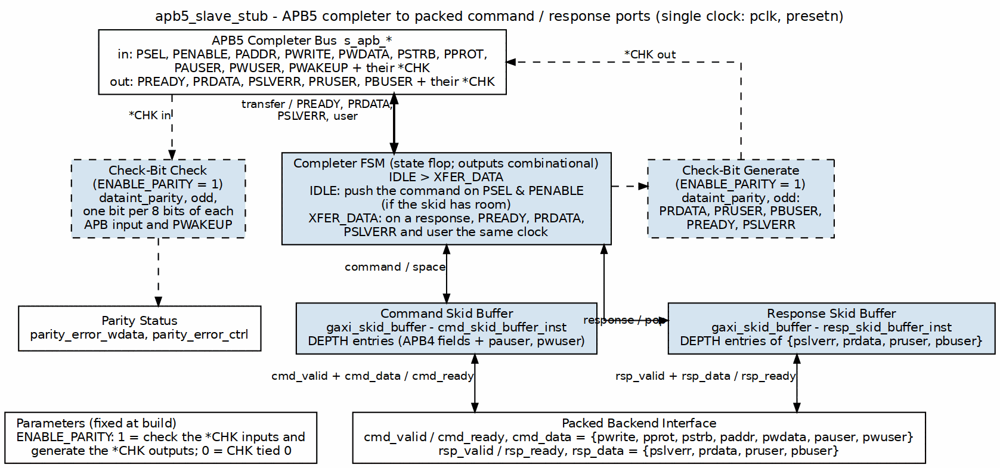
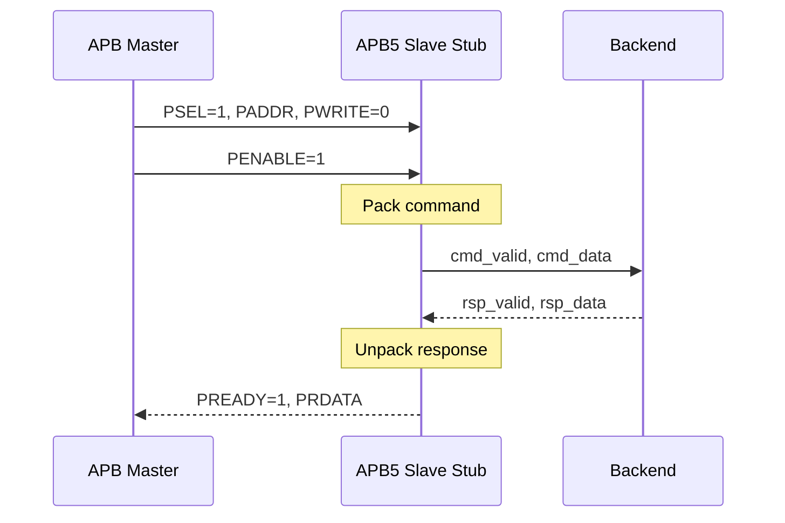

<!-- RTL Design Sherpa Documentation Header -->
<table>
<tr>
<td width="80">
  <a href="https://github.com/sean-galloway/RTLDesignSherpa">
    
  </a>
</td>
<td>
  <strong>RTL Design Sherpa</strong> · <em>Learning Hardware Design Through Practice</em><br>
  <sub>
    <a href="https://github.com/sean-galloway/RTLDesignSherpa">GitHub</a> ·
    <a href="https://github.com/sean-galloway/RTLDesignSherpa/blob/main/docs/DOCUMENTATION_INDEX.md">Documentation Index</a> ·
    <a href="https://github.com/sean-galloway/RTLDesignSherpa/blob/main/LICENSE">MIT License</a>
  </sub>
</td>
</tr>
</table>

---

<!-- End Header -->

# APB5 Slave Stub

**Module:** `apb5_slave_stub.sv`
**Location:** `rtl/amba/apb5/`
**Status:** Production Ready

---

## Overview

The APB5 Slave Stub provides a simplified packed-data interface for responding to APB5 transactions. It implements a complete APB5 slave with packet-based command/response interfaces, making it ideal for testbenches and simple backend implementations.

### Key Features

- Packed command/response packet interface
- Complete APB5 slave FSM implementation
- All APB5 extensions (PAUSER, PWUSER, PRUSER, PBUSER)
- PWAKEUP input from the Requester (IHI 0024E §3.7.2), checked by PWAKEUPCHK
- Optional parity support with error detection
- Skid buffers for command and response paths

---

## Parameters

| Parameter | Type | Default | Description |
|-----------|------|---------|-------------|
| DEPTH | int | 4 | Skid-buffer depth in entries; 2..8 inclusive (any integer) |
| ADDR_WIDTH | int | 32 | APB address bus width |
| DATA_WIDTH | int | 32 | APB data bus width |
| PROT_WIDTH | int | 3 | Protection signal width |
| AUSER_WIDTH | int | 4 | Address user signal width |
| WUSER_WIDTH | int | 4 | Write user signal width |
| RUSER_WIDTH | int | 4 | Read user signal width |
| BUSER_WIDTH | int | 4 | Response user signal width |
| ENABLE_PARITY | bit | 0 | Enable parity signals |
| STRB_WIDTH | int | DATA_WIDTH/8 | Write strobe width |
| CMD_PACKET_WIDTH | int | (calculated) | Total command packet width |
| RESP_PACKET_WIDTH | int | (calculated) | Total response packet width |

`CMD_PACKET_WIDTH` and `RESP_PACKET_WIDTH` are computed from the width
parameters and must not be overridden:

```
CMD_PACKET_WIDTH  = ADDR_WIDTH + DATA_WIDTH + STRB_WIDTH + PROT_WIDTH
                  + AUSER_WIDTH + WUSER_WIDTH + 1
                    // the single bit is pwrite

RESP_PACKET_WIDTH = DATA_WIDTH + RUSER_WIDTH + BUSER_WIDTH + 1
                    // the single bit is pslverr
```

With all defaults this gives `CMD_PACKET_WIDTH = 80` and
`RESP_PACKET_WIDTH = 41`.

Unlike [apb5_master_stub](apb5_master_stub.md), the slave stub packets carry no
`first`/`last` markers, so the two stubs' packet widths are
not interchangeable.

### Derived Parameters (do not override)

These are declared as `parameter` so the elaborator can compute them, not so callers can set them. Each defaults to an expression over the parameters above; overriding one desynchronises it from its source and the design fails to elaborate or silently mis-sizes a bus. Set the parameters they are derived FROM and leave these alone.

| Derived parameter | Default expression |
|---|---|
| `DW` | `DATA_WIDTH` |
| `AW` | `ADDR_WIDTH` |
| `SW` | `STRB_WIDTH` |
| `PW` | `PROT_WIDTH` |
| `AUW` | `AUSER_WIDTH` |
| `WUW` | `WUSER_WIDTH` |
| `CPW` | `CMD_PACKET_WIDTH` |
| `RPW` | `RESP_PACKET_WIDTH` |

---

## Ports

### Clock and Reset

| Port | Width | Direction | Description |
|------|-------|-----------|-------------|
| pclk | 1 | Input | APB clock |
| presetn | 1 | Input | APB reset (active low) |

### APB5 Slave Interface

| Port | Width | Direction | Description |
|------|-------|-----------|-------------|
| s_apb_PSEL | 1 | Input | APB select signal |
| s_apb_PENABLE | 1 | Input | APB enable signal |
| s_apb_PADDR | ADDR_WIDTH | Input | APB address |
| s_apb_PWRITE | 1 | Input | Write/read indicator |
| s_apb_PWDATA | DATA_WIDTH | Input | Write data |
| s_apb_PSTRB | STRB_WIDTH | Input | Write byte strobes |
| s_apb_PPROT | PROT_WIDTH | Input | Protection attributes |
| s_apb_PAUSER | AUSER_WIDTH | Input | User request attributes |
| s_apb_PWUSER | WUSER_WIDTH | Input | User write attributes |
| s_apb_PRDATA | DATA_WIDTH | Output | Read data to master |
| s_apb_PSLVERR | 1 | Output | Slave error response |
| s_apb_PREADY | 1 | Output | Slave ready |
| s_apb_PWAKEUP | 1 | Input | Requester wake-up (IHI 0024E §3.7.2); not waited on before PREADY |
| s_apb_PRUSER | RUSER_WIDTH | Output | User read attributes |
| s_apb_PBUSER | BUSER_WIDTH | Output | User response attributes |

### Parity Signals (Optional)

Present unconditionally; meaningful only when `ENABLE_PARITY=1`. Semantics are
identical to [apb5_slave](apb5_slave.md#parity-implementation).

| Port | Width | Direction | Description |
|------|-------|-----------|-------------|
| s_apb_PADDRCHK | ceil(ADDR_WIDTH/8) | Input | Odd parity over PADDR, one bit per 8 bits |
| s_apb_PCTRLCHK | 1 | Input | Odd parity over PPROT and PWRITE (PNSE not carried) |
| s_apb_PSELCHK | 1 | Input | Odd parity over PSEL (the spec's PSELxCHK) |
| s_apb_PENABLECHK | 1 | Input | Odd parity over PENABLE |
| s_apb_PWDATACHK | DATA_WIDTH/8 | Input | Odd parity over PWDATA, one bit per byte lane |
| s_apb_PSTRBCHK | 1 | Input | Odd parity over all of PSTRB |
| s_apb_PAUSERCHK | ceil(AUSER_WIDTH/8) | Input | Odd parity over PAUSER, one bit per 8 bits |
| s_apb_PWUSERCHK | ceil(WUSER_WIDTH/8) | Input | Odd parity over PWUSER, one bit per 8 bits |
| s_apb_PRDATACHK | DATA_WIDTH/8 | Output | Odd parity over PRDATA, one bit per byte lane |
| s_apb_PREADYCHK | 1 | Output | Odd parity over PREADY |
| s_apb_PSLVERRCHK | 1 | Output | Odd parity over PSLVERR |
| s_apb_PWAKEUPCHK | 1 | Input | Odd parity over PWAKEUP |
| s_apb_PRUSERCHK | ceil(RUSER_WIDTH/8) | Output | Odd parity over PRUSER, one bit per 8 bits |
| s_apb_PBUSERCHK | ceil(BUSER_WIDTH/8) | Output | Odd parity over PBUSER, one bit per 8 bits |

### Command Packet Interface

| Port | Width | Direction | Description |
|------|-------|-----------|-------------|
| cmd_valid | 1 | Output | Command packet valid |
| cmd_ready | 1 | Input | Backend ready for command |
| cmd_data | CMD_PACKET_WIDTH | Output | Packed command data |

### Response Packet Interface

| Port | Width | Direction | Description |
|------|-------|-----------|-------------|
| rsp_valid | 1 | Input | Response packet valid |
| rsp_ready | 1 | Output | Ready for response |
| rsp_data | RESP_PACKET_WIDTH | Input | Packed response data |

### Control and Status

| Port | Width | Direction | Description |
|------|-------|-----------|-------------|
| parity_error_wdata | 1 | Output | PWDATACHK, PSTRBCHK or PWUSERCHK mismatch |
| parity_error_ctrl | 1 | Output | PADDRCHK, PCTRLCHK, PSELCHK, PENABLECHK, PAUSERCHK or PWAKEUPCHK mismatch |

---

## Functional Description

### Block diagram



A standalone completer, like `apb4_slave_stub`, with the user fields and the
APB5 check bits added. A two-state FSM (IDLE > XFER_DATA) pushes the command into
the command skid and, on a response, drives PREADY, PRDATA, PSLVERR and the user
fields combinationally the same clock. With `ENABLE_PARITY = 1`, the input *CHK signals are
checked and the output *CHK signals generated.

### Packet Formats

#### Command Packet Structure

```
cmd_data = {pwrite, pprot, pstrb, paddr, pwdata, pauser, pwuser}
```

| Field | Width | Description |
|-------|-------|-------------|
| pwrite | 1 | Write/read indicator |
| pprot | PROT_WIDTH | Protection attributes |
| pstrb | STRB_WIDTH | Write byte strobes |
| paddr | ADDR_WIDTH | Transaction address |
| pwdata | DATA_WIDTH | Write data |
| pauser | AUSER_WIDTH | Address user signal |
| pwuser | WUSER_WIDTH | Write user signal |

#### Response Packet Structure

```
rsp_data = {pslverr, prdata, pruser, pbuser}
```

| Field | Width | Description |
|-------|-------|-------------|
| pslverr | 1 | Error response |
| prdata | DATA_WIDTH | Read data |
| pruser | RUSER_WIDTH | Read user signal |
| pbuser | BUSER_WIDTH | Response user signal |

### State Machine

```mermaid
stateDiagram-v2
    [*] --> IDLE

    IDLE --> XFER_DATA : PSEL & PENABLE & cmd_ready
    XFER_DATA --> IDLE : rsp_valid

    state IDLE {
        note right of IDLE : Wait for APB access
    }
    state XFER_DATA {
        note right of XFER_DATA : Wait for backend response
    }
```

### State Descriptions

| State | Description |
|-------|-------------|
| IDLE | Waiting for APB transaction (PSEL & PENABLE) |
| XFER_DATA | Command sent, waiting for response from backend |

### Transaction Flow

#### Read Transaction



---

## Timing Characteristics

<!-- TODO: Add wavedrom timing diagram for slave stub -->
> **Timing diagram pending.** The signals and sequence this scenario
> exercises:
>
> - pclk
> - APB signals (PSEL, PENABLE, PADDR, PWRITE, PREADY, PRDATA)
> - cmd_valid, cmd_ready, cmd_data
> - rsp_valid, rsp_ready, rsp_data
> - State transitions IDLE -> XFER_DATA -> IDLE

This module is **sequential**: it contains clocked logic (via `always_ff` or
the repository's `ALWAYS_FF_RST` macro) and therefore holds state. Outputs
driven from those blocks are registered and appear one clock after the inputs
that produced them.

Per-path cycle counts are not enumerated here; read the block that drives the
signal you care about. No synthesis frequency or area figures are quoted --
none have been measured against a target device.

Timing closure is therefore a question of the surrounding logic's slack, not of
this module's cycle count. No synthesis figures are quoted; none have been
measured.

---

## Usage Examples

```systemverilog
apb5_slave_stub #(
    .DEPTH          (4),
    .ADDR_WIDTH     (32),
    .DATA_WIDTH     (32),
    .AUSER_WIDTH    (4),
    .WUSER_WIDTH    (4),
    .RUSER_WIDTH    (4),
    .BUSER_WIDTH    (4),
    .ENABLE_PARITY  (0)
) u_apb5_slave_stub (
    .pclk           (apb_clk),
    .presetn        (apb_rst_n),

    // APB5 slave interface
    .s_apb_PSEL     (s_apb_psel),
    .s_apb_PENABLE  (s_apb_penable),
    .s_apb_PADDR    (s_apb_paddr),
    .s_apb_PWRITE   (s_apb_pwrite),
    .s_apb_PWDATA   (s_apb_pwdata),
    .s_apb_PSTRB    (s_apb_pstrb),
    .s_apb_PPROT    (s_apb_pprot),
    .s_apb_PAUSER   (s_apb_pauser),
    .s_apb_PWUSER   (s_apb_pwuser),
    .s_apb_PRDATA   (s_apb_prdata),
    .s_apb_PSLVERR  (s_apb_pslverr),
    .s_apb_PREADY   (s_apb_pready),
    .s_apb_PWAKEUP  (s_apb_pwakeup),   // input: from the Requester
    .s_apb_PRUSER   (s_apb_pruser),
    .s_apb_PBUSER   (s_apb_pbuser),

    // Packed command interface
    .cmd_valid      (be_cmd_valid),
    .cmd_ready      (be_cmd_ready),
    .cmd_data       (be_cmd_data),

    // Packed response interface
    .rsp_valid      (be_rsp_valid),
    .rsp_ready      (be_rsp_ready),
    .rsp_data       (be_rsp_data),

    // Parity interface (unused here because ENABLE_PARITY=0)
    .s_apb_PADDRCHK      ('0),
    .s_apb_PCTRLCHK      (1'b0),
    .s_apb_PSELCHK       (1'b0),
    .s_apb_PENABLECHK    (1'b0),
    .s_apb_PWDATACHK     ('0),
    .s_apb_PSTRBCHK      (1'b0),
    .s_apb_PAUSERCHK     ('0),
    .s_apb_PWUSERCHK     ('0),
    .s_apb_PRDATACHK     (),
    .s_apb_PREADYCHK     (),
    .s_apb_PSLVERRCHK    (),
    .s_apb_PWAKEUPCHK    (1'b0),
    .s_apb_PRUSERCHK     (),
    .s_apb_PBUSERCHK     (),
    .parity_error_wdata  (),
    .parity_error_ctrl   ()
);

// Simple backend: return stored_data with no error and zeroed user fields.
// Build the response from the parameters, not from literal widths -- the user
// fields are RUSER_WIDTH and BUSER_WIDTH wide, not a fixed 8 bits.
localparam int RUW = 4;   // RUSER_WIDTH
localparam int BUW = 4;   // BUSER_WIDTH

always_ff @(posedge apb_clk) begin
    if (!apb_rst_n) begin
        be_rsp_valid <= 1'b0;
    end else if (be_cmd_valid && be_cmd_ready) begin
        be_rsp_valid <= 1'b1;
        // {pslverr, prdata, pruser, pbuser}
        be_rsp_data  <= {1'b0, stored_data, {RUW{1'b0}}, {BUW{1'b0}}};
    end else if (be_rsp_ready) begin
        be_rsp_valid <= 1'b0;
    end
end
```

---

## Design Notes

### Skid Buffers

The stub uses skid buffers on both command and response paths:
- **Command skid buffer:** Absorbs command while FSM transitions
- **Response skid buffer:** Allows backend to push response before slave ready

### Parity Implementation

The stub carries its own copy of the `apb5_slave` parity logic, with identical
behaviour; the full rules and the per-signal Check Enable terms are in
[apb5_slave](apb5_slave.md#parity-implementation). In short, when
`ENABLE_PARITY=1`:
- **Odd parity** (IHI 0024E §5.3) on spec-named `*CHK` signals, one check bit
  per 8 payload bits, computed by per-byte `dataint_parity` instances.
- **Checked:** `PADDRCHK`, `PCTRLCHK` (PPROT, PWRITE), `PSELCHK`, `PENABLECHK`,
  `PWDATACHK`, `PSTRBCHK`, `PAUSERCHK`, `PWUSERCHK`, `PWAKEUPCHK`.
- **Generated:** `PRDATACHK`, `PREADYCHK`, `PSLVERRCHK`, `PRUSERCHK`,
  `PBUSERCHK`.
- `parity_error_wdata` (write-data group, while `PSEL & PWRITE`) and
  `parity_error_ctrl` (address/control group while `PSEL`, `PSELCHK` and
  `PWAKEUPCHK` at any time out of reset) are combinational and hard-tied to 0 when
  `ENABLE_PARITY=0`.

### Wake-up Handling

`s_apb_PWAKEUP` is an input from the Requester (IHI 0024E §3.7.2, Table 3-7).
The stub does not wait for it before PREADY and uses it only for the
`PWAKEUPCHK` check; there is no backend `wakeup_request` port.

---

## Related Modules

- **[APB5 Slave](apb5_slave.md)** - Full slave module
- **[APB5 Master Stub](apb5_master_stub.md)** - Corresponding master stub

---

## Testing

`val/amba/test_apb5_slave_stub.py` exercises this module. It collects 4 parameter cases at the default `REG_LEVEL`; the two `ENABLE_PARITY=1` cases also run `cocotb_test_apb5_slave_stub_parity`, a directed IHI 0024E ch. 5 check.

```bash
source env_python
pytest val/amba/test_apb5_slave_stub.py -v
```

## References

- Arm. *AMBA APB Protocol Specification*, ARM IHI 0024E, Feb. 2023 (APB5 first published in Issue D, Apr. 2021). [developer.arm.com/documentation/ihi0024/e](https://developer.arm.com/documentation/ihi0024/e/) -- ch. 3 "Transfers", ch. 4 "Operating States", §3.7 "Wake-up signaling" and §3.8 "User signaling": the protocol of the wrapped APB5 block; ch. 5 "Interface parity protection" (§5.3, Table 5-1) for the `*CHK` signals. Citation only.
- Carloni, L.P., McMillan, K.L., Sangiovanni-Vincentelli, A.L. "Theory of Latency-Insensitive Design." *IEEE Trans. Computer-Aided Design of Integrated Circuits and Systems*, 20(9), Sept. 2001. DOI: [10.1109/43.945302](https://doi.org/10.1109/43.945302) -- the valid/ready channel discipline behind the `gaxi_skid_buffer` queues: a buffered stage may stall or add latency without changing what the endpoints compute.
- Indexed in `rtl/amba/references/README.md` (local PDF: `LatencyInsensitiveDesign__Carloni2001.pdf`)

---

## Navigation

- **[← Back to APB5 Index](README.md)**
- **[← Back to rtl-amba Index](../index.md)**
- **[← Back to Main Documentation Index](../../index.md)**
