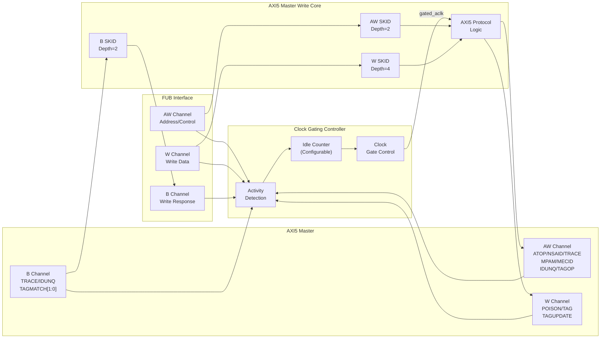

<!-- RTL Design Sherpa Documentation Header -->
<table>
<tr>
<td width="80">
  <a href="https://github.com/sean-galloway/RTLDesignSherpa">
    
  </a>
</td>
<td>
  <strong>RTL Design Sherpa</strong> · <em>Learning Hardware Design Through Practice</em><br>
  <sub>
    <a href="https://github.com/sean-galloway/RTLDesignSherpa">GitHub</a> ·
    <a href="https://github.com/sean-galloway/RTLDesignSherpa/blob/main/docs/DOCUMENTATION_INDEX.md">Documentation Index</a> ·
    <a href="https://github.com/sean-galloway/RTLDesignSherpa/blob/main/LICENSE">MIT License</a>
  </sub>
</td>
</tr>
</table>

---

<!-- End Header -->

# AXI5 Master Write with Clock Gating

**Module:** `axi5_master_wr_cg.sv`
**Location:** `rtl/amba/axi5/`
**Status:** Production Ready

---

## Overview

The AXI5 Master Write with Clock Gating module wraps the standard `axi5_master_wr` core with intelligent clock gating for power optimization. When no AXI write activity is detected for a configurable number of idle cycles, the clock gates off automatically.

**Scope:** this module transports AXI5 signals; it does not implement AXI5 transaction semantics. `AWATOP` is carried through unmodified but no atomic read-modify-write is performed, no MTE tag checking or `BTAGMATCH` generation is performed, and no outstanding-transaction tracking is done. Those behaviors belong to the endpoints on either side. See [Scope of This Implementation](README.md) in the AXI5 index for the full coverage statement.

### Key Features

- Carries the same AXI5 signal set as `axi5_master_wr`, which it wraps
- **AWATOP:** Atomic operation support (compare-and-swap, atomic operations)
- **AWNSAID:** Non-secure access identifier for security domains
- **AWTRACE:** Trace signal for debug and performance monitoring
- **AWMPAM:** Memory Partitioning and Monitoring (PartID + PMG)
- **AWMECID:** Memory Encryption Context ID for secure memory
- **AWIDUNQ / BIDUNQ:** Unique ID indicator on the request and its write response (IHI 0022L §A5.2)
- **AWTAGOP:** Memory tag operation (MTE - Memory Tagging Extension)
- **WPOISON:** Write data poison indicator for corrupted data detection
- **WTAG/WTAGUPDATE:** Memory tags and tag update control (MTE)
- **BTRACE / BIDUNQ / BTAGMATCH[1:0]:** Response trace, unique-ID indicator and the 2-bit tag match result
- **Automatic clock gating** based on activity detection
- **Configurable idle count** before clock gating activates
- **Power savings** during idle periods
- **Transparent operation** - no protocol changes
- **Status outputs** for clock gating state monitoring
- **Power Savings:** traffic-dependent; unmeasured in this repo -- treat any percentage as a placeholder until characterized

---

## Parameters

| Parameter | Type | Default | Description |
|-----------|------|---------|-------------|
| SKID_DEPTH_AW | int | 2 | AW channel SKID buffer depth |
| SKID_DEPTH_W | int | 4 | W channel SKID buffer depth |
| SKID_DEPTH_B | int | 2 | B channel SKID buffer depth |
| AXI_ID_WIDTH | int | 8 | Transaction ID width |
| AXI_ADDR_WIDTH | int | 32 | Address bus width |
| AXI_DATA_WIDTH | int | 32 | Data bus width |
| AXI_USER_WIDTH | int | 1 | User signal width |
| AXI_WSTRB_WIDTH | int | DATA_WIDTH/8 | Write strobe width (calculated) |
| AXI_ATOP_WIDTH | int | 6 | Atomic operation width |
| AXI_NSAID_WIDTH | int | 4 | Non-secure access ID width |
| AXI_MPAM_WIDTH | int | 11 | MPAM width (PartID + PMG) |
| AXI_MECID_WIDTH | int | 16 | Memory encryption context ID width |
| AXI_TAG_WIDTH | int | 4 | Memory tag width per 16 bytes |
| AXI_TAGOP_WIDTH | int | 2 | Tag operation width |
| ENABLE_ATOMIC | bit | 1 | Enable atomic operations |
| ENABLE_NSAID | bit | 1 | Enable non-secure access ID |
| ENABLE_TRACE | bit | 1 | Enable trace signals |
| ENABLE_MPAM | bit | 1 | Enable memory partitioning |
| ENABLE_MECID | bit | 1 | Enable memory encryption context |
| ENABLE_UNIQUE | bit | 1 | Enable the unique ID indicator (AxIDUNQ, and BIDUNQ/RIDUNQ on the responses) |
| ENABLE_MTE | bit | 1 | Enable Memory Tagging Extension |
| ENABLE_POISON | bit | 1 | Enable poison indicator |
| ENABLE_WAKEUP | bit | 1 | Enable AWAKEUP (IHI 0022L §A14.1.1); 0 ties the output low |
| CG_IDLE_COUNT_WIDTH | int | 4 | Width of idle counter (max 2^N-1 cycles) |

### Derived Parameters

These are computed inside the module from the parameters above. Do not override them.

| Parameter | Expression | Description |
|-----------|------------|-------------|
| SW | AXI_WSTRB_WIDTH | Write strobe width, one bit per data byte |
| NUM_TAGS | max(AXI_DATA_WIDTH / 128, 1) | MTE tags carried per beat (one tag per 16 bytes) |
| TW | AXI_TAG_WIDTH * NUM_TAGS | Total width of the `wtag` field |
| AWSize | Sum of the enabled AW fields | AW SKID buffer payload width |
| WSize | Sum of the enabled W fields | W SKID buffer payload width |
| BSize | Sum of the enabled B fields | B SKID buffer payload width |

---

## Ports

### Clock and Reset

| Port | Width | Direction | Description |
|------|-------|-----------|-------------|
| aclk | 1 | Input | AXI clock (ungated) |
| aresetn | 1 | Input | AXI active-low reset |

### Clock Gating Configuration

| Port | Width | Direction | Description |
|------|-------|-----------|-------------|
| cfg_cg_enable | 1 | Input | Clock gating enable (1=enable, 0=always active) |
| cfg_cg_idle_count | CG_IDLE_COUNT_WIDTH | Input | Idle cycles before gating activates |

### FUB AXI5 Interface (Slave Side - Input)

#### AW Channel

| Port | Width | Direction | Description |
|------|-------|-----------|-------------|
| fub_axi_awid | IW | Input | Write address ID |
| fub_axi_awaddr | AW | Input | Write address |
| fub_axi_awlen | 8 | Input | Burst length |
| fub_axi_awsize | 3 | Input | Burst size |
| fub_axi_awburst | 2 | Input | Burst type |
| fub_axi_awlock | 1 | Input | Lock type |
| fub_axi_awcache | 4 | Input | Cache attributes |
| fub_axi_awprot | 3 | Input | Protection attributes |
| fub_axi_awqos | 4 | Input | Quality of Service |
| fub_axi_awuser | UW | Input | User-defined signal |
| fub_axi_awvalid | 1 | Input | Write address valid |
| fub_axi_awakeup | 1 | Input | Wake-up request, AWAKEUP (IHI 0022L §A14.1.1; `ENABLE_WAKEUP`) |
| fub_axi_awready | 1 | Output | Write address ready (forced 0 when gating) |

#### AXI5 AW Extensions

| Port | Width | Direction | Description |
|------|-------|-----------|-------------|
| fub_axi_awatop | AXI_ATOP_WIDTH | Input | Atomic operation |
| fub_axi_awnsaid | AXI_NSAID_WIDTH | Input | Non-secure access ID |
| fub_axi_awtrace | 1 | Input | Trace signal |
| fub_axi_awmpam | AXI_MPAM_WIDTH | Input | Memory partitioning/monitoring |
| fub_axi_awmecid | AXI_MECID_WIDTH | Input | Memory encryption context ID |
| fub_axi_awidunq | 1 | Input | Unique ID indicator, AWIDUNQ (IHI 0022L §A5.2; `ENABLE_UNIQUE`) |
| fub_axi_awtagop | AXI_TAGOP_WIDTH | Input | Tag operation (MTE) |

#### W Channel

| Port | Width | Direction | Description |
|------|-------|-----------|-------------|
| fub_axi_wdata | DW | Input | Write data |
| fub_axi_wstrb | SW | Input | Write strobes |
| fub_axi_wlast | 1 | Input | Last transfer in burst |
| fub_axi_wuser | UW | Input | User-defined signal |
| fub_axi_wvalid | 1 | Input | Write data valid |
| fub_axi_wready | 1 | Output | Write data ready (forced 0 when gating) |

#### AXI5 W Extensions

| Port | Width | Direction | Description |
|------|-------|-----------|-------------|
| fub_axi_wpoison | 1 | Input | Write data poison indicator |
| fub_axi_wtag | TW | Input | Memory tags on write data |
| fub_axi_wtagupdate | NUM_TAGS | Input | Tag update control (per 16B) |

#### B Channel

| Port | Width | Direction | Description |
|------|-------|-----------|-------------|
| fub_axi_bid | IW | Output | Write response ID |
| fub_axi_bresp | 2 | Output | Write response |
| fub_axi_buser | UW | Output | User-defined signal |
| fub_axi_bvalid | 1 | Output | Write response valid |
| fub_axi_bready | 1 | Input | Write response ready |

#### AXI5 B Extensions

| Port | Width | Direction | Description |
|------|-------|-----------|-------------|
| fub_axi_btrace | 1 | Output | Trace signal |
| fub_axi_bidunq | 1 | Output | Unique ID indicator on the write response, BIDUNQ (IHI 0022L §A5.2; `ENABLE_UNIQUE`) |
| fub_axi_btagmatch | 2 | Output | Tag match result, IHI 0022L Table A12.14 (00 None, 01 Separate, 10 Fail, 11 Pass) |

### Master AXI5 Interface (Output Side)

Same port list as FUB interface but with `m_axi_*` prefix and reversed directions.

### Clock Gating Status Outputs

| Port | Width | Direction | Description |
|------|-------|-----------|-------------|
| cg_gating | 1 | Output | Clock gating active (1=clock gated, 0=clock running) |
| cg_idle | 1 | Output | Interface idle (1=no activity detected) |

---

## Functional Description

### Architecture



### Clock Gating Operation

The clock gating controller monitors activity on both user and AXI sides for all three write channels:

**User-side activity detection:**
```systemverilog
user_valid = (ENABLE_WAKEUP && fub_axi_awakeup) || fub_axi_awvalid || fub_axi_wvalid || fub_axi_bvalid || int_busy  // peer VALID (post-fix)
```

**AXI-side activity detection:**
```systemverilog
axi_valid = m_axi_awvalid || m_axi_wvalid || m_axi_bvalid
```

**Ready signal control during gating:**
```systemverilog
fub_axi_awready = cg_gating ? 1'b0 : int_awready;
fub_axi_wready = cg_gating ? 1'b0 : int_wready;
m_axi_bready = cg_gating ? 1'b0 : int_bready;
```

All three write channels must be idle before clock gating activates, ensuring no partial writes.

### Ready Deassertion and Wake Behavior

While `cg_gating` is asserted, the ready outputs listed above are forced low.

This is legal AXI. A READY output may be deasserted for any number of cycles, and neither side may assume READY asserts within a bounded time, so holding it low is ordinary backpressure rather than a protocol violation. It cannot deadlock either: the same VALID being held off also feeds the activity detector, so gating releases and READY returns to the core's value.

Two consequences are worth designing around:

- **Wake latency adds to first-transfer latency.** Activity is registered once (AXI4, AXI5, AXI4-Lite, AXI4-Stream) or twice (APB, APB5, AXI5-Stream -- with one exception: `apb4_slave_cdc_cg` drives `amba_clock_gate_ctrl` combinationally and so registers once, not twice) before reaching the ICG enable, which is combinational. The AXI5 `_cg` wrappers drive the activity terms combinationally, so there is 1 register stage and the first usable gated-clock edge arrives 2 cycles after activity asserts. Size `cfg_cg_idle_count` so that cost is amortized over the traffic burst that follows.
- **READY is a combinational function of `cg_gating`.** The path from the idle counter to the `fub_axi_awready` and `fub_axi_wready` outputs may need attention during timing closure, particularly at high frequency.

### Integration Caveat: `fub_axi_bready` in the Activity Term

The activity detector uses the corresponding VALID (`fub_axi_bvalid`), never the peer's READY. (Historically this term was `fub_axi_bready`, which meant a peer parking its ready high -- a common and entirely correct style -- pinned the block permanently awake and defeated gating; that defect was fixed family-wide, matching the rule the mon_cg wrappers always carried.)

An always-ready consumer no longer prevents gating.

### AXI5 Write-Specific Features

**Atomic transactions (AWATOP):**
When `ENABLE_ATOMIC=1`, `AWATOP` is packed into the AW SKID payload and carried through unmodified, so the following can be signalled end to end:
- AtomicStore
- AtomicLoad
- AtomicSwap
- AtomicCompare
- The ADD/CLR/EOR/SET/SMAX/SMIN/UMAX/UMIN opcodes of AtomicStore and AtomicLoad

The module does not execute the atomic operation. See [AXI5 Master Write](axi5_master_wr.md) for the full `AWATOP` encoding.

**Memory Tagging on Write (MTE):**
When `ENABLE_MTE=1`:
- **AWTAGOP:** Specifies tag operation for write address
- **WTAG:** Memory tags sent with each data beat
- **WTAGUPDATE:** Controls which tags to update (per 16 bytes)
- **BTAGMATCH[1:0]:** Tag match result, Table A12.14 (00 None, 01 Separate, 10 Fail, 11 Pass)

**Write Poison (WPOISON):**
When `ENABLE_POISON=1`:
- Indicates corrupted or invalid write data
- Propagated to memory/cache
- May trigger error response (SLVERR)

### Idle Counter Configuration

Same as read variant - see [AXI5 Master Read CG](axi5_master_rd_cg.md).

---

## Timing Characteristics

### Clock Gating with Write Burst

> **Timing diagram pending.** The signals and sequence this scenario
> exercises:
>
> - ACLK (ungated)
> - GATED_ACLK (gated clock)
> - AW channel: AWVALID, AWREADY
> - W channel: WDATA, WLAST, WVALID, WREADY
> - B channel: BVALID, BREADY
> - Idle counter after BREADY
> - cg_gating activation after idle count

### Atomic Operation with Clock Gating

> **Timing diagram pending.** The signals and sequence this scenario
> exercises:
>
> - AWATOP encoding
> - Atomic write sequence
> - Clock gating after completion

---

## Usage Examples
```systemverilog
axi5_master_wr_cg #(
    .AXI_ID_WIDTH       (8),
    .AXI_ADDR_WIDTH     (32),
    .AXI_DATA_WIDTH     (64),
    .AXI_USER_WIDTH     (4),
    .SKID_DEPTH_AW      (2),
    .SKID_DEPTH_W       (4),
    .SKID_DEPTH_B       (2),
    // Enable AXI5 features
    .ENABLE_ATOMIC      (1),
    .ENABLE_NSAID       (1),
    .ENABLE_TRACE       (1),
    .ENABLE_MPAM        (1),
    .ENABLE_MECID       (1),
    .ENABLE_UNIQUE      (1),
    .ENABLE_MTE         (1),
    .ENABLE_POISON      (1),
    // Clock gating configuration
    .CG_IDLE_COUNT_WIDTH (4)
) u_axi5_master_wr_cg (
    .aclk               (axi_clk),
    .aresetn            (axi_rst_n),

    // Clock gating configuration
    .cfg_cg_enable      (power_save_enable),
    .cfg_cg_idle_count  (4'd3),  // Gate after 4 idle cycles

    // FUB interface (slave side)
    .fub_axi_awid       (fub_awid),
    .fub_axi_awaddr     (fub_awaddr),
    .fub_axi_awlen      (fub_awlen),
    .fub_axi_awsize     (fub_awsize),
    .fub_axi_awburst    (fub_awburst),
    .fub_axi_awlock     (fub_awlock),
    .fub_axi_awcache    (fub_awcache),
    .fub_axi_awprot     (fub_awprot),
    .fub_axi_awqos      (fub_awqos),
    .fub_axi_awuser     (fub_awuser),
    .fub_axi_awvalid    (fub_awvalid),
    .fub_axi_awakeup    (fub_awakeup),
    .fub_axi_awready    (fub_awready),

    // AXI5 AW extensions
    .fub_axi_awatop     (fub_awatop),
    .fub_axi_awnsaid    (fub_awnsaid),
    .fub_axi_awtrace    (fub_awtrace),
    .fub_axi_awmpam     (fub_awmpam),
    .fub_axi_awmecid    (fub_awmecid),
    .fub_axi_awidunq   (fub_awidunq),
    .fub_axi_awtagop    (fub_awtagop),

    // W channel
    .fub_axi_wdata      (fub_wdata),
    .fub_axi_wstrb      (fub_wstrb),
    .fub_axi_wlast      (fub_wlast),
    .fub_axi_wuser      (fub_wuser),
    .fub_axi_wvalid     (fub_wvalid),
    .fub_axi_wready     (fub_wready),

    // AXI5 W extensions
    .fub_axi_wpoison    (fub_wpoison),
    .fub_axi_wtag       (fub_wtag),
    .fub_axi_wtagupdate (fub_wtagupdate),

    // B channel
    .fub_axi_bid        (fub_bid),
    .fub_axi_bresp      (fub_bresp),
    .fub_axi_buser      (fub_buser),
    .fub_axi_bvalid     (fub_bvalid),
    .fub_axi_bready     (fub_bready),

    // AXI5 B extensions
    .fub_axi_btrace     (fub_btrace),
    .fub_axi_bidunq     (fub_bidunq),
    .fub_axi_btagmatch  (fub_btagmatch),

    // Master interface (output side)
    .m_axi_awid         (m_axi_awid),
    .m_axi_awaddr       (m_axi_awaddr),
    // Every remaining m_axi_* port mirrors the fub_axi_* list above,
    // same names and widths, opposite directions. All must be connected.

    // Clock gating status
    .cg_gating          (clock_gated),
    .cg_idle            (interface_idle)
);

// Power monitoring
always_ff @(posedge axi_clk or negedge axi_rst_n) begin
    if (!axi_rst_n) begin
        write_count <= '0;
        power_cycles_saved <= '0;
    end else begin
        if (fub_awvalid && fub_awready)
            write_count <= write_count + 1;

        if (clock_gated)
            power_cycles_saved <= power_cycles_saved + 1;
    end
end
```

---

## Design Notes

### Write vs. Read Clock Gating

| Aspect | Read (AR/R) | Write (AW/W/B) |
|--------|-------------|----------------|
| Channels | 2 (AR, R) | 3 (AW, W, B) |
| Activity detection | 2 valids | 3 valids |
| Idle condition | Both channels idle | All 3 channels idle |
| Typical idle % | Higher (read-mostly traffic) | Lower (write completion delays) |
| Relative gating opportunity | Higher | Lower |

### Write-Specific Gating Considerations

**Write data buffering:**
- Clock may gate after AW but before W (if W delayed)
- SKID buffers ensure no data loss
- Gate activation waits for W channel idle

**Response latency:**
- B channel responses may delay gating
- Typical: B arrives many cycles after W
- Idle counter starts after BREADY

**Atomic operations:**
- Longer latency than normal writes
- Atomic read-modify-write sequence
- Idle detection after atomic completion

---

## Related Modules

- **[AXI5 Master Write](axi5_master_wr.md)** - Non-gated base module
- **[AXI5 Master Read CG](axi5_master_rd_cg.md)** - Read with clock gating
- **[AXI5 Master Write Monitor CG](../axi5/axi5_master_wr_mon_cg.md)** - With monitoring + clock gating
- **[AMBA Clock Gate Controller](../shared/amba_clock_gate_ctrl.md)** - Clock gating controller spec

---

## Testing

`val/amba/test_axi5_master_wr_cg.py` exercises this module. It collects 3 parameter cases at the default `REG_LEVEL`.

```bash
source env_python
pytest val/amba/test_axi5_master_wr_cg.py -v
```

## References

- Arm. *AMBA AXI Protocol Specification*, ARM IHI 0022, Issue L, Aug. 2025. [developer.arm.com/documentation/ihi0022/latest](https://developer.arm.com/documentation/ihi0022/latest/) -- §A2.3.1 "Valid-Ready signals", §A2.3.2 "Dependencies between channel handshake signals" and §A2.5 "Pipelining and register stages" (the transport this module buffers per channel), and the AXI5 signals it carries unchanged: §A6.4 "Atomic transactions" (AWATOP), §A16.1 "Data protection using Poison" (WPOISON), §A12.2 "Memory Tagging Extension (MTE)" (AWTAGOP, WTAG, WTAGUPDATE, BTAGMATCH), §A5.2 "Unique ID indicator", §A12.3 "Trace signals", §A10.1 "Non-secure Access Identifiers (NSAID)", §A12.1 "Memory System Resource Partitioning and Monitoring (MPAM)" and §A4.6 "Memory Encryption Contexts" (AWMECID). The ports follow the specification's names and widths (GitHub #102): BTAGMATCH is 2 bits with the Table A12.14 encodings, there is no BTAG or AWTAG, the Unique ID indicator is AWIDUNQ with BIDUNQ on the response, and AWAKEUP follows §A14.1.1 "AWAKEUP rules and recommendations".
- Benini, L., De Micheli, G. "Automatic Synthesis of Low-Power Gated-Clock Finite-State Machines." *IEEE Trans. Computer-Aided Design of Integrated Circuits and Systems*, 15(6), June 1996. DOI: [10.1109/43.503933](https://doi.org/10.1109/43.503933) -- the latch-based clock-gating cell (`icg`, via `amba_clock_gate_ctrl` and `clock_gate_ctrl`) that gates this wrapper's clock.
- Benini, L., Bogliolo, A., De Micheli, G. "A Survey of Design Techniques for System-Level Dynamic Power Management." *IEEE Trans. VLSI Systems*, 8(3), June 2000. DOI: [10.1109/92.845896](https://doi.org/10.1109/92.845896) -- fixed-timeout shutdown: gate after `cfg_cg_idle_count` idle cycles, wake on activity.
- Arm. *AMBA AXI Protocol Specification*, ARM IHI 0022, Issue L, Aug. 2025. [developer.arm.com/documentation/ihi0022/latest](https://developer.arm.com/documentation/ihi0022/latest/) -- §A14.1.1 "AWAKEUP rules and recommendations" in Issue L (§E1.7 "Wake-up Signaling" in Issue H) defines AWAKEUP, which lets a manager restart a gated interface before VALID. This wrapper counts AWAKEUP as an activity term (behind `ENABLE_WAKEUP`), so a manager that raises it a cycle ahead of VALID, as §A14.1.1 recommends, finds the clock running and its first request is accepted on the cycle it is presented; a manager that never drives it still wakes the block through the flopped OR of the VALIDs, with READY held low while gated (GitHub #102).
- Indexed in `rtl/amba/references/README.md` (local PDF, archived under `rtl/common/references/`: `LatchBasedClockGating__Benini1996.pdf`, `DynamicPowerManagementTimeout__Benini2000.pdf`)

---

## Navigation

- **[← Back to AXI5 Index](README.md)**
- **[← Back to rtl-amba Index](../index.md)**
- **[← Back to Main Documentation Index](../../index.md)**
