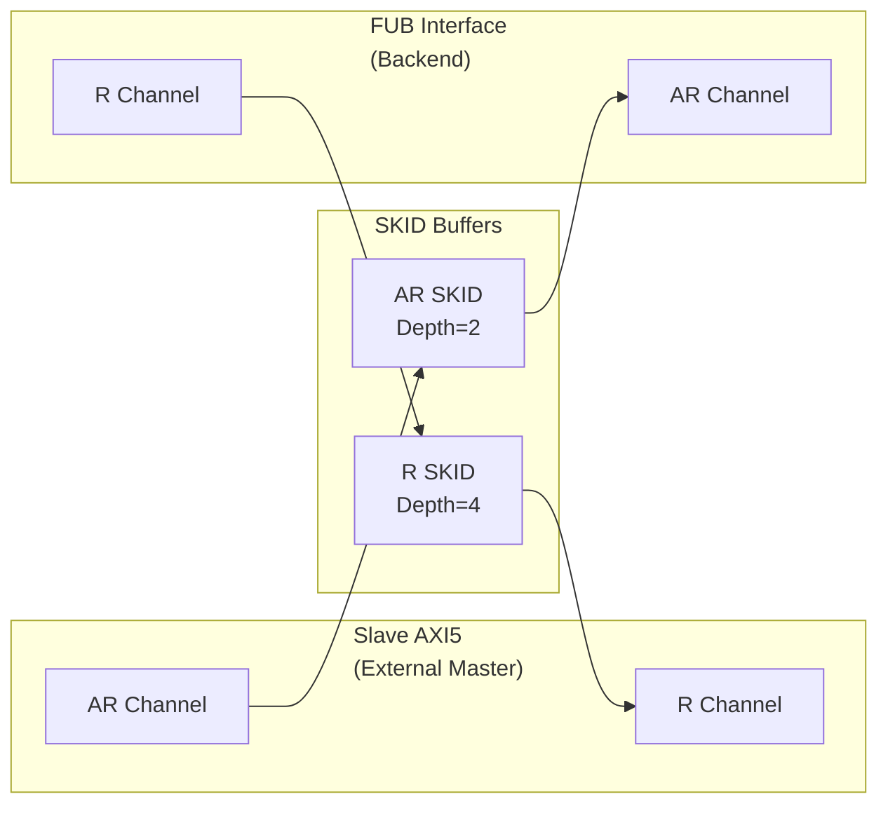

<!-- RTL Design Sherpa Documentation Header -->
<table>
<tr>
<td width="80">
  <a href="https://github.com/sean-galloway/RTLDesignSherpa">
    
  </a>
</td>
<td>
  <strong>RTL Design Sherpa</strong> · <em>Learning Hardware Design Through Practice</em><br>
  <sub>
    <a href="https://github.com/sean-galloway/RTLDesignSherpa">GitHub</a> ·
    <a href="https://github.com/sean-galloway/RTLDesignSherpa/blob/main/docs/DOCUMENTATION_INDEX.md">Documentation Index</a> ·
    <a href="https://github.com/sean-galloway/RTLDesignSherpa/blob/main/LICENSE">MIT License</a>
  </sub>
</td>
</tr>
</table>

---

<!-- End Header -->

# AXI5 Slave Read

**Module:** `axi5_slave_rd.sv`
**Location:** `rtl/amba/axi5/`
**Status:** Production Ready

---

## Overview

The AXI5 Slave Read module is the slave-side AR/R channel transport block. It receives read requests from an external AXI5 master and forwards them, with the full AXI5 sideband signal set intact, to backend memory or logic on the FUB (Functional Unit Block) interface.

**Scope:** this module transports AXI5 signals; it does not implement AXI5 transaction semantics. It performs no MTE tag checking, no chunk reassembly, no poison generation, and no outstanding-transaction tracking. Those behaviors belong to the endpoints on either side. See [Scope of This Implementation](README.md) in the AXI5 index for the full coverage statement.

### Key Features

- Carries the full AXI5 signal set listed below, unmodified, across the SKID buffers
- **ARNSAID:** Non-secure access identifier reception
- **ARTRACE:** Trace signal support
- **ARMPAM:** Memory Partitioning and Monitoring reception
- **ARMECID:** Memory Encryption Context ID reception
- **ARIDUNQ / RIDUNQ:** Unique ID indicator on the request and on every read data beat (IHI 0022L §A5.2)
- **ARCHUNKEN:** Chunking enable reception
- **ARTAGOP:** Memory tag operation reception (MTE)
- **RTRACE/RPOISON:** Response extensions
- **RCHUNKV/RCHUNKNUM/RCHUNKSTRB:** Chunking support
- **RTAG:** Memory tags returned with read data (MTE)
- SKID buffering for AR and R channels
- Busy signal for power management

### Module Architecture



---

## Parameters

| Parameter | Type | Default | Description |
|-----------|------|---------|-------------|
| SKID_DEPTH_AR | int | 2 | AR channel SKID buffer depth (legal range 2..8 inclusive, any integer) |
| SKID_DEPTH_R | int | 4 | R channel SKID buffer depth (legal range 2..8 inclusive, any integer) |
| AXI_ID_WIDTH | int | 8 | Transaction ID width |
| AXI_ADDR_WIDTH | int | 32 | Address bus width |
| AXI_DATA_WIDTH | int | 32 | Data bus width |
| AXI_USER_WIDTH | int | 1 | User signal width |
| AXI_NSAID_WIDTH | int | 4 | Non-secure access ID width |
| AXI_MPAM_WIDTH | int | 11 | MPAM width |
| AXI_MECID_WIDTH | int | 16 | Memory encryption context width |
| AXI_TAG_WIDTH | int | 4 | Memory tag width per 16 bytes |
| AXI_TAGOP_WIDTH | int | 2 | Tag operation width |
| AXI_CHUNKNUM_WIDTH | int | 4 | Chunk number width |
| ENABLE_NSAID | bit | 1 | Enable non-secure access ID |
| ENABLE_TRACE | bit | 1 | Enable trace signals |
| ENABLE_MPAM | bit | 1 | Enable memory partitioning |
| ENABLE_MECID | bit | 1 | Enable memory encryption |
| ENABLE_UNIQUE | bit | 1 | Enable the unique ID indicator (AxIDUNQ, and BIDUNQ/RIDUNQ on the responses) |
| ENABLE_CHUNKING | bit | 1 | Enable data chunking |
| ENABLE_MTE | bit | 1 | Enable Memory Tagging Extension |
| ENABLE_POISON | bit | 1 | Enable poison indicator |
| ENABLE_WAKEUP | bit | 1 | Enable AWAKEUP (IHI 0022L §A14.1.1); 0 ties the output low |

### Derived Parameters

These are computed inside the module from the parameters above. Do not override them.

| Parameter | Expression | Description |
|-----------|------------|-------------|
| NUM_TAGS | max(AXI_DATA_WIDTH / 128, 1) | MTE tags carried per beat (one tag per 16 bytes) |
| TW | AXI_TAG_WIDTH * NUM_TAGS | Total width of the `rtag` field |
| CHUNK_STRB_WIDTH | max(AXI_DATA_WIDTH / 128, 1) | Width of `rchunkstrb`, one bit per 128-bit granule |
| ARSize | Sum of the enabled AR fields | AR SKID buffer payload width |
| RSize | Sum of the enabled R fields | R SKID buffer payload width |

**Note on AXI_WSTRB_WIDTH:** this module declares `AXI_WSTRB_WIDTH` (default `AXI_DATA_WIDTH/8`) and its short alias `SW`, but neither is used. A read module has no W channel and therefore no write strobes. The parameter is retained only so the read and write module parameter lists line up; overriding it has no effect.

---

## Ports

### Clock and Reset

| Port | Width | Direction | Description |
|------|-------|-----------|-------------|
| aclk | 1 | Input | AXI clock |
| aresetn | 1 | Input | AXI active-low reset |

### Slave AXI5 Interface (External Master Input)

#### AR Channel (Input)

| Port | Width | Direction | Description |
|------|-------|-----------|-------------|
| s_axi_arid | IW | Input | Read address ID |
| s_axi_araddr | AW | Input | Read address |
| s_axi_arlen | 8 | Input | Burst length |
| s_axi_arsize | 3 | Input | Burst size |
| s_axi_arburst | 2 | Input | Burst type |
| s_axi_arlock | 1 | Input | Lock type |
| s_axi_arcache | 4 | Input | Cache attributes |
| s_axi_arprot | 3 | Input | Protection attributes |
| s_axi_arqos | 4 | Input | Quality of Service |
| s_axi_aruser | UW | Input | User-defined signal |
| s_axi_arvalid | 1 | Input | Read address valid |
| s_axi_awakeup | 1 | Input | Wake-up request, AWAKEUP (IHI 0022L §A14.1.1; `ENABLE_WAKEUP`) |
| s_axi_arready | 1 | Output | Read address ready |
| s_axi_arnsaid | AXI_NSAID_WIDTH | Input | Non-secure access ID (AXI5) |
| s_axi_artrace | 1 | Input | Trace signal (AXI5) |
| s_axi_armpam | AXI_MPAM_WIDTH | Input | Memory partitioning (AXI5) |
| s_axi_armecid | AXI_MECID_WIDTH | Input | Memory encryption context (AXI5) |
| s_axi_aridunq | 1 | Input | Unique ID indicator, ARIDUNQ (IHI 0022L §A5.2; `ENABLE_UNIQUE`) |
| s_axi_archunken | 1 | Input | Chunking enable (AXI5) |
| s_axi_artagop | AXI_TAGOP_WIDTH | Input | Tag operation (AXI5 MTE) |

#### R Channel (Output)

| Port | Width | Direction | Description |
|------|-------|-----------|-------------|
| s_axi_rid | IW | Output | Read data ID |
| s_axi_rdata | DW | Output | Read data |
| s_axi_rresp | 2 | Output | Read response |
| s_axi_rlast | 1 | Output | Last transfer in burst |
| s_axi_ruser | UW | Output | User-defined signal |
| s_axi_rvalid | 1 | Output | Read data valid |
| s_axi_rready | 1 | Input | Read data ready |
| s_axi_rtrace | 1 | Output | Trace signal (AXI5) |
| s_axi_ridunq | 1 | Output | Unique ID indicator on every read data beat, RIDUNQ (IHI 0022L §A5.2; `ENABLE_UNIQUE`) |
| s_axi_rpoison | 1 | Output | Data poison indicator (AXI5) |
| s_axi_rchunkv | 1 | Output | Chunk valid (AXI5) |
| s_axi_rchunknum | AXI_CHUNKNUM_WIDTH | Output | Chunk number (AXI5) |
| s_axi_rchunkstrb | CHUNK_STRB_WIDTH | Output | Chunk strobe (AXI5) |
| s_axi_rtag | TW | Output | Memory tags (AXI5 MTE) |

### FUB Interface (Backend Memory/Logic Output)

Same signals as slave interface but with `fub_axi_*` prefix and reversed directions for AR (output) and R (input).

### Status Outputs

| Port | Width | Direction | Description |
|------|-------|-----------|-------------|
| busy | 1 | Output | Module busy indicator |

---

## Functional Description

This slave module acts as an adapter between:
- **External AXI5 master** (s_axi_* interface)
- **Backend memory or functional unit block** (fub_axi_* interface)

**Signal Flow:**
1. AR channel: External master → SKID → Backend
2. R channel: Backend → SKID → External master

**SKID Buffering:** Provides elasticity and breaks combinational paths for timing closure.

---

## Timing Characteristics

### Basic Read Transaction

> **Timing diagram pending.** The signals and sequence this scenario
> exercises:
>
> - ACLK
> - S_AXI_ARID, S_AXI_ARADDR, S_AXI_ARVALID, S_AXI_ARREADY
> - FUB_AXI_ARVALID, FUB_AXI_ARREADY (request forwarded to the backend)
> - FUB_AXI_RDATA, FUB_AXI_RVALID, FUB_AXI_RREADY
> - S_AXI_RDATA, S_AXI_RLAST, S_AXI_RVALID, S_AXI_RREADY

---

## Usage Examples
```systemverilog
axi5_slave_rd #(
    .AXI_ID_WIDTH       (8),
    .AXI_ADDR_WIDTH     (32),
    .AXI_DATA_WIDTH     (64),
    .SKID_DEPTH_AR      (2),
    .SKID_DEPTH_R       (4),
    .ENABLE_NSAID       (1),
    .ENABLE_TRACE       (1),
    .ENABLE_MPAM        (1),
    .ENABLE_MECID       (1),
    .ENABLE_UNIQUE      (1),
    .ENABLE_CHUNKING    (1),
    .ENABLE_MTE         (1),
    .ENABLE_POISON      (1)
) u_axi5_slave_rd (
    .aclk               (axi_clk),
    .aresetn            (axi_rst_n),

    // Slave interface (from external master)
    .s_axi_arid         (s_axi_arid),
    .s_axi_araddr       (s_axi_araddr),
    .s_axi_arlen        (s_axi_arlen),
    // Every remaining s_axi_ar* port mirrors the fub_axi_ar* list. All must be connected.
    .s_axi_arnsaid      (s_axi_arnsaid),
    .s_axi_artrace      (s_axi_artrace),
    // ... (connect AXI5 extensions)

    .s_axi_rid          (s_axi_rid),
    .s_axi_rdata        (s_axi_rdata),
    // Every remaining s_axi_r* port mirrors the fub_axi_r* list. All must be connected.

    // FUB interface (to backend)
    .fub_axi_arid       (mem_arid),
    .fub_axi_araddr     (mem_araddr),
    // ... (connect to memory controller)

    .busy               (slave_rd_busy)
);
```

---

## Design Notes

- Use when you need AXI5 slave functionality with SKID buffering
- Backend FUB interface can connect to memory controller, SRAM, or functional units
- SKID buffers improve timing by breaking long combinational paths
- Feature enables allow area optimization by disabling unused AXI5 extensions

---

## Related Modules

- **[AXI5 Slave Write](axi5_slave_wr.md)** - Slave write interface
- **[AXI5 Master Read](axi5_master_rd.md)** - Master read interface
- **[AXI5 Slave Read CG](axi5_slave_rd_cg.md)** - Clock-gated variant
- **[AXI5 Slave Read Monitor](../axi5/axi5_slave_rd_mon.md)** - With integrated monitoring

---

## Testing

`val/amba/test_axi5_slave_rd.py` exercises this module. It collects 8 parameter cases at the default `REG_LEVEL`.

```bash
source env_python
pytest val/amba/test_axi5_slave_rd.py -v
```

## References

- Arm. *AMBA AXI Protocol Specification*, ARM IHI 0022, Issue L, Aug. 2025. [developer.arm.com/documentation/ihi0022/latest](https://developer.arm.com/documentation/ihi0022/latest/) -- §A2.3.1 "Valid-Ready signals", §A2.3.2 "Dependencies between channel handshake signals" and §A2.5 "Pipelining and register stages" (the transport this module buffers per channel), and the AXI5 signals it carries unchanged: §A5.6.2 "Read data chunking" (ARCHUNKEN, RCHUNKV/NUM/STRB), §A16.1 "Data protection using Poison" (RPOISON), §A12.2 "Memory Tagging Extension (MTE)" (ARTAGOP, RTAG), §A5.2 "Unique ID indicator", §A12.3 "Trace signals", §A10.1 "Non-secure Access Identifiers (NSAID)", §A12.1 "Memory System Resource Partitioning and Monitoring (MPAM)" and §A4.6 "Memory Encryption Contexts" (ARMECID). The ports follow the specification's names (GitHub #102): there is no RTAGMATCH, the Unique ID indicator is ARIDUNQ with RIDUNQ on every read data beat, and AWAKEUP follows §A14.1.1 "AWAKEUP rules and recommendations".
- Arm. *AMBA AXI and ACE Protocol Specification*, ARM IHI 0022, Issue H, Mar. 2020. [developer.arm.com/documentation/ihi0022/h](https://developer.arm.com/documentation/ihi0022/h/) -- the same AMBA 5 features as first numbered: ch. C1 "AMBA AXI5", §E1.11 "Read data chunking", §E1.15 "Memory tagging", §E2.1 "Poison", §E1.13 "Unique ID indicator". MECID is not in Issue H.
- Carloni, L.P., McMillan, K.L., Sangiovanni-Vincentelli, A.L. "Theory of Latency-Insensitive Design." *IEEE Trans. Computer-Aided Design of Integrated Circuits and Systems*, 20(9), Sept. 2001. DOI: [10.1109/43.945302](https://doi.org/10.1109/43.945302) -- relay stations: a channel can be pipelined by any number of back-pressured stages without changing its behavior, which is why a skid buffer per channel is transparent to both ends.
- Cortadella, J., Kishinevsky, M., Grundmann, B. "Synthesis of Synchronous Elastic Architectures." *Proc. 43rd Design Automation Conference (DAC '06)*, July 2006, pp. 657-662. DOI: [10.1145/1146909.1147077](https://doi.org/10.1145/1146909.1147077) -- the elastic buffer with valid/stop back-pressure, the structure a skid buffer implements.
- Chipressian. *Crack the Hardware Interview: from RTL Designers' Perspective*, Part 2 ch. 2 "Handshake Protocols" (forward and backward register slices) -- textbook treatment of the valid/ready slice (secondary source).
- Indexed in `rtl/amba/references/README.md` (local PDF: `LatencyInsensitiveDesign__Carloni2001.pdf`, `ElasticBuffer__Cortadella2006.pdf`)

---

## Navigation

- **[← Back to AXI5 Index](README.md)**
- **[← Back to rtl-amba Index](../index.md)**
- **[← Back to Main Documentation Index](../../index.md)**
