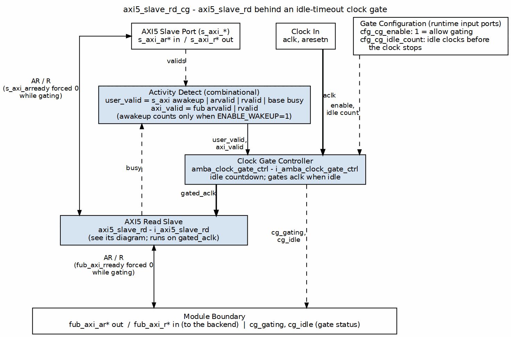

<!-- RTL Design Sherpa Documentation Header -->
<table>
<tr>
<td width="80">
  <a href="https://github.com/sean-galloway/RTLDesignSherpa">
    
  </a>
</td>
<td>
  <strong>RTL Design Sherpa</strong> · <em>Learning Hardware Design Through Practice</em><br>
  <sub>
    <a href="https://github.com/sean-galloway/RTLDesignSherpa">GitHub</a> ·
    <a href="https://github.com/sean-galloway/RTLDesignSherpa/blob/main/docs/DOCUMENTATION_INDEX.md">Documentation Index</a> ·
    <a href="https://github.com/sean-galloway/RTLDesignSherpa/blob/main/LICENSE">MIT License</a>
  </sub>
</td>
</tr>
</table>

---

<!-- End Header -->

# AXI5 Slave Read with Clock Gating

**Module:** `axi5_slave_rd_cg.sv`
**Location:** `rtl/amba/axi5/`
**Status:** Production Ready

---

## Overview

The AXI5 Slave Read with Clock Gating module wraps the standard `axi5_slave_rd` module with integrated clock gating for power optimization. When the module sits idle, the internal clock gates itself off.

**Scope:** this module transports AXI5 signals; it does not implement AXI5 transaction semantics. It performs no MTE tag checking, no chunk reassembly, no poison generation, and no outstanding-transaction tracking. Those behaviors belong to the endpoints on either side. See [Scope of This Implementation](README.md) in the AXI5 index for the full coverage statement.

### Key Features

- Carries the full AXI5 read signal set listed below, unmodified, across the SKID buffers
- **Integrated clock gating** for dynamic power reduction
- Configurable idle count before gating
- All AXI5 extensions supported (NSAID, TRACE, MPAM, MECID, IDUNQ, CHUNKING, MTE, POISON, WAKEUP)
- Transparent gating - no protocol changes
- Gating status outputs for system monitoring
- SKID buffering for AR and R channels
- **Power Savings:** traffic-dependent; unmeasured in this repo -- treat any percentage as a placeholder until characterized

### Module Architecture



The base `axi5_slave_rd` is one box (see its own diagram). The clock is the heavy main column: `aclk` enters `amba_clock_gate_ctrl`, which counts down idle cycles and drives `gated_aclk` into the child. AXI traffic passes straight through; while the clock is gated the wrapper forces the incoming readies to 0 so no handshake is lost. Activity is `s_axi` valids, the child's busy, and `s_axi_awakeup` when `ENABLE_WAKEUP=1`, on the upstream side, plus the `fub_axi` valids.

---

## Parameters

| Parameter | Type | Default | Description |
|-----------|------|---------|-------------|
| SKID_DEPTH_AR | int | 2 | AR channel SKID buffer depth |
| SKID_DEPTH_R | int | 4 | R channel SKID buffer depth |
| AXI_ID_WIDTH | int | 8 | Transaction ID width |
| AXI_ADDR_WIDTH | int | 32 | Address bus width |
| AXI_DATA_WIDTH | int | 32 | Data bus width |
| AXI_USER_WIDTH | int | 1 | User signal width |
| AXI_NSAID_WIDTH | int | 4 | Non-secure access ID width |
| AXI_MPAM_WIDTH | int | 11 | MPAM width |
| AXI_MECID_WIDTH | int | 16 | Memory encryption context width |
| AXI_TAG_WIDTH | int | 4 | Memory tag width per 16 bytes |
| AXI_TAGOP_WIDTH | int | 2 | Tag operation width |
| AXI_CHUNKNUM_WIDTH | int | 4 | Chunk number width |
| ENABLE_NSAID | bit | 1 | Enable non-secure access ID |
| ENABLE_TRACE | bit | 1 | Enable trace signals |
| ENABLE_MPAM | bit | 1 | Enable memory partitioning |
| ENABLE_MECID | bit | 1 | Enable memory encryption |
| ENABLE_UNIQUE | bit | 1 | Enable the unique ID indicator (AxIDUNQ, and BIDUNQ/RIDUNQ on the responses) |
| ENABLE_CHUNKING | bit | 1 | Enable data chunking |
| ENABLE_MTE | bit | 1 | Enable Memory Tagging Extension |
| ENABLE_POISON | bit | 1 | Enable poison indicator |
| ENABLE_WAKEUP | bit | 1 | Enable AWAKEUP (IHI 0022L §A14.1.1); 0 ties the output low |
| CG_IDLE_COUNT_WIDTH | int | 4 | Clock gating idle counter width |

### Derived Parameters

These are computed inside the module from the parameters above. Do not override them.

| Parameter | Expression | Description |
|-----------|------------|-------------|
| NUM_TAGS | max(AXI_DATA_WIDTH / 128, 1) | MTE tags carried per beat (one tag per 16 bytes) |
| TW | AXI_TAG_WIDTH * NUM_TAGS | Total width of the `rtag` field |
| CHUNK_STRB_WIDTH | max(AXI_DATA_WIDTH / 128, 1) | Width of `rchunkstrb`, one bit per 128-bit granule |
| ARSize | Sum of the enabled AR fields | AR SKID buffer payload width |
| RSize | Sum of the enabled R fields | R SKID buffer payload width |

**Note on AXI_WSTRB_WIDTH:** this module declares `AXI_WSTRB_WIDTH` (default `AXI_DATA_WIDTH/8`) and its short alias `SW`, but neither is used. A read module has no W channel and therefore no write strobes. The parameter is retained only so the read and write module parameter lists line up; overriding it has no effect.

---

### Derived Parameters (do not override)

These are declared as `parameter` so the elaborator can compute them, not so callers can set them. Each defaults to an expression over the parameters above; overriding one desynchronises it from its source and the design fails to elaborate or silently mis-sizes a bus. Set the parameters they are derived FROM and leave these alone.

| Derived parameter | Default expression |
|---|---|
| `AW` | `AXI_ADDR_WIDTH` |
| `DW` | `AXI_DATA_WIDTH` |
| `IW` | `AXI_ID_WIDTH` |
| `UW` | `AXI_USER_WIDTH` |

## Ports

### Clock and Reset

| Port | Width | Direction | Description |
|------|-------|-----------|-------------|
| aclk | 1 | Input | AXI clock (ungated) |
| aresetn | 1 | Input | AXI active-low reset |

### Clock Gating Configuration

| Port | Width | Direction | Description |
|------|-------|-----------|-------------|
| cfg_cg_enable | 1 | Input | Enable clock gating |
| cfg_cg_idle_count | CG_IDLE_COUNT_WIDTH | Input | Idle cycles before gating |

### Slave AXI5 Interface

Same as `axi5_slave_rd` - see [AXI5 Slave Read](axi5_slave_rd.md) for complete port list.

### FUB Interface

Same as `axi5_slave_rd` - see [AXI5 Slave Read](axi5_slave_rd.md) for complete port list.

### Clock Gating Status

| Port | Width | Direction | Description |
|------|-------|-----------|-------------|
| cg_gating | 1 | Output | Clock is currently gated |
| cg_idle | 1 | Output | Module is idle |

---

## Functional Description

### Clock Gating Behavior

**Activity Detection:**
- **user_valid:** Asserted when slave interface has activity (AWAKEUP, arvalid, rvalid, or internal busy -- peer VALID, post-fix)
- **axi_valid:** Asserted when FUB interface has activity (arvalid, rvalid)

**Gating State Machine:**
```mermaid
stateDiagram-v2
    [*] --> ACTIVE

    ACTIVE --> COUNTING : !user_valid && !axi_valid
    COUNTING --> ACTIVE : user_valid || axi_valid
    COUNTING --> GATED : count == cfg_cg_idle_count
    GATED --> ACTIVE : user_valid || axi_valid

    state ACTIVE {
        note right of ACTIVE : Clock enabled<br/>cg_gating = 0
    }
    state COUNTING {
        note right of COUNTING : Idle countdown<br/>cg_gating = 0
    }
    state GATED {
        note right of GATED : Clock gated<br/>cg_gating = 1
    }
```

**Key Points:**
- Clock gating disabled when `cfg_cg_enable = 0`
- Ready signals forced to 0 when gated (prevents new transactions)
- Gating only occurs after configured idle period
- Any activity immediately ungates the clock

### Ready Deassertion and Wake Behavior

While `cg_gating` is asserted, the ready outputs listed above are forced low.

This is legal AXI. A READY output may be deasserted for any number of cycles, and neither side may assume READY asserts within a bounded time, so holding it low is ordinary backpressure rather than a protocol violation. It cannot deadlock either: the same VALID being held off also feeds the activity detector, so gating releases and READY returns to the core's value.

Two consequences are worth designing around:

- **Wake latency adds to first-transfer latency.** Activity is registered once (AXI4, AXI5, AXI4-Lite, AXI4-Stream) or twice (APB, APB5, AXI5-Stream -- with one exception: `apb4_slave_cdc_cg` drives `amba_clock_gate_ctrl` combinationally and so registers once, not twice) before reaching the ICG enable, which is combinational. The AXI5 `_cg` wrappers drive the activity terms combinationally, so there is 1 register stage and the first usable gated-clock edge arrives 2 cycles after activity asserts. Size `cfg_cg_idle_count` so that cost is amortized over the traffic burst that follows.
- **READY is a combinational function of `cg_gating`.** The path from the idle counter to the `s_axi_arready` output may need attention during timing closure, particularly at high frequency.

### Integration Caveat: `s_axi_rready` in the Activity Term

The activity detector uses the corresponding VALID (`s_axi_rvalid`), never the peer's READY. (Historically this term was `s_axi_rready`, which meant a peer parking its ready high -- a common and entirely correct style -- pinned the block permanently awake and defeated gating; that defect was fixed family-wide, matching the rule the mon_cg wrappers always carried.)

An always-ready consumer no longer prevents gating.

### Clock Gating Configuration

#### Idle Count Selection

| cfg_cg_idle_count | Idle Cycles | Use Case |
|-------------------|-------------|----------|
| 0 | 1 | Aggressive power saving, frequent gating |
| 1-3 | 2-4 | Balanced, reduces gate churn |
| 4-7 | 5-8 | Conservative, for bursty traffic |
| 8-15 | 9-16 | Minimal gating (the 4-bit field maxes at 16 cycles -- the count is LITERAL, gating at count+1, not a power of two) |

**Recommendations:**
- **Streaming workloads:** Higher count (4-8) to avoid frequent gate/ungate
- **Sporadic transactions:** Lower count (0-2) for maximum power savings
- **Real-time systems:** Disable gating or use high count to ensure deterministic latency

---

## Timing Characteristics

### Clock Gating Sequence

> **Timing diagram pending.** The signals and sequence this scenario
> exercises:
>
> - ACLK (ungated)
> - GATED_ACLK
> - user_valid, axi_valid activity terms
> - Idle counter progression
> - cg_idle assertion
> - cg_gating activation

---

## Usage Examples
```systemverilog
axi5_slave_rd_cg #(
    .AXI_ID_WIDTH       (8),
    .AXI_ADDR_WIDTH     (32),
    .AXI_DATA_WIDTH     (64),
    .SKID_DEPTH_AR      (2),
    .SKID_DEPTH_R       (4),
    .CG_IDLE_COUNT_WIDTH(4),
    .ENABLE_NSAID       (1),
    .ENABLE_TRACE       (1),
    .ENABLE_MPAM        (1),
    .ENABLE_MECID       (1),
    .ENABLE_UNIQUE      (1),
    .ENABLE_CHUNKING    (1),
    .ENABLE_MTE         (1),
    .ENABLE_POISON      (1)
) u_axi5_slave_rd_cg (
    .aclk               (axi_clk),
    .aresetn            (axi_rst_n),

    // Clock gating config
    .cfg_cg_enable      (1'b1),          // Enable gating
    .cfg_cg_idle_count  (4'd3),          // Gate after 4 idle cycles (count+1; a LITERAL count, not a power of two)

    // Slave interface (from external master)
    .s_axi_arid         (s_axi_arid),
    .s_axi_araddr       (s_axi_araddr),
    // Every remaining s_axi_ar*/s_axi_r* port mirrors the fub_axi_* list,
    // same names and widths, opposite directions. All must be connected.

    // FUB interface (to backend)
    .fub_axi_arid       (mem_arid),
    .fub_axi_araddr     (mem_araddr),
    // ... (connect to memory controller)

    // Clock gating status
    .cg_gating          (slave_rd_gating),
    .cg_idle            (slave_rd_idle)
);

// Optional: Monitor power savings
always @(posedge axi_clk) begin
    if (slave_rd_gating)
        $display("AXI5 Slave RD clock gated - saving power");
end
```

---

## Design Notes

### Power Savings Estimation

Worked example, assuming the module is active 60% of the time:
- **Without gating:** 100% of this module's dynamic power
- **With gating (idle_count=2):** roughly 50%, allowing for wake/sleep transitions
- **With gating (idle_count=0):** roughly 60%; more aggressive gating, but more transition overhead

All power figures on this page are first-order estimates derived from duty cycle, not measured results. No power analysis (gate-level or otherwise) has been run against these modules. Actual savings depend on the gated logic's share of total design power, the technology library's clock-gate cell, and leakage, which clock gating does not reduce at all. Treat these numbers as a sizing aid and characterize your own instance before quoting a savings figure.

### Clock Gating Overhead

- **Area:** +5 flops, counted from the RTL -- `r_wakeup` in
  `amba_clock_gate_ctrl` plus `r_idle_counter` at `IDLE_CNTR_WIDTH`
  (default 4), scaling as 1 + `CG_IDLE_COUNT_WIDTH`. Against a base
  module of a few hundred flops that is low single-digit percent. The
  ICG itself is a latch/BUFGCE, not fabric flops; the LUT delta is not
  measured
- **Timing:** Clock gating adds minimal delay (typically <50ps)
- **Power:** Overhead from gate control logic usually <1% of savings

### When to Use Clock Gating

**Good candidates:**
- Low-duty-cycle interfaces (sporadic transactions)
- Systems with strict power budgets
- Battery-operated devices

**Avoid when:**
- Interface is continuously active
- Gate/ungate transitions exceed power savings
- Deterministic latency required (use high idle count instead)

### Integration with Power Management

```systemverilog
// System power controller
assign axi_power_save_mode = slave_rd_gating &&
                             slave_wr_gating &&
                             master_rd_gating;

// Optional: Track gating efficiency
always @(posedge axi_clk or negedge aresetn) begin
    if (!aresetn) begin
        gating_cycles <= 0;
        total_cycles <= 0;
    end else begin
        total_cycles <= total_cycles + 1;
        if (slave_rd_gating)
            gating_cycles <= gating_cycles + 1;
    end
end

assign gating_efficiency = (gating_cycles * 100) / total_cycles;
```

---

## Related Modules

- **[AXI5 Slave Read](axi5_slave_rd.md)** - Non-clock-gated version
- **[AXI5 Slave Write CG](axi5_slave_wr_cg.md)** - Clock-gated write variant
- **[AXI5 Slave Read Monitor CG](../axi5/axi5_slave_rd_mon_cg.md)** - With monitoring
- **[AMBA Clock Gate Control](../shared/amba_clock_gate_ctrl.md)** - Clock gating controller

---

## Testing

`val/amba/test_axi5_slave_rd_cg.py` exercises this module. It collects 3 parameter cases at the default `REG_LEVEL`.

```bash
source env_python
pytest val/amba/test_axi5_slave_rd_cg.py -v
```

## References

- Arm. *AMBA AXI Protocol Specification*, ARM IHI 0022, Issue L, Aug. 2025. [developer.arm.com/documentation/ihi0022/latest](https://developer.arm.com/documentation/ihi0022/latest/) -- §A2.3.1 "Valid-Ready signals", §A2.3.2 "Dependencies between channel handshake signals" and §A2.5 "Pipelining and register stages" (the transport this module buffers per channel), and the AXI5 signals it carries unchanged: §A5.6.2 "Read data chunking" (ARCHUNKEN, RCHUNKV/NUM/STRB), §A16.1 "Data protection using Poison" (RPOISON), §A12.2 "Memory Tagging Extension (MTE)" (ARTAGOP, RTAG), §A5.2 "Unique ID indicator", §A12.3 "Trace signals", §A10.1 "Non-secure Access Identifiers (NSAID)", §A12.1 "Memory System Resource Partitioning and Monitoring (MPAM)" and §A4.6 "Memory Encryption Contexts" (ARMECID). The ports follow the specification's names (GitHub #102): there is no RTAGMATCH, the Unique ID indicator is ARIDUNQ with RIDUNQ on every read data beat, and AWAKEUP follows §A14.1.1 "AWAKEUP rules and recommendations".
- Benini, L., De Micheli, G. "Automatic Synthesis of Low-Power Gated-Clock Finite-State Machines." *IEEE Trans. Computer-Aided Design of Integrated Circuits and Systems*, 15(6), June 1996. DOI: [10.1109/43.503933](https://doi.org/10.1109/43.503933) -- the latch-based clock-gating cell (`icg`, via `amba_clock_gate_ctrl` and `clock_gate_ctrl`) that gates this wrapper's clock.
- Benini, L., Bogliolo, A., De Micheli, G. "A Survey of Design Techniques for System-Level Dynamic Power Management." *IEEE Trans. VLSI Systems*, 8(3), June 2000. DOI: [10.1109/92.845896](https://doi.org/10.1109/92.845896) -- fixed-timeout shutdown: gate after `cfg_cg_idle_count` idle cycles, wake on activity.
- Arm. *AMBA AXI Protocol Specification*, ARM IHI 0022, Issue L, Aug. 2025. [developer.arm.com/documentation/ihi0022/latest](https://developer.arm.com/documentation/ihi0022/latest/) -- §A14.1.1 "AWAKEUP rules and recommendations" in Issue L (§E1.7 "Wake-up Signaling" in Issue H) defines AWAKEUP, which lets a manager restart a gated interface before VALID. This wrapper counts AWAKEUP as an activity term (behind `ENABLE_WAKEUP`), so a manager that raises it a cycle ahead of VALID, as §A14.1.1 recommends, finds the clock running and its first request is accepted on the cycle it is presented; a manager that never drives it still wakes the block through the flopped OR of the VALIDs, with READY held low while gated (GitHub #102).
- Indexed in `rtl/amba/references/README.md` (local PDF, archived under `rtl/common/references/`: `LatchBasedClockGating__Benini1996.pdf`, `DynamicPowerManagementTimeout__Benini2000.pdf`)

---

## Navigation

- **[← Back to AXI5 Index](README.md)**
- **[← Back to rtl-amba Index](../index.md)**
- **[← Back to Main Documentation Index](../../index.md)**
