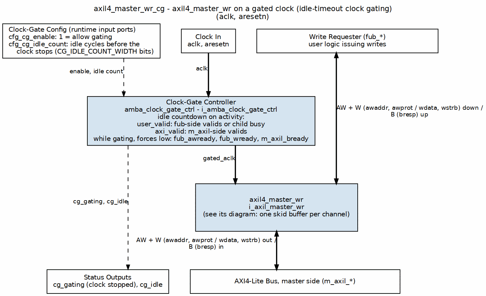

<!-- RTL Design Sherpa Documentation Header -->
<table>
<tr>
<td width="80">
  <a href="https://github.com/sean-galloway/RTLDesignSherpa">
    
  </a>
</td>
<td>
  <strong>RTL Design Sherpa</strong> · <em>Learning Hardware Design Through Practice</em><br>
  <sub>
    <a href="https://github.com/sean-galloway/RTLDesignSherpa">GitHub</a> ·
    <a href="https://github.com/sean-galloway/RTLDesignSherpa/blob/main/docs/DOCUMENTATION_INDEX.md">Documentation Index</a> ·
    <a href="https://github.com/sean-galloway/RTLDesignSherpa/blob/main/LICENSE">MIT License</a>
  </sub>
</td>
</tr>
</table>

---

<!-- End Header -->

# AXIL4 Master Write Interface (Clock-Gated)

**Module:** `axil4_master_wr_cg.sv`
**Base Module:** [axil4_master_wr](./axil4_master_wr.md)
**Location:** `rtl/amba/axil4/`
**Status:** Production Ready

---

## Overview

This is the **clock-gated variant** of [axil4_master_wr](./axil4_master_wr.md).

**For complete clock-gating documentation, usage examples, and configuration guidelines, see:**

**→ [AXIL4 Clock-Gated Variants Guide](./axil4_clock_gating_guide.md)** (AXIL4-specific)

**→ [Clock-Gated Variants Guide](../shared/clock_gated_variants.md)** (cross-protocol overview)

What the wrapper adds over the base module:

- **Same Functionality:** 100% equivalent to base module
- **Power Savings:** dynamic clock power in the gated block scales with idle
  fraction; see the [AXIL4 Clock-Gated Variants Guide](./axil4_clock_gating_guide.md)
  for the estimate table and its caveats
- **Configurable:** idle threshold and enable, both at **runtime** via
  `cfg_cg_idle_count` / `cfg_cg_enable`
- **Zero Overhead When Disabled:** `cfg_cg_enable = 0` holds the clock
  free-running, making behavior identical to the base module

---

## Parameters

In addition to all [axil4_master_wr](./axil4_master_wr.md) parameters:

The `_cg` wrapper adds exactly **one** parameter. Gating is enabled and tuned
at runtime through ports, not through parameters — there is no
`ENABLE_CLOCK_GATING` parameter, no `CG_IDLE_CYCLES` parameter, and no
per-domain `CG_GATE_*` parameters on this module.

| Parameter | Type | Default | Description |
|-----------|------|---------|-------------|
| `CG_IDLE_COUNT_WIDTH` | int | 4 | Width of the idle counter; max idle count = 2^N - 1 |

### Derived Parameters (do not override)

These are declared as `parameter` so the elaborator can compute them, not so callers can set them. Each defaults to an expression over the parameters above; overriding one desynchronises it from its source and the design fails to elaborate or silently mis-sizes a bus. Set the parameters they are derived FROM and leave these alone.

| Derived parameter | Default expression |
|---|---|
| `AW` | `AXIL_ADDR_WIDTH` |
| `DW` | `AXIL_DATA_WIDTH` |

**Data width is checked at elaboration.** `AXIL_DATA_WIDTH` must be 32 or 64 (IHI 0022H §B1.1.2); any other value stops the build in the module's `param_check` block, the elaboration-time guard form described in `vault/handbook/design/no-assertions-in-rtl.md`. `val/amba/test_axil_param_guard.py` checks it.

---

## Ports

| Port | Direction | Width | Description |
|------|-----------|-------|-------------|
| `cfg_cg_enable` | Input | 1 | Enable clock gating (0 = clock always running) |
| `cfg_cg_idle_count` | Input | CG_IDLE_COUNT_WIDTH | Idle cycles before gating |
| `cg_gating` | Output | 1 | Clock currently gated |
| `cg_idle` | Output | 1 | No activity on the previous cycle |

The base module's `busy` output is **not** exposed on the `_cg` wrapper; it is
consumed internally as a wakeup term. All other ports are identical to
`axil4_master_wr`.

---

## Usage Examples
```systemverilog
axil4_master_wr_cg #(
    // Base module parameters (see axil4_master_wr.md)
    .AXIL_ADDR_WIDTH(32),
    .AXIL_DATA_WIDTH(32),
    .SKID_DEPTH_AW(2),
    .SKID_DEPTH_W(2),
    .SKID_DEPTH_B(2),

    // Clock gating (see CG guide for details)
    .CG_IDLE_COUNT_WIDTH(4)
) u_cg (
    .aclk(clk),
    .aresetn(rst_n),

    // Clock gating control (runtime, not parameters)
    .cfg_cg_enable(1'b1),
    .cfg_cg_idle_count(4'd5),

    // ... all other ports same as axil4_master_wr, except `busy`,
    // which is replaced by cg_gating / cg_idle
    .cg_gating(clk_gated),
    .cg_idle(if_idle)
);
```

---

## Functional Description

### Block diagram



The core `axil4_master_wr` is one box here; its own diagram shows the skid buffers. `amba_clock_gate_ctrl` watches activity on both sides and, once nothing has moved for `cfg_cg_idle_count` cycles with `cfg_cg_enable` set, stops the clock it feeds the core (`gated_aclk`, the heavy clock column). While the clock is stopped the wrapper forces the outward readies low so no handshake completes against a frozen core. `cg_gating` and `cg_idle` report the state.

This wrapper is the base module plus one `amba_clock_gate_ctrl` instance. The
transport datapath is untouched -- every channel signal is forwarded verbatim
-- so functional behaviour is identical to `axil4_master_wr` and the wrapper adds no
latency of its own.

What it adds is a gated clock. `amba_clock_gate_ctrl` watches two activity
terms, `user_valid` (upstream valids plus the base module's `busy`) and
`axi_valid` (downstream valids), registers their OR into `r_wakeup`, and stops
the inner module's clock once both have been quiet for `cfg_cg_idle_count`
cycles. The clock restarts on the next activity, one cycle later.

While the clock is stopped the wrapper masks its outward-facing READY signals
with `!cg_gating`, so an upstream master sees no acceptance until the clock is
running again and no handshake is lost across the wake boundary.

`cfg_cg_enable` arms this behaviour; with it low the clock free-runs and the
module is indistinguishable from its base.

---

## Timing Characteristics

### Buffer Depths and Latency

| Parameter | Default | Channel |
|-----------|---------|---------|
| `SKID_DEPTH_AW` | 2 entries | Skid depth on the AW channel |
| `SKID_DEPTH_W` | 2 entries | Skid depth on the W channel |
| `SKID_DEPTH_B` | 2 entries | Skid depth on the B channel |

Each channel traverses one `gaxi_skid_buffer`. That module registers both
`rd_valid` and the storage array, so the **1-cycle input-to-output latency
applies on every transfer, including the unstalled case** -- there is no
combinational bypass from the upstream payload to the downstream one. Full
throughput (one transfer per cycle) is still sustained once the pipeline is
primed; the depth sets how much backpressure can be absorbed before it
propagates upstream, not the steady-state rate.

Legal depth range is 2..8 inclusive, odd values included.

---

## Design Notes

**A peer's READY must never enter the activity term.** A consumer that parks
its response-ready high while idle is behaving correctly; folding that into
`user_valid` pins this block permanently awake and defeats gating entirely --
silently, because function is unaffected. This wrapper wakes on VALIDs and
pending work only. `val/amba/test_cg_peer_ready.py` parks the peer READY high,
holds every VALID low, and requires `cg_gating`. Canonical rule:
`vault/handbook/design/clock-gating-activity-terms.md`.

**`cfg_cg_enable` is not a kill switch.** It arms gating and reaches
`amba_clock_gate_ctrl` only; `cfg_monitor_enable` and the datapath are
forwarded untouched. With it low the clock free-runs and this module behaves
exactly like its base.

**Gating latency.** The clock stops `cfg_cg_idle_count` + 2 cycles after the
last bus activity -- the counter, plus one for the `r_wakeup` flop. Budget the
idle count against your traffic's inter-burst gap; too small and the block
wakes constantly, too large and it never gates.

---

## Related Modules

- **[axil4_master_wr](./axil4_master_wr.md)** - Base module functionality
- **Detailed CG Examples:**
  - [axi4_master_rd_mon_cg.md](../axi4/axi4_master_rd_mon_cg.md) (AXI4 monitor)
  - [axil4_master_rd_mon_cg.md](../axil4/axil4_master_rd_mon_cg.md) (AXIL4 monitor)
  - [apb4_slave_cg.md](../apb4/apb4_slave_cg.md) (APB interface)

---

## References

- Arm. *AMBA AXI and ACE Protocol Specification*, ARM IHI 0022, Issue H, 2020. [developer.arm.com/documentation/ihi0022/h](https://developer.arm.com/documentation/ihi0022/h) -- Part B ch. B1 "AMBA AXI4-Lite": §B1.1 (one beat per transaction at full bus width), §B1.1.2 data bus width 32 or 64 (enforced by the `param_check` guard), §B1.1.3 write strobes, §B1.1.4 no IDs so every transaction is in order; AxPROT in §A4.7. §A3.2.1 "Handshake process" and §A3.3.1 "Dependencies between channel handshake signals" govern the AW, W and B channels; §A1.2.3 "Register slices" permits the per-channel skid stage. Issue H is the last issue that defines AXI4-Lite.
- Benini, L., Bogliolo, A., De Micheli, G. "A Survey of Design Techniques for System-Level Dynamic Power Management." *IEEE Trans. VLSI Systems*, 8(3), June 2000. DOI: [10.1109/92.845896](https://doi.org/10.1109/92.845896) -- fixed-timeout shutdown: gate after `cfg_cg_idle_count` idle cycles, wake on any VALID.
- Benini, L., De Micheli, G. "Automatic Synthesis of Low-Power Gated-Clock Finite-State Machines." *IEEE Trans. CAD*, 15(6), June 1996. DOI: [10.1109/43.503933](https://doi.org/10.1109/43.503933) -- the latch-based glitch-free clock gate under `clock_gate_ctrl`.
- Roy, S. *Advanced Digital System Design*, Springer, 2024, ch. 15 "Low-Power Digital System Design", §15.5.5 "Logic Level Power Down" -- textbook treatment of disabling the clock to idle units (secondary source).
- Indexed in `rtl/amba/references/README.md`; the clock-gating papers are archived in `rtl/common/references/` (local PDF: `DynamicPowerManagementTimeout__Benini2000.pdf`, `LatchBasedClockGating__Benini1996.pdf`)
- **[axil4_clock_gating_guide.md](./axil4_clock_gating_guide.md)** - AXIL4 Clock Gating Guide
- **[clock_gated_variants.md](../shared/clock_gated_variants.md)** - Cross-Protocol Clock Gating Guide

---

**Last Updated:** 2026-07-19

---

## Testing

`val/amba/test_axil4_master_wr_cg.py` drives this module with the AXI4-Lite BFMs from `TBClasses/axil4`. It collects 1 parameter cases at the default `REG_LEVEL`. Run it with:

```bash
source env_python
pytest val/amba/test_axil4_master_wr_cg.py -v
```

`val/amba/test_cg_peer_ready.py` additionally asserts that this wrapper gates with the peer's READY parked high -- the property the activity term exists to satisfy. See `vault/handbook/design/clock-gating-activity-terms.md`.

---

## Navigation

- **[← Back to AXIL4 Index](./README.md)**
- **[← Back to rtl-amba Index](../index.md)**
- **[← Back to Main Documentation Index](../../index.md)**
