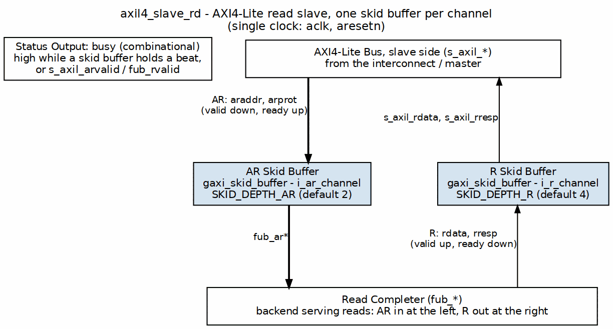

<!-- RTL Design Sherpa Documentation Header -->
<table>
<tr>
<td width="80">
  <a href="https://github.com/sean-galloway/RTLDesignSherpa">
    
  </a>
</td>
<td>
  <strong>RTL Design Sherpa</strong> · <em>Learning Hardware Design Through Practice</em><br>
  <sub>
    <a href="https://github.com/sean-galloway/RTLDesignSherpa">GitHub</a> ·
    <a href="https://github.com/sean-galloway/RTLDesignSherpa/blob/main/docs/DOCUMENTATION_INDEX.md">Documentation Index</a> ·
    <a href="https://github.com/sean-galloway/RTLDesignSherpa/blob/main/LICENSE">MIT License</a>
  </sub>
</td>
</tr>
</table>

---

<!-- End Header -->

# AXIL4 Slave Read

**Module:** `axil4_slave_rd.sv`
**Location:** `rtl/amba/axil4/`
**Status:** Production Ready

---

## Overview

The AXIL4 Slave Read module gives a slave device (memory, peripheral) a buffered AXI4-Lite read interface. It accepts read requests from an interconnect/master and forwards them to backend logic, with elastic buffering for timing closure on both sides.

### Key Features

- **AXI4-Lite Slave:** Buffered read-only interface (AR and R channels)
- **Single-Beat Transactions:** No burst support
- **Elastic Buffering:** Decouples interconnect and backend timing
- **Activity Monitoring:** Busy signal for clock gating
- **Minimal Latency:** 1-cycle buffer overhead per channel

---

## Parameters

| Parameter | Type | Default | Description |
|-----------|------|---------|-------------|
| `AXIL_ADDR_WIDTH` | int | 32 | Address bus width |
| `AXIL_DATA_WIDTH` | int | 32 | Data bus width: 32 or 64 only (IHI 0022H §B1.1.2); checked at elaboration |
| `SKID_DEPTH_AR` | int | 2 | AR channel skid buffer depth, in entries |
| `SKID_DEPTH_R` | int | 4 | R channel skid buffer depth, in entries |

### Derived Parameters (do not override)

These are declared as `parameter` so the elaborator can compute them, not so callers can set them. Each defaults to an expression over the parameters above; overriding one desynchronises it from its source and the design fails to elaborate or silently mis-sizes a bus. Set the parameters they are derived FROM and leave these alone.

| Derived parameter | Default expression |
|---|---|
| `ARSize` | `AW+3` |
| `RSize` | `DW+2` |

**Data width is checked at elaboration.** `AXIL_DATA_WIDTH` must be 32 or 64 (IHI 0022H §B1.1.2); any other value stops the build in the module's `param_check` block, the elaboration-time guard form described in `vault/handbook/design/no-assertions-in-rtl.md`. `val/amba/test_axil_param_guard.py` checks it.

---

## Ports

### Slave Interface (Input Side from Interconnect)

**Read Address Channel (AR):**
| Port | Direction | Width | Description |
|------|-----------|-------|-------------|
| `s_axil_araddr` | Input | AW | Read address (from interconnect) |
| `s_axil_arprot` | Input | 3 | Protection attributes |
| `s_axil_arvalid` | Input | 1 | Address valid |
| `s_axil_arready` | Output | 1 | Address ready (buffer status) |

**Read Data Channel (R):**
| Port | Direction | Width | Description |
|------|-----------|-------|-------------|
| `s_axil_rdata` | Output | DW | Read data (to interconnect) |
| `s_axil_rresp` | Output | 2 | Read response |
| `s_axil_rvalid` | Output | 1 | Data valid |
| `s_axil_rready` | Input | 1 | Data ready |

### Backend Interface (Output Side to Memory/Logic)

**Read Address Channel (AR):**
| Port | Direction | Width | Description |
|------|-----------|-------|-------------|
| `fub_araddr` | Output | AW | Read address (to backend) |
| `fub_arprot` | Output | 3 | Protection attributes |
| `fub_arvalid` | Output | 1 | Address valid |
| `fub_arready` | Input | 1 | Address ready (from backend) |

**Read Data Channel (R):**
| Port | Direction | Width | Description |
|------|-----------|-------|-------------|
| `fub_rdata` | Input | DW | Read data (from backend) |
| `fub_rresp` | Input | 2 | Read response |
| `fub_rvalid` | Input | 1 | Data valid |
| `fub_rready` | Output | 1 | Data ready |

### Status Outputs

| Port | Direction | Width | Description |
|------|-----------|-------|-------------|
| `busy` | Output | 1 | Interface active (for clock gating) |

---

## Functional Description

### Block diagram



The AXI4-Lite bus (`s_axil_*`) sits at the top and the completer backend (`fub_*`) is the bar at the bottom. AR runs down through its `gaxi_skid_buffer` to the bottom, and the R response climbs back up its own lane on the right through another skid buffer, so every channel crosses exactly one buffer. `busy` is a status output that is high while any buffer holds a beat or a new command or response is arriving.

**Signal Flow:** Interconnect → AR Buffer → Backend → R Buffer → Interconnect

The buffering lets the backend respond at its own pace without stalling the interconnect — the whole point of putting skid buffers on both channels.

---

## Usage Examples
```systemverilog
axil4_slave_rd #(
    .AXIL_ADDR_WIDTH(32),
    .AXIL_DATA_WIDTH(32),
    .SKID_DEPTH_AR(2),
    .SKID_DEPTH_R(4)
) u_axil_slave_rd (
    .aclk           (axi_clk),
    .aresetn        (axi_resetn),

    // Slave interface (from interconnect)
    .s_axil_araddr  (interconnect_araddr),
    .s_axil_arprot  (interconnect_arprot),
    .s_axil_arvalid (interconnect_arvalid),
    .s_axil_arready (interconnect_arready),

    .s_axil_rdata   (interconnect_rdata),
    .s_axil_rresp   (interconnect_rresp),
    .s_axil_rvalid  (interconnect_rvalid),
    .s_axil_rready  (interconnect_rready),

    // Backend interface (to memory/peripheral)
    .fub_araddr     (mem_araddr),
    .fub_arprot     (mem_arprot),
    .fub_arvalid    (mem_arvalid),
    .fub_arready    (mem_arready),

    .fub_rdata      (mem_rdata),
    .fub_rresp      (mem_rresp),
    .fub_rvalid     (mem_rvalid),
    .fub_rready     (mem_rready),

    // Status
    .busy           (rd_busy)
);
```

---

## Design Notes

- **Use Case:** Memory controllers, peripheral slaves, register blocks

---

## Timing Characteristics

### Buffer Depths and Latency

| Parameter | Default | Channel |
|-----------|---------|---------|
| `SKID_DEPTH_AR` | 2 entries | Skid depth on the AR channel |
| `SKID_DEPTH_R` | 4 entries | Skid depth on the R channel |

Each channel traverses one `gaxi_skid_buffer`. That module registers both
`rd_valid` and the storage array, so the **1-cycle input-to-output latency
applies on every transfer, including the unstalled case** -- there is no
combinational bypass from the upstream payload to the downstream one. Full
throughput (one transfer per cycle) is still sustained once the pipeline is
primed; the depth sets how much backpressure can be absorbed before it
propagates upstream, not the steady-state rate.

Legal depth range is 2..8 inclusive, odd values included.

---

## Related Modules

- **[axil4_slave_wr](axil4_slave_wr.md)** - Slave write counterpart
- **[axil4_master_rd](axil4_master_rd.md)** - Master read interface
- **[axil4_slave_rd_mon](../axil4/axil4_slave_rd_mon.md)** - Slave read with monitoring (`rtl/amba/ocelus/`)
- **[axil4_slave_rd_cg](axil4_clock_gating_guide.md)** - Clock-gated version

---

**Last Updated:** 2026-07-19

---

## Testing

`val/amba/test_axil4_slave_rd.py` drives this module with the AXI4-Lite BFMs from `TBClasses/axil4`. It collects 3 parameter cases at the default `REG_LEVEL`. Run it with:

```bash
source env_python
pytest val/amba/test_axil4_slave_rd.py -v
```

## References

- Arm. *AMBA AXI and ACE Protocol Specification*, ARM IHI 0022, Issue H, 2020. [developer.arm.com/documentation/ihi0022/h](https://developer.arm.com/documentation/ihi0022/h) -- Part B ch. B1 "AMBA AXI4-Lite": §B1.1 (one beat per transaction at full bus width), §B1.1.2 data bus width 32 or 64 (enforced by the `param_check` guard), §B1.1.3 write strobes, §B1.1.4 no IDs so every transaction is in order; AxPROT in §A4.7. §A3.2.1 "Handshake process" and §A3.3.1 "Dependencies between channel handshake signals" govern the AR and R channels; §A1.2.3 "Register slices" permits the per-channel skid stage. Issue H is the last issue that defines AXI4-Lite.
- Cortadella, J., Kishinevsky, M., Grundmann, B. "Synthesis of Synchronous Elastic Architectures." *Proc. 43rd Design Automation Conf. (DAC '06)*, pp. 657-662, 2006. DOI: [10.1145/1146909.1147077](https://doi.org/10.1145/1146909.1147077) -- the elastic buffer; its Property 3.1 (capacity C >= 2 for full throughput) is the depth-2 floor of each channel's `gaxi_skid_buffer`.
- Carloni, L.P., McMillan, K.L., Sangiovanni-Vincentelli, A.L. "Theory of Latency-Insensitive Design." *IEEE Trans. Computer-Aided Design of Integrated Circuits and Systems*, 20(9), Sept. 2001. DOI: [10.1109/43.945302](https://doi.org/10.1109/43.945302) -- relay stations: storage on a back-pressured channel adds latency without changing function.
- Chipressian. *Crack the Hardware Interview -- from RTL Designers' Perspective: Architecture and Micro-architecture Design*, ch. 2 "Handshake Protocols", Q8 valid-ready protocol and Q9 valid-ready slices -- textbook treatment of register slices (secondary source).
- Bruno, F., Eschemann, G. *The FPGA Programming Handbook*, 2nd ed., Packt, 2024, ch. 8 "Introduction to AXI", §8.3 "AXI4 interfaces (full and AXI-Lite)" -- textbook treatment of the AXI-Lite channel set (secondary source).
- Indexed in `rtl/amba/references/README.md` (local PDF: `ElasticBuffer__Cortadella2006.pdf`)

---

## Navigation

- **[← Back to AXIL4 Index](README.md)**
- **[← Back to rtl-amba Index](../index.md)**
- **[← Back to Main Documentation Index](../../index.md)**
