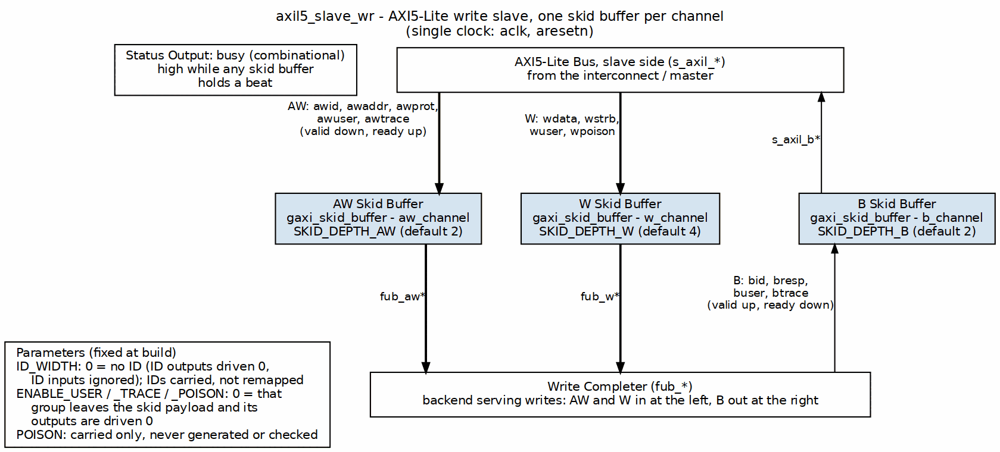

<!-- RTL Design Sherpa Documentation Header -->
<table>
<tr>
<td width="80">
  <a href="https://github.com/sean-galloway/RTLDesignSherpa">
    
  </a>
</td>
<td>
  <strong>RTL Design Sherpa</strong> &middot; <em>Learning Hardware Design Through Practice</em><br>
  <sub>
    <a href="https://github.com/sean-galloway/RTLDesignSherpa">GitHub</a> &middot;
    <a href="https://github.com/sean-galloway/RTLDesignSherpa/blob/main/docs/DOCUMENTATION_INDEX.md">Documentation Index</a> &middot;
    <a href="https://github.com/sean-galloway/RTLDesignSherpa/blob/main/LICENSE">MIT License</a>
  </sub>
</td>
</tr>
</table>

---

<!-- End Header -->

# AXIL5 Slave Write

**Module:** `axil5_slave_wr.sv`
**Location:** `rtl/amba/axil5/`
**AXI4-Lite counterpart:** [`axil4_slave_wr`](../axil4/axil4_slave_wr.md)

---

## Overview

The AXIL5 Slave Write provides a buffered AXI5-Lite write interface for slave devices.

AXI5-Lite is AXI4-Lite plus the transaction ID and a few optional signal groups. It changes no channel's handshake, ordering or response semantics, so this module is structurally `axil4_slave_wr` with the ID and those groups threaded through the packed SKID payload.

- AXI5-Lite write path (AW, W and B channels)
- Single-beat transactions: AXI-Lite has no burst support
- Configurable skid buffers on every channel for timing closure
- Elaboration fails on an illegal `AXIL_DATA_WIDTH` or `ID_WIDTH`
- Transaction ID (`AWID`/`BID`, `ARID`/`RID`; `ID_WIDTH`) plus three optional signal groups (USER, TRACE, POISON), each independently enabled
- With all groups disabled, the AXI4-Lite module of the same name plus the ID (mandatory on a Subordinate)

---

## Parameters

| Parameter | Type | Default | Description |
|---|---|---|---|
| `AXIL_ADDR_WIDTH` | int | `32` |  |
| `AXIL_DATA_WIDTH` | int | `32` | Any AXI data width, 8..1024 and a power of two (IHI 0022L Table A3.19; Table B2.4 adds no AXI5-Lite limit). Checked at elaboration. |
| `ID_WIDTH` | int | `4` | AWID/BID and ARID/RID width, 1..32 (Subordinate side: the ID is mandatory, Table B2.2 code YS). IHI 0022L Table A5.2. |
| `USER_WIDTH` | int | `4` |  |
| `ENABLE_USER` | bit | `1` |  |
| `ENABLE_TRACE` | bit | `1` |  |
| `ENABLE_POISON` | bit | `1` |  |
| `SKID_DEPTH_AW` | int | `2` |  |
| `SKID_DEPTH_W` | int | `4` |  |
| `SKID_DEPTH_B` | int | `2` |  |
| `AW` | int | `AXIL_ADDR_WIDTH` |  |
| `DW` | int | `AXIL_DATA_WIDTH` |  |
| `SW` | int | `DW / 8` |  |
| `IW` | int | `(ID_WIDTH > 0) ? ID_WIDTH : 1` | ID port width; a 1-bit placeholder when `ID_WIDTH = 0` |
| `UW` | int | `USER_WIDTH` |  |
| `PW` | int | `(DW / 64) > 0 ? (DW / 64) : 1` |  |
| `AWSize` | int | `AW + 3 +` |  |
| `WSize` | int | `DW + SW +` |  |
| `BSize` | int | `2 +` |  |

The derived parameters (`AW`, `DW`, `UW`, ... and the `*Size` payload widths) are computed from the ones above. **Do not override them.** Forcing a `*Size` to a value the RTL did not derive makes every optional-group field a part-select past the end of the vector -- which is exactly how `test_axil5_master_wr` failed until `d6266344` removed those overrides.

---

## Ports

The `s_axil_*` side faces the bus; your backend drives the `fub_*` side.

| Port | Direction | Width | Description |
|---|---|---|---|
| `aclk` | Input | 1 |  |
| `aresetn` | Input | 1 |  |
| `s_axil_awid` | Input | `[IW-1:0]` |  |
| `s_axil_awaddr` | Input | `[AW-1:0]` |  |
| `s_axil_awprot` | Input | `[2:0]` |  |
| `s_axil_awuser` | Input | `[UW-1:0]` |  |
| `s_axil_awtrace` | Input | 1 |  |
| `s_axil_awvalid` | Input | 1 |  |
| `s_axil_awready` | Output | 1 |  |
| `fub_awid` | Output | `[IW-1:0]` |  |
| `fub_awaddr` | Output | `[AW-1:0]` |  |
| `fub_awprot` | Output | `[2:0]` |  |
| `fub_awuser` | Output | `[UW-1:0]` |  |
| `fub_awtrace` | Output | 1 |  |
| `fub_awvalid` | Output | 1 |  |
| `fub_awready` | Input | 1 |  |
| `s_axil_wdata` | Input | `[DW-1:0]` |  |
| `s_axil_wstrb` | Input | `[SW-1:0]` |  |
| `s_axil_wuser` | Input | `[UW-1:0]` |  |
| `s_axil_wpoison` | Input | `[PW-1:0]` |  |
| `s_axil_wvalid` | Input | 1 |  |
| `s_axil_wready` | Output | 1 |  |
| `fub_wdata` | Output | `[DW-1:0]` |  |
| `fub_wstrb` | Output | `[SW-1:0]` |  |
| `fub_wuser` | Output | `[UW-1:0]` |  |
| `fub_wpoison` | Output | `[PW-1:0]` |  |
| `fub_wvalid` | Output | 1 |  |
| `fub_wready` | Input | 1 |  |
| `fub_bid` | Input | `[IW-1:0]` |  |
| `fub_bresp` | Input | `[1:0]` |  |
| `fub_buser` | Input | `[UW-1:0]` |  |
| `fub_btrace` | Input | 1 |  |
| `fub_bvalid` | Input | 1 |  |
| `fub_bready` | Output | 1 |  |
| `s_axil_bid` | Output | `[IW-1:0]` |  |
| `s_axil_bresp` | Output | `[1:0]` |  |
| `s_axil_buser` | Output | `[UW-1:0]` |  |
| `s_axil_btrace` | Output | 1 |  |
| `s_axil_bvalid` | Output | 1 |  |
| `s_axil_bready` | Input | 1 |  |
| `busy` | Output | 1 |  |

---

## Functional Description

### Block diagram



The AXI5-Lite bus (`s_axil_*`) sits at the top and the completer (`fub_*`) is the bar at the bottom. AW and W run down through their own `gaxi_skid_buffer`s, and the B response climbs back up its own lane on the right through a third, so every channel crosses exactly one buffer. This is the axil4 structure; AXI5-Lite only adds carried fields -- the ID on every channel and the optional USER, TRACE and POISON groups, each dropped from the skid payload (outputs driven 0) when its `ENABLE_*` parameter is 0, as the Parameters legend states. `busy` is high while any skid buffer holds a beat.

### Optional signal groups

The ID plus three optional groups -- the ones IHI 0022L Table B2.2 allows on AXI5-Lite. The ID has no enable (it is sized by `ID_WIDTH`); each group is gated by its own `ENABLE_*` parameter and contributes to the packed SKID payload only when enabled.

| Group | Parameter | Signals on this module | Width |
|---|---|---|---|
| ID | `ID_WIDTH` (no enable) | `AxID`, `BID`, `RID` | `ID_WIDTH` (0..32; >= 1 on slave-side modules) |
| USER | `ENABLE_USER` | `AxUSER`, `WUSER`, `BUSER`, `RUSER` | `USER_WIDTH` |
| TRACE | `ENABLE_TRACE` | `AxTRACE`, `BTRACE`, `RTRACE` | 1 |
| POISON | `ENABLE_POISON` | `WPOISON`, `RPOISON` | one bit per 64 data bits |

(Only the channels this module carries are present; a read module has no W or B channel, so it has no WPOISON or BUSER.)

### With no ID and every group disabled, this IS the AXI4-Lite module

The packed payload width of a no-ID, fully-disabled build equals its AXI4-Lite counterpart's, channel for channel:

| Payload | AXI4-Lite | AXI5-Lite, `ID_WIDTH=0`, groups off | AXI5-Lite defaults (`ID_WIDTH=4`, groups on) |
|---|---|---|---|
| `ARSize` | 35 | 35 | 44 |
| `RSize` | 34 | 34 | 44 |
| `AWSize` | 35 | 35 | 44 |
| `WSize` | 36 | 36 | 41 |
| `BSize` | 2 | 2 | 11 |

(at `AXIL_ADDR_WIDTH = AXIL_DATA_WIDTH = 32` and the default widths. `ID_WIDTH = 0` is legal only on the Manager-side `axil5_master_*` modules; a Subordinate must carry the ID, so the `axil5_slave_*` modules require `ID_WIDTH >= 1` and their minimum payload is the AXI4-Lite one plus the ID on AR/R or AW/B.)

That equivalence is what `val/amba/test_axil5_axil4_equivalence.py` pins: it runs the same AXI5-Lite BFMs, built with no ID and no groups, against both `axil4_master_rd` and `axil5_master_rd` elaborated with `ID_WIDTH=0` and every `ENABLE_*` = 0.

### It transports; it does not interpret

The ID is carried in both directions like every other field: AxID crosses with the request, and BID/RID cross back with the response unchanged. Reflecting AxID onto BID/RID is the Subordinate's job (IHI 0022L A5.1.1); this module only guarantees that whatever ID it is given leaves on the other side. With `ID_WIDTH = 0` (Manager-side modules only) the ID outputs are driven 0 -- the "tied LOW" of A5.1.1 -- and the ID inputs are ignored.

TRACE and USER are carried end to end unmodified. POISON is carried -- never generated, never checked. Those behaviours belong to the endpoints on either side, and nothing in this module implements them.

AxLOCK, AxMPAM, AxMECID, AxNSAID and xLOOP are not carried. Table B2.2 of IHI 0022L marks them "not present" on AXI5-Lite and B2.1.5 states exclusive accesses are not supported; earlier versions of this module carried them behind `ENABLE_*` parameters (removed by issue #102).

A disabled group's output is driven to zero rather than left dangling, so an integrator who disables a group downstream of one that enables it sees a defined value instead of X.

---

## Timing Characteristics

### Buffer Depths and Latency

| Parameter | Default | Channel |
|-----------|---------|---------|
| `SKID_DEPTH_AW` | 2 entries | Skid depth on the AW channel |
| `SKID_DEPTH_W` | 4 entries | Skid depth on the W channel |
| `SKID_DEPTH_B` | 2 entries | Skid depth on the B channel |

Each channel traverses one `gaxi_skid_buffer`. That module registers both
`rd_valid` and the storage array, so the **1-cycle input-to-output latency
applies on every transfer, including the unstalled case** -- there is no
combinational bypass from the upstream payload to the downstream one. Full
throughput (one transfer per cycle) is still sustained once the pipeline is
primed; the depth sets how much backpressure can be absorbed before it
propagates upstream, not the steady-state rate.

Legal depth range is 2..8 inclusive, odd values included.

### Optional-group effect

The AXI5-Lite optional groups widen the packed skid payload but do not add a
pipeline stage: `ARSize`, `AWSize`, `WSize`, `RSize` and `BSize` are
conditional sums over the `ENABLE_*` parameters, so disabling a group narrows
the storage without changing latency.

---


## Usage Examples

Every parameter and port below is taken from the module declaration; the
elisions name the remaining members of each group, all of which appear in the
Ports table above. Override only what your integration needs, and never
override a derived parameter -- see the note under Parameters.

```systemverilog
axil5_slave_wr #(
    .AXIL_ADDR_WIDTH     (32),
    .AXIL_DATA_WIDTH     (32),
    .ID_WIDTH            (4),
    .USER_WIDTH          (4),
    .ENABLE_USER         (1),
    .ENABLE_TRACE        (1),
    .ENABLE_POISON       (1),
    .SKID_DEPTH_AW       (2),
    .SKID_DEPTH_W        (4),
    .SKID_DEPTH_B        (2)
) u_axil5_slave_wr (
    // clock/reset
    .aclk                (aclk),
    .aresetn             (aresetn),
    // s_axil_aw
    .s_axil_awid         (s_axil_awid),
    // ... `s_axil_awaddr`, `s_axil_awprot`, `s_axil_awuser`, +3 more
    // fub_aw
    .fub_awid            (fub_awid),
    // ... `fub_awaddr`, `fub_awprot`, `fub_awuser`, +3 more
    // s_axil_w
    .s_axil_wdata        (s_axil_wdata),
    // ... `s_axil_wstrb`, `s_axil_wuser`, `s_axil_wpoison`, +2 more
    // fub_w
    .fub_wdata           (fub_wdata),
    // ... `fub_wstrb`, `fub_wuser`, `fub_wpoison`, +2 more
    // fub_b
    .fub_bid             (fub_bid),
    // ... `fub_bresp`, `fub_buser`, `fub_btrace`, +2 more
    // s_axil_b
    .s_axil_bid          (s_axil_bid),
    // ... `s_axil_bresp`, `s_axil_buser`, `s_axil_btrace`, +2 more
    // status
    .busy                (busy)
);
```

---

## Design Notes

**No ID and all optional groups off is AXI4-Lite.** `ARSize`/`AWSize`/`WSize`/`RSize`/
`BSize` are sums of `ID_WIDTH` and conditional terms over the `ENABLE_*`
parameters. With `ID_WIDTH=0` (Manager side only) and every group disabled
they collapse to the AXI4-Lite payload widths exactly, which is what
`val/amba/test_axil5_axil4_equivalence.py` asserts against both the AXI4-Lite
RTL and `axil5_master_rd` configured that way.

**Illegal widths do not elaborate.** An `initial begin : param_check` block
under `` `ifndef SYNTHESIS `` stops the build when `AXIL_DATA_WIDTH` is not an
AXI data width (8..1024, power of two; IHI 0022L Table A3.19 -- Table B2.4
adds no AXI5-Lite restriction) or `ID_WIDTH` is outside 0..32 (1..32 on the
slave-side modules). `val/amba/test_axil_param_guard.py` checks it.

**Do not override a derived parameter.** The `*Size` parameters and the `AW`/
`DW`/`IW` aliases are declared as `parameter` so the elaborator can compute them,
not so callers can set them. Forcing one to the AXI4-Lite value while a group
is enabled part-selects past the end of the vector -- the failure reads
"Extracting 4 bits from only 2 bit number", and it is how this family's test
port broke.

**The ID is AXI5-Lite's, not the monitor's.** AXI5-Lite carries AWID/BID and
ARID/RID (IHI 0022L Table B2.2, code YS: optional on a Manager, mandatory on
a Subordinate) and this family carries them through. The `_mon`/`_monlite` wrappers feed it to the shared monitor core (amba #104),
so each response is paired with the oldest outstanding command of its own ID
and a Subordinate may reorder across IDs (B2.1.5); W carries no ID and is
attributed in AW order (A5.5).

**The skid buffer is not a bypass.** `gaxi_skid_buffer` registers both
`rd_valid` and its storage, so every transfer costs one cycle even unstalled.
Depth buys backpressure absorption, not throughput.

---

## Related Modules

- [axil5_master_rd](axil5_master_rd.md)
- [axil5_master_rd_cg](axil5_master_rd_cg.md)
- [axil5_master_rd_mon](axil5_master_rd_mon.md)
- [axil5_master_rd_mon_cg](axil5_master_rd_mon_cg.md)
- [axil5_master_wr](axil5_master_wr.md)
- [axil5_master_wr_cg](axil5_master_wr_cg.md)
- [`axil4_slave_wr`](../axil4/axil4_slave_wr.md) -- the AXI4-Lite counterpart
- [AXI4-Lite modules](../axil4/README.md)

---

## Testing

`val/amba/test_axil5_slave_wr.py` drives this module with the AXI5-Lite BFMs and **the ID and every optional group enabled** -- `TBClasses/axil5` sets the group widths in `COMPONENT_KWARGS` to mirror the RTL defaults. A BFM configured differently from its DUT is a bind failure, which is the loud version of the mistake.

Every transaction the Manager-side BFM issues carries a rotating non-zero ID and must come back with the same BID/RID (`bin/TBClasses/axil5/axil5_id_check.py`); the inherited AXI4-Lite phases alone would only ever send ID 0, which a module that dropped the ID would pass.

The testbench class is the AXI4-Lite one with the component factories swapped, so every phase, check and randomizer sweep has a single definition, and a fix to the AXI4-Lite flow reaches this module automatically.

## References

- Arm. *AMBA AXI Protocol Specification*, ARM IHI 0022, Issue L, Aug. 2025. [developer.arm.com/documentation/ihi0022/l](https://developer.arm.com/documentation/ihi0022/l) -- §B2.1.5 "AXI5-Lite" and Table B2.2 signal matrix; carried groups per §A12.5 User defined signaling, §A12.3 Trace signals, §A5.1.1 transaction ID signals, §A16.1 Poison; handshake on the AW, W and B channels per §A2.3.1/§A2.3.2; register stages per §A2.5. Table B2.2 marks AxLOCK, AxMPAM, AxMECID, AxNSAID and xLOOP not present on AXI5-Lite and AxID/BID/RID mandatory on a Subordinate (YS): this module carries the ID (`ID_WIDTH`) and none of the not-present signals (issue #102). Data width per Table A3.19 (any AXI DATA_WIDTH; Table B2.4 adds no AXI5-Lite constraint).
- Arm. *AMBA AXI and ACE Protocol Specification*, ARM IHI 0022, Issue H, 2020. [developer.arm.com/documentation/ihi0022/h](https://developer.arm.com/documentation/ihi0022/h) -- Part C ch. C2 "AMBA AXI5-Lite", §C2.2 comparison with AXI4-Lite and §C2.5/§C2.6 upgrading an AXI4-Lite master/slave: the `ID_WIDTH=0`, every-group-disabled Manager-side build is the AXI4-Lite-equivalent port.
- Cortadella, J., Kishinevsky, M., Grundmann, B. "Synthesis of Synchronous Elastic Architectures." *Proc. 43rd Design Automation Conf. (DAC '06)*, pp. 657-662, 2006. DOI: [10.1145/1146909.1147077](https://doi.org/10.1145/1146909.1147077) -- the elastic buffer; its Property 3.1 (capacity C >= 2 for full throughput) is the depth-2 floor of each channel's `gaxi_skid_buffer`.
- Carloni, L.P., McMillan, K.L., Sangiovanni-Vincentelli, A.L. "Theory of Latency-Insensitive Design." *IEEE Trans. Computer-Aided Design of Integrated Circuits and Systems*, 20(9), Sept. 2001. DOI: [10.1109/43.945302](https://doi.org/10.1109/43.945302) -- relay stations: storage on a back-pressured channel adds latency without changing function.
- Chipressian. *Crack the Hardware Interview -- from RTL Designers' Perspective: Architecture and Micro-architecture Design*, ch. 2 "Handshake Protocols", Q8 valid-ready protocol and Q9 valid-ready slices -- textbook treatment of register slices (secondary source).
- Bruno, F., Eschemann, G. *The FPGA Programming Handbook*, 2nd ed., Packt, 2024, ch. 8 "Introduction to AXI", §8.3 "AXI4 interfaces (full and AXI-Lite)" -- textbook treatment of the AXI-Lite channel set (secondary source).
- Indexed in `rtl/amba/references/README.md` (local PDF: `ElasticBuffer__Cortadella2006.pdf`)

---

## Navigation

[AXI5-Lite index](README.md) | [AMBA overview](../overview.md)
