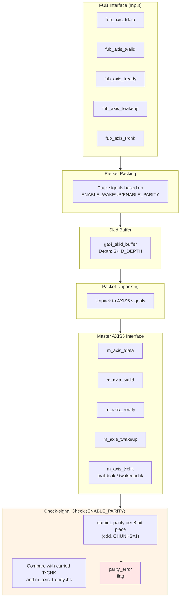

<!-- RTL Design Sherpa Documentation Header -->
<table>
<tr>
<td width="80">
  <a href="https://github.com/sean-galloway/RTLDesignSherpa">
    
  </a>
</td>
<td>
  <strong>RTL Design Sherpa</strong> · <em>Learning Hardware Design Through Practice</em><br>
  <sub>
    <a href="https://github.com/sean-galloway/RTLDesignSherpa">GitHub</a> ·
    <a href="https://github.com/sean-galloway/RTLDesignSherpa/blob/main/docs/DOCUMENTATION_INDEX.md">Documentation Index</a> ·
    <a href="https://github.com/sean-galloway/RTLDesignSherpa/blob/main/LICENSE">MIT License</a>
  </sub>
</td>
</tr>
</table>

---

<!-- End Header -->

# AXIS5 Master

**Module:** `axis5_master.sv`
**Location:** `rtl/amba/axis5/`
**Status:** Production Ready

---

## Overview

The AXIS5 Master implements an AXI5-Stream master interface with the AMBA5 extensions — wake-up signaling for power management — plus optional interface parity protection (the IHI 0051B ch. 5 check signals). Buffering comes from an internal skid buffer, which is what keeps the timing clean at the endpoint boundary.

### Key Features

- AXI4-Stream data path (TDATA, TSTRB, TLAST, TID, TDEST, TUSER, TVALID/TREADY)
- TWAKEUP: Wake-up signaling for power management
- Interface parity (IHI 0051B ch. 5): TDATACHK, TSTRBCHK, TLASTCHK, TIDCHK, TDESTCHK, TUSERCHK, TVALIDCHK, TREADYCHK, TWAKEUPCHK -- odd parity, one check bit per 8 bits, gated by `ENABLE_PARITY`
- Internal skid buffer for backpressure handling
- Configurable data, ID, destination, and user signal widths
- Check-signal error detection (sticky `parity_error`)
- Busy status indication

**Signal coverage:** this module does not implement TKEEP, TPOISON, or any chunking sideband. See [Implemented Signal Set](README.md#implemented-signal-set) for the full list of deviations from the ARM signal set.

### AXIS5 Extensions Over AXIS4

| Feature | AXIS4 | AXIS5 | ARM standard signal? |
|---------|-------|-------|----------------------|
| Wake-up signal | None | TWAKEUP (configurable) | Yes, AXI5-Stream addition |
| Interface parity | None | T*CHK check signals, odd parity, 1 bit per 8 bits (configurable) | Yes, AXI5-Stream ch. 5 (Check_Type = Odd_Parity_Byte_All) |
| Parity error detection | None | Built-in sticky `parity_error` flag | No - implementation status output |

---

## Parameters

| Parameter | Type | Default | Description |
|-----------|------|---------|-------------|
| SKID_DEPTH | int | 4 | Internal skid buffer depth |
| AXIS_DATA_WIDTH | int | 32 | AXIS data bus width (must be multiple of 8) |
| AXIS_ID_WIDTH | int | 8 | AXIS ID signal width (0 to disable) |
| AXIS_DEST_WIDTH | int | 4 | AXIS TDEST signal width (0 to disable) |
| AXIS_USER_WIDTH | int | 1 | AXIS TUSER signal width (0 to disable) |
| ENABLE_WAKEUP | bit | 1 | Enable TWAKEUP signal (1=enabled) |
| ENABLE_PARITY | bit | 0 | Enable the IHI 0051B ch. 5 check signals (1 = Check_Type Odd_Parity_Byte_All, 0 = False) |

**Note on `ENABLE_WAKEUP`:** the default is 1, so TWAKEUP ports exist and are carried through the buffer unless you explicitly set `ENABLE_WAKEUP=0`. Set it to 0 for an AXI4-Stream-compatible port list with no wake-up sideband and slightly less area. `ENABLE_PARITY` defaults to 0, the spec's `Check_Type = False`: the `*chk` ports are still present but outputs are tied 0 and inputs are ignored.

### Derived Values (do not override)

These are declared in the parameter list so they can be used in port widths, but they are derived from the parameters above. Overriding them directly produces an inconsistent module.

| Name | Derivation | Meaning |
|------|------------|---------|
| DW | AXIS_DATA_WIDTH | Data width short name |
| IW | AXIS_ID_WIDTH | ID width short name |
| DESTW | AXIS_DEST_WIDTH | DEST width short name |
| UW | AXIS_USER_WIDTH | USER width short name |
| SW | DW/8 | Strobe width in bytes |
| IW_WIDTH / DESTW_WIDTH / UW_WIDTH | max(width, 1) | Zero-width avoidance for disabled sidebands |
| TDATACHK_W | SW | TDATACHK width, TDATA_WIDTH/8 (Table 5-1) |
| TSTRBCHK_W | ceil(SW/8) | TSTRBCHK width, ceil(TDATA_WIDTH/64) |
| TIDCHK_W / TDESTCHK_W / TUSERCHK_W | ceil(width/8) | TIDCHK / TDESTCHK / TUSERCHK widths |

`TSize` (skid payload width) is a body `localparam` now, not a parameter.

---

## Ports

### Clock and Reset

| Port | Width | Direction | Description |
|------|-------|-----------|-------------|
| aclk | 1 | Input | AXIS clock |
| aresetn | 1 | Input | AXIS active-low asynchronous reset |

### FUB AXIS5 Interface (Input Side)

| Port | Width | Direction | Description |
|------|-------|-----------|-------------|
| fub_axis_tdata | DW | Input | Transfer data |
| fub_axis_tstrb | SW | Input | Transfer byte strobes |
| fub_axis_tlast | 1 | Input | Last transfer in packet |
| fub_axis_tid | IW_WIDTH | Input | Transfer ID (optional) |
| fub_axis_tdest | DESTW_WIDTH | Input | Transfer destination (optional) |
| fub_axis_tuser | UW_WIDTH | Input | Transfer user-defined signals (optional) |
| fub_axis_tvalid | 1 | Input | Transfer valid |
| fub_axis_tready | 1 | Output | Transfer ready (skid buffer not full) |
| fub_axis_twakeup | 1 | Input | Wake-up signal (AXIS5 extension) |
| fub_axis_tdatachk | TDATACHK_W | Input | TDATACHK from the producer, carried with the beat |
| fub_axis_tstrbchk | TSTRBCHK_W | Input | TSTRBCHK, carried |
| fub_axis_tlastchk | 1 | Input | TLASTCHK, carried |
| fub_axis_tidchk | TIDCHK_W | Input | TIDCHK, carried |
| fub_axis_tdestchk | TDESTCHK_W | Input | TDESTCHK, carried |
| fub_axis_tuserchk | TUSERCHK_W | Input | TUSERCHK, carried |

### Master AXIS5 Interface (Output Side)

| Port | Width | Direction | Description |
|------|-------|-----------|-------------|
| m_axis_tdata | DW | Output | Transfer data |
| m_axis_tstrb | SW | Output | Transfer byte strobes |
| m_axis_tlast | 1 | Output | Last transfer in packet |
| m_axis_tid | IW_WIDTH | Output | Transfer ID (optional) |
| m_axis_tdest | DESTW_WIDTH | Output | Transfer destination (optional) |
| m_axis_tuser | UW_WIDTH | Output | Transfer user-defined signals (optional) |
| m_axis_tvalid | 1 | Output | Transfer valid |
| m_axis_tready | 1 | Input | Transfer ready from downstream |
| m_axis_twakeup | 1 | Output | Wake-up signal (AXIS5 extension) |
| m_axis_tdatachk | TDATACHK_W | Output | TDATACHK: odd parity, bit n covers tdata[8n+7:8n] |
| m_axis_tstrbchk | TSTRBCHK_W | Output | TSTRBCHK: odd parity over tstrb, 1 bit per 8 strobes |
| m_axis_tlastchk | 1 | Output | TLASTCHK (= ~tlast for a correct beat) |
| m_axis_tidchk | TIDCHK_W | Output | TIDCHK |
| m_axis_tdestchk | TDESTCHK_W | Output | TDESTCHK |
| m_axis_tuserchk | TUSERCHK_W | Output | TUSERCHK |
| m_axis_tvalidchk | 1 | Output | TVALIDCHK = ~m_axis_tvalid, generated here every cycle |
| m_axis_treadychk | 1 | Input | TREADYCHK from the receiver, checked every cycle out of reset |
| m_axis_twakeupchk | 1 | Output | TWAKEUPCHK = ~m_axis_twakeup, generated here every cycle |

### Status Outputs

| Port | Width | Direction | Description |
|------|-------|-----------|-------------|
| busy | 1 | Output | Module busy (data in buffer or input valid) |
| parity_error | 1 | Output | Sticky: a payload check mismatched on a TVALID cycle, or TREADYCHK was not ~TREADY |

---

## Functional Description



### Skid Buffer Operation

The module uses an internal `gaxi_skid_buffer` to:
- Accept incoming transfers even when downstream is not ready
- Prevent backpressure propagation
- Provide registered outputs for timing closure
- Track buffer occupancy via `busy` signal

### Packet Packing/Unpacking

**Conditional packing based on configuration:**

```systemverilog
// Full feature set (ENABLE_WAKEUP=1, ENABLE_PARITY=1)
{tdata, tstrb, tlast, tid, tdest, tuser, twakeup, tdatachk, tstrbchk, tlastchk, tidchk, tdestchk, tuserchk}

// Wake-up only (ENABLE_WAKEUP=1, ENABLE_PARITY=0)
{tdata, tstrb, tlast, tid, tdest, tuser, twakeup}

// Parity only (ENABLE_WAKEUP=0, ENABLE_PARITY=1)
{tdata, tstrb, tlast, tid, tdest, tuser, tdatachk, tstrbchk, tlastchk, tidchk, tdestchk, tuserchk}

// Base AXIS4 (ENABLE_WAKEUP=0, ENABLE_PARITY=0)
{tdata, tstrb, tlast, tid, tdest, tuser}
```

### Interface Parity (ENABLE_PARITY=1)

The check signals follow IHI 0051B ch. 5 with `Check_Type = Odd_Parity_Byte_All`:

- **Odd parity** (§5.3): a check bit plus the bits it covers always hold an odd number of ones.
- **Granularity** (§5.3, Table 5-1): check bit [n] covers bits [8n+7:8n] of its signal; when the signal is not a whole number of bytes, the top check bit covers the short remainder. TDATACHK is TDATA_WIDTH/8 bits, TSTRBCHK ceil(TDATA_WIDTH/64), TIDCHK/TDESTCHK/TUSERCHK ceil(width/8), and TLASTCHK, TVALIDCHK, TREADYCHK, TWAKEUPCHK one bit each (a one-bit check is the inversion of its signal).
- Every check bit is computed by one `rtl/common/dataint_parity` instance (`CHUNKS=1`, `parity_type=0` = odd) over its own piece, which gives the spec layout at any width.

What this module does with each signal:

| Check signal | Here | Check Enable (Table 5-1) |
|--------------|------|--------------------------|
| TDATACHK, TSTRBCHK, TLASTCHK, TIDCHK, TDESTCHK, TUSERCHK | Supplied by the FUB on `fub_axis_t*chk`, carried through the skid buffer with the beat, driven on `m_axis_t*chk`, and checked on the output side | TVALID |
| TVALIDCHK | Generated: `m_axis_tvalidchk = ~m_axis_tvalid` | ARESETn (every cycle) |
| TWAKEUPCHK | Generated: `m_axis_twakeupchk = ~m_axis_twakeup` | ARESETn |
| TREADYCHK | Input from the receiver, checked every cycle | ARESETn |

`parity_error` latches (until reset) on any payload mismatch in a cycle where `m_axis_tvalid` is high, or on any cycle where `m_axis_treadychk` is not the inversion of `m_axis_tready`. When a parameter removes TID, TDEST or TUSER, the spec omits its check (§5.3): the port stays, is driven with the odd parity of the tied-zero field, and is not checked.

Because the payload checks are carried, not regenerated, the output-side check validates the path *through this module* against the parity the producer computed. The receiving endpoint runs its own check (`axis5_slave` checks on its input). If the upstream FUB does not compute the checks, leave `ENABLE_PARITY=0`; tying `fub_axis_t*chk` to a constant while parity is enabled sets `parity_error` on the first beat whose parity disagrees.

### Busy Signal

The `busy` output indicates:
- Input side has valid data (`fub_axis_tvalid`)
- Skid buffer contains data (`int_t_count > 0`)

---

## Timing Characteristics
### Basic Transfer with Wake-up

<!-- TODO: Add wavedrom timing diagram for AXIS5 transfer with wake-up -->
> **Timing diagram pending.** The signals and sequence this scenario
> exercises:
>
> - aclk
> - fub_axis_tvalid/tready
> - fub_axis_tdata
> - fub_axis_tlast
> - fub_axis_twakeup (AXIS5 extension)
> - m_axis_tvalid/tready
> - m_axis_tdata
> - m_axis_twakeup
> - busy

### Transfer with Parity Error

<!-- TODO: Add wavedrom timing diagram for parity error detection -->
> **Timing diagram pending.** The signals and sequence this scenario
> exercises:
>
> - aclk
> - m_axis_tvalid / m_axis_tready
> - m_axis_tdata, m_axis_tdatachk (carried)
> - m_axis_treadychk (from the receiver)
> - parity_error (sticky flag)

### Skid Buffer Backpressure

<!-- TODO: Add wavedrom timing diagram for skid buffer operation -->
> **Timing diagram pending.** The signals and sequence this scenario
> exercises:
>
> - aclk
> - fub_axis_tvalid/tready
> - m_axis_tvalid/tready (downstream blocked)
> - int_t_count (buffer fill level)
> - busy

---

## Usage Examples
### Basic Configuration

```systemverilog
axis5_master #(
    .SKID_DEPTH       (4),
    .AXIS_DATA_WIDTH  (64),
    .AXIS_ID_WIDTH    (8),
    .AXIS_DEST_WIDTH  (4),
    .AXIS_USER_WIDTH  (1),
    .ENABLE_WAKEUP    (1),
    .ENABLE_PARITY    (0)
) u_axis5_master (
    .aclk                (axis_clk),
    .aresetn             (axis_rst_n),

    // FUB interface (from upstream)
    .fub_axis_tdata      (fub_tdata),
    .fub_axis_tstrb      (fub_tstrb),
    .fub_axis_tlast      (fub_tlast),
    .fub_axis_tid        (fub_tid),
    .fub_axis_tdest      (fub_tdest),
    .fub_axis_tuser      (fub_tuser),
    .fub_axis_tvalid     (fub_tvalid),
    .fub_axis_tready     (fub_tready),
    .fub_axis_twakeup    (fub_twakeup),
    .fub_axis_tdatachk   ('0),  // check inputs ignored when ENABLE_PARITY=0
    .fub_axis_tstrbchk   ('0),
    .fub_axis_tlastchk   (1'b0),
    .fub_axis_tidchk     ('0),
    .fub_axis_tdestchk   ('0),
    .fub_axis_tuserchk   ('0),

    // Master AXIS5 interface (to downstream)
    .m_axis_tdata        (m_axis_tdata),
    .m_axis_tstrb        (m_axis_tstrb),
    .m_axis_tlast        (m_axis_tlast),
    .m_axis_tid          (m_axis_tid),
    .m_axis_tdest        (m_axis_tdest),
    .m_axis_tuser        (m_axis_tuser),
    .m_axis_tvalid       (m_axis_tvalid),
    .m_axis_tready       (m_axis_tready),
    .m_axis_twakeup      (m_axis_twakeup),
    .m_axis_tdatachk     (),  // tied 0 when ENABLE_PARITY=0
    .m_axis_tstrbchk     (),
    .m_axis_tlastchk     (),
    .m_axis_tidchk       (),
    .m_axis_tdestchk     (),
    .m_axis_tuserchk     (),
    .m_axis_tvalidchk    (),
    .m_axis_treadychk    (1'b0),
    .m_axis_twakeupchk   (),

    // Status
    .busy                (axis_busy),
    .parity_error        ()  // Not used when ENABLE_PARITY=0
);
```

### With Parity Protection

```systemverilog
axis5_master #(
    .AXIS_DATA_WIDTH  (32),
    .ENABLE_WAKEUP    (1),
    .ENABLE_PARITY    (1)  // IHI 0051B ch. 5 check signals
) u_axis5_master_parity (
    .aclk                (axis_clk),
    .aresetn             (axis_rst_n),

    // FUB interface with its payload check signals
    .fub_axis_tdata      (fub_tdata),
    .fub_axis_tstrb      (fub_tstrb),
    .fub_axis_tlast      (fub_tlast),
    .fub_axis_tid        (fub_tid),
    .fub_axis_tdest      (fub_tdest),
    .fub_axis_tuser      (fub_tuser),
    .fub_axis_tvalid     (fub_tvalid),
    .fub_axis_tready     (fub_tready),
    .fub_axis_twakeup    (fub_twakeup),
    .fub_axis_tdatachk   (fub_tdatachk),   // 4 bits for 32-bit data
    .fub_axis_tstrbchk   (fub_tstrbchk),   // 1 bit
    .fub_axis_tlastchk   (fub_tlastchk),
    .fub_axis_tidchk     (fub_tidchk),     // 1 bit for an 8-bit TID
    .fub_axis_tdestchk   (fub_tdestchk),
    .fub_axis_tuserchk   (fub_tuserchk),

    // Master AXIS5 interface
    .m_axis_tdata        (m_axis_tdata),
    .m_axis_tstrb        (m_axis_tstrb),
    .m_axis_tlast        (m_axis_tlast),
    .m_axis_tid          (m_axis_tid),
    .m_axis_tdest        (m_axis_tdest),
    .m_axis_tuser        (m_axis_tuser),
    .m_axis_tvalid       (m_axis_tvalid),
    .m_axis_tready       (m_axis_tready),
    .m_axis_twakeup      (m_axis_twakeup),
    .m_axis_tdatachk     (m_axis_tdatachk),
    .m_axis_tstrbchk     (m_axis_tstrbchk),
    .m_axis_tlastchk     (m_axis_tlastchk),
    .m_axis_tidchk       (m_axis_tidchk),
    .m_axis_tdestchk     (m_axis_tdestchk),
    .m_axis_tuserchk     (m_axis_tuserchk),
    .m_axis_tvalidchk    (m_axis_tvalidchk),
    .m_axis_treadychk    (m_axis_treadychk),
    .m_axis_twakeupchk   (m_axis_twakeupchk),

    // Status - monitor check-signal errors
    .busy                (axis_busy),
    .parity_error        (axis_parity_err)  // Sticky error flag
);

// Error handling
always_ff @(posedge axis_clk or negedge axis_rst_n) begin
    if (!axis_rst_n)
        error_count <= '0;
    else if (axis_parity_err && !prev_parity_err)
        error_count <= error_count + 1;
end
```

---

## Design Notes

### AXIS5 vs AXIS4 Differences

| Feature | AXIS4 | AXIS5 |
|---------|-------|-------|
| Wake-up signal | Not present | TWAKEUP (optional) |
| Interface parity | Not present | IHI 0051B ch. 5 T*CHK check signals (optional) |
| Power management | Limited | Enhanced via TWAKEUP |
| Data integrity | CRC/checksum in TUSER | Odd-parity check signals option |
| TKEEP | Not present | Not present |

### Skid Buffer Sizing

- **Typical depth:** 4-8 entries
- Deeper buffers:
  - Absorb longer downstream stalls
  - Increase area and latency
- Shallower buffers:
  - Lower latency
  - May cause upstream backpressure

**Recommendation:** depth 4 covers most applications; go deeper if your downstream stalls frequently.

### Parity Implementation

When `ENABLE_PARITY=1`:
- **Overhead:** 1 bit per 8 bits of every protected signal (a 512-bit TDATA adds 64 TDATACHK bits and 8 TSTRBCHK bits), plus 1 bit each for TLAST, TVALID, TREADY and TWAKEUP
- **Detection:** Any odd number of bit errors within an 8-bit piece; two flipped bits in the same piece are undetected
- **Correction:** None - error flag only
- **Polarity:** Odd, as IHI 0051B §5.3 requires; there is no parameter to select even parity
- **Use case:** Low-cost error detection in reliable environments

For stronger protection, use:
- CRC in TUSER field
- ECC (external module)
- End-to-end checksums at packet level

### Optional Signal Widths

Setting width parameters to 0 disables optional signals:
- `AXIS_ID_WIDTH=0` → TID tied to 0, saves area
- `AXIS_DEST_WIDTH=0` → TDEST tied to 0
- `AXIS_USER_WIDTH=0` → TUSER tied to 0

Internal logic uses `IW_WIDTH = (IW > 0) ? IW : 1` to avoid zero-width signals.

---

## Related Modules

- **[AXIS5 Slave](axis5_slave.md)** - AXIS5 slave interface
- **[AXIS5 Master CG](axis5_master_cg.md)** - Clock-gated variant with power management
- **[AXIS5 Slave CG](axis5_slave_cg.md)** - Clock-gated slave variant
- **[AXIS4 Master](../axis4/axis4_master.md)** - AXIS4 version for comparison
- **[AMBA5 Overview](../overview.md)** - AMBA5 specifications and extensions

---

## Testing

`val/amba/test_axis5_master.py` exercises this module. It collects 3 parameter cases at the default `REG_LEVEL`.

```bash
source env_python
pytest val/amba/test_axis5_master.py -v
```

## References

- Arm. *AMBA AXI-Stream Protocol Specification*, ARM IHI 0051B, Apr. 2021 (defines AXI4-Stream and AXI5-Stream). [developer.arm.com/documentation/ihi0051/b](https://developer.arm.com/documentation/ihi0051/b/) — §2.2 "Handshake signaling", §2.3 "Wake-up signaling" (`TWAKEUP`), ch. 5 "Interface parity protection" (§5.3 odd parity and the 8-bit granularity, Table 5-1 check-signal names, widths and Check Enable terms), implemented here as specified when `ENABLE_PARITY=1` (issue #102). Citation only.
- Carloni, L.P., McMillan, K.L., Sangiovanni-Vincentelli, A.L. "Theory of Latency-Insensitive Design." *IEEE Trans. Computer-Aided Design of Integrated Circuits and Systems*, 20(9), Sept. 2001. DOI: [10.1109/43.945302](https://doi.org/10.1109/43.945302) — the valid/ready channel discipline behind the `gaxi_skid_buffer` queues: a buffered stage may stall or add latency without changing what the endpoints compute.
- Maaref, M. *Architecting and Building High-Speed SoCs*, Packt, 2022, ch. 3 "Basic and Advanced On-Chip Busses and Interconnects", section "ARM AMBA interconnect protocols suite" (AXI Stream bus protocol overview) — textbook treatment (secondary source).
- Chipressian. *Crack the Hardware Interview - from RTL Designers' Perspective*, Part 2 ch. 2 "Handshake Protocols" (valid-ready protocol and valid-ready slices) — textbook treatment of the skid buffer (secondary source).
- Indexed in `rtl/amba/references/README.md` (local PDF: `LatencyInsensitiveDesign__Carloni2001.pdf`)

---

## Navigation

- **[← Back to AXIS5 Index](README.md)**
- **[← Back to rtl-amba Index](../index.md)**
- **[← Back to Main Documentation Index](../../index.md)**
