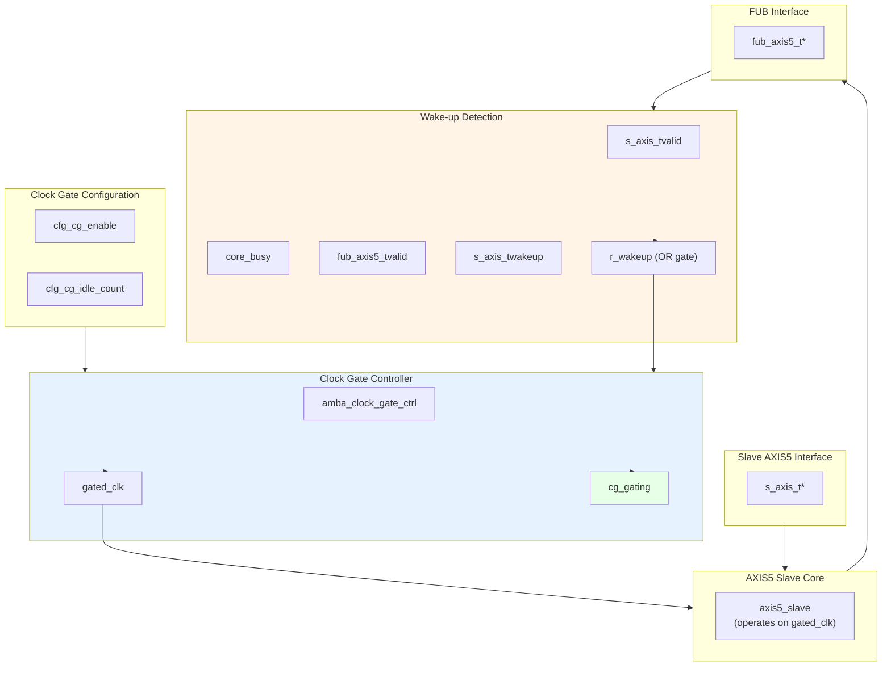

<!-- RTL Design Sherpa Documentation Header -->
<table>
<tr>
<td width="80">
  <a href="https://github.com/sean-galloway/RTLDesignSherpa">
    
  </a>
</td>
<td>
  <strong>RTL Design Sherpa</strong> · <em>Learning Hardware Design Through Practice</em><br>
  <sub>
    <a href="https://github.com/sean-galloway/RTLDesignSherpa">GitHub</a> ·
    <a href="https://github.com/sean-galloway/RTLDesignSherpa/blob/main/docs/DOCUMENTATION_INDEX.md">Documentation Index</a> ·
    <a href="https://github.com/sean-galloway/RTLDesignSherpa/blob/main/LICENSE">MIT License</a>
  </sub>
</td>
</tr>
</table>

---

<!-- End Header -->

# AXIS5 Slave with Clock Gating

**Module:** `axis5_slave_cg.sv`
**Location:** `rtl/amba/axis5/`
**Status:** Production Ready

---

## Overview

The AXIS5 Slave CG (Clock Gated) wraps the standard AXIS5 slave with the AMBA clock gate controller, giving you an AXI5-Stream slave interface that gates its own clock during idle periods. Full AXIS5 functionality survives the wrapping — wake-up signaling, the optional IHI 0051B ch. 5 check signals, the skid buffer, all of it.

### Key Features

- Same AXI5-Stream data path as `axis5_slave` (see its [signal coverage note](axis5_slave.md#key-features); TKEEP and TPOISON are not implemented)
- Automatic clock gating during idle periods for power savings
- TWAKEUP: Wake-up signaling integration with clock gate control
- Interface parity (IHI 0051B ch. 5): the T*CHK check signals, odd parity, one bit per 8 bits, gated by `ENABLE_PARITY` (see [AXIS5 Slave](axis5_slave.md#interface-parity-enable_parity1))
- Configurable idle count threshold for gating activation
- Internal skid buffer for backpressure handling
- Check-signal error detection on the input side (sticky `parity_error`)
- Clock gating status output

### Power Management Features

| Feature | Implementation | Benefit |
|---------|---------------|---------|
| Clock gating | Automatic via idle detection | Reduces dynamic power |
| Wake-up integration | TWAKEUP prevents gating | Preserves responsiveness |
| Configurable threshold | Programmable idle count | Tune power vs. latency |
| Activity detection | Multi-source OR logic | Comprehensive coverage |

---

## Parameters

| Parameter | Type | Default | Description |
|-----------|------|---------|-------------|
| SKID_DEPTH | int | 4 | Internal skid buffer depth |
| AXIS_DATA_WIDTH | int | 32 | AXIS data bus width (must be multiple of 8) |
| AXIS_ID_WIDTH | int | 8 | AXIS ID signal width (0 to disable) |
| AXIS_DEST_WIDTH | int | 4 | AXIS TDEST signal width (0 to disable) |
| AXIS_USER_WIDTH | int | 1 | AXIS TUSER signal width (0 to disable) |
| ENABLE_WAKEUP | bit | 1 | Enable TWAKEUP signal (1=enabled) |
| ENABLE_PARITY | bit | 0 | Enable the IHI 0051B ch. 5 check signals (1 = Check_Type Odd_Parity_Byte_All, 0 = False) |
| CG_IDLE_COUNT_WIDTH | int | 4 | Clock gate idle counter width |

**Note on `ENABLE_WAKEUP`:** the default is 1, so TWAKEUP ports exist and are carried through the buffer unless you explicitly set `ENABLE_WAKEUP=0`. Set it to 0 for an AXI4-Stream-compatible port list with no wake-up sideband and slightly less area. `ENABLE_PARITY` defaults to 0, the spec's `Check_Type = False`: the `*chk` ports are still present but outputs are tied 0 and inputs are ignored.

### Derived Values (do not override)

These are declared in the parameter list so they can be used in port widths, but they are derived from the parameters above. Overriding them directly produces an inconsistent module.

| Name | Derivation | Meaning |
|------|------------|---------|
| DW | AXIS_DATA_WIDTH | Data width short name |
| IW | AXIS_ID_WIDTH | ID width short name |
| DESTW | AXIS_DEST_WIDTH | DEST width short name |
| UW | AXIS_USER_WIDTH | USER width short name |
| SW | DW/8 | Strobe width in bytes |
| ICW | CG_IDLE_COUNT_WIDTH | Idle count width short name |
| IW_WIDTH / DESTW_WIDTH / UW_WIDTH | max(width, 1) | Zero-width avoidance for disabled sidebands |
| TDATACHK_W | SW | TDATACHK width, TDATA_WIDTH/8 (Table 5-1) |
| TSTRBCHK_W | ceil(SW/8) | TSTRBCHK width, ceil(TDATA_WIDTH/64) |
| TIDCHK_W / TDESTCHK_W / TUSERCHK_W | ceil(width/8) | TIDCHK / TDESTCHK / TUSERCHK widths |

---

## Ports

### Clock and Reset

| Port | Width | Direction | Description |
|------|-------|-----------|-------------|
| aclk | 1 | Input | AXIS ungated clock (always running) |
| aresetn | 1 | Input | AXIS active-low asynchronous reset |

### Clock Gating Configuration

| Port | Width | Direction | Description |
|------|-------|-----------|-------------|
| cfg_cg_enable | 1 | Input | Clock gating enable (1=allow gating, 0=force always on) |
| cfg_cg_idle_count | ICW | Input | Idle clock cycles before gating activates |

### Slave AXIS5 Interface (Input Side)

| Port | Width | Direction | Description |
|------|-------|-----------|-------------|
| s_axis_tdata | DW | Input | Transfer data from upstream |
| s_axis_tstrb | SW | Input | Transfer byte strobes |
| s_axis_tlast | 1 | Input | Last transfer in packet |
| s_axis_tid | IW_WIDTH | Input | Transfer ID (optional) |
| s_axis_tdest | DESTW_WIDTH | Input | Transfer destination (optional) |
| s_axis_tuser | UW_WIDTH | Input | Transfer user-defined signals (optional) |
| s_axis_tvalid | 1 | Input | Transfer valid from upstream |
| s_axis_tready | 1 | Output | Transfer ready (skid buffer not full) |
| s_axis_twakeup | 1 | Input | Wake-up signal (prevents clock gating) |
| s_axis_tdatachk | TDATACHK_W | Input | TDATACHK (odd parity, 1 bit per byte) |
| s_axis_tstrbchk | TSTRBCHK_W | Input | TSTRBCHK |
| s_axis_tlastchk | 1 | Input | TLASTCHK |
| s_axis_tidchk | TIDCHK_W | Input | TIDCHK |
| s_axis_tdestchk | TDESTCHK_W | Input | TDESTCHK |
| s_axis_tuserchk | TUSERCHK_W | Input | TUSERCHK |
| s_axis_tvalidchk | 1 | Input | TVALIDCHK, checked every cycle out of reset (while the clock runs) |
| s_axis_treadychk | 1 | Output | TREADYCHK = ~s_axis_tready -- generated in this wrapper from the MASKED ready, so it reads 1 while gated |
| s_axis_twakeupchk | 1 | Input | TWAKEUPCHK, checked when ENABLE_WAKEUP=1 |

### FUB AXIS5 Interface (Output Side to Backend)

| Port | Width | Direction | Description |
|------|-------|-----------|-------------|
| fub_axis5_tdata | DW | Output | Transfer data to backend |
| fub_axis5_tstrb | SW | Output | Transfer byte strobes |
| fub_axis5_tlast | 1 | Output | Last transfer in packet |
| fub_axis5_tid | IW_WIDTH | Output | Transfer ID (optional) |
| fub_axis5_tdest | DESTW_WIDTH | Output | Transfer destination (optional) |
| fub_axis5_tuser | UW_WIDTH | Output | Transfer user-defined signals (optional) |
| fub_axis5_tvalid | 1 | Output | Transfer valid to backend |
| fub_axis5_tready | 1 | Input | Transfer ready from backend |
| fub_axis5_twakeup | 1 | Output | Wake-up signal |
| fub_axis5_tdatachk | TDATACHK_W | Output | TDATACHK (odd parity, 1 bit per byte) |
| fub_axis5_tstrbchk | TSTRBCHK_W | Output | TSTRBCHK |
| fub_axis5_tlastchk | 1 | Output | TLASTCHK |
| fub_axis5_tidchk | TIDCHK_W | Output | TIDCHK |
| fub_axis5_tdestchk | TDESTCHK_W | Output | TDESTCHK |
| fub_axis5_tuserchk | TUSERCHK_W | Output | TUSERCHK |

### Status Outputs

| Port | Width | Direction | Description |
|------|-------|-----------|-------------|
| busy | 1 | Output | Module busy (data in buffer or input valid) |
| parity_error | 1 | Output | Sticky check-signal error on the input side (see [AXIS5 Slave](axis5_slave.md#interface-parity-enable_parity1)) |
| cg_gating | 1 | Output | Clock gating active status (1=gated, 0=running) |
| `cg_idle` | Out | 1 | Activity terms quiet (registered `~wakeup`). |

---

## Functional Description



### Clock Gating Control

**Wake-up detection logic:**
```systemverilog
r_wakeup <= s_axis_tvalid ||    // Input has data
            core_busy ||         // Core processing
            fub_axis5_tvalid ||  // Backend has data
            s_axis_twakeup;      // Explicit wake-up
```

The clock gate controller:
1. Monitors `r_wakeup` for activity
2. If idle (r_wakeup=0) for `cfg_cg_idle_count` cycles, gates the clock
3. On activity (r_wakeup=1), ungates the clock
4. Respects `cfg_cg_enable` (clock forced on when 0)

### Wake-up and Gating Latency

Activity is registered once (AXI4, AXI5, AXI4-Lite, AXI4-Stream) or twice (APB, APB5, AXI5-Stream -- with one exception: `apb4_slave_cdc_cg` drives `amba_clock_gate_ctrl` combinationally and so registers once, not twice) before reaching the ICG enable, which is combinational. AXI5-Stream is a **two-stage** family: `r_wakeup` in this wrapper, then a second `r_wakeup` inside `amba_clock_gate_ctrl`. The first gated-clock rising edge available to the core therefore arrives 3 `aclk` cycles after activity asserts. Budget accordingly:

| Event | Latency | Path |
|-------|---------|------|
| Activity to first usable gated-clock edge | 3 `aclk` cycles (2 register stages) | `s_axis_tvalid` to `r_wakeup` to controller `r_wakeup` to combinational ICG enable to next edge |
| Last activity to clock gated | `cfg_cg_idle_count` + 3 `aclk` cycles | `cfg_cg_idle_count` + 1 after the internal wakeup deasserts, plus two wake-up register stages |

The wake-up path is **not** zero-latency. Nothing is lost during those cycles: `s_axis_tready` is masked with `!cg_gating`, so it reads 0 while the clock is stopped.
The register behind it holds its last value when the clock stops -- it does
NOT fall on its own -- so without that mask a producer would see a
still-asserted READY and lose a beat (TASK-076, fixed 2026-09-02) and the upstream master simply holds TVALID until the clock resumes. Both registers and the idle counter run on the ungated `aclk`, so the wake-up path stays live even while the core clock is stopped.

### Reset Behavior

Reset is safe with respect to gating; the clock is guaranteed to be running whenever reset is asserted:

- `aresetn` is asynchronous and is passed **ungated** to both the clock gate controller and the core, so its assertion edge does not depend on the gated clock.
- `r_wakeup` in this wrapper and `r_wakeup` inside `amba_clock_gate_ctrl` both reset to 1, which forces the ICG enable active. The clock therefore runs during reset and for at least the idle countdown after reset deassertion.
- `clock_gate_ctrl` loads its idle counter with `cfg_cg_idle_count` on reset, so gating cannot re-engage until a full idle period has elapsed after release.

Because reset removal is asynchronous, apply the usual practice of releasing `aresetn` synchronously to `aclk` at the system level.

### Power Saving Mechanism

**Clock gating states:**

| Condition | r_wakeup | Clock State | Power State |
|-----------|----------|-------------|-------------|
| Receiving data | 1 | Running | Full power |
| Buffer has data | 1 | Running | Full power |
| Backend processing | 1 | Running | Full power |
| Wake-up asserted | 1 | Running | Full power |
| Idle < threshold | 0 | Running | Full power |
| Idle ≥ threshold | 0 | Gated | Low power |

**Benefits:**
- Reduces dynamic power during idle periods
- Wake-up on new transfers costs 2 register stages; the first usable gated-clock edge arrives 3 `aclk` cycles after activity (see Wake-up and Gating Latency)
- No protocol impact (transparent to upstream/backend)

### Check-signal Error Detection

When `ENABLE_PARITY=1`:
- The payload checks (`s_axis_t*chk`) and TVALIDCHK/TWAKEUPCHK are checked on the **input side** by the wrapped `axis5_slave`
- `parity_error` flag is sticky (latches until reset)
- No transfer can slip past the check while gated: `s_axis_tready` is masked to 0 while gated, so no transfer is accepted until the clock has resumed
- **TREADYCHK covers the masked ready.** The core's READY register holds its last value when the clock stops, which is why the wrapper masks `s_axis_tready`; the core's own TREADYCHK would then disagree with the pin. The wrapper therefore leaves the core's `s_axis_treadychk` unconnected and regenerates it from the masked `s_axis_tready` (one `dataint_parity`, odd), so the pair is consistent in every cycle, gated or not

### Idle Count Configuration

**Typical values for `cfg_cg_idle_count`:**
- **Aggressive power saving:** 2-4 cycles
  - Quick gating, may have frequent gate/ungate transitions
  - Best for bursty traffic with long idle periods
- **Balanced:** 8-16 cycles
  - Reduces gate/ungate overhead
  - Good for moderate traffic patterns
- **Conservative:** 32-64 cycles
  - Only gates during extended idle
  - Minimal gate/ungate overhead

**Trade-off:** lower count means more power savings but more gate transitions, and each transition has its own dynamic overhead.

---

## Timing Characteristics
### Clock Gating Activation on Slave

<!-- TODO: Add wavedrom timing diagram for slave clock gating -->
> **Timing diagram pending.** The signals and sequence this scenario
> exercises:
>
> - aclk (always running)
> - s_axis_tvalid (input activity)
> - r_wakeup (activity detection)
> - cfg_cg_idle_count (threshold)
> - gated_clk (starts gating after threshold)
> - cg_gating (status)
> - New s_axis_tvalid arrival ungates clock

### Wake-up Preventing Gating During Receive

<!-- TODO: Add wavedrom timing diagram for wake-up during receive -->
> **Timing diagram pending.** The signals and sequence this scenario
> exercises:
>
> - aclk
> - s_axis_twakeup (asserted during transfer)
> - s_axis_tvalid
> - r_wakeup (stays high)
> - gated_clk (remains running)
> - cg_gating (stays 0)
> - fub_axis5_tvalid (output forwarded)

### Backend Backpressure with Clock Gating

<!-- TODO: Add wavedrom timing diagram for backpressure scenario -->
> **Timing diagram pending.** The signals and sequence this scenario
> exercises:
>
> - aclk
> - s_axis_tvalid (upstream sending)
> - fub_axis5_tready (backend blocked)
> - core_busy (stays high)
> - r_wakeup (stays high)
> - gated_clk (remains running due to busy)
> - cg_gating (stays 0 during backpressure)

---

## Usage Examples
### Basic Clock-Gated Slave

```systemverilog
axis5_slave_cg #(
    .SKID_DEPTH             (4),
    .AXIS_DATA_WIDTH        (64),
    .AXIS_ID_WIDTH          (8),
    .AXIS_DEST_WIDTH        (4),
    .AXIS_USER_WIDTH        (1),
    .ENABLE_WAKEUP          (1),
    .ENABLE_PARITY          (0),
    .CG_IDLE_COUNT_WIDTH    (4)
) u_axis5_slave_cg (
    .aclk                   (axis_clk),
    .aresetn                (axis_rst_n),

    // Clock gating configuration
    .cfg_cg_enable            (1'b1),        // Enable clock gating
    .cfg_cg_idle_count        (4'd8),        // Gate after 8 idle cycles

    // Slave interface (from upstream)
    .s_axis_tdata           (s_axis_tdata),
    .s_axis_tstrb           (s_axis_tstrb),
    .s_axis_tlast           (s_axis_tlast),
    .s_axis_tid             (s_axis_tid),
    .s_axis_tdest           (s_axis_tdest),
    .s_axis_tuser           (s_axis_tuser),
    .s_axis_tvalid          (s_axis_tvalid),
    .s_axis_tready          (s_axis_tready),
    .s_axis_twakeup         (s_axis_twakeup),
    .s_axis_tdatachk         ('0),
    .s_axis_tstrbchk         ('0),
    .s_axis_tlastchk         (1'b0),
    .s_axis_tidchk           ('0),
    .s_axis_tdestchk         ('0),
    .s_axis_tuserchk         ('0),
    .s_axis_tvalidchk       (1'b0),
    .s_axis_treadychk       (),
    .s_axis_twakeupchk      (1'b0),

    // FUB interface (to backend)
    .fub_axis5_tdata        (fub_tdata),
    .fub_axis5_tstrb        (fub_tstrb),
    .fub_axis5_tlast        (fub_tlast),
    .fub_axis5_tid          (fub_tid),
    .fub_axis5_tdest        (fub_tdest),
    .fub_axis5_tuser        (fub_tuser),
    .fub_axis5_tvalid       (fub_tvalid),
    .fub_axis5_tready       (fub_tready),
    .fub_axis5_twakeup      (fub_twakeup),
    .fub_axis5_tdatachk      (),
    .fub_axis5_tstrbchk      (),
    .fub_axis5_tlastchk      (),
    .fub_axis5_tidchk        (),
    .fub_axis5_tdestchk      (),
    .fub_axis5_tuserchk      (),

    // Status
    .busy                   (axis_busy),
    .parity_error           (),
    .cg_gating      (axis_clk_gated)  // Monitor gating status
);
```

### With Parity Protection and Power Monitoring

```systemverilog
// Clock-gated slave with parity and comprehensive monitoring
axis5_slave_cg #(
    .AXIS_DATA_WIDTH        (32),
    .ENABLE_WAKEUP          (1),
    .ENABLE_PARITY          (1),  // IHI 0051B ch. 5 check signals
    .CG_IDLE_COUNT_WIDTH    (4)
) u_rx_slave_cg (
    .aclk                   (sys_clk),
    .aresetn                (sys_rst_n),

    // Dynamic clock gating control
    .cfg_cg_enable            (cfg_cg_enable),
    .cfg_cg_idle_count        (cfg_cg_threshold),

    // Slave interface with its check signals
    .s_axis_tdata           (rx_tdata),
    .s_axis_tstrb           (rx_tstrb),
    .s_axis_tlast           (rx_tlast),
    .s_axis_tid             (rx_tid),
    .s_axis_tdest           (rx_tdest),
    .s_axis_tuser           (rx_tuser),
    .s_axis_tvalid          (rx_tvalid),
    .s_axis_tready          (rx_tready),
    .s_axis_twakeup         (rx_twakeup),
    .s_axis_tdatachk         (rx_tdatachk),
    .s_axis_tstrbchk         (rx_tstrbchk),
    .s_axis_tlastchk         (rx_tlastchk),
    .s_axis_tidchk           (rx_tidchk),
    .s_axis_tdestchk         (rx_tdestchk),
    .s_axis_tuserchk         (rx_tuserchk),
    .s_axis_tvalidchk       (rx_tvalidchk),
    .s_axis_treadychk       (rx_treadychk),
    .s_axis_twakeupchk      (rx_twakeupchk),

    // FUB interface
    .fub_axis5_tdata        (proc_tdata),
    .fub_axis5_tstrb        (proc_tstrb),
    .fub_axis5_tlast        (proc_tlast),
    .fub_axis5_tid          (proc_tid),
    .fub_axis5_tdest        (proc_tdest),
    .fub_axis5_tuser        (proc_tuser),
    .fub_axis5_tvalid       (proc_tvalid),
    .fub_axis5_tready       (proc_tready),
    .fub_axis5_twakeup      (proc_twakeup),
    .fub_axis5_tdatachk      (proc_tdatachk),
    .fub_axis5_tstrbchk      (proc_tstrbchk),
    .fub_axis5_tlastchk      (proc_tlastchk),
    .fub_axis5_tidchk        (proc_tidchk),
    .fub_axis5_tdestchk      (proc_tdestchk),
    .fub_axis5_tuserchk      (proc_tuserchk),

    // Status monitoring
    .busy                   (rx_busy),
    .parity_error           (rx_parity_err),
    .cg_gating      (rx_clk_gated)
);

// Error and power monitoring
always_ff @(posedge sys_clk or negedge sys_rst_n) begin
    if (!sys_rst_n) begin
        parity_error_count <= '0;
        total_cycles <= '0;
        gated_cycles <= '0;
    end else begin
        // Count cycles
        total_cycles <= total_cycles + 1;
        if (rx_clk_gated)
            gated_cycles <= gated_cycles + 1;

        // Count parity errors
        if (rx_parity_err && !prev_parity_err)
            parity_error_count <= parity_error_count + 1;
        prev_parity_err <= rx_parity_err;
    end
end

// Calculate power savings
assign gated_duty_pct = (gated_cycles * 100) / total_cycles;
```

**Read this metric carefully.** `gated_duty_pct` is the fraction of time the clock was gated, not a power saving. Actual dynamic power saved depends on the switching activity that would have occurred during those cycles; leakage is unaffected by gating; and the gating logic and its clock-tree branch consume power themselves. Use the number as a gating-effectiveness indicator, and get real figures from a power analysis tool fed a VCD or SAIF from a representative workload.

### Receive Pipeline with Power Management

```systemverilog
// Network receive path with clock gating
axis5_slave_cg #(
    .AXIS_DATA_WIDTH        (512),  // Wide data path
    .AXIS_ID_WIDTH          (4),
    .ENABLE_WAKEUP          (1),
    .ENABLE_PARITY          (1),
    .CG_IDLE_COUNT_WIDTH    (6)     // Wider counter for longer idle
) u_rx_interface (
    .aclk                   (net_clk),
    .aresetn                (net_rst_n),

    // Aggressive clock gating for power
    .cfg_cg_enable            (1'b1),
    .cfg_cg_idle_count        (6'd4),  // Gate quickly after 4 idle cycles

    // From network PHY
    .s_axis_tdata           (phy_rx_tdata),
    .s_axis_tstrb           (phy_rx_tstrb),
    .s_axis_tlast           (phy_rx_tlast),
    .s_axis_tid             (phy_rx_tid),
    .s_axis_tdest           (phy_rx_tdest),
    .s_axis_tuser           (phy_rx_tuser),
    .s_axis_tvalid          (phy_rx_tvalid),
    .s_axis_tready          (phy_rx_tready),
    .s_axis_twakeup         (phy_rx_twakeup),
    .s_axis_tdatachk         (phy_rx_tdatachk),
    .s_axis_tstrbchk         (phy_rx_tstrbchk),
    .s_axis_tlastchk         (phy_rx_tlastchk),
    .s_axis_tidchk           (phy_rx_tidchk),
    .s_axis_tdestchk         (phy_rx_tdestchk),
    .s_axis_tuserchk         (phy_rx_tuserchk),
    .s_axis_tvalidchk       (phy_rx_tvalidchk),
    .s_axis_treadychk       (phy_rx_treadychk),
    .s_axis_twakeupchk      (phy_rx_twakeupchk),

    // To packet processor
    .fub_axis5_tdata        (pkt_proc_tdata),
    .fub_axis5_tstrb        (pkt_proc_tstrb),
    .fub_axis5_tlast        (pkt_proc_tlast),
    .fub_axis5_tid          (pkt_proc_tid),
    .fub_axis5_tdest        (pkt_proc_tdest),
    .fub_axis5_tuser        (pkt_proc_tuser),
    .fub_axis5_tvalid       (pkt_proc_tvalid),
    .fub_axis5_tready       (pkt_proc_tready),
    .fub_axis5_twakeup      (pkt_proc_twakeup),
    .fub_axis5_tdatachk      (pkt_proc_tdatachk),
    .fub_axis5_tstrbchk      (pkt_proc_tstrbchk),
    .fub_axis5_tlastchk      (pkt_proc_tlastchk),
    .fub_axis5_tidchk        (pkt_proc_tidchk),
    .fub_axis5_tdestchk      (pkt_proc_tdestchk),
    .fub_axis5_tuserchk      (pkt_proc_tuserchk),

    // Status for system monitoring
    .busy                   (rx_busy),
    .parity_error           (rx_parity_err),
    .cg_gating      (rx_clk_gated)
);

// Interrupt on parity error
assign parity_err_irq = rx_parity_err && !prev_rx_parity_err;
```

---

## Design Notes

### Clock Gating vs. Non-Gated Variant

| Aspect | axis5_slave | axis5_slave_cg |
|--------|------------|----------------|
| Area | Smaller | +5-10% (clock gate logic) |
| Dynamic power | Higher | Lower (gating reduces) |
| Static power | Same | Same |
| Latency | Lower | Same in steady state; +3 `aclk` cycles when waking from a gated state (two register stages) |
| Complexity | Lower | Higher (gating control) |
| Use case | Always-on systems | Power-sensitive designs |

**When to use clock-gated variant:**
- Battery-powered devices
- Receive paths with bursty traffic
- Power budget constraints
- SoC integration with power domains

### Slave-Specific Gating Considerations

**Differences from master variant:**
1. **Wake-up source:** Upstream signal (`s_axis_twakeup`)
2. **Activity detection:** Input valid (`s_axis_tvalid`)
3. **Backpressure:** Backend ready affects gating

**Receive path characteristics:**
- Often idle waiting for upstream data
- Good candidate for aggressive clock gating
- Wake-up from upstream provides early notification

### Gate Transition Overhead

Each clock gate transition has overhead:
- **Gate activation:** `cfg_cg_idle_count` + 1 cycles after the internal wakeup deasserts, which is `cfg_cg_idle_count` + 3 cycles after the last bus activity
- **Ungate activation:** two wake-up register stages; first usable gated-clock edge 3 cycles after activity asserts
- **Dynamic power:** Gate/ungate switching consumes power

**Recommendation:** set `cfg_cg_idle_count` high enough to amortize the transition overhead, especially in scenarios where gating engages frequently.

### Parity Error Handling with Clock Gating

Parity errors detected on input side:
- The comparison is combinational on `s_axis_t*` and `s_axis_t*chk`, so it is evaluated before data enters the skid buffer
- The `parity_error` register is clocked by `gated_clk` and captures on any `s_axis_tvalid` cycle with a bad payload check (Check Enable = TVALID), or any cycle with a bad TVALIDCHK/TWAKEUPCHK. While the clock is stopped nothing is sampled, but no transfer can be accepted either: `s_axis_tready` is masked low until the clock resumes, and `s_axis_tvalid` wakes the clock first
- Once set, the flag holds through subsequent gating; a stopped clock cannot clear a register

**Important:** the `parity_error` flag requires reset to clear — plan for error recovery.

### Clock Domain Considerations

- **Input signals:** Sampled by the wake-up logic on `aclk` (always running) and by the core on `gated_clk`
- **Core logic:** Operates on `gated_clk` domain
- **Output signals:** Driven by `gated_clk` domain
- **Status outputs:** `cg_gating` on `aclk` domain

No CDC synchronizers are needed, because `gated_clk` is `aclk` passed through an ICG cell: same frequency, same phase, no independent clock source. There is still physical work to do:

- **Clock tree synthesis:** `gated_clk` must be balanced against `aclk`. The wake-up registers and `cg_gating` sit on `aclk` while the core sits on `gated_clk`, so uncontrolled skew between the two branches eats directly into the timing budget on every path that crosses between them.
- **ICG placement:** place the ICG cell close to the root of the gated branch so the insertion delay it adds is common to the whole core.
- **FPGA targets:** `clock_gate_ctrl` instantiates an ICG cell, which is an ASIC library primitive. On FPGAs use a clock-enable style implementation or a device buffer with an enable (for example `BUFGCE`) instead; a bare ICG will not map cleanly.

---

## Related Modules

- **[AXIS5 Slave](axis5_slave.md)** - Base AXIS5 slave without clock gating
- **[AXIS5 Master CG](axis5_master_cg.md)** - Clock-gated master variant
- **[AXIS5 Master](axis5_master.md)** - Base AXIS5 master
- **[AMBA Clock Gate Controller](../shared/amba_clock_gate_ctrl.md)** - Clock gating controller
- **[AMBA5 Power Management](../overview.md#power-management)** - AMBA5 power features

---

## Testing

`val/amba/test_axis5_slave_cg.py` exercises this module. It collects 3 parameter cases at the default `REG_LEVEL`.

```bash
source env_python
pytest val/amba/test_axis5_slave_cg.py -v
```

## References

- Arm. *AMBA AXI-Stream Protocol Specification*, ARM IHI 0051B, Apr. 2021 (defines AXI4-Stream and AXI5-Stream). [developer.arm.com/documentation/ihi0051/b](https://developer.arm.com/documentation/ihi0051/b/) -- ch. 2 "Interface Signals" including §2.3 "Wake-up signaling" (`TWAKEUP`), and ch. 5 "Interface parity protection" (§5.3 odd parity, Table 5-1 check signals), implemented by the wrapped block when `ENABLE_PARITY=1` (issue #102): the protocol of the wrapped AXI5-Stream block. Citation only.
- Benini, L., Bogliolo, A., De Micheli, G. "A Survey of Design Techniques for System-Level Dynamic Power Management." *IEEE Trans. VLSI Systems*, 8(3), June 2000. DOI: [10.1109/92.845896](https://doi.org/10.1109/92.845896) -- the fixed-timeout policy `amba_clock_gate_ctrl` implements: gate after `cfg_cg_idle_count` idle cycles, wake on activity.
- Benini, L., De Micheli, G. "Automatic Synthesis of Low-Power Gated-Clock Finite-State Machines." *IEEE Trans. CAD*, 15(6), June 1996. DOI: [10.1109/43.503933](https://doi.org/10.1109/43.503933) -- the latch-based gated clock (`icg`) at the bottom of the gating chain.
- Roy, S. *Advanced Digital System Design*, Springer, ch. 15 "Low-Power Digital System Design", §15.5.5 "Logic Level Power Down" -- textbook treatment of clock gating (secondary source).
- Indexed in `rtl/amba/references/README.md` (local PDF: `rtl/common/references/DynamicPowerManagementTimeout__Benini2000.pdf`, `rtl/common/references/LatchBasedClockGating__Benini1996.pdf`)

---

## Navigation

- **[← Back to AXIS5 Index](README.md)**
- **[← Back to rtl-amba Index](../index.md)**
- **[← Back to Main Documentation Index](../../index.md)**
