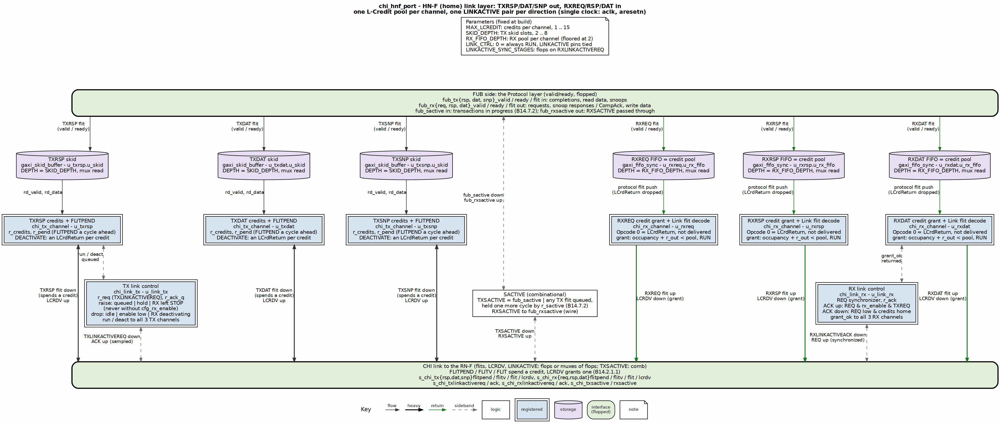

<!-- RTL Design Sherpa Documentation Header -->
<table>
<tr>
<td width="80">
  <a href="https://github.com/sean-galloway/RTLDesignSherpa">
    
  </a>
</td>
<td>
  <strong>RTL Design Sherpa</strong> · <em>Learning Hardware Design Through Practice</em><br>
  <sub>
    <a href="https://github.com/sean-galloway/RTLDesignSherpa">GitHub</a> ·
    <a href="https://github.com/sean-galloway/RTLDesignSherpa/blob/main/docs/DOCUMENTATION_INDEX.md">Documentation Index</a> ·
    <a href="https://github.com/sean-galloway/RTLDesignSherpa/blob/main/LICENSE">MIT License</a>
  </sub>
</td>
</tr>
</table>

---

<!-- End Header -->

# CHI HN-F Port

**Module:** `chi_hnf_port.sv`
**Location:** `rtl/amba/chi/`
**Status:** New (2026-10-29)

---

## Overview

`chi_hnf_port` is the link layer of a CHI Home Node (HN-F) facing one RN-F: the completer side of one link pair and the mirror image of [`chi_rnf_port`](chi_rnf_port.md). It transmits on RSP, DAT and SNP and receives on REQ, RSP and DAT (Table B13.1). The Protocol layer above it, a home agent with a snoop filter and a memory path, receives requests on `fub_rxreq`, snoop responses, CompAck and write data on `fub_rxrsp` and `fub_rxdat`, and sends completions, read data and snoops on `fub_txrsp`, `fub_txdat` and `fub_txsnp`, each a valid/ready port carrying one packed flit word. The link side faces the requester with prefix `s_chi_`. The property set, flit widths and FUB flit convention are on the family page, [CHI Modules](README.md).

### Key Features

- Three `chi_tx_channel` and three `chi_rx_channel` instances, each with its own L-Credit pool of up to `MAX_LCREDIT`; a grant is usable the cycle after it arrives (B14.2.1.1)
- `FLITPEND` exactly one cycle before every `FLITV` (B14.4); LCrdReturns absorbed on receive and generated on deactivation (B13.11)
- One LINKACTIVE pair per direction (`chi_link_tx`, `chi_link_rx`), cross-coupled so the requester's activation brings this port's transmit direction up by itself (B14.6) and the four outputs keep the B14.6.3.4 order
- Deactivation on idleness (`cfg_idle_cycles`), on `cfg_link_enable` low, or because the receive direction deactivated; ACK dropped only once every credit is home
- `TXSACTIVE` from `fub_sactive` and queued flits; `RXSACTIVE` passed through
- Flits opaque beyond the Opcode and TxnID; the illegal property set stops elaboration with its `config_error` rule number
- Sticky `protocol_error` over every channel; `credit_starved` and per-channel credit counts for a monitor

---

## Parameters

The `CHI` property parameters are described in [CHI Modules: Properties and Parameters](README.md#properties-and-parameters). They are identical to `chi_rnf_port`'s: both ends of a link must be built from the same widths.

| Parameter | Type | Default | Description |
|---|---|---|---|
| NODEID_WIDTH | int | 7 | NodeID_Width, 7..16 |
| ADDR_WIDTH | int | 44 | Req_Addr_Width, 44..52 |
| DATA_WIDTH | int | 128 | Data_Width, 128 / 256 / 512 |
| REQ_RSVDC_WIDTH / DAT_RSVDC_WIDTH | int | 0 | 0, 4, 8, 12, 16, 24, 32 |
| MPAM_WIDTH / PBHA_WIDTH / MECID_WIDTH / STREAMID_WIDTH / SECSID1_WIDTH | int | 0 | 0/12/15, 0/4, 0/16, 0/16, 0/1 |
| DATA_CHECK / POISON | bit | 0 | Size the DAT flit by DW/8 / DW/64; nothing is computed or checked |
| MAX_LCREDIT | int | 15 | Credits per channel, 1..15, the same bound on every channel |
| LINK_CTRL | bit | 1 | 1 = LINKACTIVE handshake; 0 = always RUN, `s_chi_txlinkactivereq` and `s_chi_rxlinkactiveack` tied low |
| SKID_DEPTH | int | 4 | TX skid buffer slots, 2..8 |
| RX_FIFO_DEPTH | int | MAX_LCREDIT | Receive FIFO per RX channel, i.e. its credit pool, >= 1; floored at 2 inside the channel |
| LINKACTIVE_SYNC_STAGES | int | 2 | Synchronizer flops on `s_chi_rxlinkactivereq`; 0 for a known-synchronous system, never 1 |

### Derived Values (do not override)

| Name | Derivation | Meaning |
|---|---|---|
| REQ_W / RSP_W / SNP_W / DAT_W | `chi_pkg::req_flit_w()` etc. | Flit widths (137 / 71 / 94 / 240 at the defaults) |
| CRW | clog2(MAX_LCREDIT + 1) | Credit counter width |

---

## Ports

### Clock, Reset and Configuration

| Port | Width | Direction | Description |
|---|---|---|---|
| aclk / aresetn | 1 | Input | Clock, active-low asynchronous reset |
| cfg_link_enable | 1 | Input | 0 = do not keep the TX link up: it drops when idle and is never held; queued flits and a remote activation still raise it |
| cfg_link_hold | 1 | Input | 1 = keep the TX link in RUN with nothing to send (with `cfg_link_enable`) |
| cfg_idle_cycles | 8 | Input | Idle RUN cycles before deactivating; 0 = never on idleness alone |
| cfg_rx_enable | 1 | Input | 0 = keep the whole port in STOP: no activation acknowledged or started |
| fub_sactive | 1 | Input | Protocol layer: transactions in progress (B14.7.2) |
| fub_rxsactive | 1 | Output | `RXSACTIVE` passed through (B14.7.3) |

### FUB Side: Transmit Channels (valid/ready flits in)

| Port | Width | Direction | Description |
|---|---|---|---|
| fub_txrsp_valid / fub_txrsp_ready / fub_txrsp_flit | 1 / 1 / RSP_W | In / Out / In | RSP flit word (ready = skid not full) |
| fub_txdat_valid / fub_txdat_ready / fub_txdat_flit | 1 / 1 / DAT_W | In / Out / In | DAT flit word |
| fub_txsnp_valid / fub_txsnp_ready / fub_txsnp_flit | 1 / 1 / SNP_W | In / Out / In | SNP flit word |

### FUB Side: Receive Channels (valid/ready flits out)

| Port | Width | Direction | Description |
|---|---|---|---|
| fub_rxreq_valid / fub_rxreq_ready / fub_rxreq_flit | 1 / 1 / REQ_W | Out / In / Out | REQ flit word (FIFO not empty / consumer ready); LCrdReturns never appear here |
| fub_rxrsp_valid / fub_rxrsp_ready / fub_rxrsp_flit | 1 / 1 / RSP_W | Out / In / Out | RSP flit word |
| fub_rxdat_valid / fub_rxdat_ready / fub_rxdat_flit | 1 / 1 / DAT_W | Out / In / Out | DAT flit word |

### CHI Link: Activity and LINKACTIVE Pairs (B14.5, B14.7)

| Port | Width | Direction | Description |
|---|---|---|---|
| s_chi_txsactive | 1 | Output | `TXSACTIVE` (combinational from `fub_sactive` and the TX queues, held one more cycle) |
| s_chi_rxsactive | 1 | Input | `RXSACTIVE`, passed to `fub_rxsactive` |
| s_chi_txlinkactivereq / s_chi_txlinkactiveack | 1 | Out / In | Transmit direction pair; ACK is sampled into a flop |
| s_chi_rxlinkactivereq / s_chi_rxlinkactiveack | 1 | In / Out | Receive direction pair; REQ is synchronized |

### CHI Link: Transmit Channels

| Port | Width | Direction | Description |
|---|---|---|---|
| s_chi_txrspflitpend / s_chi_txrspflitv / s_chi_txrspflit / s_chi_txrsplcrdv | 1 / 1 / RSP_W / 1 | Out / Out / Out / In | TXRSP: `FLITPEND`, `FLITV`, `FLIT` (zero while not valid or for an LCrdReturn), `LCRDV` |
| s_chi_txdat* | as above, DAT_W | | TXDAT |
| s_chi_txsnp* | as above, SNP_W | | TXSNP |

### CHI Link: Receive Channels

| Port | Width | Direction | Description |
|---|---|---|---|
| s_chi_rxreqflitpend / s_chi_rxreqflitv / s_chi_rxreqflit / s_chi_rxreqlcrdv | 1 / 1 / REQ_W / 1 | In / In / In / Out | RXREQ; `LCRDV` is a flop |
| s_chi_rxrsp* | as above, RSP_W | | RXRSP |
| s_chi_rxdat* | as above, DAT_W | | RXDAT |

### Status

| Port | Width | Direction | Description |
|---|---|---|---|
| busy | 1 | Output | Any TX flit queued, any RX flit buffered, or either link not in STOP |
| tx_link_state | 2 | Output | `{TXLINKACTIVEREQ, TXLINKACTIVEACK sampled}`: 00 STOP, 10 ACTIVATE, 11 RUN, 01 DEACTIVATE |
| rx_link_state | 2 | Output | `{RXLINKACTIVEREQ synchronized, RXLINKACTIVEACK}` |
| txrsp_credits / txdat_credits / txsnp_credits | CRW | Output | Credits held per TX channel |
| rxreq_outstanding / rxrsp_outstanding / rxdat_outstanding | CRW | Output | Credits granted and not home per RX channel |
| credit_starved | 1 | Output | A flit waits in RUN with no credit on some TX channel |
| protocol_error | 1 | Output | Sticky OR of every channel's protocol error |

---

## Functional Description

### Block diagram



Each TX channel is one column dropping from the FUB bar through its skid buffer and credit logic to the link; each RX channel climbs its own column from the link through the LCrdReturn decode into its FIFO, which is the credit pool, and out to the FUB. The two link controllers sit beside the columns and broadcast the direction state to every channel of their direction.

### Credits

Per TX channel, `r_credits` updates by `+LCRDV - FLITV` each cycle; a flit goes when the skid holds one, the direction is in RUN and `r_credits` is nonzero. `r_credits` is a register, so a grant cannot be spent in the cycle it arrives. A grant that would exceed `MAX_LCREDIT` is dropped and flagged. Per RX channel, `o_lcrdv` is a flop driven by `occupancy + outstanding < RX_FIFO_DEPTH` and `outstanding < MAX_LCREDIT`, evaluated for the state after this edge, so a slot freed by a FUB pop at cycle t backs a grant at t+1. Credits are granted only in RUN; flits are accepted in any state, which covers the ACTIVATE and DEACTIVATE races of Table B14.2.

### FLITPEND

`FLITPEND` is the next-cycle condition itself, computed from flops: a flit queued while in RUN, or a credit to return while in DEACTIVATE. It is registered into `r_pend`, and `FLITV` in a cycle requires `r_pend`, so every flit was announced the cycle before. A pend not followed by a flit (the credit never came, the direction changed) is permitted (B14.4). On receive, `FLITV` without `FLITPEND` the cycle before is a protocol error.

### Link control

| Direction | From | To | When |
|---|---|---|---|
| TX | STOP | ACTIVATE | `cfg_rx_enable` and `RXLINKACTIVEACK` low, and one of: a TX flit queued, `cfg_link_hold && cfg_link_enable`, the RX direction has left STOP (B14.6.1) |
| TX | ACTIVATE | RUN | `TXLINKACTIVEACK` sampled high |
| TX | RUN | DEACTIVATE | `RXLINKACTIVEACK` high, and either the RX direction is in DEACTIVATE, or nothing is queued, no hold, and `cfg_link_enable` is low or `cfg_idle_cycles` idle cycles have passed |
| TX | DEACTIVATE | STOP | the requester drops ACK after every credit is home; meanwhile each channel returns one credit per cycle as an LCrdReturn |
| RX | ACTIVATE | RUN | synchronized REQ high, `cfg_rx_enable`, and `TXLINKACTIVEREQ` already high |
| RX | RUN | DEACTIVATE | REQ falls: granting stops at once, in-flight flits still accepted |
| RX | DEACTIVATE | STOP | every RX channel reports its credits home and `TXLINKACTIVEREQ` is low |

In the usual case the requester activates first: its REQ arrives on `s_chi_rxlinkactivereq`, this port raises `s_chi_txlinkactivereq` on its own, then acknowledges, and no Protocol-layer action is needed. `cfg_rx_enable = 0` holds the port in STOP; `cfg_link_enable = 0` only stops the TX link being kept up. With `LINK_CTRL = 0` both directions are permanently RUN, the LINKACTIVE pins stay low, and the status reads 11 (RUN).

### SACTIVE

`TXSACTIVE` is high while `fub_sactive` is high or any TX channel holds a flit, and for one cycle after (`r_sactive`). The home's Protocol layer must hold `fub_sactive` while it owes anything to the requester: a snoop it issued, data it is returning (B14.7.2). `RXSACTIVE` is wired to `fub_rxsactive` (B14.7.3).

### Status

`busy` is the clock-gating term: any flit queued or buffered, or a link away from STOP. `protocol_error` is the sticky OR of the six channels: a grant beyond the bound on a TX channel; on an RX channel a flit without `FLITPEND`, a flit with no credit outstanding, or an LCrdReturn with a non-zero TxnID.

---

## Timing Characteristics

- FUB to link: a flit accepted at cycle t sits in the skid at t+1, `FLITPEND` is raised at t+1 and `FLITV` at t+2 at the earliest.
- `LCRDV` at cycle t: usable at t+1; `FLITV` at t+1 if `FLITPEND` was already up.
- `TXLINKACTIVEACK` rising at t: RUN at t+1 (registered sample), `FLITPEND` at t+1, first flit at t+2.
- Link to FUB: the FIFO is in mux-read mode, so a flit received at t is offered at t+1. A slot freed at t supports a grant driven at t+1.
- Requester activation: REQ seen after `LINKACTIVE_SYNC_STAGES` cycles, `TXLINKACTIVEREQ` one cycle later, `RXLINKACTIVEACK` the cycle after that, first grant one more cycle on.
- Back-to-back flits at one per cycle need `MAX_LCREDIT` and the partner's pool at least as large as the credit round trip.

---

## Usage Example

```systemverilog
chi_hnf_port #(
    .NODEID_WIDTH  (7),
    .ADDR_WIDTH    (44),
    .DATA_WIDTH    (256),
    .MAX_LCREDIT   (8),
    .LINK_CTRL     (1'b1),
    .SKID_DEPTH    (4),
    .RX_FIFO_DEPTH (8)
) u_hn_port (
    .aclk (aclk), .aresetn (aresetn),
    .cfg_link_enable (1'b1), .cfg_link_hold (1'b0), .cfg_idle_cycles (8'd64),
    .cfg_rx_enable (1'b1),
    .fub_sactive (home_busy), .fub_rxsactive (rn_active),
    // Protocol layer (home agent): one packed flit word per channel, bit 0 first
    .fub_txrsp_valid (rsp_v), .fub_txrsp_ready (rsp_r), .fub_txrsp_flit (rsp_word),
    .fub_txdat_valid (dat_v), .fub_txdat_ready (dat_r), .fub_txdat_flit (dat_word),
    .fub_txsnp_valid (snp_v), .fub_txsnp_ready (snp_r), .fub_txsnp_flit (snp_word),
    .fub_rxreq_valid (req_v),  .fub_rxreq_ready (req_r),  .fub_rxreq_flit (req_word),
    .fub_rxrsp_valid (rrsp_v), .fub_rxrsp_ready (rrsp_r), .fub_rxrsp_flit (rrsp_word),
    .fub_rxdat_valid (rdat_v), .fub_rxdat_ready (rdat_r), .fub_rxdat_flit (rdat_word),
    // CHI link to the requester: wire s_chi_* straight to the RN-F's pins
    .s_chi_txsactive (TXSACTIVE), .s_chi_rxsactive (RXSACTIVE),
    .s_chi_txlinkactivereq (TXLINKACTIVEREQ), .s_chi_txlinkactiveack (TXLINKACTIVEACK),
    .s_chi_rxlinkactivereq (RXLINKACTIVEREQ), .s_chi_rxlinkactiveack (RXLINKACTIVEACK),
    .s_chi_txrspflitpend (TXRSPFLITPEND), .s_chi_txrspflitv (TXRSPFLITV),
    .s_chi_txrspflit (TXRSPFLIT), .s_chi_txrsplcrdv (TXRSPLCRDV),
    .s_chi_txdatflitpend (TXDATFLITPEND), .s_chi_txdatflitv (TXDATFLITV),
    .s_chi_txdatflit (TXDATFLIT), .s_chi_txdatlcrdv (TXDATLCRDV),
    .s_chi_txsnpflitpend (TXSNPFLITPEND), .s_chi_txsnpflitv (TXSNPFLITV),
    .s_chi_txsnpflit (TXSNPFLIT), .s_chi_txsnplcrdv (TXSNPLCRDV),
    .s_chi_rxreqflitpend (RXREQFLITPEND), .s_chi_rxreqflitv (RXREQFLITV),
    .s_chi_rxreqflit (RXREQFLIT), .s_chi_rxreqlcrdv (RXREQLCRDV),
    .s_chi_rxrspflitpend (RXRSPFLITPEND), .s_chi_rxrspflitv (RXRSPFLITV),
    .s_chi_rxrspflit (RXRSPFLIT), .s_chi_rxrsplcrdv (RXRSPLCRDV),
    .s_chi_rxdatflitpend (RXDATFLITPEND), .s_chi_rxdatflitv (RXDATFLITV),
    .s_chi_rxdatflit (RXDATFLIT), .s_chi_rxdatlcrdv (RXDATLCRDV),
    // status, left to a monitor
    .busy (), .tx_link_state (), .rx_link_state (),
    .txrsp_credits (), .txdat_credits (), .txsnp_credits (),
    .rxreq_outstanding (), .rxrsp_outstanding (), .rxdat_outstanding (),
    .credit_starved (), .protocol_error (hn_proto_err)
);
```

---

## Related Modules

- **[CHI RN-F Port](chi_rnf_port.md)**: the other end of the link pair
- **[CHI Modules](README.md)**: `chi_pkg`, `chi_tx_channel`, `chi_rx_channel`, `chi_link_tx`, `chi_link_rx`
- **[CXS Master](../cxs/cxs_master.md)** / **[CXS Slave](../cxs/cxs_slave.md)**: the single-link credited endpoints this family extends
- `gaxi_skid_buffer`, `gaxi_fifo_sync`, `glitch_free_n_dff_arn`

---

## Testing

`val/amba/test_chi_hnf_port.py` drives the FUB side with GAXI BFMs and the link side with the framework `CHIRequestNode` on `s_chi_`, with a `CHIMonitor` on the same pins. The TB plays a minimal home Protocol layer at flit level: serves the requester's reads and writes (CompData, CompDBIDResp then write data), issues snoops on `fub_txsnp` and checks their responses, and holds `fub_sactive` while it owes anything. The configuration grid and phases are those of the family, `val/amba/chi_test_common.py`: fast, starve, gappy, back-to-back, pool fill, and with `LINK_CTRL` the idle, remote-activation and churn phases.

```bash
source env_python
cd val/amba && make clean-all && make run-chi_hnf_port-func-parallel
```

## References

- Arm. *AMBA 5 CHI Architecture Specification*, ARM IHI 0050 Issue H. [developer.arm.com/documentation/ihi0050](https://developer.arm.com/documentation/ihi0050/latest/): B13.2 link pairs, Table B13.1 HN-F channels, B13.11 Link flits, B14.2.1.1 L-Credits, B14.4 FLITPEND, B14.5 and Tables B14.1 / B14.2 link activation, B14.6.1 and B14.6.3.4 the two directions, B14.7.2 TXSACTIVE, B14.7.3 RXSACTIVE. Citation only.

---

## Navigation

- **[Back to CHI Index](README.md)**
- **[Back to rtl-amba Index](../index.md)**
- **[Back to Main Documentation Index](../../index.md)**
