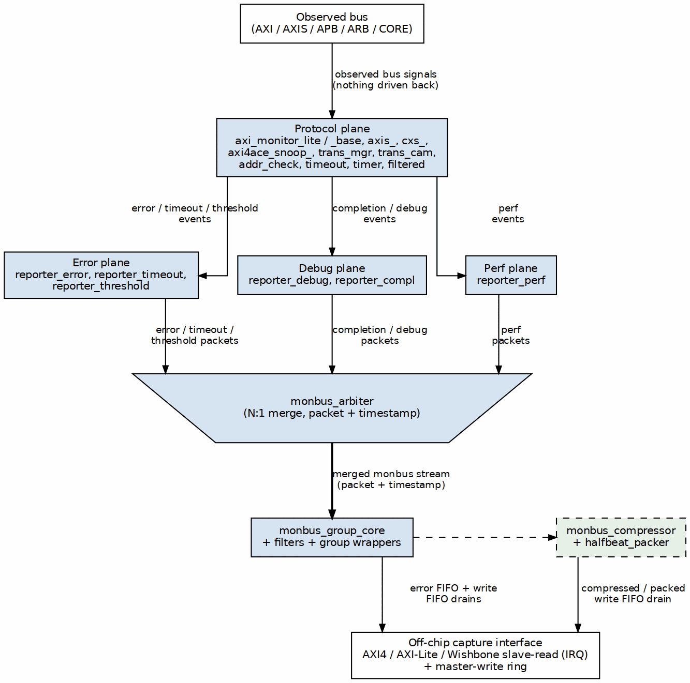

<!-- RTL Design Sherpa Documentation Header -->
<table>
<tr>
<td width="80">
  
</td>
<td>
  <strong>RTL Design Sherpa</strong> · <em>Learning Hardware Design Through Practice</em> 
  
    <a href="https://github.com/sean-galloway/RTLDesignSherpa">GitHub</a> ·
    <a href="https://github.com/sean-galloway/RTLDesignSherpa/blob/main/docs/DOCUMENTATION_INDEX.md">Documentation Index</a> ·
    <a href="https://github.com/sean-galloway/RTLDesignSherpa/blob/main/LICENSE">MIT License</a>
  
</td>
</tr>
</table>

---

<!-- End Header -->

# Ocelus plane map

**Scope:** the five purpose-sliced layers that make up the Ocelus AMBA
monitor, their membership, and how they fit together. For the repo-wide
definition of a "plane" see the handbook note
[what-is-a-plane](../../../../vault/handbook/design/what-is-a-plane.md).

---

## The five planes

Ocelus is sliced into five planes. Each plane is a unit you can decide to
keep or drop; dropping one never reroutes the others.

| Plane | Job | Members |
|---|---|---|
| **Protocol plane** | Observe the bus and emit protocol-event packets | `axi_monitor_base`, `axi_monitor_lite`, `axis_monitor_lite`, `cxs_monitor_lite`, `axi4ace_snoop_monitor_lite`, `axi_monitor_trans_mgr`, `monitor_trans_cam`, `axi_monitor_addr_check`, `apb_monitor_addr_check`, `axi_monitor_timeout`, `axi_monitor_timer`, `axi_monitor_filtered` |
| **Error plane** | Detect and packetize errors, timeouts and threshold violations | `axi_monitor_reporter_error`, `axi_monitor_reporter_timeout`, `axi_monitor_reporter_threshold` |
| **Debug plane** | Emit completion and debug-trace packets | `axi_monitor_reporter_debug`, `axi_monitor_reporter_compl` |
| **Perf plane** | Roll up performance counters into perf packets | `axi_monitor_reporter_perf` |
| **Output plane** | Arbitrate, filter, compress and drain packets off-chip | `arbiter_monbus_common`, `arbiter_rr_pwm_monbus`, `arbiter_wrr_pwm_monbus`, `monbus_arbiter`, `monbus_group_core`, `monbus_axi4_axi4_group`, `monbus_axi4_axil4_group`, `monbus_axil4_axi4_group`, `monbus_axil4_axil4_group`, `monbus_wb4_axi4_group`, `monbus_wb4_axil4_group`, `monbus_wb4_rd_shim`, `monbus_compressor`, `monbus_halfbeat_packer`, `monbus_cam`, `monbus_cam_pipe`, `monbus_legal_cam`, `monbus_pkt_tally` |

### Shared reporter infrastructure

`axi_monitor_reporter.sv` (no suffix) is **not a plane** and **not a
protocol-plane member**. It is the thin top-level dispatcher that multiplexes
the six per-packet-type reporter cones onto the shared MonBus output and
reports events back to `axi_monitor_trans_mgr`. The error, debug and perf
planes feed through it; dropping one of those planes simply disables its cone,
leaving the dispatcher and the others untouched.

---

## Build personas (examples, not prescriptions)

These are illustrative inclusion matrices. The exact parameters live on each
module page.

| Persona | Planes kept | Output-plane options | Typical use |
|---|---|---|---|
| **bring-up** | protocol + error | AXI4 group drain, no compressor, no CAM capture | catch SLVERR, DECERR, timeouts and bus hangs |
| **silicon-perf** | protocol + perf | compressor + halfbeat_packer enabled | long runs measuring utilization and error roll-ups with compressed bulk trace |
| **field-debug** | protocol + error + debug | CAM capture enabled (`monbus_cam` / `monbus_legal_cam`), Wishbone drain | capture trace around a rare failure and drain through a low-pin-count WB4 port |
| **full** | all five | all options enabled | maximum observability; pay the area and bandwidth cost |

Omitting a plane at build time is a parameter change (`ENABLE_*_LOGIC` on the
reporter cones, `USE_COMPRESSION` on the group wrappers, `USE_CAM` on capture)
not a rewrite of the data path.

---

## Data-flow contract

The contract is the same in every build:

1. **Observed bus → protocol plane.** The protocol plane taps the bus as a
   passive observer. It never drives the bus back.
2. **Protocol plane → reporter planes.** The protocol plane produces
   transaction state and event triggers. Each reporter plane consumes only the
   events it owns.
3. **Reporter planes → output plane.** Each reporter plane emits typed
   `monitor_packet_t` records with a side-band 64-bit timestamp. They are
   independent sources.
4. **Output plane → off-chip capture.** `monbus_arbiter` merges N sources into
   one MonBus stream. `monbus_group_core` filters and steers records to the
   interrupt/read FIFO or the master-write ring; optional compression/packing
   sits on the write path. The final drain leaves through one capture
   interface, regardless of which reporter planes produced the packets.

Dropping a plane removes its source from the arbiter; the remaining sources
still merge the same way.

---

## Plane architecture

The observed bus enters at the top. The protocol plane sits on it. The error,
debug and perf planes consume protocol events independently, feed the MonBus
arbiter inside the output plane, and the merged stream is filtered, optionally
compressed, and drained off-chip through the single capture interface at the
bottom.

---

## Related

- [Handbook: what is a plane](../../../../vault/handbook/design/what-is-a-plane.md)
- [Ocelus architecture overview](monitor_system_architecture.md)
- [Monitor package / packet format](../includes/monitor_package_spec.md)

## Navigation

- **[← Back to Shared Infrastructure Index](../_book_monitor_index.md)**
- **[← Back to rtl-amba Index](../index.md)**
- **[← Back to Main Documentation Index](../../index.md)**
