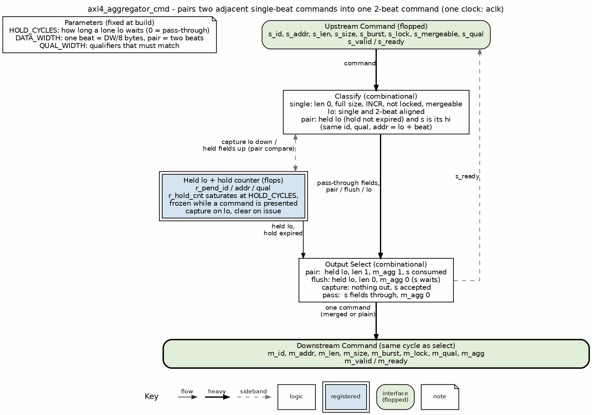

<!-- RTL Design Sherpa Documentation Header -->
<table>
<tr>
<td width="80">
  
</td>
<td>
  <strong>RTL Design Sherpa</strong> · <em>Learning Hardware Design Through Practice</em> 
  
    <a href="https://github.com/sean-galloway/RTLDesignSherpa">GitHub</a> ·
    <a href="https://github.com/sean-galloway/RTLDesignSherpa/blob/main/docs/DOCUMENTATION_INDEX.md">Documentation Index</a> ·
    <a href="https://github.com/sean-galloway/RTLDesignSherpa/blob/main/LICENSE">MIT License</a>
  
</td>
</tr>
</table>

---

<!-- End Header -->

# AXI4 Aggregator Pairing Core

**Module:** `axi4_aggregator_cmd.sv`
**Location:** `rtl/amba/shared/`
**Status:** New (2026-10-28)

---

## Overview

The pairing core shared by `axi4_wr_aggregator` (on AW) and `axi4_rd_aggregator` (on AR). It sees one AXI4 command stream and emits one: two adjacent single-beat commands to the two halves of a 2-beat-aligned pair come out as one 2-beat INCR command with `m_agg = 1`; everything else comes out as it went in, in order. One held command, one hold counter, no state machine.

The qualifiers that must match (cache, prot, qos, region, user) are packed by the wrapper into `s_qual` so the core does not know the channel it is on.

---

## Parameters

| Parameter | Type | Default | Description |
|-----------|------|---------|-------------|
| ID_WIDTH | int | 8 | Width of the command ID |
| ADDR_WIDTH | int | 32 | Width of the address |
| DATA_WIDTH | int | 32 | Beat width, a power of two; one beat is DW/8 bytes, a pair is two beats |
| QUAL_WIDTH | int | 16 | Width of the packed qualifiers that must match |
| HOLD_CYCLES | int | 4 | Cycles during which a hi may pair with the held lo; a lone lo leaves HOLD_CYCLES + 1 cycles after capture. 0 = never capture, pure pass-through |
| IW, AW, DW, QW | int | aliases | Shorthand |

---

## Ports

| Port | Direction | Width | Description |
|------|-----------|-------|-------------|
| aclk, aresetn | input | 1 | Clock, active-low asynchronous reset |
| s_id, s_addr, s_len, s_size, s_burst, s_lock, s_mergeable, s_qual | input | IW, AW, 8, 3, 2, 1, 1, QW | Upstream command fields; `s_mergeable` is AxCACHE[1], and a non-modifiable command never pairs |
| s_valid / s_ready | input / output | 1 | Upstream handshake |
| m_id, m_addr, m_len, m_size, m_burst, m_lock, m_qual | output | IW, AW, 8, 3, 2, 1, QW | Downstream command fields; a merged command has lo's address and `m_len = 1` |
| m_agg | output | 1 | 1 when the downstream command is two upstream commands |
| m_valid / m_ready | output / input | 1 | Downstream handshake |

---

## Functional Description

### Block diagram

### Classification

| Term | Condition |
|---|---|
| single | `s_len = 0`, `s_size = log2(DW/8)`, `s_burst = INCR`, `s_lock = 0`, `s_mergeable = 1` |
| lo | single, and `s_addr mod (2 * DW/8) = 0`, and HOLD_CYCLES > 0 |
| pair | a lo is held, the hold has not expired, and s is single with the same id and qual, at `held addr + DW/8` |

### The four cases of the output select

| Held lo? | s | m_valid | Downstream | s_ready |
|---|---|---|---|---|
| yes | its hi | 1 | held lo, `m_len = 1`, `m_agg = 1` | `m_ready` (the hi rides the merged handshake) |
| yes | anything else, or hold expired | 1 | held lo, `m_len = 0`, `m_agg = 0` | 0 (s waits one cycle) |
| yes | nothing, hold running | 0 | nothing | 0 |
| no | a lo | 0 | nothing: captured | 1 |
| no | not a lo | `s_valid` | s, unchanged, `m_agg = 0` | `m_ready` |

### Why the handshakes are legal

Once `m_valid` rises it stays high with a stable payload until `m_ready`. The hold counter freezes while `m_valid` is high, so a presented pair cannot expire into a flush under backpressure. A flush that started from expiry cannot turn into a pair, because pairing is refused once the hold has expired; a hi that arrives late passes through alone the cycle after. A flush started by a non-pairing s is stable because the upstream holds s until `s_ready`. The review that found the expiry-then-hi case (2026-10-28) is why the two guards exist. `m_valid` never depends on `m_ready`; `s_ready` depends on `m_ready` only in the pass-through and pair cases, which is the ordinary combinational-ready coupling of a bypass.

### Why there is no boundary check

A lo is aligned to two beats, and the merged command is exactly two beats, so it stays inside one aligned 2-beat block. A 2-beat block of DW/8 bytes each is at most 4 KB for DW up to 16384 bits, so no AXI 4 KB boundary can fall inside it.

---

## Related Modules

- **axi4_wr_aggregator.sv** - packs the AW qualifiers, adds the W and B handling
- **axi4_rd_aggregator.sv** - packs the AR qualifiers, adds the R handling

---

## Testing

The core has no test of its own; it is exercised through both wrappers (`val/amba/test_axi4_wr_aggregator.py`, `val/amba/test_axi4_rd_aggregator.py`), whose directed streams cover every row of the output-select table.

### Source Code
- RTL: `rtl/amba/shared/axi4_aggregator_cmd.sv`

---

**Last Updated:** 2026-10-28

---

## Navigation

- [Back to Shared Infrastructure Index](README.md)
- [Back to rtl-amba Index](../index.md)
