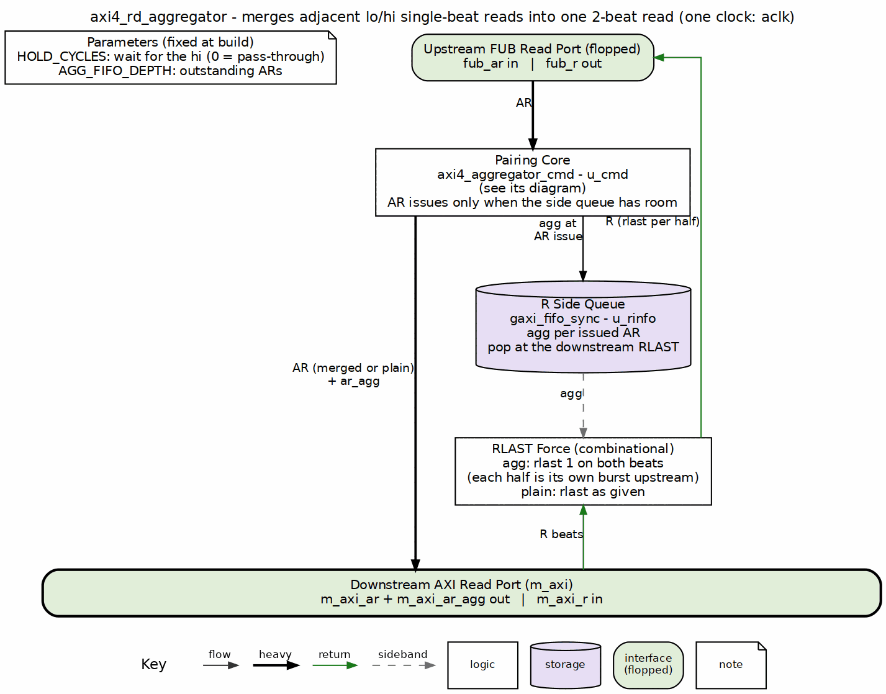

<!-- RTL Design Sherpa Documentation Header -->
<table>
<tr>
<td width="80">
  <a href="https://github.com/sean-galloway/RTLDesignSherpa">
    
  </a>
</td>
<td>
  <strong>RTL Design Sherpa</strong> · <em>Learning Hardware Design Through Practice</em><br>
  <sub>
    <a href="https://github.com/sean-galloway/RTLDesignSherpa">GitHub</a> ·
    <a href="https://github.com/sean-galloway/RTLDesignSherpa/blob/main/docs/DOCUMENTATION_INDEX.md">Documentation Index</a> ·
    <a href="https://github.com/sean-galloway/RTLDesignSherpa/blob/main/LICENSE">MIT License</a>
  </sub>
</td>
</tr>
</table>

---

<!-- End Header -->

# AXI4 Read Aggregator

**Module:** `axi4_rd_aggregator.sv`
**Location:** `rtl/amba/shared/`
**Status:** New (2026-10-28)

---

## Overview

The read half of the poor man's aggregator. Two adjacent single-beat reads of the two halves of a 2-beat-aligned pair (lo then hi) leave as ONE 2-beat INCR read flagged `m_axi_ar_agg`. The 2-beat R burst that comes back is handed upstream as two single-beat bursts: RLAST is forced high on both beats and nothing else changes. Everything that is not such a pair passes through in order.

The read side is simpler than the write side because R carries its own framing. There is no W to hold back and no response to replay; the one side queue only has to say, per downstream burst, whether RLAST needs forcing. The pairing core, the hold rule and the assumptions are the same as the write aggregator's; see that page for the discussion and this one for what differs.

### Key Features

- Same pairing rule as `axi4_wr_aggregator`: lo (single-beat, full-width, INCR, non-locked, 2-beat-aligned) plus the hi that follows (same ID, size and qualifiers, address + one beat)
- One downstream AR per pair: lo's address, `ARLEN = 1`, `m_axi_ar_agg = 1`
- A lone lo gets `HOLD_CYCLES` cycles for its partner, then leaves alone; `HOLD_CYCLES = 0` is a pass-through
- Only modifiable reads (`ARCACHE[1] = 1`) pair
- R passes through; an aggregated burst gets `RLAST = 1` on both beats so each upstream read sees its own one-beat burst
- One side queue, `gaxi_fifo_sync`, `AGG_FIFO_DEPTH` deep, bounds the outstanding reads

| Upstream ARs | Downstream ARs | Aggregations |
|---|---|---|
| lo0, hi0, lo1, hi2 | {lo0+hi0, agg}, lo1, hi2 | 1 |
| lo0, lo1, hi0, hi1 | lo0, lo1, hi0, hi1 | 0 |

---

## Parameters

| Parameter | Type | Default | Description |
|-----------|------|---------|-------------|
| AXI_ID_WIDTH | int | 8 | Width of ARID / RID |
| AXI_ADDR_WIDTH | int | 32 | Width of ARADDR |
| AXI_DATA_WIDTH | int | 32 | Width of RDATA, a power of two; a beat is DW/8 bytes, a pair is two beats |
| AXI_USER_WIDTH | int | 1 | Width of ARUSER / RUSER |
| HOLD_CYCLES | int | 4 | Cycles a lone lo waits for its hi before leaving alone; 0 = never aggregate |
| AGG_FIFO_DEPTH | int | 4 | Depth of the R side queue; bounds the ARs in flight. Minimum 2 |
| IW, AW, DW, UW | int | aliases | Shorthand for the four widths |

---

## Ports

### Clock and Reset

| Port | Direction | Width | Description |
|------|-----------|-------|-------------|
| aclk | input | 1 | Clock for every interface |
| aresetn | input | 1 | Active-low asynchronous reset |

### Upstream Read Interface (fub)

| Port | Direction | Width | Description |
|------|-----------|-------|-------------|
| fub_arid, fub_araddr, fub_arlen, fub_arsize, fub_arburst, fub_arlock, fub_arcache, fub_arprot, fub_arqos, fub_arregion, fub_aruser | input | AXI4 | Read address channel as issued by the master |
| fub_arvalid / fub_arready | input / output | 1 | AR handshake. A lo is accepted the cycle it is captured; its hi is accepted with the merged downstream AR |
| fub_rid, fub_rdata, fub_rresp, fub_ruser | output | AXI4 | Read data, copied from the downstream R |
| fub_rlast | output | 1 | Forced to 1 on both beats of an aggregated burst, as given otherwise |
| fub_rvalid / fub_rready | output / input | 1 | R handshake |

### Downstream Read Interface (m_axi)

| Port | Direction | Width | Description |
|------|-----------|-------|-------------|
| m_axi_arid, m_axi_araddr, m_axi_arlen, m_axi_arsize, m_axi_arburst, m_axi_arlock, m_axi_arcache, m_axi_arprot, m_axi_arqos, m_axi_arregion, m_axi_aruser | output | AXI4 | The merged or plain AR. A merged AR carries lo's address and ARLEN = 1 |
| m_axi_ar_agg | output | 1 | Sideband with the AR: 1 when this AR is two upstream reads |
| m_axi_arvalid / m_axi_arready | output / input | 1 | AR handshake; valid also requires room in the side queue |
| m_axi_rid, m_axi_rdata, m_axi_rresp, m_axi_rlast, m_axi_ruser | input | AXI4 | Read data channel |
| m_axi_rvalid / m_axi_rready | input / output | 1 | R handshake |

---

## Functional Description

### Block diagram



### Command side

Identical to the write aggregator: `axi4_aggregator_cmd` holds a lo for up to HOLD_CYCLES, merges it with its hi into one AR with `ARLEN = 1` and `m_axi_ar_agg = 1`, or flushes it alone. The AR issues only when the side queue has room, and the `agg` bit is pushed at the AR handshake.

### Read data

The side queue's head is the `agg` bit of the burst currently returning. `fub_rlast = agg ? 1 : m_axi_rlast`; every other R field passes through, and the handshake is gated on the queue being non-empty so a stray beat with no AR behind it is never forwarded. The queue pops at the downstream RLAST, which for an aggregated burst is the second beat. The upstream master therefore sees two one-beat bursts with the same RID, exactly as if its two ARs had gone out separately.

---

## Timing Characteristics

| Path | Latency |
|---|---|
| Plain command (not a lo) | 0 cycles: AR passes combinationally |
| lo with its hi | the gap to the hi: 1 cycle when the hi is next, up to HOLD_CYCLES |
| lo with no partner | HOLD_CYCLES + 1 cycles |
| R beat | 0 cycles |

---

## Design Notes

### Assumptions

1. **R bursts return in AR issue order.** The side queue is a FIFO. True for a single-ID stream and for an in-order slave; AXI permits reordering across IDs, and a slave that does so needs the CAM-based path.
2. **Bursts are not interleaved.** AXI4 forbids interleaving R beats of different bursts, so the head of the queue always belongs to the burst in progress.
3. **Only modifiable reads pair.** `ARCACHE[1] = 0` is never a lo or a hi, as AXI A4.3.1 requires.

### Response errors

Both halves of an aggregated read see the RRESP of their own beat, because the slave returns one RRESP per beat. That is the one place the read side is more precise than the write side, where a single BRESP covers both halves.

---

## Related Modules

### Uses
- **axi4_aggregator_cmd.sv** - the pairing core, shared with the write aggregator
- **gaxi_fifo_sync.sv** - the R side queue
- **reset_defs.svh** - reset macros

### See Also
- **axi4_wr_aggregator.sv** - the write side (AW + W + B), with the full discussion of the rule and the assumptions
- **axi_master_rd_splitter.sv** - the inverse: one burst into many at a boundary

---

## Testing

`val/amba/test_axi4_rd_aggregator.py` is the runner; the stimulus and the checkers are `bin/TBClasses/axi_aggregator/axi4_aggregator_tb.py`, with the directed streams and the random plan in `agg_plan.py` beside it. One TB class serves both sides (`AGG_KIND=wr|rd`). REG_LEVEL selects the parameter grid and TEST_LEVEL the depth inside the TB.

```bash
source env_python
python3 bin/sim_build_clean.py val/amba --pattern aggregator
REG_LEVEL=GATE pytest val/amba/test_axi4_rd_aggregator.py -v
REG_LEVEL=FUNC pytest val/amba/test_axi4_rd_aggregator.py -v
```

---

## References

- Arm. *AMBA AXI and ACE Protocol Specification*, ARM IHI 0022, Issue H, 2020. [developer.arm.com/documentation/ihi0022/h](https://developer.arm.com/documentation/ihi0022/h), sec. A3.4.1 "Address structure" and A5.3 "Read data interleaving" (AXI4 removed it).

### Source Code
- RTL: `rtl/amba/shared/axi4_rd_aggregator.sv`, `rtl/amba/shared/axi4_aggregator_cmd.sv`
- Tests: `val/amba/test_axi4_rd_aggregator.py`
- Testbench: `bin/TBClasses/axi_aggregator/axi4_aggregator_tb.py`

---

**Last Updated:** 2026-10-28

---

## Navigation

- [Back to Shared Infrastructure Index](README.md)
- [Back to rtl-amba Index](../index.md)
