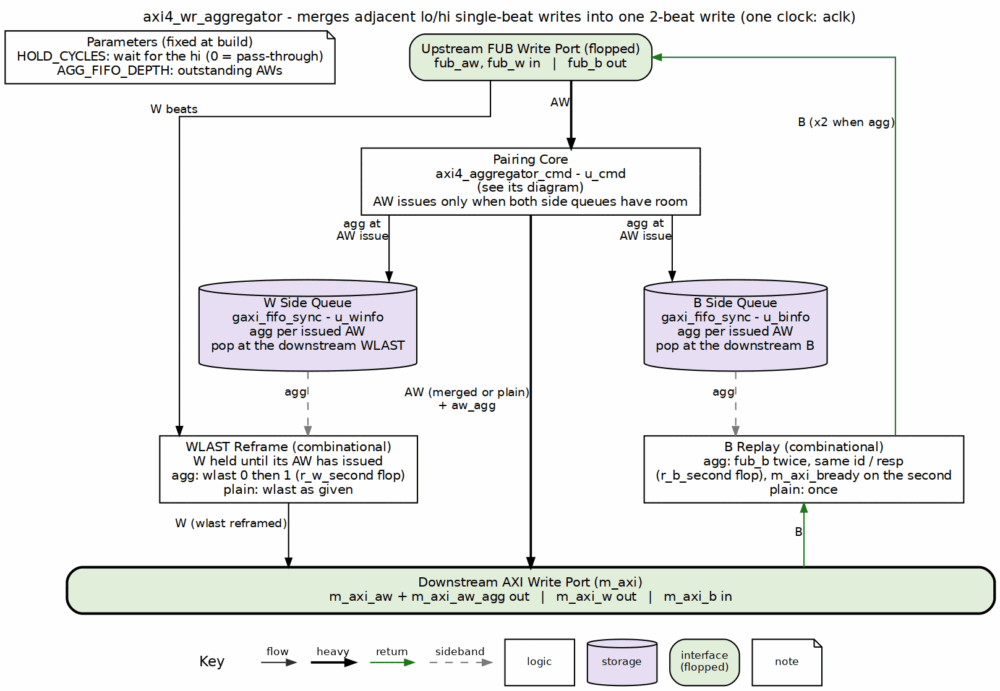

<!-- RTL Design Sherpa Documentation Header -->
<table>
<tr>
<td width="80">
  <a href="https://github.com/sean-galloway/RTLDesignSherpa">
    
  </a>
</td>
<td>
  <strong>RTL Design Sherpa</strong> · <em>Learning Hardware Design Through Practice</em><br>
  <sub>
    <a href="https://github.com/sean-galloway/RTLDesignSherpa">GitHub</a> ·
    <a href="https://github.com/sean-galloway/RTLDesignSherpa/blob/main/docs/DOCUMENTATION_INDEX.md">Documentation Index</a> ·
    <a href="https://github.com/sean-galloway/RTLDesignSherpa/blob/main/LICENSE">MIT License</a>
  </sub>
</td>
</tr>
</table>

---

<!-- End Header -->

# AXI4 Write Aggregator

**Module:** `axi4_wr_aggregator.sv`
**Location:** `rtl/amba/shared/`
**Status:** New (2026-10-28)

---

## Overview

The poor man's write aggregator. A master that writes a wide word as two narrow halves, the lower half then the upper, costs the memory controller two commands for one DRAM beat. This block watches the AW stream for exactly that pattern, two adjacent single-beat writes to the two halves of a 2-beat-aligned pair, and issues them as ONE 2-beat INCR write flagged `m_axi_aw_agg`. Everything else passes through in order. The W channel passes through with WLAST reframed, and the one B that comes back is replayed twice upstream so each original write gets its response.

No CAM, no reorder, no state machine. The whole block is one held command, a hold counter and two one-bit side queues. That is the design point: pumice does this job with CAMs that carry `agg`/`last` through the intake; this block is for the case where a FIFO in command order is enough, which it is whenever responses return in command order.

### Key Features

- Pairs `lo` (single-beat, full-width, INCR, non-locked, 2-beat-aligned) with the `hi` that follows it (same ID, size and qualifiers, address + one beat)
- One downstream AW per pair: lo's address, `AWLEN = 1`, `m_axi_aw_agg = 1`
- A lone `lo` gets `HOLD_CYCLES` cycles for its partner to arrive, then leaves alone; `HOLD_CYCLES = 0` makes the block a pass-through
- Only modifiable writes (`AWCACHE[1] = 1`) pair; a Device write passes through alone, as AXI requires
- Order preserved: nothing is reordered, dropped or duplicated on the command side
- W: WLAST is 0 then 1 across an aggregated pair; plain commands keep their WLAST
- B: an aggregated write's single B is presented upstream twice with the same ID and response
- Side queues are plain `gaxi_fifo_sync`, `AGG_FIFO_DEPTH` deep, and bound the outstanding writes

**Two streams the owner asked about:**

| Upstream AWs | Downstream AWs | Aggregations |
|---|---|---|
| lo0, hi0, lo1, hi2 | {lo0+hi0, agg}, lo1, hi2 | 1 |
| lo0, lo1, hi0, hi1 | lo0, lo1, hi0, hi1 | 0 |

The second stream has pairs in it, but not adjacent ones. A simple aggregator never looks past the next command, so it finds nothing. That is the price of no CAM, and it is the intended price.

---

## Parameters

| Parameter | Type | Default | Description |
|-----------|------|---------|-------------|
| AXI_ID_WIDTH | int | 8 | Width of AWID / BID |
| AXI_ADDR_WIDTH | int | 32 | Width of AWADDR |
| AXI_DATA_WIDTH | int | 32 | Width of WDATA, a power of two; a beat is DW/8 bytes, a pair is two beats |
| AXI_USER_WIDTH | int | 1 | Width of AWUSER / WUSER / BUSER |
| HOLD_CYCLES | int | 4 | Cycles a lone lo waits for its hi before leaving alone; 0 = never aggregate |
| AGG_FIFO_DEPTH | int | 4 | Depth of the W and B side queues; bounds the AWs in flight. Minimum 2 |
| IW, AW, DW, UW | int | aliases | Shorthand for the four widths |

---

## Ports

### Clock and Reset

| Port | Direction | Width | Description |
|------|-----------|-------|-------------|
| aclk | input | 1 | Clock for every interface |
| aresetn | input | 1 | Active-low asynchronous reset |

### Upstream Write Interface (fub)

| Port | Direction | Width | Description |
|------|-----------|-------|-------------|
| fub_awid, fub_awaddr, fub_awlen, fub_awsize, fub_awburst, fub_awlock, fub_awcache, fub_awprot, fub_awqos, fub_awregion, fub_awuser | input | AXI4 | Write address channel as issued by the master |
| fub_awvalid / fub_awready | input / output | 1 | AW handshake. A lo is accepted the cycle it is captured; its hi is accepted with the merged downstream AW |
| fub_wdata, fub_wstrb, fub_wlast, fub_wuser | input | AXI4 | Write data channel, passed through |
| fub_wvalid / fub_wready | input / output | 1 | W handshake; held until the beat's AW has issued downstream |
| fub_bid, fub_bresp, fub_buser | output | AXI4 | Write response, copied from the downstream B |
| fub_bvalid / fub_bready | output / input | 1 | B handshake; an aggregated write's B is presented twice |

### Downstream Write Interface (m_axi)

| Port | Direction | Width | Description |
|------|-----------|-------|-------------|
| m_axi_awid, m_axi_awaddr, m_axi_awlen, m_axi_awsize, m_axi_awburst, m_axi_awlock, m_axi_awcache, m_axi_awprot, m_axi_awqos, m_axi_awregion, m_axi_awuser | output | AXI4 | The merged or plain AW. A merged AW carries lo's address and AWLEN = 1 |
| m_axi_aw_agg | output | 1 | Sideband with the AW: 1 when this AW is two upstream writes |
| m_axi_awvalid / m_axi_awready | output / input | 1 | AW handshake; valid also requires room in both side queues |
| m_axi_wdata, m_axi_wstrb, m_axi_wuser | output | AXI4 | Write data, passed through |
| m_axi_wlast | output | 1 | Reframed: 0 then 1 across an aggregated pair, as given otherwise |
| m_axi_wvalid / m_axi_wready | output / input | 1 | W handshake |
| m_axi_bid, m_axi_bresp, m_axi_buser | input | AXI4 | Write response |
| m_axi_bvalid / m_axi_bready | input / output | 1 | B handshake; ready is withheld until the last upstream copy has been taken |

---

## Functional Description

### Block diagram



### The pairing rule

The pairing core is `axi4_aggregator_cmd` and has its own page. In short:

- **lo**: `AWLEN = 0`, `AWSIZE = log2(DW/8)`, `AWBURST = INCR`, `AWLOCK = 0`, `AWCACHE[1] = 1` (modifiable), and `AWADDR` aligned to two beats (`addr mod (2*DW/8) == 0`).
- **hi**: the very next command, with the same ID, cache, prot, qos, region and user, also single-beat full-width INCR non-locked and modifiable, at `lo + DW/8`.

A lo is captured (accepted upstream, nothing issued) and held. The next command is compared against it:

| Next command | Downstream | Then |
|---|---|---|
| its hi | one AW: lo's address, AWLEN 1, agg 1; the hi is accepted in the same handshake | nothing held |
| anything else | lo alone, agg 0 | the next command is evaluated the cycle after, in order |
| nothing for HOLD_CYCLES cycles | lo alone, agg 0, HOLD_CYCLES + 1 cycles after capture | idle |

A 2-beat burst at a 2-beat-aligned address never crosses a 4 KB boundary, so the merged command needs no boundary check.

### Write data

W beats are released once their AW has been presented downstream, because the WLAST decision needs the `agg` bit the AW pushed into the W side queue. Presented, not accepted: AXI forbids a master to wait for AWREADY before asserting WVALID, so the side queues are written the first cycle the AW is valid (`r_aw_logged` marks an AW that is out but not yet taken), and W can flow while the slave is still holding AWREADY low. That is safe because the core keeps the AW payload, `agg` included, stable until the handshake. For an aggregated pair the first beat leaves with `WLAST = 0` and the second with `WLAST = 1`; `r_w_second` is the one flop that tells them apart. A plain command keeps the WLAST it came with, so bursts with `AWLEN > 0` pass through unchanged. The side queue pops at the downstream WLAST.

### Write response

The B side queue holds the same `agg` bit per issued AW, popped at the downstream B. A plain B passes straight through. An aggregated B is presented upstream twice: `fub_bvalid` stays high across both copies, `r_b_second` marks the second, and `m_axi_bready` is withheld until the second copy is taken, so the downstream B stays valid and stable for both. Both halves see the one response the slave gave, so a SLVERR on the merged write is reported on both.

---

## Timing Characteristics

| Path | Latency |
|---|---|
| Plain command (not a lo) | 0 cycles: AW passes combinationally |
| lo with its hi | the gap to the hi: 1 cycle when the hi is next, up to HOLD_CYCLES |
| lo with no partner | HOLD_CYCLES + 1 cycles |
| W beat | 0 cycles once its AW has been presented |
| B, plain | 0 cycles |
| B, aggregated | 2 upstream beats for 1 downstream beat |

---

## Usage Examples

### In front of a memory controller

```systemverilog
axi4_wr_aggregator #(
    .AXI_ID_WIDTH   (4),
    .AXI_ADDR_WIDTH (32),
    .AXI_DATA_WIDTH (32),
    .HOLD_CYCLES    (4),
    .AGG_FIFO_DEPTH (8)
) u_wr_agg (
    .aclk    (aclk),
    .aresetn (aresetn),
    // upstream: the host's AW / W / B, 32-bit
    .fub_aw*  (host_aw*),  .fub_w*  (host_w*),  .fub_b*  (host_b*),
    // downstream: the controller's AW / W / B, 32-bit, 2-beat bursts where a pair was found
    .m_axi_aw*  (mc_aw*),  .m_axi_w*  (mc_w*),  .m_axi_b*  (mc_b*),
    .m_axi_aw_agg (mc_aw_agg)   // the controller may count or route on it
);
```

A 2-beat 32-bit burst is one 64-bit DRAM beat. Put a data-width converter after the aggregator when the controller's host port is 64 bits wide and the pair should arrive as one wide beat; the aggregator itself stays width-neutral.

---

## Design Notes

### Assumptions, and what each one buys

1. **B returns in AW issue order.** The side queue is a FIFO, so the agg bit it pops must belong to the B that arrived. True for a single-ID stream and for an in-order slave such as a memory controller. AXI does not guarantee it across IDs; in front of a slave that reorders B across IDs, use the CAM-based path instead.
2. **W beats arrive in AW order.** They do for single-beat writes from one master, which is the only case that pairs.
3. **Only modifiable writes pair.** AXI forbids merging non-modifiable transactions (A4.3.1), so `AWCACHE[1] = 0` is never a lo or a hi. Two Device writes to 0x100 and 0x104 reach the slave as two writes.

### Choosing HOLD_CYCLES

Against a pass-through, a lo that pairs costs the gap to its hi (1 to HOLD_CYCLES cycles) and a lo that does not pair costs HOLD_CYCLES + 1. A master that always issues the hi right behind the lo wants HOLD_CYCLES of 1 or 2. Random traffic with few pairs wants 0. The parameter is the whole tuning surface.

### Why not a CAM

pumice carries `agg` and `last` through its command CAM and can match halves that arrive out of order. That is the right tool when the stream reorders. When it does not, the CAM is wasted area and this block is the one to use. The two are deliberately not the same module.

---

## Related Modules

### Uses
- **axi4_aggregator_cmd.sv** - the pairing core, shared with the read aggregator
- **gaxi_fifo_sync.sv** - the W and B side queues
- **reset_defs.svh** - reset macros

### See Also
- **axi4_rd_aggregator.sv** - the read side (AR + R)
- **axi_master_wr_splitter.sv** - the inverse: one burst into many at a boundary

---

## Testing

`val/amba/test_axi4_wr_aggregator.py` is the runner; the stimulus and the checkers are `bin/TBClasses/axi_aggregator/axi4_aggregator_tb.py`, with the directed streams and the random plan in `agg_plan.py` beside it. One TB class serves both sides (`AGG_KIND=wr|rd`). REG_LEVEL selects the parameter grid and TEST_LEVEL the depth inside the TB.

```bash
source env_python
python3 bin/sim_build_clean.py val/amba --pattern aggregator
REG_LEVEL=GATE pytest val/amba/test_axi4_wr_aggregator.py -v
REG_LEVEL=FUNC pytest val/amba/test_axi4_wr_aggregator.py -v
```

The verdict counts aggregations, plain commands, replayed Bs and reframed WLASTs, and the directed streams above are checked for exactly one and exactly zero aggregations.

---

## References

- Arm. *AMBA AXI and ACE Protocol Specification*, ARM IHI 0022, Issue H, 2020. [developer.arm.com/documentation/ihi0022/h](https://developer.arm.com/documentation/ihi0022/h), sec. A3.4.1 "Address structure" (the 4 KB rule the merged burst never breaks), A3.3.1 "Dependencies between channel handshake signals" (why W must not wait for AWREADY) and A4.3.1 "Memory types" (non-modifiable transactions are never merged).

### Source Code
- RTL: `rtl/amba/shared/axi4_wr_aggregator.sv`, `rtl/amba/shared/axi4_aggregator_cmd.sv`
- Tests: `val/amba/test_axi4_wr_aggregator.py`
- Testbench: `bin/TBClasses/axi_aggregator/axi4_aggregator_tb.py`

---

**Last Updated:** 2026-10-28

---

## Navigation

- [Back to Shared Infrastructure Index](README.md)
- [Back to rtl-amba Index](../index.md)
