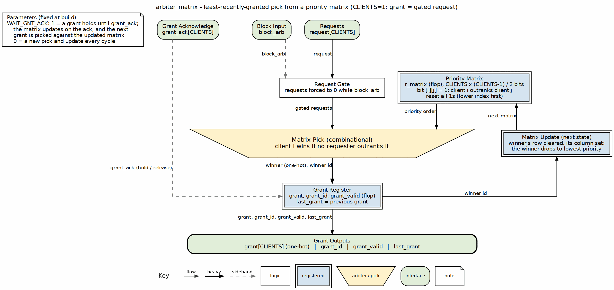

<!-- RTL Design Sherpa Documentation Header -->
<table>
<tr>
<td width="80">
  <a href="https://github.com/sean-galloway/RTLDesignSherpa">
    
  </a>
</td>
<td>
  <strong>RTL Design Sherpa</strong> · <em>Learning Hardware Design Through Practice</em><br>
  <sub>
    <a href="https://github.com/sean-galloway/RTLDesignSherpa">GitHub</a> ·
    <a href="https://github.com/sean-galloway/RTLDesignSherpa/blob/main/docs/DOCUMENTATION_INDEX.md">Documentation Index</a> ·
    <a href="https://github.com/sean-galloway/RTLDesignSherpa/blob/main/LICENSE">MIT License</a>
  </sub>
</td>
</tr>
</table>

---

<!-- End Header -->

**[← Back to Main Index](../index.md)** | **[rtl-common Index](index.md)**

# Matrix Arbiter

Fair arbitration with no rotating pointer. Every requester keeps its own scorecard of who it outranks, so there's no barrel shifter and no priority-encoder chain in the winner path — just a grid of pairwise priority bits settling the argument in one combinational pass.

## Overview

I lifted the scheme straight from Dally & Towles, *Principles and Practices of Interconnection Networks*, chapter 17 §18.5. Priority lives in a `CLIENTS`×`CLIENTS` bit matrix `M`:

- `M[i][j] = 1` means requester `i` currently outranks requester `j`.
- `M[i][j] = 0` means requester `i` is outranked by requester `j`.
- The diagonal is a don't-care.

Half those bits are redundant — `M[j][i]` is just `~M[i][j]` — so the module stores only the `CLIENTS·(CLIENTS-1)/2` upper-triangle bits and derives the rest combinationally. Every grant rewrites the winner's row and column, shoving it to the back of the line. That's the entire fairness argument: keep requesting and you'll be served within `CLIENTS` consecutive grants. Guaranteed, no starvation corner cases hiding anywhere.

One naming note so the parameter tables don't trip you: `N` is the bit width of `grant_id` — `$clog2(CLIENTS)`, guarded to 1 when `CLIENTS==1`. It's not the client count. The client count is always `CLIENTS`.

## Parameters

| Parameter | Type | Default | Description |
|-----------|------|---------|-------------|
| CLIENTS | int | 4 | Number of requesting clients (must be ≥ 1) |
| WAIT_GNT_ACK | int | 0 | When 1, holds the grant until the winner acknowledges it |
| N | int | $clog2(CLIENTS) (guarded) | **Derived** bit width of `grant_id`; do not override |

## Ports

### Inputs

| Port | Width | Description |
|------|-------|-------------|
| clk | 1 | System clock |
| rst_n | 1 | Active-low asynchronous reset |
| block_arb | 1 | When asserted, masks all requests to zero and stops grants |
| request | CLIENTS | One-bit request per client |
| grant_ack | CLIENTS | Per-client grant acknowledgment (used when `WAIT_GNT_ACK = 1`) |

### Outputs

| Port | Width | Description |
|------|-------|-------------|
| grant_valid | 1 | High when a valid grant is being issued |
| grant | CLIENTS | One-hot grant vector (exactly one bit set when `grant_valid=1`) |
| grant_id | `N` (`$clog2(CLIENTS)`, guarded) | Binary-encoded ID of the granted client |
| last_grant | CLIENTS | Previous cycle's grant (for debugging/history) |

## Functional Description

### Block diagram



Requests drop down the center through the `block_arb` gate into the matrix
pick (the trapezium): a client wins when no other requester outranks it in the
priority matrix. The winner is registered as the grant. Its id runs out to the
right into the matrix update, which moves the winner to lowest priority, and
the next matrix is loaded back into `r_matrix`, so the least recently granted
requester always wins. With `WAIT_GNT_ACK=1` the grant holds until `grant_ack`,
and the update happens on the ack.

### Matrix Representation

The stored state is the upper triangle of `M`, packed into `CLIENTS*(CLIENTS-1)/2` bits. Out of reset every stored bit is 1, so power-on priority is the plain total order:

```text
0 > 1 > 2 > ... > CLIENTS-1
```

Client 0 wins everything until that first grant shuffles the deck.

### Grant Logic

Each grant bit is a purely combinational vote:

```text
g[i] = request[i] AND (for all j != i: NOT(request[j] AND M[j][i]))
```

Read it out loud: client `i` wins unless some other *requesting* client outranks it. The matrix is a tournament — antisymmetric and complete — so whenever anybody asks, exactly one winner steps forward. No tie-breaking. No encoder to consult.

### Matrix Update

When client `k` wins, two things happen:

- **Row `k` cleared**: `M[k][j] = 0` for all `j > k` — `k` loses to all higher-index clients.
- **Column `k` set**: `M[i][k] = 1` for all `i < k` — all lower-index clients outrank `k`.

Net effect: `k` goes last. The new order becomes:

```text
0 > 1 > ... > k-1 > k+1 > ... > CLIENTS-1 > k
```

### No-ACK Mode (`WAIT_GNT_ACK = 0`)

Grant, rotate, repeat. A one-cycle grant goes out every cycle a winner exists, and the matrix updates right behind it.

### ACK Mode (`WAIT_GNT_ACK = 1`)

Here the grant holds until the granted client asserts its own `grant_ack` bit, and the matrix doesn't move until that ACK arrives — priority state stays frozen mid-transaction. The part worth your attention: the post-ACK update and the next-winner calculation happen combinationally in the ACK cycle itself, and the new grant registers on the same edge. Feed it a steady stream of ACKs and grants come out back-to-back, no idle cycles.

One guard, and it's deliberate: only the granted client's ack bit can retire the grant. ACKs from other clients are ignored (foreign-ack immunity). That hazard is real — an errant ack retiring a grant it didn't own costs you a debug session — so the immunity is cheap insurance.

### Block Arbitration

`block_arb` squashes every request to zero, so nothing grants while it's high. Release it and arbitration picks up exactly where the matrix left off. Pausing costs you cycles, never state.

## Timing Characteristics

Grants are registered — expect one full cycle between a request and the grant it earns. The matrix updates on the same clock, so in no-ACK mode each new winner is chosen from the freshly updated matrix.

ACK mode pulls the update forward into the ACK cycle: combinationally evaluated when the ACK arrives, registered on that same edge. Keep the ACKs coming and grants stream out with zero idle cycles.

No frequency or area numbers on this page. Nothing's been measured against a real device yet, and I'd rather admit that than invent a figure.

---

## Usage Examples

```systemverilog
arbiter_matrix #(
    .CLIENTS     (8),
    .WAIT_GNT_ACK(0)
) u_arbiter_matrix (
    .clk         (clk),
    .rst_n       (rst_n),
    .block_arb   (1'b0),
    .request     (request_vec),
    .grant_ack   ('0),                 // Unused in No-ACK mode
    .grant_valid (grant_valid),
    .grant       (grant_vec),
    .grant_id    (winner_id),
    .last_grant  (last_grant_vec)
);
```

---

## Design Notes

### Usage Notes

- Out of reset, client 0 is king — the first all-requesting grant goes to client 0.
- There's no central pointer, no mask register. Just the pairwise bits updating themselves, locally. Synthesis tools eat this structure up.
- The grant is registered, so a lone requester waits exactly one cycle after raising its request.
- Sizing honesty: lovely at small `CLIENTS`. At large counts the `O(CLIENTS²)` matrix storage and the cross-client comparison web get fat, and you'll feel it in both area and timing. Dally & Towles land on the same conclusion.

## Related Modules

**Instantiated by:** (none yet)

**See also:**
- `arbiter_round_robin` — pointer/mask-based round-robin arbiter
- `arbiter_round_robin_simple` — minimal rotating-priority arbiter
- `arbiter_priority_encoder` — fixed-priority encoder used by the round-robin variants

---

## Testing

`val/common/test_arbiter_matrix.py` puts the module through its paces. It validates:

- One-hot or zero grant, never granted to an unrequested client
- Strong fairness over `4·CLIENTS` consecutive grants with all clients requesting
- Correct rotation from cold start and after partial-request idle gaps
- Immediate service for a single requester regardless of matrix state
- Reset restoring client 0 as the highest-priority requester
- In ACK mode: hold-until-owner-ack, foreign-ack immunity, back-to-back same-cycle handoff, and single-requester re-grant
- Parameterization across `CLIENTS = 2, 4, 5, 8` in no-ACK mode, plus ACK mode at `REG_LEVEL=GATE` and `FULL`

```bash
source env_python
pytest val/common/test_arbiter_matrix.py -v
```

The testbench (`bin/TBClasses/common/arbiter_matrix_tb.py`) sticks to the same `ArbiterMaster` / `ArbiterMonitor` methodology as the round-robin testbench:

- A `RoundRobinArbiterMonitor` is attached because the observable rotation of the matrix arbiter is equivalent to round-robin.
- Randomized scenario phases (grant-signals, basic-arbitration, walking-requests, block-arb, bursty-traffic, rapid-request-changes, single-client-saturation, fairness) drive stimulus through `ArbiterMaster` and assert one-hot, no-unrequested-grant, and rotation behavior through the monitor.
- Deterministic directed supplements cover corner cases the randomized master/monitor cannot express cleanly: one-hot/request-match, strong-fairness-continuous, fairness-cold-start-and-gaps, single-requester-immediate, and reset-order. ACK-mode equivalents are exercised separately (hold-until-owner-ack, foreign-ack immunity, back-to-back handoff, single-requester).
- `ArbiterCompliance` protocol checking is enabled and asserted at the end of the run.
- Directed tests shut the master down via `enter_directed_mode()` / `exit_directed_mode()` so the testbench pokes the DUT signals directly without interference.
- Verification passes at `REG_LEVEL=GATE`, `FUNC`, and `FULL` across `CLIENTS = 2, 4, 5, 8` (no-ACK), plus ACK mode at `GATE` and `FULL`.

---

## References

- No peer paper — the matrix (least-recently-served) arbiter is a standard technique with no defensible single origin (marked "standard technique" in the references index).
- Dally, W.J., Towles, B. *Principles and Practices of Interconnection Networks*, Morgan Kaufmann, 2004, ch. 18 "Arbitration", §18.5 "Matrix Arbiter". Backs the grant/update scheme and the observation that matrix arbiters are well suited to small arbiters.
- Indexed in `rtl/common/references/README.md`

---

## Navigation

- **[← Back to rtl-common Index](index.md)**
- **[← Back to Main Documentation Index](../index.md)**
