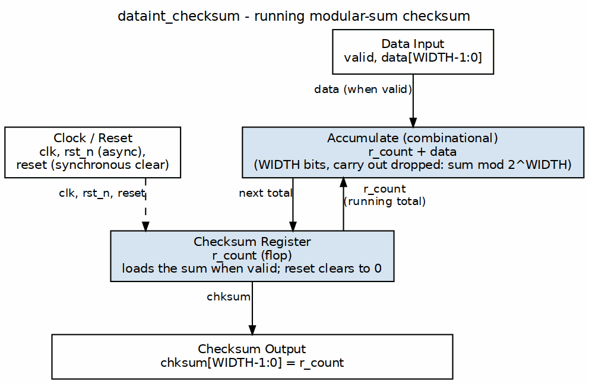

<!-- RTL Design Sherpa Documentation Header -->
<table>
<tr>
<td width="80">
  <a href="https://github.com/sean-galloway/RTLDesignSherpa">
    
  </a>
</td>
<td>
  <strong>RTL Design Sherpa</strong> · <em>Learning Hardware Design Through Practice</em><br>
  <sub>
    <a href="https://github.com/sean-galloway/RTLDesignSherpa">GitHub</a> ·
    <a href="https://github.com/sean-galloway/RTLDesignSherpa/blob/main/docs/DOCUMENTATION_INDEX.md">Documentation Index</a> ·
    <a href="https://github.com/sean-galloway/RTLDesignSherpa/blob/main/LICENSE">MIT License</a>
  </sub>
</td>
</tr>
</table>

---

<!-- End Header -->

# dataint_checksum

## Overview

The `dataint_checksum` module is a simple accumulating checksum calculator. It keeps adding incoming data values into a running checksum you can use for basic data integrity verification. Nothing fancy — that's the point.

### Module Declaration

```systemverilog
module dataint_checksum #(
    parameter int WIDTH = 8
) (
    input  logic             clk,
    rst_n,
    input  logic             reset,
    input  logic             valid,
    input  logic [WIDTH-1:0] data,
    output logic [WIDTH-1:0] chksum
);
```

## Parameters

| Parameter | Default | Description |
|-----------|---------|-------------|
| `WIDTH` | 8 | Width of the data and checksum in bits |

## Ports

| Port | Direction | Width | Description |
|------|-----------|-------|-------------|
| `clk` | Input | 1 | Clock signal |
| `rst_n` | Input | 1 | Active-low asynchronous reset |
| `reset` | Input | 1 | Synchronous reset signal |
| `valid` | Input | 1 | Data valid signal - when high, data is accumulated |
| `data` | Input | WIDTH | Input data to be added to checksum |
| `chksum` | Output | WIDTH | Current checksum value |

## Functional Description

### Block diagram



Data enters at the top and, on each cycle `valid` is high, the adder sums it
with the running total in `r_count`. The register loads the new total, and the
total climbs the right edge back into the adder. The sum is `WIDTH` bits wide
with the carry out dropped, so the checksum is the sum modulo 2^WIDTH. The
synchronous `reset` and the asynchronous `rst_n` both clear the total to 0, and
`chksum` is the register itself.

### Operation

The module keeps an internal counter (`r_count`) that accumulates incoming data:
- On reset (either asynchronous `rst_n` or synchronous `reset`), the counter clears to zero
- When `valid` is asserted, the input `data` is added to the current counter value
- The checksum output is simply the current counter value

### Reset Behavior

Two reset mechanisms, and you should know which one wins:
1. **Asynchronous Reset**: `rst_n` (active-low) immediately clears the counter
2. **Synchronous Reset**: `reset` (active-high) clears the counter on the next clock edge

### Key Features

- **Simple Accumulation**: Uses basic addition for checksum calculation
- **Parameterizable Width**: Supports any data width through the `WIDTH` parameter
- **Dual Reset Support**: Both asynchronous and synchronous reset capabilities
- **Enable Control**: Data accumulation only occurs when `valid` is asserted

### Special Considerations

- **Overflow Handling**: The checksum wraps around when the accumulated value exceeds the maximum representable in `WIDTH` bits — expected behavior for a checksum, not a bug
- **Continuous Output**: The checksum output is always valid and reflects the current accumulated value
- **Reset Priority**: Asynchronous reset (`rst_n`) takes precedence over synchronous reset (`reset`)

### State Machine

No formal FSM here — it operates as a simple accumulator with two states:
- **RESET**: Counter is zero
- **ACCUMULATING**: Counter adds valid data inputs

## Related Modules

Nothing in the tree instantiates this module and it
instantiates nothing: it is a leaf, used directly by whatever design needs
it. Its nearest neighbours in `rtl/common/` are:

- `dataint_crc`
- `dataint_crc_xor_shift`
- `dataint_crc_xor_shift_cascade`
- `dataint_ecc_hamming_decode_secded`
- `dataint_ecc_hamming_encode_secded`

---

## Timing Characteristics

This module is **sequential**: it contains clocked logic (via `always_ff` or
the repository's `ALWAYS_FF_RST` macro) and therefore holds state. Outputs
driven from those blocks are registered and appear one clock after the inputs
that produced them.

Per-path cycle counts are not enumerated here; read the block that drives the
signal you care about. No synthesis frequency or area figures are quoted --
none have been measured against a target device.

Timing closure is therefore a question of the surrounding logic's slack, not of
this module's cycle count. No synthesis figures are quoted; none have been
measured.

---

## Usage Examples
```systemverilog
// 16-bit checksum calculator
dataint_checksum #(
    .WIDTH(16)
) checksum_calc (
    .clk(clk),
    .rst_n(rst_n),
    .reset(soft_reset),
    .valid(data_valid),
    .data(input_data),
    .chksum(calculated_checksum)
);
```

## Design Notes

### Common Applications

- Simple data integrity checking
- Packet checksum calculation
- Basic error detection in data streams
- Accumulation of data values for verification purposes

## Testing

`val/common/test_dataint_checksum.py` exercises this module. It collects 4 parameter cases at the default `REG_LEVEL`.

```bash
source env_python
pytest val/common/test_dataint_checksum.py -v
```

## References

- Maxino, T.C., Koopman, P.J. "The Effectiveness of Checksums for Embedded Control Networks." *IEEE Transactions on Dependable and Secure Computing*, 6(1), Jan. 2009. DOI: [10.1109/TDSC.2007.70216](https://doi.org/10.1109/TDSC.2007.70216) — measures this exact two's-complement modular-sum checksum against one's-complement, Fletcher, Adler and CRC; it is the weakest of the additive options at equal width.
- Fletcher, J.G. "An Arithmetic Checksum for Serial Transmissions." *IEEE Transactions on Communications*, 30(1), Jan. 1982. DOI: [10.1109/TCOM.1982.1095369](https://doi.org/10.1109/TCOM.1982.1095369) — the stronger position-sensitive arithmetic checksum this module does not implement.
- Indexed in `rtl/common/references/README.md` (local PDF: `ChecksumEffectiveness__Maxino2009.pdf`).

---

## Navigation

- **[← Back to rtl-common Index](index.md)**
- **[← Back to Main Documentation Index](../index.md)**
