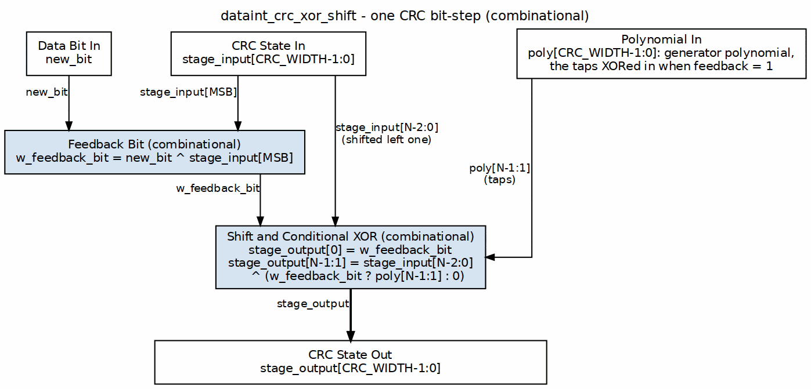

<!-- RTL Design Sherpa Documentation Header -->
<table>
<tr>
<td width="80">
  <a href="https://github.com/sean-galloway/RTLDesignSherpa">
    
  </a>
</td>
<td>
  <strong>RTL Design Sherpa</strong> · <em>Learning Hardware Design Through Practice</em><br>
  <sub>
    <a href="https://github.com/sean-galloway/RTLDesignSherpa">GitHub</a> ·
    <a href="https://github.com/sean-galloway/RTLDesignSherpa/blob/main/docs/DOCUMENTATION_INDEX.md">Documentation Index</a> ·
    <a href="https://github.com/sean-galloway/RTLDesignSherpa/blob/main/LICENSE">MIT License</a>
  </sub>
</td>
</tr>
</table>

---

<!-- End Header -->

# dataint_crc_xor_shift

## Overview

The fundamental CRC step, applied to exactly one input bit: shift the current CRC state, and XOR in the polynomial when the feedback bit says to.

- **Single Bit Processing**: One bit per operation, no more
- **Combinational Logic**: Pure combinational implementation (no clock)
- **Parameterizable Width**: Any CRC width you need
- **Optimized Design**: Breaks the circular dependency with an intermediate signal

### Module Declaration

```systemverilog
module dataint_crc_xor_shift #(
    parameter int CRC_WIDTH = 32
) (
    input [CRC_WIDTH-1:0] stage_input,
    input [CRC_WIDTH-1:0] poly,
    input new_bit,
    output [CRC_WIDTH-1:0] stage_output
);
```

## Parameters

| Parameter | Default | Description |
|-----------|---------|-------------|
| `CRC_WIDTH` | 32 | Width of the CRC register and polynomial |

## Ports

| Port | Direction | Width | Description |
|------|-----------|-------|-------------|
| `stage_input` | Input | CRC_WIDTH | Current CRC state |
| `poly` | Input | CRC_WIDTH | CRC polynomial |
| `new_bit` | Input | 1 | New data bit to process |
| `stage_output` | Output | CRC_WIDTH | Updated CRC state |

## Functional Description

### Block diagram



One bit-step of a CRC, all combinational. The feedback bit is the incoming
`new_bit` XORed with the MSB of the CRC state. The state shifts left one place,
the feedback bit becomes the new bit 0, and when the feedback bit is 1 the
polynomial taps `poly[N-1:1]` are XORed into the shifted state.
`dataint_crc_xor_shift_cascade` chains eight of these to fold in a byte.

### Core CRC Operation

This is the classic CRC shift-and-XOR, broken into three moves:
1. **Feedback Calculation**: XOR the new input bit with the MSB of the current CRC
2. **Shift Operation**: Shift the CRC register left by one position
3. **Polynomial XOR**: If the feedback bit is 1, XOR with the polynomial

### Mathematical Foundation

The CRC operation follows this algorithm:

```
feedback = new_bit ⊕ CRC[MSB]
CRC_new[0] = feedback
CRC_new[MSB:1] = CRC[MSB-1:0] ⊕ (polynomial[MSB:1] & {WIDTH-1{feedback}})
```

### Circular Dependency Solution

A naive write-up of this has a circular dependency — you'd be computing the output from itself. The fix is to compute the feedback bit first, on its own, then reuse it:

```systemverilog
logic feedback_bit;

// Calculate feedback first
assign feedback_bit = new_bit ^ stage_input[CRC_WIDTH-1];

// Then use it for output calculation
assign stage_output[0] = feedback_bit;
assign stage_output[CRC_WIDTH-1:1] = stage_input[CRC_WIDTH-2:0] ^ 
    ({CRC_WIDTH-1{feedback_bit}} & poly[CRC_WIDTH-1:1]);
```

### Bit-wise Operations

- **LSB Assignment**: Always gets the feedback bit
- **MSBs Assignment**: Shifted previous bits XORed with the polynomial when feedback is active
- **Conditional XOR**: Bit replication builds the conditional XOR mask

### Feedback Bit Logic

The feedback bit runs the whole show:
- It decides whether the polynomial gets applied
- It's the XOR of the input bit and the current MSB
- It gates the polynomial application

### Polynomial Application

The polynomial goes in conditionally:
- Only bits [MSB:1] of the polynomial are used (bit 0 is implicit)
- Applied through an AND mask built by replicating the feedback bit
- XORed with the shifted CRC bits

### No State Elements

This module is purely combinational:
- No clock, no reset
- Instantaneous response to input changes
- Can be cascaded for multi-bit processing

### Mathematical Verification

For a polynomial P(x) and data bit d:
- Feedback = 0: it's a plain left shift
- Feedback = 1: left shift, then XOR the polynomial

That's CRC polynomial division, done in gates.

## Timing Characteristics
- **Latency**: Combinational (zero clock cycles)
- **Throughput**: One bit per clock when wrapped in a sequential system
- **Area**: Minimal — a few XOR gates and multiplexers
- **Power**: Low — just simple combinational logic

## Usage Examples
You rarely instantiate this block alone — it's a building block.

### Single Bit Processing

```systemverilog
dataint_crc_xor_shift #(.CRC_WIDTH(16)) crc_stage (
    .stage_input(current_crc),
    .poly(crc_polynomial),
    .new_bit(data_bit),
    .stage_output(next_crc)
);
```

### Cascaded for Multiple Bits

Chain as many instances as you have bits to process:

```systemverilog
// Process 8 bits. Do NOT also `assign stage[0] = initial_crc;` -- stage[0] is
// driven by the i==0 instance below, and a second continuous driver on the same
// wire is an elaboration error (X contention in simulation).
wire [CRC_WIDTH-1:0] stage[0:7];

genvar i;
generate
    for (i = 0; i < 8; i++) begin
        dataint_crc_xor_shift #(.CRC_WIDTH(CRC_WIDTH)) stage_inst (
            .stage_input(i == 0 ? initial_crc : stage[i-1]),
            .poly(polynomial),
            .new_bit(data_byte[7-i]),
            .stage_output(stage[i])
        );
    end
endgenerate

assign final_crc = stage[7];
```

## Design Notes

### Applications

- Building block for CRC calculation engines
- Serial CRC processors
- Component in parallel CRC architectures
- Educational CRC implementations
- Custom protocol CRC calculators

## Related Modules

Read out of the RTL, not curated: these are the
modules this one instantiates and the modules that instantiate it.

**Instantiated by:**
- `dataint_crc_xor_shift_cascade`

---

## Testing

**No dedicated testbench for this module.** It has no
`val/**/test_dataint_crc_xor_shift.py`. It is exercised indirectly, through the tests of
modules that instantiate it (directly or further up):

- `dataint_crc` -- `val/**/test_dataint_crc.py`

Indirect coverage exercises this module only in the configurations those
parents elaborate. A parameter or mode no parent uses is untested.

Treat any behaviour described on this page as unverified by simulation.

## References

- Peterson, W.W., Brown, D.T. "Cyclic Codes for Error Detection." *Proceedings of the IRE*, 49(1), Jan. 1961. DOI: [10.1109/JRPROC.1961.287814](https://doi.org/10.1109/JRPROC.1961.287814) — origin of cyclic codes for error detection and their shift-register encoder, the per-bit step this module implements.
- Albertengo, G., Sisto, R. "Parallel CRC Generation." *IEEE Micro*, 10(5), Oct. 1990. DOI: [10.1109/40.60527](https://doi.org/10.1109/40.60527) — byte-parallel CRC lineage; this one-bit stage is the unit the parallel forms unroll.
- Moon, T.K. *Error Correction Coding*, 2nd ed., Wiley, 2021, ch. 4 "Cyclic Codes, Rings, and Polynomials" (Sec. 4.9 hardware background, Sec. 4.13 Binary CRC Codes) (textbook treatment; secondary source).
- Indexed in `rtl/common/references/README.md`.

---

## Navigation

- **[← Back to rtl-common Index](index.md)**
- **[← Back to Main Documentation Index](../index.md)**
