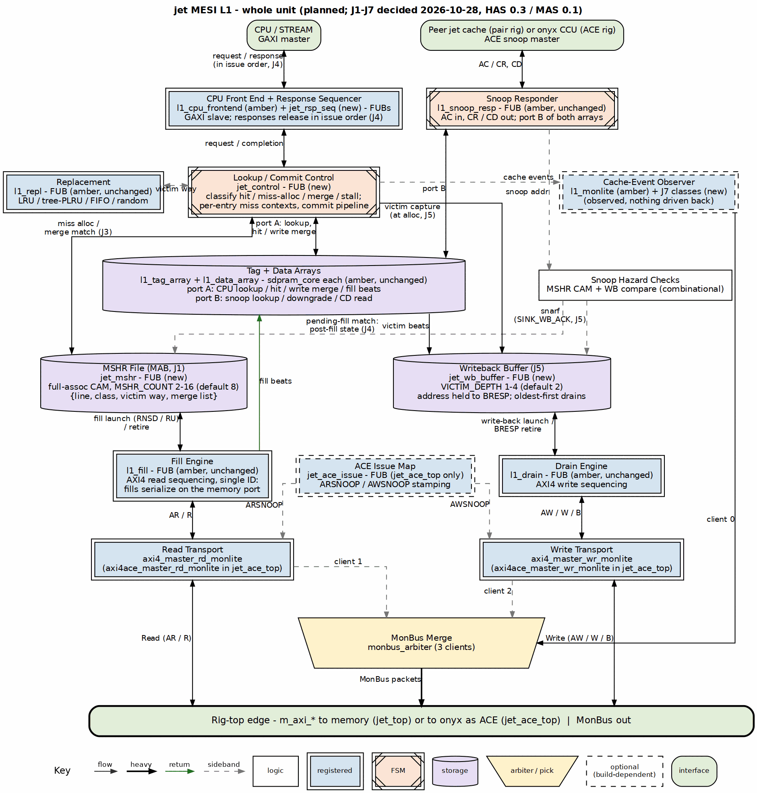

<!-- RTL Design Sherpa Documentation Header -->
<table>
<tr>
<td width="80">
  
</td>
<td>
  <strong>RTL Design Sherpa</strong> · <em>Learning Hardware Design Through Practice</em> 
  
    <a href="https://github.com/sean-galloway/RTLDesignSherpa">GitHub</a> ·
    <a href="https://github.com/sean-galloway/RTLDesignSherpa/blob/main/docs/DOCUMENTATION_INDEX.md">Documentation Index</a> ·
    <a href="https://github.com/sean-galloway/RTLDesignSherpa/blob/main/LICENSE">MIT License</a>
  
</td>
</tr>
</table>

---

<!-- End Header -->

# Block Diagram

At 0.3 the J1–J7 rulings fix the shape, depth, and connection of every
block, and Figure 2.1 draws exactly that: amber's landed whole unit with
jet's three additions — the MSHR file (MAB), the writeback buffer, and the
response sequencer — on the flows the decisions give them. No jet RTL
exists yet; the figure is marked planned and is the contract the MAS
elaborates.

### Figure 2.1: jet whole unit (planned)

**Source:** [01_block_diagram.dot](../assets/graphviz/01_block_diagram.dot)

Reading the figure:

- **CPU flow (center).** Requests enter from the GAXI master through the
  front end into `jet_control`'s lookup stage (hit / miss-alloc / merge /
  stall classify); hits are served from the arrays' port A. Responses
  release through the response sequencer in issue order (J4).
- **Miss flow (left).** A miss allocates an MSHR entry (J1: full-assoc CAM,
  exact-line match) claiming its victim way at alloc — the set
  oversubscription cap of WAYS outstanding per set applies. The fill engine
  launches the fill; fill beats return up the green lane straight into the
  data array (the MAB scheme: no line data in the MSHR). Merged requesters
  ride the entry's merge list and are served at commit (J3).
- **Write-back flow (right).** A dirty victim is captured into the
  writeback buffer at alloc (J5); the drain engine empties the buffer
  oldest-first, independently of any fill. The entry's address is held
  until BRESP.
- **Snoop column (right).** The inherited snoop responder works the
  arrays' port B; the hazard-check block compares the snoop against the
  MSHR CAM (answer at the post-fill state, J4) and the writeback buffer
  (snarf, SINK_WB_ACK, J5). A snoop never waits behind a fill or a drain.
- **Observation.** The monlite observer taps the control block (now
  including MSHR alloc/merge/retire and buffer occupancy, the J7 classes)
  and merges with the transport observers into the MonBus out.
