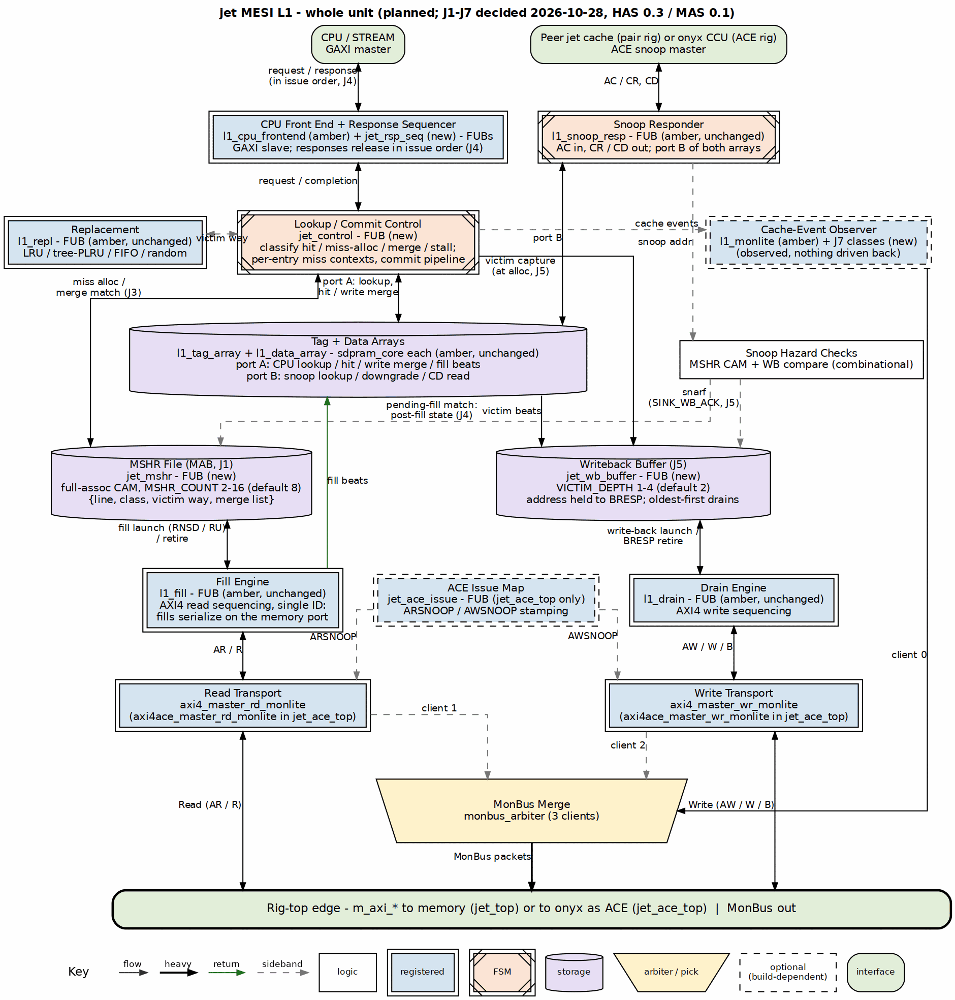

<!-- RTL Design Sherpa Documentation Header -->
<table>
<tr>
<td width="80">
  <a href="https://github.com/sean-galloway/RTLDesignSherpa">
    
  </a>
</td>
<td>
  <strong>RTL Design Sherpa</strong> · <em>Learning Hardware Design Through Practice</em><br>
  <sub>
    <a href="https://github.com/sean-galloway/RTLDesignSherpa">GitHub</a> ·
    <a href="https://github.com/sean-galloway/RTLDesignSherpa/blob/main/docs/DOCUMENTATION_INDEX.md">Documentation Index</a> ·
    <a href="https://github.com/sean-galloway/RTLDesignSherpa/blob/main/LICENSE">MIT License</a>
  </sub>
</td>
</tr>
</table>

---

<!-- End Header -->

# Architecture Overview

**Component:** jet — Lockup-Free MESI Snoopy L1 Cache
**Version:** 0.1
**Status:** blueprint — no jet RTL yet; this is the micro-architecture
contract for the landing implementation

## Introduction

The jet [HAS](../../jet_has/jet_has_index.md) fixes the module set, the
interface shapes, and the parameter decisions (J1–J7, closed 2026-10-28).
This MAS closes what the HAS deferred: the MSHR entry lifecycle, the lookup
and commit pipeline staging, the write-port arbitration, the response
sequencing, the snoop service under concurrency, and the hazard rules that
make the whole thing deadlock- and livelock-free by construction.

Like amber, jet has **no register block**; all runtime visibility is through
the MonBus observation fabric, and this book carries the observation map
(ch04) in place of a register-map chapter.

### What this book covers that the HAS does not

1. **Per-module micro-architecture** — `jet_control`'s lookup/commit split,
   `jet_mshr`'s entry format and allocation rules, `jet_wb_buffer`'s
   capture/drain/snarf behavior, `jet_rsp_seq`'s release logic, and the
   snoop path's per-entry bypass.
2. **Cycle-level interface behavior** — GAXI accept/release timing under
   MSHR-full stalls, AXI4 AR pipelining on the single read ID, drain BRESP
   retirement, and snoop ordering under concurrency.
3. **The hazard rulebook** — set oversubscription, cross-class merge waits,
   the anti-livelock hold-off, and the arbitration bounds, each stated as a
   checkable property for ch05.

## High-Level Block Diagram

`jet_top` (pair rig) and `jet_ace_top` (onyx rig) wrap the shared arrays and
engines from `cache-ip/common-ip` with jet's new control blocks:

```
jet_top  /  jet_ace_top            (jet-mesi-l1/rtl/top/)
+-- l1_tag_array                   (common-ip, unchanged)
+-- l1_data_array                  (common-ip, unchanged)
+-- l1_repl                        (common-ip, unchanged)
+-- l1_fill                        (common-ip, unchanged)
+-- l1_drain                       (common-ip, unchanged)
+-- l1_snoop_resp                  (common-ip, unchanged)
+-- jet_control                    (new: lookup/commit pipeline)
|   +-- jet_mshr                   (new: MAB file, full-assoc CAM)
|   +-- jet_wb_buffer              (new: decoupled writeback buffer)
|   +-- (snoop hazard compare)     (MSHR CAM + WB match, combinational)
+-- l1_cpu_frontend + jet_rsp_seq  (GAXI slave + response sequencer)
+-- l1_monlite                     (extended with the J7 event classes)
+-- jet_ace_issue                  (jet_ace_top only; cache events -> ACE)
+-- axi4_master_rd/wr_monlite      (jet_top)  or
|   axi4ace_master_rd/wr_monlite   (jet_ace_top)
+-- monbus_arbiter                 (merges the observer streams)
```

Figure 1.1 is the same whole-unit drawing as the HAS Figure 2.1 (derived
from it, kept in step):

### Figure 1.1: jet whole unit (planned)



**Source:** [01_whole_unit.dot](../assets/graphviz/01_whole_unit.dot)

## Key Architectural Concepts

### 1. Lookup/commit split (the non-blocking core)

Amber's blocking FSM runs one transaction through every stage before
accepting the next. jet splits this: the **lookup stage** classifies each
accepted request against the tags (port A) and the MSHR CAM in the same
window — hit, miss-alloc, merge, or stall — and the **commit pipeline**
retires fills as their data lands: tag write, merged store data (amber's
D-4 write-merge at commit), entry retire, response release. Misses allocate
and return to the fabric; they never hold the lookup stage.

### 2. MAB, not FB (Chinnakonda §9.10.2)

`jet_mshr` holds no line data. Fill beats write the data array at the
highest write-port priority as they arrive; a hit to a line being filled
cannot occur before its tag installs at commit (an access to a pending line
is the merge case). The forwarding path is the regular array read path —
no fill-buffer forwarding mux.

### 3. Point of serialization at lookup (Chinnakonda §10.7)

Accesses to the same line serialize through the MSHR entry (merge list);
accesses to different lines proceed in any order. The lookup stage is the
single point where tag state and outstanding-miss state are both visible,
so it is the PoS.

### 4. In-order responses over out-of-order internals (J4)

GAXI carries no ID, so responses release in issue order through
`jet_rsp_seq`. Fills, merges, and drains complete out of order internally;
the sequencer holds each completed response until its predecessors have
released.

### 5. Snoop progress, always (Chinnakonda §7.8, §8.2)

A snoop is answered from the arrays (port B), from the pending-fill bypass
at the post-fill state (per MSHR entry, PF_GUARD), or from the writeback
buffer (snarf) — never stalled behind a fill or a drain. The one permitted
hold-off is the bounded anti-livelock window after an upgrade grant
(§10.9), which expires with the granted write's commit.

### 6. The measurement is a first-class output (J7)

The MonBus event map (ch04) carries MSHR alloc/merge/retire events, an
occupancy gauge, writeback occupancy, and hit-under-miss latency markers —
the four J7 metrics come from these, not from a debugger's afterthought.
