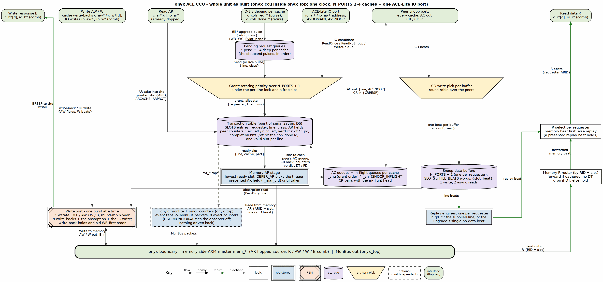

<!-- RTL Design Sherpa Documentation Header -->
<table>
<tr>
<td width="80">
  
</td>
<td>
  <strong>RTL Design Sherpa</strong> · <em>Learning Hardware Design Through Practice</em> 
  
    <a href="https://github.com/sean-galloway/RTLDesignSherpa">GitHub</a> ·
    <a href="https://github.com/sean-galloway/RTLDesignSherpa/blob/main/docs/DOCUMENTATION_INDEX.md">Documentation Index</a> ·
    <a href="https://github.com/sean-galloway/RTLDesignSherpa/blob/main/LICENSE">MIT License</a>
  
</td>
</tr>
</table>

---

<!-- End Header -->

# Block Diagram

**Status:** the manager shape is built (`onyx_ccu`, TASK-001 step 2). Figure 2.1 is the planned shape drawn before the D rows closed; it still names the right blocks, and a redraw from the RTL is part of the documentation step.

### Figure 2.1: onyx manager shape (planned, pre-RTL)

**Source:** [01_block_diagram.dot](../assets/graphviz/01_block_diagram.dot)

## The shape as built

`onyx_ccu` is one module, and its blocks are the ones the planned figure named, with the D rows now fixing what each is:

1. **Per-port front end.** The D-8 sideband pulse enters a four-deep pending queue; the port's AR is taken into the granted slot; the port's R channel is driven by its replay engine or by a forwarded memory beat.
2. **Transaction table (the point of serialization, D5).** `SLOTS` entries shared by all ports: requester port, line, class, the taken AR, the peer counters, the verdict bits, the completion bits. The grant arbiter (rotating priority over the ports) allocates into it under the per-line lock.
3. **Fanout and gather (D3, D4).** One AC queue per attached cache in grant order, one in-flight queue per cache for the ACs accepted and unanswered, per-slot counters for the gather, the CRRESP merge.
4. **Adjudication and the memory read (D6).** The memory AR candidate (lowest slot with every AC accepted, or every CR in under `DEFER_AR`, and no supplier), the AR hold, the memory R router (forward, hold, drop).
5. **Snoop-data buffers and replay.** One buffer per requester port written by the arbitrated CD beat, one replay engine per port, the absorption read.
6. **Write port.** Round-robin over the N write-back channels and the absorption, one burst at a time, with the write-back hold.
7. **Debug taps.** The pair fabric's tap names (busy, slot valid, pending, absorption pending, grant and its port, address and slot), read by the pair-rig testbench. MonBus taps (D9) are not yet built.

## What is not in the shape yet

The ACE-Lite IO port (D1), the monlite taps (D9), and an `ARSNOOP`-decoding front end for a true ACE master. Each is a later step of onyx TASK-001.
