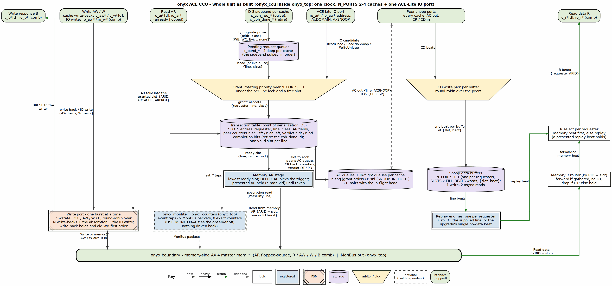

<!-- RTL Design Sherpa Documentation Header -->
<table>
<tr>
<td width="80">
  <a href="https://github.com/sean-galloway/RTLDesignSherpa">
    
  </a>
</td>
<td>
  <strong>RTL Design Sherpa</strong> · <em>Learning Hardware Design Through Practice</em><br>
  <sub>
    <a href="https://github.com/sean-galloway/RTLDesignSherpa">GitHub</a> ·
    <a href="https://github.com/sean-galloway/RTLDesignSherpa/blob/main/docs/DOCUMENTATION_INDEX.md">Documentation Index</a> ·
    <a href="https://github.com/sean-galloway/RTLDesignSherpa/blob/main/LICENSE">MIT License</a>
  </sub>
</td>
</tr>
</table>

---

<!-- End Header -->

# Architecture Overview

**Component:** onyx — Snoop-Based ACE Coherency Unit
**Version:** 0.1
**Status:** as built (onyx TASK-001)

## Introduction

The onyx [HAS](../../onyx_has/onyx_has_index.md) fixes what the manager
does: broadcast snoop (D3), a tagged gather per transaction (D4), per-line
serialization (D5), an adjudicated data source with two memory-read modes
(D6), N_PORTS 2 to 4 (D11), one ACE-Lite IO port (D1) and MonBus
observation (D9). This MAS records how `onyx_ccu` does it: which state each
block keeps, what each cycle's decision reads, and which handshakes are
flopped and which are combinational.

onyx has **no register block**. Its runtime knobs are the observer's mask
inputs (`mon_cfg_*`) and the counters' clear and freeze, all ports of
`onyx_top` that a rig drives from its own CSRs; its build knobs are
elaboration parameters (Chapter 6).

### What this book covers that the HAS does not

1. **Per-block state and decisions.** The table's fields and their set and
   clear points, the queues' shift discipline, the pick rules (lowest index
   or rotating priority, and where each is used), the hold registers.
2. **Cycle-level interface behavior.** Which outputs come from flops, which
   pass an input through combinationally, and which READY depends on VALID.
3. **The ordering rules as the RTL states them.** The per-line lock, the
   memory-read hold against a write in flight (BUG-002), the write-back
   holds and the old-write-back-first order (BUG-003), the
   presentation-order yield between two caches' write-backs.

## No pipeline, one table

`onyx_ccu` has no request pipeline in the usual sense. A transaction is a
slot, and every step of its life is a bit or counter of that slot; each
block is a set of combinational picks over the table plus the registers
that hold a pick stable until its handshake. In one cycle, independently:

- the grant may allocate one slot;
- each requester's AR may be taken into its granted slot;
- each peer may accept one AC and answer one CR, and deliver one CD beat;
- the memory AR stage may present or hand over one read;
- the memory R router may forward, drop or hold one beat;
- each requester's R select may deliver one beat (memory or replay);
- the write port may advance its one burst by one handshake;
- any number of slots may be released.

The single sequential block (`onyx_ccu.sv:1251-1537`) updates all of these
from the cycle's handshakes. The only state machine is the write port's
four-state burst sequencer (`r_wstate`); every data path is a held pick, in
line with the house rule against FSMs on the data path
(`vault/handbook/design/streaming-no-fsm.md`, `minimal-fsm.md`).

## High-Level Structure

```
onyx_top                              (rtl/top/onyx_top.sv)
+-- onyx_ccu          u_ccu           (rtl/top/onyx_ccu.sv, one module)
|   +-- front end: pending queues, candidates, AR take       (ch02/01)
|   +-- transaction table, grant, per-line lock, release     (ch02/02)
|   +-- AC queues, in-flight queues, gather counters, CD pick (ch02/03)
|   +-- memory AR stage, AR hold, memory R router            (ch02/04)
|   +-- snoop-data buffers (g_buf), replay engines, R select (ch02/05)
|   +-- write port (r_wstate), holds, write-back order       (ch02/06)
|   +-- IO port state: r_ior_*, r_iow_*                      (ch02/07)
|   +-- event taps evt_*, debug taps dbg_*                   (ch03/04)
+-- onyx_monlite      u_mon           (rtl/fub/onyx_monlite.sv)
|   +-- gaxi_fifo_sync u_out_q        (output queue, OUT_DEPTH)
+-- onyx_counters     u_cnt           (rtl/fub/onyx_counters.sv)
```

### Figure 1.1: onyx whole unit as built



**Source:** [01_whole_unit.dot](../assets/graphviz/01_whole_unit.dot), a
copy of the HAS Figure 2.1 source kept in step with it.

## Key Micro-Architectural Concepts

### 1. The slot index is the memory read ID

`mem_arid = IW'(slot)` (`onyx_ccu.sv:859`). A returning beat names its slot
directly, so the R router needs no lookup, several reads are outstanding at
once (one per slot), and the requester's own `ARID` is restored from the
slot (`r_arid`) on the way back. The elaboration check
`2**AXI_ID_WIDTH >= SLOTS` (`onyx_ccu.sv:470`) is this rule.

### 2. Counters, not a response window

Each slot carries `r_ac_left` and `r_cr_left`, the peers yet to accept the
AC and yet to answer. They are loaded at the grant with the slot's peer
count and step down by the number of the cycle's handshakes for that slot,
not by one (`w_ac_dec`, `w_cr_dec`, `onyx_ccu.sv:753-777`): two peers can
accept or answer for the same slot in one cycle, and a per-peer decrement
written twice to one register lands once (the first IO read against two
sharers hung on exactly that).

### 3. Snoops carry no ID; order pairs them

Each peer answers its ACs in order, so per peer an in-flight queue `r_sni`
holds the slots of the ACs it accepted; the next CR and the CD beats before
it belong to the head. CD before CR (the family's invariant 6) means a CR
handshake also resets the peer's CD beat counter `r_cd_beat`.

### 4. Held picks

Every output that AXI requires stable is driven from a pick that is held
once presented: the memory AR (`r_mar_vld` / `r_mar_slot`), each replay
engine (`r_rpl_vld`, with `r_rpl_hold` keeping a presented replay beat ahead
of a later memory beat), the write port's selection (`r_w_sel`,
`r_w_slot`), and the AC head (a queue that shifts only on its handshake).

### 5. One write burst system-wide

The write port runs one burst at a time from selection to BRESP. That makes
the `AWID` policy trivial (write-backs and IO writes keep their own,
absorptions use `8'hA0 | requester`) and gives the write-back order rules a
single point to act on.

### 6. Observation never feeds back

The event taps (`evt_*`) are wires off the datapath's own handshakes;
nothing in `onyx_ccu` reads them, and `onyx_monlite` drops rather than
backpressures (handbook `design/observers-do-not-drive.md`).
