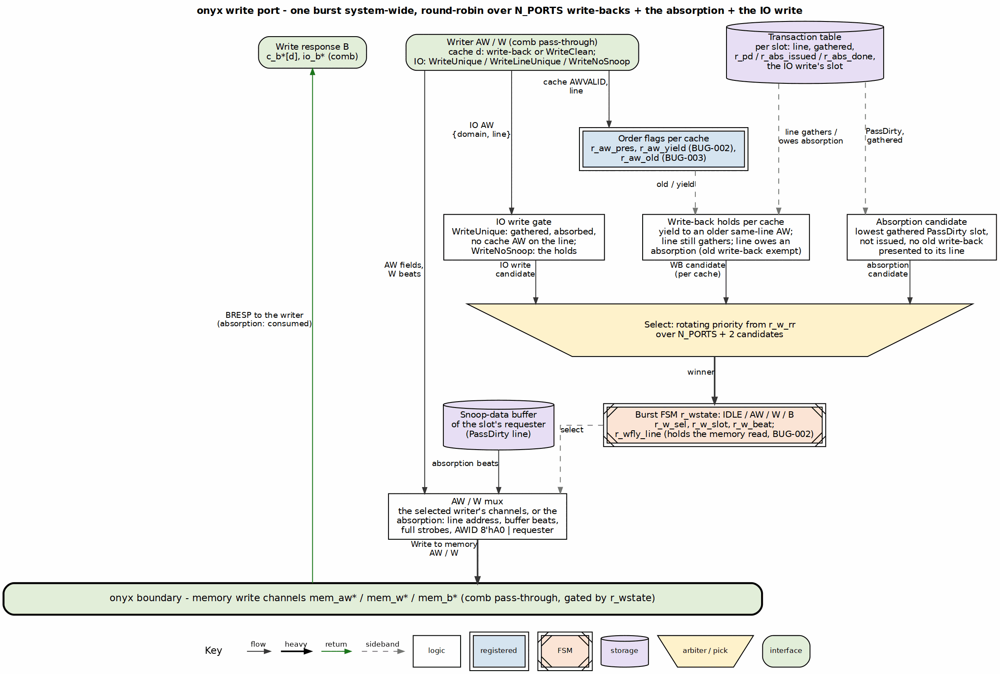

<!-- RTL Design Sherpa Documentation Header -->
<table>
<tr>
<td width="80">
  <a href="https://github.com/sean-galloway/RTLDesignSherpa">
    
  </a>
</td>
<td>
  <strong>RTL Design Sherpa</strong> · <em>Learning Hardware Design Through Practice</em><br>
  <sub>
    <a href="https://github.com/sean-galloway/RTLDesignSherpa">GitHub</a> ·
    <a href="https://github.com/sean-galloway/RTLDesignSherpa/blob/main/docs/DOCUMENTATION_INDEX.md">Documentation Index</a> ·
    <a href="https://github.com/sean-galloway/RTLDesignSherpa/blob/main/LICENSE">MIT License</a>
  </sub>
</td>
</tr>
</table>

---

<!-- End Header -->

# Write Port and Write-Back Order

**RTL:** `onyx_ccu.sv:1013-1231` (candidates, holds, order flags, the
selection, the AW / W / B muxes), `1487-1529` (the burst FSM).

onyx has one memory write port and runs **one burst at a time, system-wide**,
from selection to BRESP. Three kinds of writer share it:

| Candidate index | Writer | Data source | `AWID` |
|---|---|---|---|
| `0 .. N_PORTS-1` | cache `d`'s write-back or WriteClean (pass-through) | `c_w*[d]` | the cache's `c_awid[d]` |
| `W_ABS = N_PORTS` | the absorption of a PassDirty slot | the requester's snoop-data buffer | `IW'(8'hA0 \| r_dir[slot])` |
| `W_IO = N_PORTS + 1` | the IO write (WriteUnique / WriteLineUnique after its gather, or WriteNoSnoop) | `io_w*` | the IO's `io_awid` |

: Table 2.8: Write-port candidates (`NW = N_PORTS + 2`)

### Figure 2.6: The write port



**Source:** [02_write_port.dot](../assets/graphviz/02_write_port.dot)

## The burst FSM

`r_wstate` is the only state machine in onyx (`W_IDLE`, `W_AW`, `W_W`,
`W_B`):

- **IDLE:** if any candidate is eligible, latch the round-robin winner
  `r_w_sel`, the absorption slot `r_w_slot`, `r_w_beat = 0`, move the
  pointer one past the winner, go to AW. Selecting the absorption sets
  `r_abs_issued`; selecting the IO write sets `r_iow_busy`. The burst's
  line is latched in `r_wfly_line` (the memory read hold, ch02/04).
- **AW:** `mem_awvalid` = 1 for the absorption, else the selected writer's
  own AWVALID; on `mem_awready` go to W.
- **W:** beats pass; the absorption's beats come from the buffer at
  `{r_w_slot, r_w_beat}` with full strobes and WLAST at beat
  `FILL_BEATS - 1`; a writer's WLAST ends the phase.
- **B:** `mem_bready` = 1 for the absorption, else the writer's BREADY; on
  the handshake set `r_abs_done` (absorption) or close the IO write
  (`r_iow_busy` clears, and for a WriteUnique `r_iow_done` sets, which
  delivers and frees its slot); go to IDLE.

A burst therefore costs at least one IDLE cycle, one AW, one cycle per W
beat and one B. The pass-through is combinational: `mem_aw*`, `mem_w*` are
the selected writer's inputs, and its `AWREADY`, `WREADY`, `BVALID` are the
memory's, gated by the state and the selection (`onyx_ccu.sv:1190-1231`).
`mem_wuser` is 0 and an absorption's `AWCACHE`, `AWPROT`, `AWQOS`,
`AWREGION`, `AWUSER` are 0.

## Eligibility: the holds

A write-back candidate is `c_awvalid[d] & ~w_wb_blocked[d]`, where
(`onyx_ccu.sv:1078-1102`):

```
w_wb_blocked[d] = w_aw_younger[d]                    -- yield to an older same-line AW
                | w_wb_gather_blk[d]                 -- a slot on the line still gathers
                | (w_wb_abs_blk[d] & ~r_aw_old[d])   -- a slot on the line owes an absorption,
                                                     -- unless this write is OLD
```

**The gather hold** closes the race the serial order used to prevent for
free: a write-back landing in memory between a slot's memory read and its
snoop. While any slot on the line still gathers, no write to it starts.

**The absorption hold** keeps a new owner's write-back behind the line it
must overwrite: a write first presented after the verdict waits for the
absorption.

**Old write-backs first (onyx BUG-003).** A write presented, and not taken,
while a slot on its line was still gathering predates that slot's verdict:

```
r_aw_old <= c_awvalid & ~c_awready & (r_aw_old | w_wb_gather_blk)
```

(`onyx_ccu.sv:1122-1128`). An old write-back is not held behind the
absorption, and the absorption waits while an old write-back to its line is
presented (`w_abs_old_wb`, `onyx_ccu.sv:1130-1138`). Without this, a past
owner's drain held across a later slot landed on top of the newer owner's
absorbed bytes. No cycle results: an absorption needs its slot gathered, so
an old write-back on that line is never held by a gather while the
absorption waits for it.

**Presentation order between two caches (jet-prime BUG-002).**

```
r_aw_pres  <= c_awvalid & ~c_awready          -- presented last cycle, not taken
r_aw_yield <= w_aw_younger
w_aw_younger[d] = some other port e presents an AW to the same line, and
                  (r_aw_yield[d] | (r_aw_pres[e] & ~r_aw_pres[d]))
```

(`onyx_ccu.sv:1040-1063`). A write-back presented while another port
already presents one to the same line yields until that one is taken, and
keeps yielding (`r_aw_yield`) while both stay presented. Two first
presented in the same cycle cannot be a stale / new pair (the new owner's
write-back follows its fill, which follows the verdict the stale AW
predates), so neither yields.

**The absorption candidate** is the lowest-indexed valid, gathered slot
with `r_pd`, not yet issued, and no old write-back to its line presented
(`onyx_ccu.sv:1140-1152`).

**The IO write** is eligible as a WriteUnique once its slot is gathered,
any PassDirty line absorbed, and no cache presents an AW to its line, or as
a WriteNoSnoop under the same gather and absorption holds as a cache's
write-back (ch02/07).

## Selection

Rotating priority over the `NW` candidates from `r_w_rr`
(`onyx_ccu.sv:1154-1167`); the pointer moves one past each winner. No
candidate has fixed priority, so neither the absorptions, the IO nor any
cache can be starved by another.

## What the harnesses state here

`ap_wb_select_hold` (a write-back is selected only when no slot on its line
lacks its gather or owes an absorption, old write-backs excepted),
`ap_abs_after_old_wb` (BUG-003), `ap_wb_order` (two write-backs to one line
leave in presentation order), `ap_abs_legal` (an absorption writes a
PassDirty slot's line, once, with onyx's own ID).
