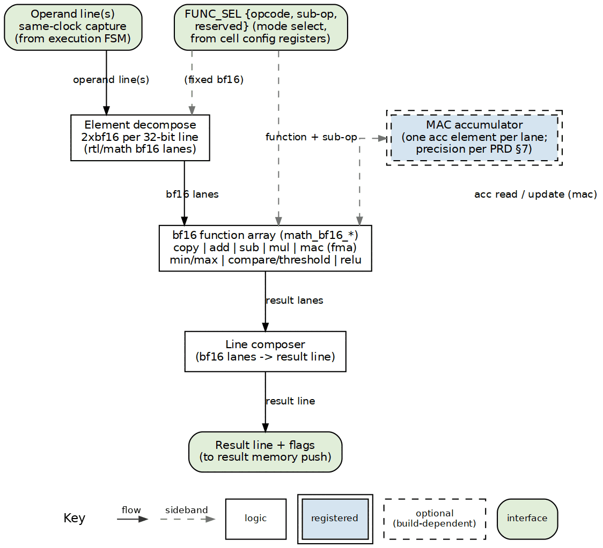

<!-- RTL Design Sherpa Documentation Header -->
<table>
<tr>
<td width="80">
  
</td>
<td>
  <strong>RTL Design Sherpa</strong> · <em>Learning Hardware Design Through Practice</em> 
  
    <a href="https://github.com/sean-galloway/RTLDesignSherpa">GitHub</a> ·
    <a href="https://github.com/sean-galloway/RTLDesignSherpa/blob/main/docs/DOCUMENTATION_INDEX.md">Documentation Index</a> ·
    <a href="https://github.com/sean-galloway/RTLDesignSherpa/blob/main/LICENSE">MIT License</a>
  
</td>
</tr>
</table>

---

<!-- End Header -->

**[← Back to compute-eng-ip](../README.md)**

# ALU-INFER — Cell Inference ALU Product Requirements Document

**Version:** 0.50 (2026-10-18 — **revs pinned at 0.50 per owner, "for
now,"** while the ALU heads to the board; this rev accumulates every
ruling to date). Accumulated since the v0.3 base: **tag-based elastic
alignment** (§4 invariant 3) — each loaded invocation takes an 8-bit tag,
common to all ops that must execute in parallel; a FIFO tracks tags in
flight; an op asserts its valid only when every op of its tag group is
ready; tags stay inside the block and the seam keeps its two valid/ready
pairs only; enables the §7 growth item (deep-pipelining the multiplier /
FMA rows with the adder's `PIPE_STAGE_*` pattern). **Tetrad-engine
deferral / gatling ruling 2026-10-19** (§5) — the per-tetrad core is
defined after the cell is fully defined and working; the owner-authored
gatling-rv32itetrad barrel-core PRD is the **selected sequencer** for its
tetrad (kestrel-class stays a `CORE_FLAVOR` candidate). **Port-width correction** — operand ports stay `LINE_W` each
(one line per side, both captured in the same clock); the earlier
"widening" was a line-vs-lane mis-count. **Owner accept-and-defer** — M7
and `acc_ctrl` accepted as drafted; per-row latency work deferred to FPGA
bring-up (M8). **Elastic-pipeline interface** — valid/ready at both ends,
backpressure freezes the alignment tracking, II=1 while draining, no
padded stages on quick rows, in-order results. **Base decisions** — bf16
element model on the rtl/math `math_bf16_*` library, fp32 MAC accumulate,
one RV32I core per tetrad with in-band everything.
**Status:** Pre-HAS PRD, and the **normative definition of the cell's ALU
block**: the RTL implementation lives in this component (`alu-infer/rtl/`,
unit tests in `alu-infer/dv/tests/`; moved from `cell/rtl/` 2026-10-20) and
the **cell** component integrates it. Where
this document and the [cell PRD](../cell/docs/PRD.md) touch the ALU, this
one governs (the cell PRD was reconciled to it 2026-10-17; see §2).

---

## 1. Identity and scope

**alu-infer** is the compute engine of the **cell**: the function array the
cell's execution FSM drives to turn input-memory lines into result-memory
lines. It is an *inference* ALU — the arithmetic a neural-network layer
needs (add, multiply, fused accumulate, min/max, threshold, ReLU-family
activations), not a general-purpose ISA datapath.

**Component base (owner direction 2026-10-17): the implementation is built
mostly from the `math_bf16_*` family of
[`rtl/math/`](../../../../rtl/math/)** — the repo's existing brain-float
arithmetic library. Nearly every v1 function row has a block there (adder,
multiplier, FMA, comparator, min/max, ReLU, and the rest of the activation
set), so the ALU is the math library's inference consumer the same way the
falcon suite's garuda rung is its IEEE-fp32 consumer. Rows without a bf16
block (copy, and the compare *mask* packing) are wires and glue.

Placement (owner decision 2026-10-17, updated 2026-10-20): this directory
holds the product definition, verification doctrine, the RTL
(`rtl/`, SystemVerilog), and its cocotb unit tests (`dv/tests/`) —
organized like the repo's other component areas (the dma-ip/stream
pattern: flat RTL with per-block filelists and a lint master, a four-line
area Makefile, and a discoverable `dv/tests` suite). The
[`cell/`](../cell/README.md) component integrates the block as the cell's
"ALU + execution FSM" element: the cell filelists include this block's
filelist, and cell-level tests will verify it with the memories,
packetizer, and credit logic it serves.
The block boundaries in the cell PRD were chosen so a future CGRA array
replaces this ALU without disturbing the network, credit, or observation
contracts (cell PRD §11); this PRD's interface contract (§4) is written to
that same seam.

Out of scope: the execution FSM's sequencing policy, the memories, the
packetizer, credit/grant logic, and the delta node (all cell PRD territory).

## 2. Element model

Owner direction 2026-10-17: a **32-bit line is read as 2×bf16 elements** —
two 16-bit brain-float lanes — and the function array is built from
`math_bf16_*` blocks. bf16 keeps fp32's 8-bit exponent and truncates the
mantissa to 7 bits, which is why the library's inference blocks (and the
quantization literature behind them) chose it: full fp32 range at half the
storage. The packed-line structure of cell PRD §4 is retained: the
configured function applies to every element in the line **in parallel**
(2 lanes per 32-bit line), and wider lines (cell PRD §12) scale the lane
count, never the element width.

**Supersession, reconciled.** Cell PRD §4's element-width note (owner,
2026-10-16) defined B4/B8/B16/B32 *integer* widths; that note is superseded
by this bf16 model. The cell PRD was updated to match on 2026-10-17 — the
B4–B32 integer model is not planned (a companion integer mode is deferred,
§7). One source per fact: this PRD owns the ALU's element model; the cell
PRD links here rather than restating it.

## 3. Function set (v1)

Opcode rows on the bf16 base; the `math_bf16_*` block named in each row is
the implementation base in the ALU's RTL. Each row is an RTL table
entry, not a new block.

| Opcode | Function | `rtl/math` base | Operand pattern |
|---|---|---|---|
| 0 | copy / passthrough | wires | 1 line → 1 line |
| 1 | add | `math_bf16_adder` | 2 lines → 1 line |
| 2 | sub | `math_bf16_adder` (sign-flipped operand) | 2 lines → 1 line |
| 3 | mul | `math_bf16_multiplier` (`math_bf16_mantissa_mult` + `math_bf16_exponent_adder`) | 2 lines → 1 line |
| 4 | mac | `math_bf16_fma` — fused, fp32 accumulate (§3 note) | 2 lines + accumulator → 1 line |
| 5 | min / max (sub-op 1b) | `math_bf16_min` / `math_bf16_max` (via `math_bf16_comparator`) | 2 lines → 1 line |
| 6 | compare / threshold (sub-op) | `math_bf16_comparator` | 2 lines or line + imm → 1 mask line |
| 7 | relu | `math_bf16_relu` | 1 line → 1 line |

**MAC accumulation (decided 2026-10-17):** the FMA row computes the bf16
product **exactly in fp32** (8×8 significand bits fit fp32's 24) and
accumulates in a **per-lane fp32 accumulator**; one rounding to bf16 per
result line at drain. This is the production bf16 pattern; it promotes the
v0.2 open question to a decision.

Opcode space reserves 5 bits; sub-ops 2 bits; 8–31 are growth. The fused
family (`math_bf16_fma`) makes the mac row the workhorse an inference
workload expects.

The full block diagram — every v1 row with its `rtl/math` block, the fp32
accumulator, and the sideband plane:

**Growth rows** (same table, later opcodes — the library blocks already
exist): leaky-relu / gelu / sigmoid / silu / tanh activations
(`math_bf16_leaky_relu`, `math_bf16_gelu`, `math_bf16_sigmoid`,
`math_bf16_silu`, `math_bf16_tanh`); reciprocal and divide
(`math_bf16_reciprocal`, `math_bf16_newton_raphson_recip`,
`math_bf16_goldschmidt_div`); exp2 / log2 scaling (`math_bf16_exp2`,
`math_bf16_log2`, `math_bf16_log2_scale`); int8 drain
(`math_bf16_scale_to_int8`); format conversions (`math_bf16_to_fp32`,
`math_bf16_to_fp16`, `math_bf16_to_fp8_e4m3/e5m2`).

`FUNC_SEL` (cell PRD §7) carries {opcode 5b, sub-op 2b, element-width 2b} —
the element-width field is **reserved** under this model (bf16 is the only
v1 element width); its final disposition is §8.

### Function-set roadmap (owner ruling 2026-10-19)

The v1 rows 0–7 in the table above stand unchanged. Row additions after
FPGA bring-up, in priority order:

1. **reduce** — sum/max tree over a span of lines into the fp32
   accumulator; unlocks softmax/layernorm/pooling.
2. **PWL/LUT activation** — 256-entry LUT + linear interpolation covering
   sigmoid/tanh/gelu/exp; `exp` plus reciprocal-multiply covers softmax's
   divide. No true divider is planned.
3. **const/bias** — emit the immediate register as a result line so
   programs can build bias lines without memory traffic.

Format roadmap, via the reserved `func_sel[8:7]` element-width field (open
item M6): **int8** (4 lanes per 32-bit line) first — the same MAC fabric
runs 4 MACs/clk and teaches quantization; **fp32** (1 lane per line)
second — a general vector engine. **bf16 stays the v1 format.**

**No-fork rationale:** there are no A/B/C ALU variants — one ALU per cell;
heterogeneity belongs at cell/tile granularity because delta/tile is
payload-agnostic. The `alu-rv32i` and `alu-rv32f` blocks are ISA-datapath
ALUs for the falcon cores (a different role, not variants of this one).

## 4. Interface contract

The contract the cell implementation obeys at the ALU↔FSM seam:

| Signal group | Direction | Width | Notes |
|---|---|---|---|
| `op_line_a`, `op_line_b` | in | LINE_W each | operands — the function's `OP_LINES` count is across both ports (1 for copy/relu: the A line only; 2 for binary/mac: the A line and the B line); both lines are presented **in the same clock** and captured at the issue edge (owner ruling 2026-10-17: two ops scheduled in the same clock finish at the same time) |
| `threshold_imm` | in | 16 (bf16) | immediate operand for opcode 6 |
| `func_sel` | in | 9b | {opcode, sub-op, reserved} — the legacy element-width field is reserved (§3) |
| `acc_ctrl` | in | — | accumulator clear / hold / accumulate (opcode 4 state) |
| `result_line` | out | LINE_W | one line per invocation for all v1 rows (2 bf16 lanes, fp32-rounded at drain for opcode 4) |
| `result_flags` | out | LINE_W | opcode-6 mask — one bit per lane, packed low (M5 closed 2026-10-17, owner ruling); zero for other rows |
| `valid` / `ready` | in handshake | 1/1 | elastic issue: the invocation enters the row pipeline when `valid && ready`; `ready` deasserts only under downstream backpressure, so a new invocation may be accepted **every clock** while the output drains (II=1); the FSM holds `valid` and its operands/config stable while `ready` is low |
| `result_valid` / `result_ready` | out handshake | 1/1 | elastic retire: each result is offered exactly `ROW_LATENCY` cycles after its issue (continuous drain) and held with stable data until accepted; results retire strictly in issue order |

Invariants:

1. **Lane independence.** Except for opcode 4's accumulator, no lane of a
   result line depends on any other lane of the same or the other operand
   line. A lane can be checked against a scalar golden reference in
   isolation.
2. **Accumulator isolation.** The fp32 accumulator is per-lane, private to
   opcode 4, cleared only by `acc_ctrl`.
3. **Registered shell, uniform presentation, elastic timing.** Rows may be
   combinational or pipelined (cell MAS decides); the contract is a
   valid/ready elastic pipeline either way: every result is **presented**
   exactly `ROW_LATENCY` cycles after its issue, in issue order, when the
   output drains continuously. Quick rows compute in parallel at their
   natural speed and the block's alignment mechanism delays their
   presentation — no padded pipe stages on fast rows. **Tag-based
   alignment (owner ruling 2026-10-18):** when an invocation is loaded it
   takes an 8-bit tag, common to all ops that must execute in parallel; a
   FIFO tracks the tags in flight, and an op asserts its valid only when
   every op of its tag group is ready — the join yields group-aligned,
   in-order, elastic retirement without per-op timers. The v1-as-built
   block realizes the same contract with the alignment-timer mailbox of
   the MAS; the tag mechanism is the alignment architecture when rows
   gain uneven pipeline depths (§7). Backpressure
   propagates: a stalled consumer holds `result_valid` (data stable),
   freezes the alignment tracking, and deasserts `ready` at the input once
   the pipe fills; on release the pipeline resumes where it stopped.
   **Scheduler-paced feedback.** Whenever results feed back — opcode 4's
   chain today, any future recurrence — the scheduler owns the pace
   entirely: it shapes the `valid` stream and obeys `ready`, and the
   ALU makes no autonomous pacing decisions (owner ruling 2026-10-17).
   **No tags on this seam** — the tags above live inside the block; seam
   flow control is the two valid/ready pairs alone, with no error signal.
   Steady state, un-stalled, is one invocation per clock regardless of depth.
4. **Function-table growth.** New opcodes and sub-ops are additive rows;
   they must not change §4's handshake or the lane-independence invariant.

## 5. Control interface — one RV32I core per tetrad, in-band everything

**Owner ruling 2026-10-19:** gatling sequences the four ALUs of its
adjacent cells. The barrel RV32I core is the programmable sequencer for its
tetrad — each context runs a small program whose POP presents operands to
the cell's alu-infer issue handshake and whose PUSH retires a result line;
the ALU keeps its elastic valid/ready seam and tag-alignment contract
unchanged. Gatling is also a barrel RISC-V with custom commands (Xcell:
CFG/POP/PUSH/ECTX/FLUSH/KICK/WAIT) — the program is the schedule. Gatling
never originates config traffic; cell configuration arrives in-band over
delta.

The tile blocks take **all data, config, and programming in-band on delta**
(owner ruling 2026-10-17). The programming stream rides with the data as
`cfg` packets (cell PRD §3); the cells' demux writes the §7 register map
from the stream — **the stream is the programmer**. Consequences, decided
with the owner:

- **The tetrad controller is deliberately not a config originator.** No
  config traffic is generated by the compute-side control core; configs
  arrive inline with the delta traffic. There is no per-tetrad config
  broadcaster to design or verify.
- **One RV32I core per tetrad** (4 cells), four per tile: the local
  programmable agent for its tetrad. The owner-authored
  [`gatling-rv32itetrad`](../../riscv-ip/gatling-rv32itetrad/PRD.md) barrel
  RISC-V is the tetrad sequencer (owner ruling 2026-10-19). **Kestrel-class**
  — single-cycle, CPI 1, the repo's proven core (rv32ui battery and
  riscv-formal green) — remains a `CORE_FLAVOR` candidate via the same swap
  pattern HIVE-C uses. **Not SERV:** SERV is the repo's bit-serial *agent*
  core, and its role is the Ocelus observability infrastructure (hive-serv
  monitors) — its CPI class is wrong for compute control, and its job is
  already taken.
- **Duties** — local reaction, not programming: read cell status and IRQs
  (done, error, grant-starved, credit-timeout — cell PRD §8) over the local
  AXIL register plane; run small decision firmware (layer-boundary
  detection, flush policy — the cell PRD §12 open item; local event
  bookkeeping); exercise *operational* registers (flush-and-send, soft
  reset, IRQ clear — the AXIL-for-registers plane, not fabric config). Its
  own firmware arrives in-band like everything else's, booted through the
  repo's loader-window pattern.
- **Custom instructions stay minimal** (gatling Xcell subset in the custom-0
  opcode space): KICK (funct3=100) starts its tetrad's cells once local
  conditions hold, WAIT (funct3=101) stalls until the tetrad's group-done
  bitmask is set; POP/PUSH present operands and retire results across the
  ALU↔FSM seam. The gatling PRD v0.2 carries the exact encodings; the
  ALU's elastic handshake and tag-alignment contract are unchanged. The
  array's programming model remains the in-band stream; the core's firmware
  programs only its own reactions.
- **Why per-tetrad:** the tetrad is the tile's structural group; one
  group-done per four cells; four independent control points allow layer
  pipelining across tetrads without sixteen instruction streams or sixteen
  I-mems. SIMD width per tetrad: 4 cells × 2 bf16 lanes = 8 bf16 lanes
  stepping together; the 16-cell tile is 32 bf16 lanes.
- **Observability stays with Ocelus.** The tile's MonBus aggregation and
  the SERV-based monitor plane are untouched; the tetrad core reads
  registers and reacts — it is control, not instrumentation (§8 lists the
  boundary as an open detail).
- **Deferral (owner direction 2026-10-18):** the tetrad engine — core
  flavor, attach, and duties above — is defined **after the cell is fully
  defined and working**. The cell is the lowest module (cell PRD v0.3 §1);
  the owner-authored
  [`gatling-rv32itetrad`](../../riscv-ip/gatling-rv32itetrad/PRD.md) barrel-core
  PRD (2026-10-17) is the selected sequencer, with kestrel-class remaining a
  candidate flavor via `CORE_FLAVOR`. The in-band-everything model in this
  section is unchanged by the deferral.

## 6. Verification hooks

- Stack per house convention: cocotb + rds-dv BFMs (cell PRD §9); the ALU's
  unit tests live in the cell's `dv/` tree since the RTL does.
- **Golden reference:** a small bf16 numerics model (fp32 computation per
  lane, rounded to bf16 RNE) — matching how the math library's own dv
  checks the bf16 blocks; lanes compared independently, which §4 invariant 1
  makes a strong check. Opcode 4 checks the fp32-accumulate chain
  (long MAC runs, clear/hold corners, single-round-at-drain).
- **Special values are mandatory corners**, not extras: NaN payloads, ±inf,
  ±0, and denormals/FTZ behavior (the library's `SUBNORMAL_SUPPORT`
  parameter lineage — see the math references index) on every arithmetic row.
- **Activation rows** check against the library's reference approximations
  (piecewise/LUT), with the accuracy class stated per row in the cell MAS.
- **Cross-check against `rtl/math`:** the ALU's rows instantiate the library
  blocks; a unit-vs-library diff on identical operands is a bug in exactly
  one of them.
- **Controller bring-up** reuses the kestrel battery, loader contract, and
  lockstep flow unchanged (the HIVE-C precedent); the kick/wait extension
  and the in-band cfg stream are verified at the cell testbench level — the
  cfg path already exists in the cell PRD's dataflow tests.
- Coverage matrix: opcode (8) × special-value class × lane position (2 per
  line), plus accumulator chains and threshold immediate corners. The cell
  PRD's credit-loop tests already verify lines-in → credits-out
  independently of the datapath.

## 7. Deferred and growth

- **Deep-pipelined multiplier / FMA rows** — the combinational fp32 FMA
  (with its accumulator feedback) is the timing risk at FPGA bring-up;
  pipeline it with the adder's `PIPE_STAGE_*` pattern. Mixed row depths
  then stay II=1 with in-order retirement under the tag-based alignment
  ruling (§4 invariant 3), which "naturally takes care of the elastic
  nature" (owner 2026-10-18). A single lane's serial MAC dependency is
  arithmetic, not implementation — pipelining does not change it.
- **Activation expansion** (gelu, sigmoid, silu, tanh, leaky-relu) —
  library blocks exist; table rows once an owner priority calls for them.
- **Reciprocal / divide, exp2 / log2, int8 drain, format conversions** —
  library blocks exist (§3 growth list); same path.
- **fp8 element lanes** — `math_fp8_e4m3_*` / `math_fp8_e5m2_*` families
  exist; a mixed bf16/fp8 mode is an element-model extension, not v1.
- **Companion integer mode** (B4–B32) — deferred, and not currently planned;
  the bf16 model is the accelerator's single datapath (§2).
- **CGRA replacement** — per cell PRD §11, an array replaces this ALU behind
  the same FSM handshake.
- Context switching / multi-function pipelines and cell-initiated grant
  requests (both cell PRD §11) — cross-referenced, not restated.

## 8. Open questions

- **NaN / inf semantics in min/max and activations.** IEEE 754-2008
  `minNum`/`maxNum` quiet-NaN propagation vs the inference-convention
  "ignore NaN" — the library's `math_bf16_min/max` and `math_bf16_comparator`
  semantics decide; state the choice in the cell MAS.
- **Rounding and exception policy.** RNE throughout per the library; a
  dynamic rounding mode is out of scope (garuda's RNE ruling is the
  precedent). Whether the ALU reports bf16 flag equivalents (the library's
  blocks carry IEEE exception outputs) into `result_flags`, or leaves them
  unobserved, is a cell-observability decision.
- **Denormal / FTZ behavior** on the arithmetic rows — follow each library
  block's `SUBNORMAL_SUPPORT` default, or force one policy cell-wide?
- **Tetrad-controller boundary details** — the core's program-load path and
  local memory map, the kick/wait encoding, and whether it ever takes a
  MonBus observation tap (default: no — Ocelus/SERV owns observability).
  All land in the cell/tile MAS, not this PRD.
- **Immediate encoding** for opcode 6 (`threshold_imm` as a raw bf16 bit
  pattern vs a small int compared after convert).
- **Result-flag line format** for opcode 6 — **closed 2026-10-17**
  (owner ruling): per-lane 1-bit mask, packed low in the `LINE_W`
  line (M5).
- **`FUNC_SEL` element-width field disposition** — retire the field from
  the register map, or keep it reserved for the fp8/integer growth modes.

## 9. Dependencies

- `rtl/math` `math_bf16_*` family — the implementation base (§3 names the
  block per row): adder, multiplier (`mantissa_mult`, `exponent_adder`),
  `fma`, `comparator`, `min`, `max`, `relu`, plus the activation, divide,
  scale, and conversion blocks of the growth list.
- [`cell/docs/PRD.md`](../cell/docs/PRD.md) — the cell around the ALU
  (memories, FSM seam, packetizer, credits; reconciled to this PRD
  2026-10-17).
- [`kestrel-rv32i/`](../../riscv-ip/kestrel-rv32i/) — the tetrad controller's
  reference core (falcon suite; `CORE_FLAVOR`-swappable per the HIVE-C
  precedent).
- [`tile/docs/TILE_SPEC.md`](../tile/docs/TILE_SPEC.md) §11 — packet,
  credit/grant, and coordinate protocols the cell (not the ALU) answers to;
  listed so a reader of this PRD can find the whole contract. (The
  tetrad-level control core is not yet recorded in the tile spec — flagged
  for its next edit.)
- [`rtl/math/references/README.md`](../../../../rtl/math/references/README.md)
  — the central math-paper index (bf16 format, activation, quantization, and
  fp8 citations for §§3, 7).

## 10. References

- [`cell/docs/PRD.md`](../cell/docs/PRD.md) — the cell around the ALU
  (normative for everything except the ALU block, which this PRD owns).
- [`riscv-ip/README.md`](../../riscv-ip/README.md) — the falcon suite
  (kestrel rung: the tetrad controller's reference core; `CORE_FLAVOR`
  precedent per the [hive-serv PRD](../hive-serv/PRD.md) §10.3).
- S. Wang, P. Kanwar, "BFloat16: The Secret to High Performance on Cloud
  TPUs," Google Cloud blog, Aug. 2019 — the bf16 format's canonical
  definition (non-peer; citation-only in the math index).
  [`rtl/math/references/README.md`](../../../../rtl/math/references/README.md).
- V. Nair, G. E. Hinton, "Rectified Linear Units Improve Restricted
  Boltzmann Machines," *Proc. 27th ICML*, 2010 — backs the opcode-7 ReLU row.
  PDF: [`rtl/math/references/ReLU__Nair2010.pdf`](../../../../rtl/math/references/ReLU__Nair2010.pdf).
- D. Hendrycks, K. Gimpel, "Gaussian Error Linear Units (GELUs)," arXiv,
  2016 — backs the §7 gelu growth row.
  PDF: [`rtl/math/references/GELU__Hendrycks2016.pdf`](../../../../rtl/math/references/GELU__Hendrycks2016.pdf).
- S. Elfwing, E. Uchibe, K. Doya, "Sigmoid-Weighted Linear Units…" (*Neural
  Networks*, 2018) and P. Ramachandran, B. Zoph, Q. V. Le, "Searching for
  Activation Functions" (Swish, arXiv 2017) — back the §7 silu growth row.
  PDFs: [`rtl/math/references/SiLU__Elfwing2018.pdf`](../../../../rtl/math/references/SiLU__Elfwing2018.pdf),
  [`rtl/math/references/Swish__Ramachandran2017.pdf`](../../../../rtl/math/references/Swish__Ramachandran2017.pdf).
- B. Jacob et al., "Quantization and Training of Neural Networks for
  Efficient Integer-Arithmetic-Only Inference," *Proc. IEEE CVPR*, 2018 —
  backs the §7 int8-drain row (`math_bf16_scale_to_int8`) and the §3
  int8-lane roadmap.
  PDF: [`rtl/math/references/Int8Quantization__Jacob2018.pdf`](../../../../rtl/math/references/Int8Quantization__Jacob2018.pdf).
- D. Kalamkar et al., "A Study of BFLOAT16 for Deep Learning," arXiv,
  2019 — backs the bf16 format choice (secondhand citation; primary
  provenance is the Google Cloud blog and the IEEE 754-2008 fp32 exponent).
  PDF: [`rtl/math/references/README.md`](../../../../rtl/math/references/README.md).
- The RISC-V Instruction Set Manual, Volume I: Unprivileged ISA — the
  custom-0 opcode space is the defined home for the gatling Xcell
  instruction subset (KICK/WAIT/...) described in §5.
  https://riscv.org/technical/specifications/

---

**Last Updated:** 2026-10-19
**Maintained By:** RTL Design Sherpa Project
