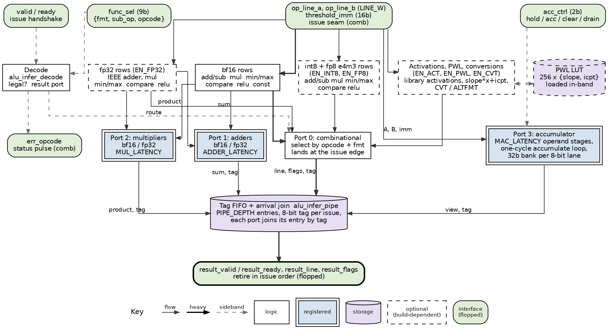

<!-- RTL Design Sherpa Documentation Header -->
<table>
<tr>
<td width="80">
  <a href="https://github.com/sean-galloway/RTLDesignSherpa">
    
  </a>
</td>
<td>
  <strong>RTL Design Sherpa</strong> · <em>Learning Hardware Design Through Practice</em><br>
  <sub>
    <a href="https://github.com/sean-galloway/RTLDesignSherpa">GitHub</a> ·
    <a href="https://github.com/sean-galloway/RTLDesignSherpa/blob/main/docs/DOCUMENTATION_INDEX.md">Documentation Index</a> ·
    <a href="https://github.com/sean-galloway/RTLDesignSherpa/blob/main/LICENSE">MIT License</a>
  </sub>
</td>
</tr>
</table>

---

<!-- End Header -->

# alu_infer_top (module tree)

## Purpose

`alu_infer_top` is the ALU block the cell instantiates at its issue seam.
It owns everything between the operand inputs and the result outputs:
decode, the row families, the accumulator, the result ports and the tag
FIFO.

## Module Tree

```text
alu_infer_top                     the ALU block at the issue seam
├── alu_infer_pipe                tag FIFO + arrival join (one join per port)
└── alu_infer_rows                the function table
    ├── alu_infer_decode          legality + result-port routing
    ├── alu_infer_bf16_rows       bf16: add/sub, mul, min/max, cmp, relu, const
    ├── alu_infer_int8_rows       int8: saturating add/sub/mul, min/max, cmp, relu, const   [EN_INT8]
    ├── alu_infer_fp32_rows       fp32: IEEE add/sub, mul, min/max, cmp, relu, const          [EN_FP32]
    ├── alu_infer_fp8_rows        fp8 e4m3: add/sub, mul, min/max, cmp, relu, const           [EN_FP8]
    ├── alu_infer_act_rows        activations (bf16/fp32/fp8) + recip/exp2/log2/qscale (bf16) [EN_ACT]
    ├── alu_infer_pwl             256-entry PWL LUT activation                                 [EN_PWL]
    ├── alu_infer_cvt             CVT and ALTFMT conversions                                   [EN_CVT]
    ├── alu_infer_delay           tag/data delay lines (adder tag, MUL_LATENCY)
    └── alu_infer_acc             MAC / REDUCE: operand pipeline + accumulate stage + bank
        └── alu_infer_delay       MAC_LATENCY operand stages
```

`alu_infer_pkg` (`rtl/includes/`) holds the shared encodings: opcodes,
formats, `acc_ctrl`, port numbers. Each `[EN_*]` family is a generate
branch: built out, it costs nothing and decodes as illegal (Chapter 2.4).
The four planned submodules of the first draft (decompose, select,
compose, decode) are absorbed: lane split and pack are part-selects inside
each row family, and the select is the per-port mux in `alu_infer_rows`.

### Figure 2.1: ALU-INFER full block diagram



The element key is the house v3 key: green rounded boxes are the seam,
white boxes combinational logic, double-bordered blue boxes registered,
lavender cylinders storage, and dashed outlines build-optional families.
The four result ports sit in one rank above the tag FIFO. Each port
carries its rows' results and tags at that port's latency.

## Parameters

| Parameter | Default | Meaning |
|-----------|---------|---------|
| `LINE_W` | 32 | Line width; a positive multiple of 32. Lanes scale with it, element widths never do |
| `PIPE_DEPTH` | 8 | Tag-FIFO entries = invocations in flight, [2,16]; the stall tolerance, not a latency |
| `ADDER_LATENCY` | 3 | bf16 and fp32 adder pipe stages (the library `PIPE_STAGE_1..4`), [0,4] |
| `MUL_LATENCY` | 0 | bf16 and fp32 multiplier output stages, [0,4]; retiming candidates |
| `MAC_LATENCY` | 0 | Operand stages ahead of the one-cycle accumulate stage, [0,4] |
| `TAG_W` | 8 | Alignment tag width (owner ruling 2026-10-18) |
| `LEAKY_SHIFT` | 4 | Leaky-relu alpha = 2^-LEAKY_SHIFT, every format |
| `EN_INT8`, `EN_FP32`, `EN_FP8` | 1 | Build the element format |
| `EN_REDUCE`, `EN_PWL`, `EN_ACT`, `EN_CVT` | 1 | Build the row family |
| `N_LANES`, `ACC_W` | `LINE_W/16`, 32 | Retained for compatibility; not used by the rows |

: Table 2.1: `alu_infer_top` parameters

## Clock and Reset

Single clock, active-low asynchronous `aresetn` (house `ALWAYS_FF_RST`),
matching the cell. Reset clears the tag FIFO, the delay lines and the
accumulator bank. The PWL table is a memory and has no reset (house SRAM
rule): it must be loaded before use (Chapter 2.5).

---

**Last Updated:** 2026-10-20
