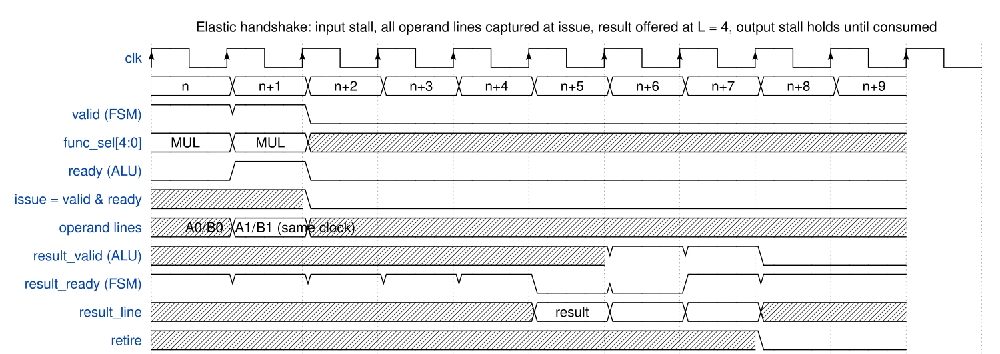
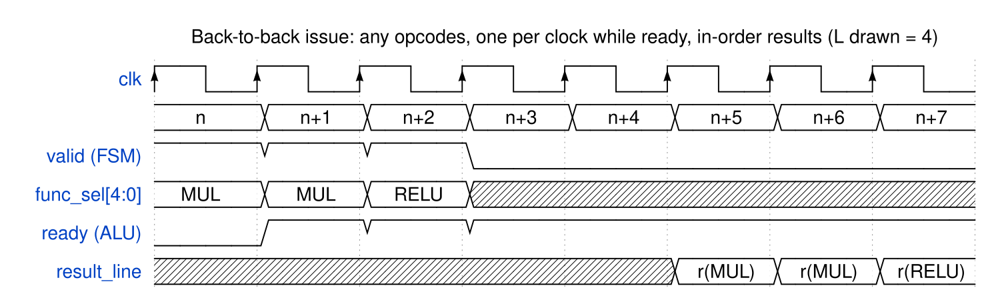

<!-- RTL Design Sherpa Documentation Header -->
<table>
<tr>
<td width="80">
  
</td>
<td>
  <strong>RTL Design Sherpa</strong> · <em>Learning Hardware Design Through Practice</em> 
  
    <a href="https://github.com/sean-galloway/RTLDesignSherpa">GitHub</a> ·
    <a href="https://github.com/sean-galloway/RTLDesignSherpa/blob/main/docs/DOCUMENTATION_INDEX.md">Documentation Index</a> ·
    <a href="https://github.com/sean-galloway/RTLDesignSherpa/blob/main/LICENSE">MIT License</a>
  
</td>
</tr>
</table>

---

<!-- End Header -->

# The ALU↔FSM Interface

The seam between the cell's execution FSM and this block. It is the
entire external surface of the ALU: the FSM owns sequencing, memories,
and the credit loop, and reaches the ALU only through these signals plus
clock and reset.

## Signal Contract

| Signal | Dir (ALU view) | Width | Semantics |
|--------|----------------|-------|-----------|
| `op_line_a` | in | `LINE_W` | operand line A (the function's `OP_LINES` count is across both ports: 1 for copy/relu, the A+B pair for binary/mac) — presented together with `op_line_b` and captured at the issue edge; owner ruling 2026-10-17: two ops scheduled in the same clock finish at the same time |
| `op_line_b` | in | `LINE_W` | operand line B (idle for unary rows) |
| `threshold_imm` | in | 16 | bf16 immediate for opcode 6 |
| `func_sel` | in | 9 | {opcode[4:0], sub_op[6:5], reserved[8:7]} — sampled at issue |
| `acc_ctrl` | in | 2 | accumulator action for a mac invocation (Table 2.3) |
| `valid` | in | 1 | FSM presents an invocation; operands and config stay stable while `valid` is high and `ready` is low |
| `ready` | out | 1 | the ALU can accept an invocation at this edge — high in every cycle that has room (sustained, that is every clock) and low only when a downstream stall backs up into the block |
| `result_valid` | out | 1 | a result is offered; stays high with stable data until consumed |
| `result_ready` | in | 1 | FSM consumes the offered result |
| `result_line` | out | `LINE_W` | the offered result line — one per invocation, in issue order |
| `result_flags` | out | `LINE_W` | opcode-6 mask — one bit per lane, packed low (M5 closed by owner ruling 2026-10-17); zero otherwise |
| `clk`, `aresetn` | in | 1 | house single clock, async active-low reset |

: Table 3.1: ALU↔FSM signals

An **issue** is a rising edge with `valid && ready`; a **retire** is a
rising edge with `result_valid && result_ready`. (The `accept` of
pre-v0.6 notes is exactly the issue event, not a pin.) `OP_LINES` (cell
PRD §7) is the per-function operand-line count — 1 for copy/relu (the A
line only), 2 for the binary rows and mac (the A line and the B line) —
and the two lines arrive **in the same clock** and are captured at the
issue edge; the count never appears as a beat sequence on this
interface.

## Handshake Rules

1. **Issue is `valid && ready`.** The invocation enters the selected
   row's pipeline only when both are high at the edge. `ready` is high
   whenever the block has room, so the FSM may present a new invocation
   **every clock** (II=1); it deasserts only under downstream
   backpressure, and while it is low the FSM holds `valid`, the operand
   lines, `func_sel`, and `acc_ctrl` stable — the standard valid/ready
   contract.
2. **Retire is `result_valid && result_ready`, strictly in issue
   order.** Each result is offered exactly `ROW_LATENCY` cycles after
   its issue *when the output has been draining continuously*. When
   `result_ready` is low, `result_valid` holds with stable data and the
   results behind it wait in order — no loss, no reorder, no tags.
3. **The pipeline is elastic end to end.** Every stage boundary obeys
   valid/ready, so a stall at the result port propagates back to the
   input port: the output stage holds, the alignment timer freezes
   mid-countdown, in-flight invocations keep their state, and `ready`
   falls once the backup reaches the front of the pipe. When
   `result_ready` returns, the pipeline resumes exactly where it
   stopped; `ROW_LATENCY` is measured in drain cycles, not wall clocks.
4. **Uniform presentation, in order by construction.** Every result
   emerges in issue order at the common `ROW_LATENCY`; the FSM pairs
   result N with invocation N by counting. Quick rows compute in
   parallel at their natural speed — `alu_infer_pipe` is an alignment
   timer that holds each result until its presentation slot, **not** a
   bank of padded pipe stages (owner direction 2026-10-17).
5. **Config sampled at issue.** `func_sel` and `acc_ctrl` are sampled
   at the issue edge and travel with the invocation through the
   pipeline, so the FSM may change them for the next issue immediately.
6. **No error signal on this interface in v1.** An out-of-range opcode
   is a cell-level error (Chapter 2.4); the library blocks' IEEE
   exception outputs are not forwarded (open item M2).

The one place uniform latency is *engineered* rather than padded is
opcode 4: a dependent MAC chain feeds back through the accumulator, so
its sustained rate is set by the feedback loop's latency, not the issue
rate. The mac row is therefore split — pipelined exact-fp32-product
stage(s) ahead, single-cycle fp32 accumulate stage in the feedback
path — so a chain sustains II=1 with the output draining (Chapter 2.3).
**Scheduler-paced feedback** (owner ruling 2026-10-17): whenever
results feed back — opcode 4's chain today, any future recurrence —
the scheduler owns the pace entirely; it shapes the `valid` stream and
obeys `ready`, and the ALU makes no autonomous pacing decisions. The
single-cycle accumulate exists so that scheduler-chosen II=1 is
sustainable.

### Waveform 3.1: Elastic handshake — input stall, fixed-latency result, output stall

One invocation rides the elastic protocol end to end. The input stalls
one cycle (`valid` high, `ready` low — the output stage is still
holding a stalled result), the issue lands at n+1, and the result is
offered L = 4 cycles later. The consumer then stalls two cycles:
`result_valid` and `result_line` hold with stable data until
`result_ready` accepts at n+7; the input side saw `ready` fall only
because the backup reached it. Operands and config are stable from
`valid` to issue; operand pops happen inside the block between those
events.

### Waveform 3.2: Back-to-back issue — mixed opcodes, one per clock, in-order results

Three invocations (MUL, MUL, RELU) issue on consecutive clocks; three
results retire on consecutive clocks, L later, in the same order — the
II=1 steady state with the output draining. The RELU computes almost
immediately and its result waits in a holding slot until the alignment
timer releases it — same external timing as every other row, without
padding its datapath to depth L.

## Boundary Notes

- **Config plane.** The cell PRD's §7 register map (`FUNC_SEL`,
  `OP_LINES`, …) is AXIL and cell-RTL scope; this block sees config
  only as the registered `func_sel`/`acc_ctrl` inputs above. The
  in-band `cfg` packets that write those registers at layer boundaries
  travel with the delta traffic and are demuxed by the cell, never by
  this block.
- **Tetrad control core.** The kestrel-class per-tetrad core reads cell
  status and IRQs and exercises operational registers over the AXIL
  plane (alu-infer PRD §5; TILE_SPEC §11.13); it has no direct signals
  here by construction.

---

**Last Updated:** 2026-10-17
