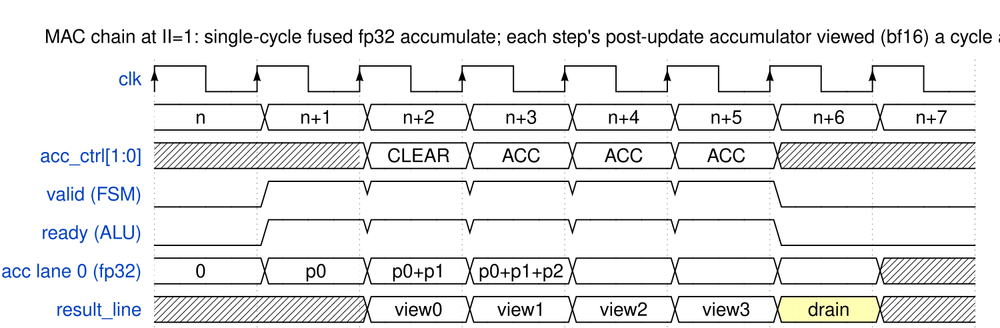

<!-- RTL Design Sherpa Documentation Header -->
<table>
<tr>
<td width="80">
  
</td>
<td>
  <strong>RTL Design Sherpa</strong> · <em>Learning Hardware Design Through Practice</em> 
  
    <a href="https://github.com/sean-galloway/RTLDesignSherpa">GitHub</a> ·
    <a href="https://github.com/sean-galloway/RTLDesignSherpa/blob/main/docs/DOCUMENTATION_INDEX.md">Documentation Index</a> ·
    <a href="https://github.com/sean-galloway/RTLDesignSherpa/blob/main/LICENSE">MIT License</a>
  
</td>
</tr>
</table>

---

<!-- End Header -->

# The Compute Cycle, per Opcode Class

Every invocation is the same three beats — **pop, compute, push** — but
under the elastic handshake (Chapter 3) the beats of consecutive
invocations overlap in the pipeline: while one invocation computes,
the next pops and the previous pushes. This chapter walks each opcode
class once as if it were alone; the overlap rules at the end apply to
all of them together.

## Unary Rows (copy, relu)

The FSM presents its single line on `op_line_a` (operand B idle). The
row computes both lanes in parallel; the composer packs the result. Copy
adds nothing; relu clamps negative lanes to +0 per the library block.
One pop, one push, no state touched.

## Binary Rows (add, sub, mul, min/max)

Both operand lines — one of A, one of B — arrive **in the same clock**;
the owner ruling of 2026-10-17 is that two ops scheduled in the same
clock finish at the same time. The decompose block splits the two lines
into lanes at the issue edge, so the row sees lane pairs (A[0],B[0])
and (A[1],B[1]) for the same element positions, captured together. The
row computes both lane pairs independently (PRD §4 invariant 1); the
select forwards; the composer packs. Sub shares the adder with
sign-flipped B (Chapter 2.2). Min/max resolve the sub-op internally
(Chapter 2.4).

## Compare / Threshold

Like a binary row, except the comparator's per-lane decision bits —
A `<` B per lane, or A `<` imm when the sub-op selects the immediate
form — are what get packed, into `result_flags` (format M5), while
`result_line` carries the mask bits replicated or zero per the same
open item. `threshold_imm` must be stable through issue like any
operand.

## MAC (the chain that matters)

A mac invocation is `acc[i] ← fma(a[i], b[i], acc[i])` per lane, with
`acc_ctrl` choosing the wrapper behavior:

1. **CLEAR** at the layer boundary: `acc` ← +0.0, applied in issue
   order at the accumulate stage so a following ACC never sees stale
   state. The invocation **flows through the pipeline** like any other
   (owner ruling 2026-10-17): no operands are consumed, and its
   presentation slot retires a don't-care result line — every issued
   invocation retires, so the FSM's count pairing never breaks.
2. **ACCUMULATE** per step of the chain: pop the A and B lines —
   presented together in the issue clock — and fused-accumulate. The
   result
   line presents the post-update accumulator rounded to bf16 (decision
   M7) — observable, lossy, and cheap. Because the row is split
   (Chapter 2.3) — pipelined exact product ahead, one-cycle fp32
   accumulate in the feedback path — the chain can sustain one step
   per clock when the scheduler issues that fast (feedback pacing is
   the scheduler's — Chapter 3); the per-step bf16 views on the result
   line lag the accumulator state by the product-pipe depth and retire
   in order with everything else.
3. **DRAIN** for the layer's final values: present the rounded
   accumulator without accumulating. After drain the FSM re-points the
   result memory or starts the next layer with CLEAR.

### Waveform 4.1: MAC chain — clear, three accumulates, drain

The numerics that make this safe: each product is exact in fp32 before
the add, so the only rounding before presentation is the FMA's single
rounding per step, and the bf16 views on the result line never feed
back into the accumulator — the state stays fp32 end to end. A long
chain is therefore reproducible from `{reset, acc_ctrl sequence,
operand sequence}`, which is exactly the property Chapter 5's
accumulator tests rely on.

## Overlapping Invocations

The pipeline never inserts a stall of its own: a MUL issue on one
clock, a RELU on the next, a MAC step on the third — all in flight
together, results retiring in issue order as each tag group arrives
(Waveform 3.2). The one stall source is downstream: when
`result_ready` deasserts, the head entry holds its offer with stable
data, rows behind it keep landing in their own entries, and `ready`
falls only once the FIFO is full (Waveform 3.1). Three consequences are
worth stating:

- **No drain logic.** Because retirement is in issue order regardless
  of per-row latency, switching opcode mid-stream costs nothing; there
  is no pipeline flush, no bubble. Backpressure needs no drain either —
  the FIFO entries simply hold their state until the blockage clears.
- **The FSM pairs results by counting.** Result N belongs to
  invocation N; no tags ride the interface.
- **Idle is a hold.** When the FSM stops issuing (`valid` low), the
  protocol needs nothing further: in-flight invocations drain, the last
  result holds until consumed, and the accumulator bank holds until
  `acc_ctrl` says otherwise.

**The alignment mechanism (owner ruling 2026-10-18, as-built since
2026-10-19).** When an invocation is loaded it takes an **8-bit tag**,
common to all ops that must execute in parallel; a **FIFO** tracks the
tags in flight; an op asserts its valid only when every op of its tag
group is ready. The as-built `alu_infer_pipe` is exactly this: a
free-running tag counter at issue, a `PIPE_DEPTH`-entry FIFO in issue
order, and an arrival join — combinational rows land at the issue edge,
the pipelined add/sub row re-joins its entry by **tag compare** (not
position) when its result lands. v1 issues one row-op per invocation,
so a tag group is one arrival; the group join is exercised structurally
and multi-op parallel issue is the growth path the ruling targets
(deep-pipelined rows, PRD §7). This supersedes the first v1 build's
alignment-timer mailbox and its uniform `ROW_LATENCY` presentation —
with no interface change: the tags stay inside the block; the ALU↔FSM
seam keeps its two valid/ready pairs.

---

**Last Updated:** 2026-10-19
