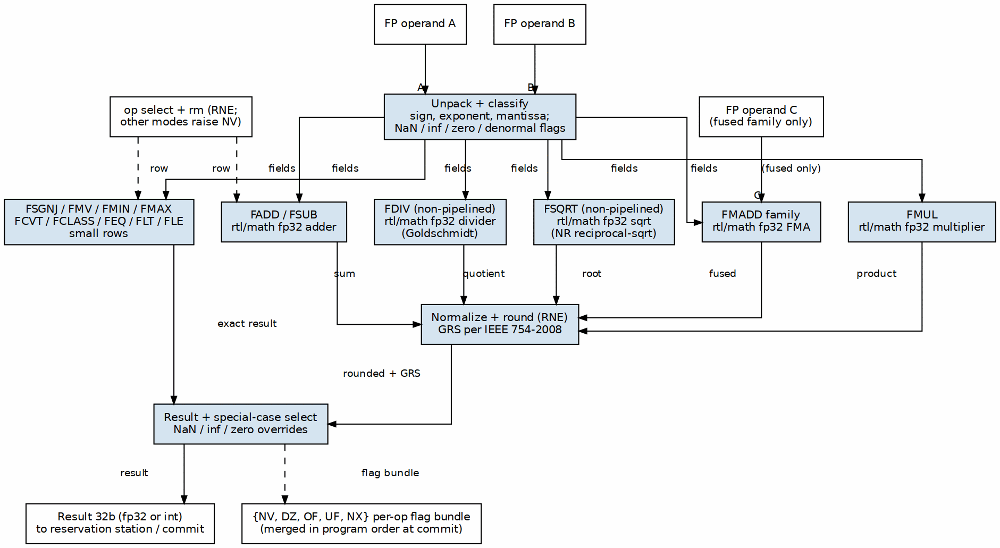

<!-- RTL Design Sherpa Documentation Header -->
<table>
<tr>
<td width="80">
  
</td>
<td>
  <strong>RTL Design Sherpa</strong> · <em>Learning Hardware Design Through Practice</em> 
  
    <a href="https://github.com/sean-galloway/RTLDesignSherpa">GitHub</a> ·
    <a href="https://github.com/sean-galloway/RTLDesignSherpa/blob/main/docs/DOCUMENTATION_INDEX.md">Documentation Index</a> ·
    <a href="https://github.com/sean-galloway/RTLDesignSherpa/blob/main/LICENSE">MIT License</a>
  
</td>
</tr>
</table>

---

<!-- End Header -->

**[← Back to compute-eng-ip](../README.md)**

# ALU-RV32F — Falcon-Suite FP32 Execution-Unit Product Requirements Document

**Version:** 0.1 (2026-10-17)
**Status:** Definition PRD. This directory holds the product definition and
doctrine only — **no RTL lives here**. The definition is realized by the
garuda rung ([`garuda-rv32imaf`](../../riscv-ip/README.md), RV32IMAF) per the
falcon doctrine "rungs do not share RTL."
**Queue:** realization waits behind **cell → gatling** (owner priority
2026-10-18); the drop-in structure lands when this definition is built.

---

## 1. Identity and scope

**alu-rv32f** is the floating-point execution unit of the falcon suite: the
block that performs the RV32F single-precision arithmetic garuda adds to
gyrfalcon's out-of-order machine. Where the falcon ladder's integer story
climbs single-cycle → pipeline → speculation → out-of-order, this unit is the
suite's **long-latency-execution lesson**: multi-cycle arithmetic, a fused
multiply-add, non-pipelined divide and square root, and precise exception
flags that must survive the reorder buffer.

The arithmetic is **built on the repo's math library** — the
`math_ieee754_2008_fp32_*` blocks (adder, multiplier, divider, square root,
FMA, exponent adder, mantissa multiplier) behind this unit are the same
blocks the [`docs/markdown/rtl-math/`](../../../../docs/markdown/rtl-math/)
book teaches, so the unit is the math library's end-to-end consumer. That
reuse is deliberate: garuda exists in the same repo as the math area, and the
falcon suite's packaging doctrine says garuda "consumes the math library's
`math_ieee754_2008_fp32_*` blocks end-to-end."

fp32 only — RV32F has no double-precision rows. The FP register file, its
rename, and the ROB glue that keeps flags precise are **garuda core-block
scope, out of scope here**; this PRD is the execution unit behind the
reservation station. Sign-inject, move, classify, and convert rows are small
datapaths and belong to the unit because their fcsr flags do.

## 2. Operation set

The full F-extension computational set (unpriv §11):

| Row | Ops | Notes |
|---|---|---|
| Arithmetic | FADD, FSUB, FMUL, FDIV, FSQRT | FDIV/FSQRT are the long-latency lesson (§4) |
| Fused family | FMADD, FMSUB, FNMSUB, FNMADD | single rounding of `a×b + c` — the FMA row |
| Sign inject | FSGNJ, FSGNJN, FSGJX | sign-bit multiplexing; never raise flags |
| Move | FMV.W.X, FMV.X.W | bit pattern moves, no conversion |
| Compare | FEQ, FLT, FLE | result is an integer 0/1 in rd; quiet comparisons |
| Min/max | FMIN, FMAX | the IEEE 754-2008 `minNum`/`maxNum` NaN-propagating semantics |
| Convert | FCVT.W.S, FCVT.WU.S, FCVT.S.W, FCVT.S.WU | the only int↔fp rows RV32F defines |
| Classify | FCLASS.S | a 10-bit mask in rd; never raises flags |

## 3. fcsr contract

- **Accrued flags.** Five IEEE 754 exception flags — **NV** (invalid), **DZ**
  (divide-by-zero), **OF** (overflow), **UF** (underflow), **NX**
  (inexact) — accrue in `fcsr` per the F extension's rules (set on any
  operation that raises them; never silently cleared).
- **Precision through the ROB.** Flags are architectural state committed with
  the instruction; an instruction raising NV that is later squashed must not
  leave its flag set. This is garuda's precise-exception story applied to
  fp32, and it is the reason the flags leave the unit as a per-operation
  bundle alongside the result, to be merged at commit in program order.
- **Rounding.** Hard-wired **RNE** (owner decision, garuda rung goal): the
  datapath implements round-to-nearest-even per IEEE 754-2008 and **any other
  requested rounding mode raises NV**. No dynamic rounding-mode datapath; the
  CSR story stays honest without one.

## 4. Latency class

Per the garuda rung goal: **FMUL/FADD are multi-cycle**; **FDIV (Goldschmidt)
and FSQRT (Newton reciprocal-sqrt) are non-pipelined long-latency units in
the 9–11-cycle class**. The units sit behind reservation stations and
complete out of order; issue and completion separation, wakeup/select, and
replay are garuda MAS territory. The contract this PRD pins is the unit's
externally visible behavior — operands accepted against a grant, one result
plus one flag bundle per operation — not its internal schedule.

## 5. Interface contract

| Item | Contract |
|---|---|
| Operand ports | A, B (32b fp32); C (32b) for the fused family only |
| Select | operation row (§2) + `rm` rounding-mode field (§3: anything but RNE raises NV) |
| Result | 32b — fp32 for arithmetic/fused/sign/move/min-max rows; integer for compare/convert/classify rows |
| Flags | per-operation bundle {NV, DZ, OF, UF, NX} to the commit/merge logic, never a global side effect inside the unit |
| Handshake | ready/valid against the reservation station; one result per accepted operation; divide/sqrt hold their slot until completion (non-pipelined) |
| NaN boxing | `FMV.X.W`/`FCLASS`/compare/convert results are integer values in rd; NaN-boxing of narrow results is a core writeback concern, noted here because the unit produces the raw values |

## 6. Verification doctrine

Per the falcon design spec's verification ladder, FP rungs verify harder than
integer ones:

- **TestFloat-style vectors** (or the riscv-tests `rv32uf` battery) as the
  operation-level gate — special values (NaN payloads, ±inf, ±0, denormals)
  are mandatory corners, not extras.
- **riscv-formal where it pays**: targeted properties — flag precision under
  squash, in-order flag commit, divide/sqrt occupancy — rather than full ISA
  compliance, per the suite's per-rung ladder.
- **spike lockstep** at the core level with the `rv32uf` battery; the unit
  itself checks against a bit-accurate fp32 golden model (the math library's
  own dv is the first reference).
- **Cross-check against `rtl/math`**: the unit's arithmetic rows are the math
  blocks under test again; any unit-vs-library diff on identical operands is
  a bug in exactly one of them.

## 7. Growth

- **bf16 / fp16 / fp8 modes** — the math library already carries the
  `math_bf16_*`, `math_fp16_*`, and `math_fp8_*` families; a narrower-format
  variant of this unit is a format-parameter exercise on the same rows. Not
  in the falcon ladder's ISA scope (garuda is RV32IMAF); noted so the
  definition here does not preclude it.
- **Pipelined FDIV/FSQRT** — the non-pipelined choice is the lesson; a
  pipelined variant would be a different rung's story.

## 8. References

- [`riscv-ip/README.md`](../../riscv-ip/README.md) — garuda rung goal
  (long-latency lesson, RNE ruling, math-library consumption).
- [`docs/superpowers/specs/2026-10-06-riscv-falcon-suite-design.md`](../../../../docs/superpowers/specs/2026-10-06-riscv-falcon-suite-design.md)
  — design spec (scope, verification ladder, packaging).
- [`docs/markdown/rtl-math/index.md`](../../../../docs/markdown/rtl-math/index.md)
  — the math library book the unit's arithmetic is built from.
- R. E. Goldschmidt, "Applications of Division by Convergence," M.S. thesis,
  MIT, 1964 — the FDIV algorithm. PDF:
  [`rtl/math/references/GoldschmidtDivision__Goldschmidt1964.pdf`](../../../../rtl/math/references/GoldschmidtDivision__Goldschmidt1964.pdf).
- M. J. Flynn, "On Division by Functional Iteration," *IEEE Trans.
  Computers* C-19(8), 1970 — the multiplicative-iteration family survey.
  PDF: [`rtl/math/references/FunctionalIterationDivision__Flynn1970.pdf`](../../../../rtl/math/references/FunctionalIterationDivision__Flynn1970.pdf).
- T. Lang, J. D. Bruguera, "Floating-Point Fused Multiply-Add with Reduced
  Latency for Floating-Point Addition," *Proc. ARITH-17*, 2005 — the FMA row.
  PDF: [`rtl/math/references/FMAReducedLatency__Lang2005.pdf`](../../../../rtl/math/references/FMAReducedLatency__Lang2005.pdf).
- *IEEE Std 754-2008* and the RISC-V unprivileged ISA (F extension) — cited
  via [`riscv-ip/references/`](../../riscv-ip/references/) and the
  [`rtl/math/references/README.md`](../../../../rtl/math/references/README.md)
  index (citation-only entries there).

---

**Last Updated:** 2026-10-17
**Maintained By:** RTL Design Sherpa Project
