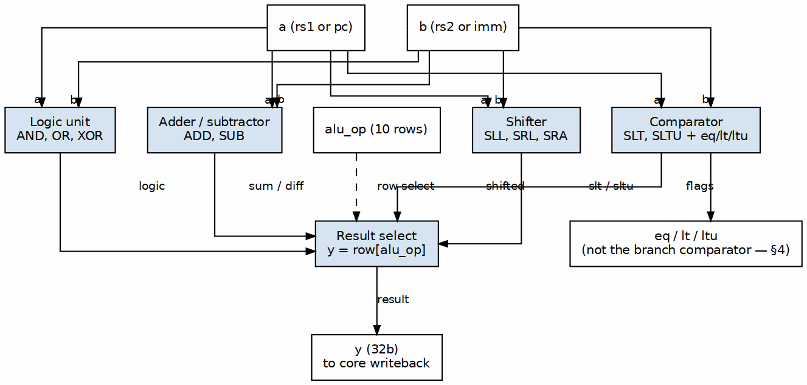

<!-- RTL Design Sherpa Documentation Header -->
<table>
<tr>
<td width="80">
  
</td>
<td>
  <strong>RTL Design Sherpa</strong> · <em>Learning Hardware Design Through Practice</em> 
  
    <a href="https://github.com/sean-galloway/RTLDesignSherpa">GitHub</a> ·
    <a href="https://github.com/sean-galloway/RTLDesignSherpa/blob/main/docs/DOCUMENTATION_INDEX.md">Documentation Index</a> ·
    <a href="https://github.com/sean-galloway/RTLDesignSherpa/blob/main/LICENSE">MIT License</a>
  
</td>
</tr>
</table>

---

<!-- End Header -->

**[← Back to compute-eng-ip](../README.md)**

# ALU-RV32I — Falcon-Suite Integer ALU Product Requirements Document

**Version:** 0.1 (2026-10-17)
**Status:** Definition PRD. This directory holds the product definition and
doctrine only — **no RTL lives here**. Each falcon-ladder rung realizes this
definition in its own RTL, per the suite doctrine "rungs do not share RTL —
each core is the cleanest possible example of its level"
([`riscv-ip/README.md`](../../riscv-ip/README.md)).
**Queue:** realization waits behind **cell → gatling** (owner priority
2026-10-18); the drop-in structure lands when this definition is built.

---

## 1. Identity and scope

**alu-rv32i** is the integer ALU of the falcon suite: the datapath block that
performs the RV32I base-integer arithmetic for every rung. It is defined once
here so all five rungs teach the same operation contract while their
microarchitectures diverge around it — the suite's core premise is that the
*diff between rungs is the lesson*, and a shared behavioral contract is what
makes those diffs measurable.

The v1 reference realization is
[`kestrel_alu`](../../riscv-ip/kestrel-rv32i/docs/kestrel_mas/ch02_blocks/04_kestrel_alu.md)
(single-cycle, kestrel rung). Later rungs re-implement it inside their own
pipelines — merlin behind an EX stage, peregrine beside a separate
multiply/divide unit, gyrfalcon and garuda behind issue ports. This PRD pins
what an implementation must do; each rung's MAS is free to decide how
(latency, pipelining, operand sourcing).

Out of scope: the M-extension multiply/divide unit (a separate block,
peregrine's iterative multi-cycle lesson), branch decision comparators
(§4), and PC generation.

## 2. Operation set

Ten operations selected by `alu_op`, covering the RV32I computational rows
(excluding loads/stores/branches/jumps, which use the ALU's arithmetic but
add memory and control semantics of their own):

| `alu_op` | Result | Notes |
|---|---|---|
| `ADD` | `a + b` | also computes branch/JAL targets with `a = pc` |
| `SUB` | `a - b` | |
| `AND` / `OR` / `XOR` | bitwise | |
| `SLL` | `a << shamt` | `shamt = b[4:0]` — RV32I shift amounts are 5 bits (unpriv §2.1.4.1) |
| `SRL` | `a >> shamt` | logical |
| `SRA` | `$signed(a) >>> shamt` | arithmetic |
| `SLT` | `{{31{1'b0}}, lt}` | signed set-less-than |
| `SLTU` | `{{31{1'b0}}, ltu}` | unsigned; notably SLTIU's sign-extended-then-unsigned immediate |

Encodings with `shamt[5]` set are reserved in RV32I: they must never reach
the ALU as shifts — decode halts them illegal first. That boundary is part of
the contract.

## 3. Flags

The ALU computes `eq = (a == b)`, `lt = ($signed(a) < $signed(b))`,
`ltu = (a < b)`. `lt`/`ltu` feed the SLT/SLTU rows internally; `eq/lt/ltu`
are available on dedicated outputs for any consumer whose `a`/`b` are the
intended operands.

## 4. The flags ruling

For branch instructions the core drives `a = pc` (the ALU is simultaneously
computing `pc + imm` on its ADD row), so the ALU's `eq/lt/ltu` would compare
pc against imm — silently wrong. Branches therefore decide on a **dedicated
rs1/rs2 comparator in the core**, not on the ALU flags. The kestrel core's
instance leaves the flag pins unconnected on purpose; this was a reviewed
ruling (kestrel Task 4 review, SDD ledger), recorded here and in the kestrel
MAS so nobody "fixes" the dangling pins. Any rung realization keeps the same
split: ALU flags serve SLT/SLTU and honest operand compares; branch
resolution is the core's own comparator.

## 5. Contract

Every rung's realization obeys the same shape — operands fan out to the
parallel function rows, and the mode select picks the row the opcode names:

| Item | Contract |
|---|---|
| Operand ports | `a`, `b` (32b) from the core's source muxes — the ALU does not fetch |
| Select | `alu_op` enum; the ten rows of §2 and no implicit extras |
| Result | `y` (32b); SLT/SLTU zero-extend their flag (§2) |
| Shift semantics | 5-bit `shamt` from `b[4:0]`; SRA is sign-propagating |
| Address reuse | ADD must serve `pc + imm` when `a = pc` — one adder, two jobs |
| Freedom | Latency, pipelining, operand muxing, and physical decomposition are the rung's choice, at the cost the rung exists to teach (kestrel: combinational everything; merlin: EX-stage logic; later rungs: issue/complete separation) |

## 6. Verification doctrine

Verification is per-rung, against this shared contract:

- **ISA compliance** where it pays per the falcon design spec — full
  riscv-formal on kestrel, retire-interface on merlin, targeted properties on
  the upper rungs — with the classic `rv32ui` riscv-tests battery and spike
  ISS lockstep as the compliance gate.
- **Unit truth-table tests** per rung: all ten rows × corner operands
  (0x00000000, 0xFFFFFFFF, 0x80000000, sign-boundary pairs, all shamt
  values 0–31, SLTIU's sign-extended immediate).
- **Cross-rung equivalence**: same contract, different microarchitecture —
  a kestrel-vs-merlin result diff on any §2 row is a bug in one of them.

## 7. Growth

- **M extension** (mul/div) deliberately stays a separate unit — peregrine's
  structural-hazard lesson; this ALU gains no mul/div rows.
- **Zba/Zbb** bit-manipulation rows are out of scope for v1; if the suite
  ever adds a rung for them, this PRD gains a section then, not before.

## 8. References

- [`riscv-ip/README.md`](../../riscv-ip/README.md) — the falcon suite ladder,
  doctrine, and rung goals.
- [`docs/superpowers/specs/2026-10-06-riscv-falcon-suite-design.md`](../../../../docs/superpowers/specs/2026-10-06-riscv-falcon-suite-design.md)
  — design spec (source of truth for scope, ISA, verification, packaging).
- [`kestrel_mas/ch02_blocks/04_kestrel_alu.md`](../../riscv-ip/kestrel-rv32i/docs/kestrel_mas/ch02_blocks/04_kestrel_alu.md)
  — the v1 reference realization and the flags ruling.
- [`riscv-ip/references/`](../../riscv-ip/references/) — the RISC-V ISA
  manuals (primary sources, cited by chapter).

---

**Last Updated:** 2026-10-17
**Maintained By:** RTL Design Sherpa Project
