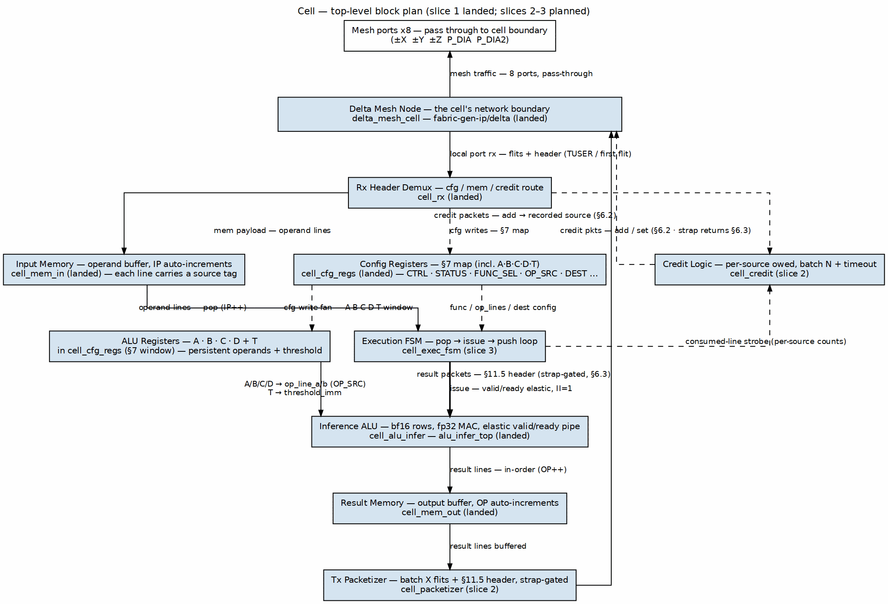

<!-- RTL Design Sherpa Documentation Header -->
<table>
<tr>
<td width="80">
  
</td>
<td>
  <strong>RTL Design Sherpa</strong> · <em>Learning Hardware Design Through Practice</em> 
  
    <a href="https://github.com/sean-galloway/RTLDesignSherpa">GitHub</a> ·
    <a href="https://github.com/sean-galloway/RTLDesignSherpa/blob/main/docs/DOCUMENTATION_INDEX.md">Documentation Index</a> ·
    <a href="https://github.com/sean-galloway/RTLDesignSherpa/blob/main/LICENSE">MIT License</a>
  
</td>
</tr>
</table>

---

<!-- End Header -->

**[← Back to cell](../README.md)**

# Cell — Compute Engine IP Product Requirements Document

**Version:** 0.5 (2026-10-19): records the 2026-10-19 owner ruling that
**gatling sequences the cell ALU** (`POP`/`PUSH`/`FLUSH` Xcell
encodings, gatling PRD v0.2) while the slice-3 `cell_exec_fsm` remains
the standalone bring-up driver; `DEST` is explicitly reserved for the
deferred cell→cell path and `FLUSH_DEST`/`FLUSH_TAG` are the operational
drain destination; strap terminology replaces remaining grant terms in
§§6.3/7/10 (slice-1 RTL still uses the old grant identifiers, noted in
the MAS). Carries v0.4 (2026-10-18): §6.3 rewritten to the strap model
(`TILE_LAND_FLITS`, RAPIDS returns on drain; owner direction
2026-10-18) and the result destination becomes gatling-programmed
(TILE_SPEC §11.14) — `DEST` chain-back superseded, register retained for
the deferred cell-destined path. Carries v0.3 (2026-10-18): **cell register file + sender-generic credits**
— owner direction 2026-10-18 defines the cell as the lowest module: the
alu-infer ALU, one delta node, the config registers, the ALU registers
(`A`/`B`/`C`/`D` + `T`) as persistent operands for repeated calculations over
a run (`OP_SRC` operand-source mux, `IP`/`OP` memory pointers), and the
data-in / data-out memories; the tetrad engine is deferred (the
owner-authored gatling-rv32i barrel-core PRD is the leading candidate;
§10). Credit returns become sender-generic — per-source batching to the
recorded source coordinate; the packetizer gains `DEST` (default: recorded
source, chain-back). §4 reconciles to the alu-infer elastic valid/ready
pipeline ("one-function-at-a-time" superseded). The house-style graphviz
figure replaces the ASCII block diagram. Carries v0.2: ALU element model,
function set, and control interface reconciled to the alu-infer PRD v0.3
(owner direction 2026-10-17; owner datapath decisions 2026-10-16).
**Status:** Pre-HAS PRD. This document is the cell's product definition;
the HAS/MAS follow it. The tile architecture it plugs into is the adopted
hierarchy of [`tile/docs/TILE_SPEC.md`](../../tile/docs/TILE_SPEC.md) §11
(owner decision 2026-10-16); the packet header, payload types, coordinate,
and credit/grant protocols referenced below are defined there and are not
restated except where the cell consumes them.

---

## 1. Identity and scope

The **cell** is the tile's compute unit: sixteen of them make a tile.
Each cell contains exactly **one delta node** — a `delta_mesh_cell`
instantiated inside the cell, its local port facing the cell's internal
datapath and its seven other ports passing through to the cell
boundary. That containment is the **entire** cell↔delta relationship
(owner clarification 2026-10-16): the node is a black-box subcomponent
governed by delta's own HAS/MAS, and everything else in the cell — the
memories, the execution FSM, the ALU, the ALU registers, the packetizer,
the credit logic, the registers — is the cell's own design, speaking the
tile-level contracts of TILE_SPEC §11, not delta internals. The node fills
the cell's input memory from delta traffic; the cell's ALU and execution
FSM consume that memory and produce results; results leave as batched
flits back through the node toward their destination. As each input line
is consumed, a credit returns to the line's sender so it may write more.

Owner decision 2026-10-16: the cell's compute engine is the
**ALU + execution FSM** described here. The earlier CGRA-array ambition
([README](../README.md), 2026-10-13) is **deferred** — §11 — and the
[`axon_spec.md`](axon_spec.md) sketch (SERV-based result collector) is
**superseded**: the result collection, packetization, and streaming it
proposed are this PRD's output path, and its interfaces section predates
the adopted §11 header/credit protocols.

Owner direction 2026-10-17: the ALU block is governed by the
[`alu-infer` PRD](../../alu-infer/PRD.md) — bf16 element model on the
`rtl/math` `math_bf16_*` library, fp32 MAC accumulation, and a per-tetrad
RV32I control core (not SERV; SERV is the Ocelus observability agent).
Config and programming arrive in-band with the delta traffic; the tetrad
core is a local reaction agent, not a config originator. See alu-infer
PRD §5.

Owner direction 2026-10-18: **the cell is the lowest module and is defined
first.** Its contents: the alu-infer ALU, one delta node, the config
registers (§7), the ALU registers `A`/`B`/`C`/`D` (+`T`) — persistent
operands for a sequence of the same calculations over a run — the data-in
memory, and the data-out memory. The tetrad-level engine is **deferred**:
gatling/tetrad is figured out once the cell is fully defined and working,
with the owner-authored [`gatling-rv32i`](../../../riscv-ip/gatling-rv32i/PRD.md)
barrel-core PRD (2026-10-17) the leading candidate. See §10.

Out of scope: tetrad/root node internals, rapids internals, the CXS
modules themselves, and fabric-level Z stacking.

## 2. Architecture

### Figure 1: Cell top-level block plan (house style — three flows: programming down the center, operand fill on the left, results and credits back up the right)

| Block | Function | Notes |
|---|---|---|
| `delta_mesh_cell` | network attachment | instantiated black box, not owned, here — containment is the whole cell↔delta relationship (owner clarification 2026-10-16); the cell consumes its local port and passes its mesh ports through; delta HAS/MAS govern only the node |
| rx header/demux | parses the §11.5 tile header (first data flit) and delta's route header (`TUSER` on AXIS), routes payload to input memory, handles `cfg` writes to registers, routes `credit` packets to the credit logic | per §11.6 (TILE_SPEC v1.6 clarification: tile header = first data beat on both transports; cell-bound traffic rides delta QoS ≠ 0 — QoS 0 is the node's own config plane); records each packet's tile-header source coordinate |
| input memory | delta-written operand/input buffer | sized in lines; its flit capacity is the boot advertisement value; each line carries a source-coordinate tag for credit returns (§6.2); read pointer `IP` auto-increments on pop |
| config registers | AXIL, registers-only per house rule | §7 — `CTRL`/`STATUS`/`FUNC_SEL`/`OP_SRC`/`DEST`/batching knobs/`IP`/`OP` |
| ALU registers | `A`·`B`·`C`·`D` persistent operands + `T` threshold | §7; written by `cfg` packets or AXIL, read into the ALU operand muxes per `OP_SRC`; persistent across a run (owner direction 2026-10-18) |
| credit logic | returns credits to the recorded sender of each consumed input line | §6.2; per-source batching, N configurable, default 1 |
| ALU + execution FSM | pops line(s), issues them to the ALU's elastic pipeline, pushes result line(s) | §4; the cell's only datapath |
| result memory | buffers result lines before packetization | sized with §12; write pointer `OP` auto-increments on push |
| packetizer | batches result writes into X flits, builds §11.5 header (destination per §6.3 — gatling-programmed drain), sends via node | sends only against the `TILE_LAND_FLITS` strap counter (§6.3) |

## 3. Dataflow

A run is programmed first, then fed; everything — data, config, and
programming — arrives in-band (owner ruling 2026-10-17):

1. **Program.** `cfg` packets (`ptype` = `cfg`) write the §7 registers —
   `FUNC_SEL`, `OP_SRC`, `DEST`, the persistent operands `A`–`D`, `T`, and
   the batching knobs — instead of the input memory. A `cfg` read is
   answered with a write-format packet echoing the tag, per §11.8.
2. **Fill.** A write packet (`ptype` = `mem`, destination coordinate
   `{level=0, cell X, Y, Z}`, target address inside the cell's
   input-memory window) arrives on the node's local port — from rapids in
   the v1 flow, but sender-generic by construction: any node may send it.
   The demux writes payload lines into the input memory and tags each line
   with its packet's source coordinate. The sender spends one end-to-end
   credit per flit sent, header included, from the per-destination
   counter it holds for this cell (§11.9).
3. **Consume.** The execution FSM pops the configured number of input
   lines for its function (`IP` auto-increments), issues the invocation to
   the ALU, and the elastic pipeline returns result line(s) in order; the
   FSM pushes them into the result memory (`OP` auto-increments).
4. **Credit return.** As each input line is consumed, the credit logic
   owes the line's recorded sender one credit (§6.2 — per-source batching),
   so the sender refills the space. Credits return on consumption, not
   arrival (§11.9(3)).
5. **Emit.** When the packetizer has ≥ X result flits (or a flush
   condition fires, §6.3), it builds the §11.5 header — destination =
   the gatling-programmed drain destination (§6.3; the cell does not
   choose it) — source = this cell's external ID, `op` = 0, length =
   bytes that follow, tag = the sink channel gatling programmed — and
   sends the packet through the node, spending its `TILE_LAND_FLITS`
   strap counter (§6.3). Cell-destined sending awaits the tile-spec
   extension (§6.3).

## 4. ALU and execution FSM

The FSM is a pop→issue→push loop: it issues invocations into the ALU's
valid/ready **elastic pipeline** (multiple invocations in flight, results
retire in order — the alu-infer MAS contract), and pushes each retired
result line into the result memory. Functions are register-selected, and
both the function and its operand pattern come from config, so new
functions are RTL table rows, not new blocks. (The v0.2
"one-function-at-a-time" phrasing is superseded by the elastic contract;
owner ruling 2026-10-17, alu-infer PRD v0.4+.)

**Operand sources (owner direction 2026-10-18):** the ALU's `op_line_a` /
`op_line_b` are driven through an operand-source mux configured by
`OP_SRC` (§7): each side selects the input-memory pop or one of the
persistent ALU registers `A`–`D` (32 bits each, two bf16 lanes — matching
`LINE_W`), and `T` (bf16) backs `threshold_imm`. This is the "sequence of
the same calculations over a run" pattern: streamed operands arrive from
delta into the input memory and pop under `IP`, while persistent scalars
(weights, biases, constants) sit in `A`–`D` for the whole run. `IP`/`OP`
auto-increment on pop/push and wrap at the configured memory depth;
`CTRL.soft_reset` clears them.

**Element model (owner direction 2026-10-17, superseding the B4/B8/B16/B32
note of 2026-10-16):** a 32-bit line is read as **2×bf16** elements, and the
function array is built mostly from the `math_bf16_*` family of `rtl/math`
(adder, multiplier, FMA, comparator, min/max, ReLU, activations as growth).
The ALU's product definition — element model, function set, interface
contract, verification doctrine, and the per-tetrad control interface — is
the **[`alu-infer` PRD](../../alu-infer/PRD.md)**, which governs the ALU block;
it is not restated here (one source per fact). MAC accumulates in fp32 with
one rounding per result line at drain. Wider lines (§12) scale the lane
count, never the element width.

**Gatling sequences the cell ALU (owner ruling 2026-10-19):** in the
tetrad-integrated tile, gatling (the barrel-core tetrad engine) drives
the cell's alu-infer ALU through `Xcell` instructions: `POP` presents
operand line(s) to the ALU issue handshake, `PUSH` retires result
line(s) into the result memory, and `FLUSH` programs
`FLUSH_DEST`/`FLUSH_TAG` and triggers the drain. The slice-3
`cell_exec_fsm` remains the standalone bring-up driver with the same
POP/issue → PUSH/retire client contract. Gatling never originates cell
config traffic; cell programming stays in-band per the 2026-10-17 owner
ruling. The `Xcell` encodings (`CFG`, `POP`, `PUSH`, `ECTX`, `FLUSH`,
`KICK`, `WAIT`) live in gatling PRD v0.2.

**v1 function set:** eight opcode rows (copy, add, sub, mul, mac, min/max,
compare/threshold, relu) defined with their `math_bf16_*` implementation
base in [alu-infer PRD §3](../../alu-infer/PRD.md); not restated here. Opcode
space reserves 5 bits; 8–31 are growth. Exact datapath widths and latency
land in the MAS, consistent with the math area's learning ethos
(sophisticated low-latency techniques).

## 5. Packet interface

The cell consumes and produces the §11.5 header unchanged; §11.6
locates it per transport. Fields the cell uses directly:

| Field | Cell use |
|---|---|
| Destination coordinate | demux match against `{level=0, own X/Y/Z}`; rapids-bound emits use `FLUSH_DEST` (gatling-programmed). `DEST` is reserved for the deferred cell→cell path (TILE_SPEC §10). |
| Source coordinate | the tile header's source field (the originator — TILE_SPEC v1.6 §11.5 note; not delta's hop-source route header), recorded per arriving packet — credit-return destination and the deferred chain-back default for `DEST` (rapids sends as `level` 3, §11.3) |
| `ptype` | `mem` → input memory; `cfg` → registers; `credit` → credit/grant handler |
| `op` | write vs `cfg` read; credit `add` vs `set` |
| Length | payload bytes / credit count / read size |
| Target address | input-memory line index or register offset |
| Tag | echoed on replies and result packets so rapids routes them to the right sink channel |

## 6. Credit behavior

### 6.1 Boot advertisement

After reset the cell sends one `set` credit packet (`op` = 1) to
`level` 3 carrying its input memory's size **in flits**. Rapids's
per-destination counter for this cell starts at 0 and cannot send until
the advertisement arrives — the advertisement is the cell's "alive"
(§11.10). The packet rides the credit VC and needs no grant.

### 6.2 Consumed-line credit returns

- Each input line consumed by the FSM owes **its sender** one credit
  return. The sender is the source coordinate recorded when the demux
  wrote the line (every input-memory line carries a source tag). Rapids
  (`level` 3) is the sender in the v1 flow, but the return is
  sender-generic per §11.9 — a credit return goes to the source
  coordinate of the packet whose flits it frees, so a cell that streamed
  into this cell's input memory receives the credits.
- Returns are `add` credit packets addressed to the recorded source
  coordinate, per §11.9(4): routed like any packet by destination
  coordinate; the sink port accepts them unconditionally and never stores
  them. They ride the credit VC and need no grant.
- **Batching (owner decision 2026-10-16, extended sender-generic
  2026-10-18):** the credit logic keeps a per-source owed count and sends
  one credit packet per N consumed lines **per source**, with a timeout so
  a partial batch drains. **N = 1 is the default and the exact per-line
  behavior.** N > 1 trades return latency for less credit-packet traffic
  on the fabric.

### 6.3 Straps on the result path

The result path adopts §11.9's strap mechanism (owner direction
2026-10-18: credits toward RAPIDS are **straps, not grants**):

1. Toward RAPIDS the cell keeps no grant protocol. Space in RAPIDS's
   sink is fixed by construction: a per-cell strap of `TILE_LAND_FLITS`
   flits (a Hive-set parameter passed to RAPIDS, default 16 — TILE_SPEC
   §11.9 Hive contract), reserved at configuration.
2. The packetizer sends a result packet only while its strap counter
   covers the whole packet, header included, and spends the counter as
   it sends. RAPIDS returns `credit`/`add` as it drains the cell's
   landing space, restoring the counter.
3. Resync/re-baselining of the strap state follows RAPIDS's
   advertisement/resync rules (TILE_SPEC §11.10); exact timing is a
   tile §10 open item.
4. The cell never asks for result space — no ask path; the strap is
   the contract.

**Result destination (owner direction 2026-10-18, TILE_SPEC §11.14):**
gatling hands the cell the drain destination. Result flushes go to
`{ext 0, level 3}` (the tile I/O), source = this cell's external ID, tag
= the sink channel gatling programmed. **The cell does not choose the
destination.**

- **Operational drain:** `FLUSH_DEST` (coordinate) and `FLUSH_TAG`
  (sink channel) are programmed by gatling and used by the packetizer
  when `CTRL.flush-and-send` fires.
- **Reserved/deferred:** the legacy `DEST` register (offset `0x38`) is
  retained only for the future cell→cell result path. It is **not**
  used for rapids-bound drains. `DEST` becomes operational only after
  the tile-spec cell→cell credit/grant extension lands (TILE_SPEC §10);
  until then, v1 result traffic is RAPIDS-bound and
  `FLUSH_DEST`/`FLUSH_TAG` take precedence.

## 7. Config registers

AXI4-Lite, registers-only (house rule); routing/mode config travels
in-band as `cfg` packets per the standing owner decisions — every register
below is writable both from AXIL and from the `cfg` stream, and readable
over AXIL for debug. v1 map:

| Offset | Register | Notes |
|---|---|---|
| 0x00 | `CTRL` | enable, soft reset (also clears `IP`/`OP`), flush-and-send (packetizer) |
| 0x04 | `STATUS` | busy, input-empty, result-nonempty, strap counter nonzero (slice-1 RTL alias `status_grant_nonzero`) |
| 0x08 | `FUNC_SEL` | opcode (5b) + sub-op (2b) + reserved (2b) — element width is reserved under the bf16 model (alu-infer PRD §3) |
| 0x0C | `OP_LINES` | input lines per function invocation |
| 0x10 | `EMIT_BATCH_X` | flits per result packet (packetizer) |
| 0x14 | `CREDIT_BATCH_N` | consumed lines per credit packet **per source**, default 1 |
| 0x18 | `IRQ_EN` | done, error, strap-starved (slice-1 RTL alias `IRQ_GRANT_STARVED_BIT`), credit-timeout enables |
| 0x1C | `IRQ_STATUS` | write-1-clear status |
| 0x20 | `A` | persistent operand register A — 32b (2×bf16 lanes); feeds `op_line_a/b` per `OP_SRC` |
| 0x24 | `B` | persistent operand register B |
| 0x28 | `C` | persistent operand register C |
| 0x2C | `D` | persistent operand register D |
| 0x30 | `T` | bf16 threshold immediate backing register (opcode 6) |
| 0x34 | `OP_SRC` | operand-source mux: `sel_a[2:0]`, `sel_b[2:0]` — 0 = input memory (pop), 1 = A, 2 = B, 3 = C, 4 = D; reset 0 (both operands from memory) |
| 0x38 | `DEST` | *reserved for the deferred cell→cell path (2026-10-18/19 ruling)* — the rapids-bound drain destination is gatling-programmed into `FLUSH_DEST`/`FLUSH_TAG`; the cell does not choose it. `DEST` is retained (bits [13:0] = §11.3 coordinate at `COORD_W` = 4; bit [16] = override) but is **not** used until the tile-spec cell→cell credit/grant extension lands (TILE_SPEC §10). |
| 0x3C | `IP` | input-memory read pointer — auto-increments on pop, wraps at depth |
| 0x40 | `OP` | result-memory write pointer — auto-increments on push, wraps at depth |
| 0x44+ | counters | lines in, lines out, credits returned, packets sent (§8) |

The `A`–`D`/`T` window is written by `cfg` packets like any other register
(§3); loading `A`–`D` *from* the input memory is deferred (§11).

## 8. Status and observability

- IRQs: computation done, error, strap-starved (a packetizer with data
  and no strap, time-limited), credit-timeout.
- Software counters per §7.
- One MonBus observer stream per cell, on AXI4-Lite (owner direction
  2026-10-19), per the tile's §5 aggregation hierarchy: the cell's stream
  is a leaf the tetrad-level merge consumes, alongside the other three
  cells and the tetrad node. Exact leaf selection is the tile §10 open
  item.

## 9. Verification hooks

cocotb + rds-dv BFMs per the standing convention. Test levels follow the
house gate/func/full grid. Natural hooks: drive the node from a GAXI
master instead of a mesh (the node's local port is a normal stream
face), force credits and grants from the TB, and check the credit loop
(count lines in → credits out, per recorded source) independently of the
datapath.

## 10. Dependencies

- delta — the backbone network — **in progress**, built by a separate
  agent (fabric-gen-ip/delta). The cell instantiates one
  `delta_mesh_cell` node as a black box; modes 9–10 diagonal ports
  landed (Task 6c), the rest of the backbone is being built out.
- rapids — the DMA running data in and out of the tile — **in
  progress**, separate lane. The cell's dependencies on it are the
  per-destination credit counters, strap pool (`TILE_LAND_FLITS`), and
  sink-to-source credit-return path (§11.9 requirements list); sequencing
  with the rapids lane.
- rapids_cxs + delta CXS migration — **in flight** (amba lane); the
  cell's §11.6 transport note applies unchanged until delta ports move.
- TILE_SPEC §10 open items that touch the cell: input-buffer sizing,
  grant allocation policy, resync timing, cell→cell grant mediation
  (needed for cell-destined `DEST`, §6.3).
- the alu-infer PRD — the ALU block's product definition (bf16 element
  model, function set, interface contract, control interface); **normative
  for the ALU** since 2026-10-17.
- the alu-infer MAS — the implementation-intent book (module tree,
  function rows, accumulator, interface, cycle behavior, verification,
  configuration); lives in this directory's `docs/alu_infer_mas/`.
- a tetrad-level RV32I control core per alu-infer PRD §5 — **deferred**
  (owner direction 2026-10-18): the tetrad engine is defined once the
  cell is fully defined and working, with the owner-authored
  [`gatling-rv32i`](../../../riscv-ip/gatling-rv32i/PRD.md) barrel-core
  PRD the leading candidate and kestrel-class a candidate flavor via
  `CORE_FLAVOR`. When it lands, gatling sequences the cell ALU through
  `POP`/`PUSH`/`FLUSH` (owner ruling 2026-10-19); the cells see its
  local AXIL register plane and its operational writes only. Cell
  *programming* stays in-band (owner ruling 2026-10-17).

## 11. Deferred

- CGRA array of richer PEs (2026-10-13 ambition): the cell's
  block boundaries — node, input memory, compute, result memory,
  packetizer — are chosen so an array replaces the ALU+FSM block
  without disturbing the network, credit, or observation contracts.
- Context switching / multi-function pipelines.
- Cell-initiated grant requests.
- Wider-than-32-bit lines (element widths stay bf16-only regardless; §4).
- Loading `A`–`D` from the input memory (v1 writes them via `cfg`/AXIL).
- Cell-destined result sending (`DEST` = another cell) pending the
  tile-spec cell→cell grant extension (§6.3).
- The tetrad-level control core and the gatling/tetrad engine (§10).

## 12. Open questions

- Input memory and result memory depths (lines, and flit-conversion for
  the advertisement) — sized in the MAS against the MAS injection-FIFO
  and credit-flow analysis.
- `cfg` read reply path: whether rapids's sink half strips headers
  (TILE_SPEC §11.7 open item) affects nothing here — the cell always
  builds a full reply header.
- Flush conditions for the packetizer beyond batch-X (idle timeout?
  end-of-job marker from the FSM?).
- Cell→cell grant/advertisement rules: who grants sink space for
  cell-destined results, and how a cell advertises its input-memory
  credits to peer cells (today: to rapids only, §11.10). Needed for
  `DEST` overrides (§6.3); lands in the tile spec first.
- `DEST` coordinate width tracks the §11.3 `COORD_W` parameterization
  (4 today); the register is 32-bit with the used low bits defined above.

## References

- [`alu-infer/PRD.md`](../../alu-infer/PRD.md) — the ALU block's product
  definition (normative for the ALU since 2026-10-17).
- [`tile/docs/TILE_SPEC.md`](../../tile/docs/TILE_SPEC.md) — adopted tile
  hierarchy, §11 packet header, credits/grants (normative for §§3, 5, 6).
- [`delta_has/ch07_mesh_network/`](../../../fabric-gen-ip/delta/docs/delta_has/ch07_mesh_network/)
  — the node the cell instantiates.
- [`riscv-ip/gatling-rv32i/PRD.md`](../../../riscv-ip/gatling-rv32i/PRD.md)
  — owner-authored barrel-core tetrad-engine PRD (leading candidate;
  deferred per §10).
- [`axon_spec.md`](axon_spec.md) — superseded 2026-10-16 (decision trail).
- [`2026-10-13-delta-mesh-design.md`](../../../../../docs/superpowers/specs/2026-10-13-delta-mesh-design.md)
  — working design record.

---

**Last Updated:** 2026-10-19
**Maintained By:** RTL Design Sherpa Project
