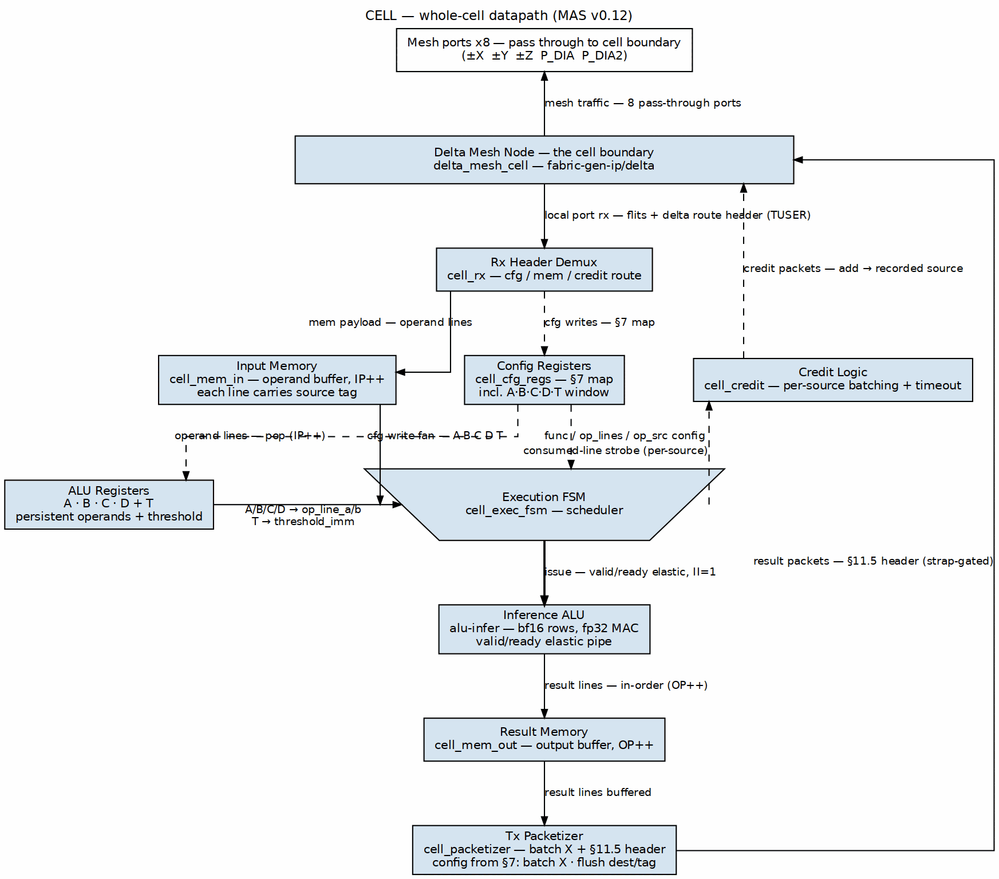
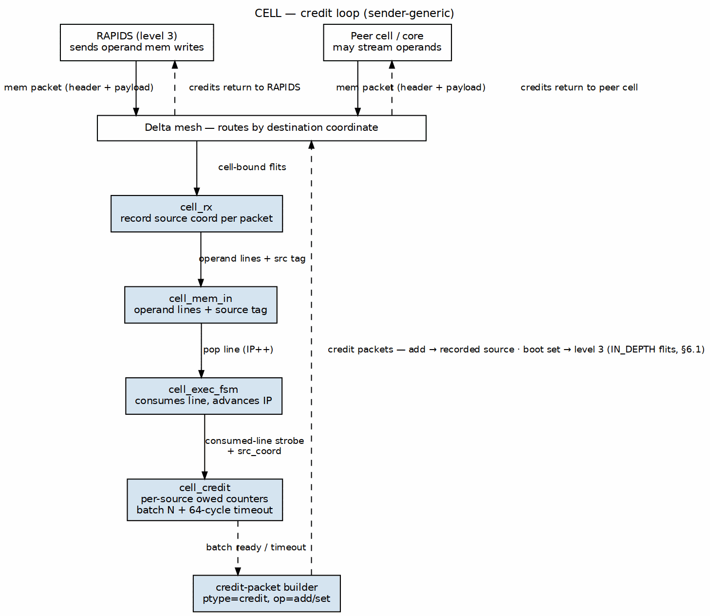
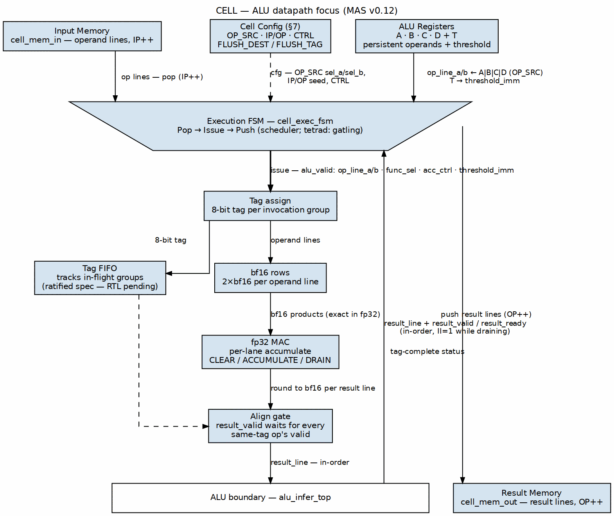

<!-- RTL Design Sherpa Documentation Header -->
<table>
<tr>
<td width="80">
  
</td>
<td>
  <strong>RTL Design Sherpa</strong> · <em>Learning Hardware Design Through Practice</em> 
  
    <a href="https://github.com/sean-galloway/RTLDesignSherpa">GitHub</a> ·
    <a href="https://github.com/sean-galloway/RTLDesignSherpa/blob/main/docs/DOCUMENTATION_INDEX.md">Documentation Index</a> ·
    <a href="https://github.com/sean-galloway/RTLDesignSherpa/blob/main/docs/LICENSE">MIT License</a>
  
</td>
</tr>
</table>

---

<!-- End Header -->

# Datapath Figures

## Whole-Cell Datapath

### Figure 2.1: Whole-cell datapath

The figure follows the house-style rule that three flows must be
traceable at a glance:

- **Programming/config flows down the center:** `cfg` packets enter
  through the delta node, are demuxed by `cell_rx`, and write the config
  registers; the registers in turn configure the FSM, the ALU, and the
  packetizer.
- **Operand fill flows down the left:** `mem` payloads are written into
  the input memory and are later popped by the execution FSM.
- **Results and credit returns flow back up the right:** result lines
  move from the ALU into the result memory, through the packetizer, and
  back out through the delta node; consumed-line credits return on their
  own dashed path up to the node.

The boundary bar is the delta node edge. Every arrow is labeled with the
transaction class it carries; sideband/config arrows are dashed.

## Credit Loop

### Figure 2.2: Credit loop

The credit-loop figure shows the sender-generic return path:

1. An input line arrives from a source and is tagged with that source's
   coordinate.
2. The execution FSM consumes the line and strobes `cell_credit`.
3. `cell_credit` increments a per-source owed counter and, when the
   batch threshold `CREDIT_BATCH_N` is reached (or the 64-cycle timeout
   expires), sends a header-only `credit`/`add` packet addressed to the
   recorded source.
4. The packet travels back through the delta node to the source, which
   restores its per-destination credit counter.

The path never shares an arrow with result data; credits are a separate
sideband VC.

## ALU Datapath Focus

### Figure 2.3: ALU datapath focus

The ALU-focus figure drops the delta/network side and traces the three
cell-internal flows around `alu_infer_top`:

1. **Operand fill (left):** `cell_mem_in` pops (`IP++`) and the
   persistent `A·B·C·D`/`T` registers feed the execution FSM, which owns
   the `OP_SRC` operand mux. Config (`OP_SRC`, `IP/OP`, `CTRL`) arrives
   dashed from §7.
2. **Issue (center, heavy pen):** the FSM issues the bundle
   (`op_line_a/b`, `func_sel`, `acc_ctrl`, `threshold_imm`) with
   `alu_valid`; the tag assign gives the invocation group its 8-bit tag
   and the tag FIFO tracks in-flight groups (ratified spec — RTL
   pending). Rows multiply in bf16 exactly, the fp32 MAC accumulates
   per-lane under `acc_ctrl`, and the align gate holds `result_valid`
   until every same-tag op's valid has asserted.
3. **Result flow (right):** `result_line` returns **up** its own route
   through the ALU boundary bar (`result_valid`/`result_ready`,
   in-order, II=1 while draining), and the FSM pushes the accepted
   lines down to `cell_mem_out` (`OP++`).

The single boundary bar is the `alu_infer_top` edge; no flow shares an
arrow with another.

---

**Last Updated:** 2026-10-18
