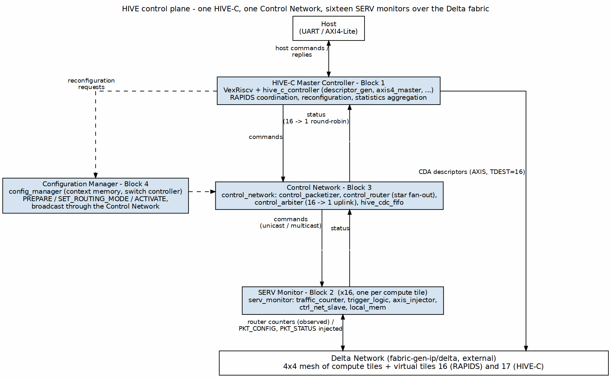
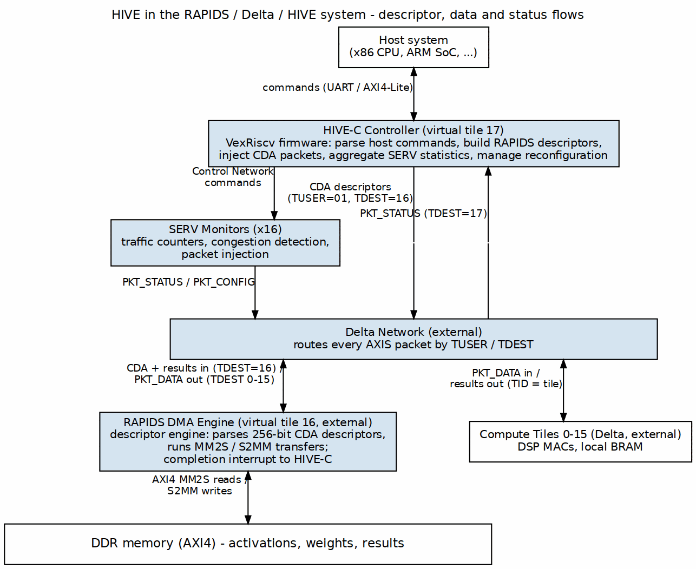
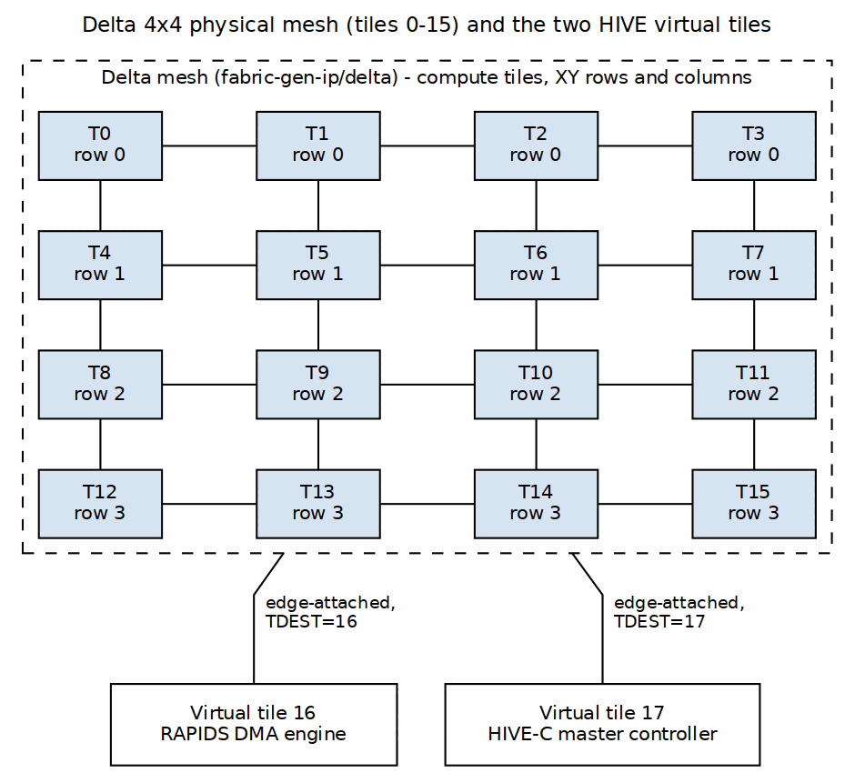

<!-- RTL Design Sherpa Documentation Header -->
<table>
<tr>
<td width="80">
  
</td>
<td>
  <strong>RTL Design Sherpa</strong> · <em>Learning Hardware Design Through Practice</em> 
  
    <a href="https://github.com/sean-galloway/RTLDesignSherpa">GitHub</a> ·
    <a href="https://github.com/sean-galloway/RTLDesignSherpa/blob/main/docs/DOCUMENTATION_INDEX.md">Documentation Index</a> ·
    <a href="https://github.com/sean-galloway/RTLDesignSherpa/blob/main/LICENSE">MIT License</a>
  
</td>
</tr>
</table>

---

<!-- End Header -->

# System Overview and Context

## Executive Summary

HIVE is a distributed control and monitoring subsystem coordinating the RAPIDS
DMA engine and the Delta Network compute fabric. A hierarchical RISC-V
architecture provides it: one VexRiscv master controller manages global
operations, and sixteen lightweight SERV cores — one per Delta compute tile —
provide per-tile traffic monitoring and inband descriptor/configuration
injection.

**Primary design goals:**
- Low-latency, inband control of RAPIDS DMA through AXIS-native descriptor
  injection (~10-20 cycles vs. 100+ for memory-mapped polling)
- Distributed traffic monitoring across the Delta compute network
- Reconfigurable network topologies through virtual configuration switching
- A comprehensive educational platform with performance models and modular design

**Target platforms:**
- **Proof of Concept:** Digilent NexysA7 100T (Xilinx Artix-7 XC7A100T)
- **Production target:** Digilent Genesys2 (Xilinx Kintex-7 325T)
- **Alternative:** Terasic DE10 Standard (Cyclone V SX, Quartus toolchain)

---

## Hierarchical Organization

### Figure 2.1: HIVE control plane

The compute tiles, routers, and network interfaces belong to Delta (see the
Delta HAS). HIVE owns the control plane above them: HIVE-C, the sixteen SERV
monitors, the Control Network, and the Configuration Manager.

---

## Position in the RAPIDS / Delta / HIVE Ecosystem

> **Delta relationship (owner, 2026-10-13):** the delta component
> (`projects/components/fabric-gen-ip/delta/`) — the AXIS fabric
> generator — *is* the fabric HIVE communicates with. The archived
> NoC-mesh draft (`noc-ip/delta_spec/`) and the generator describe the
> same fabric; the 2026-10-12 re-home from `noc-ip/` was organizational.
> HIVE's architecture stands as specified against delta, and HIVE talks
> to it exclusively over AXI4-Stream (§4.1).

### Figure 2.2: HIVE in the RAPIDS / Delta / HIVE system

---

## Control Flow Example: Matrix Multiply

The end-to-end flow that exercises every HIVE block:

1. **Setup (HIVE-C):** Host sends "matmul layer N, tiles 0-7". HIVE-C switches
   Delta to mesh mode if needed, then generates MM2S descriptors (DDR → tiles)
   and S2MM descriptors (tiles → DDR).
2. **Descriptor injection (HIVE-C → RAPIDS):** 256-bit descriptors are sent as
   CDA packets (TUSER=2'b01, TDEST=16); Delta routes them to the RAPIDS
   descriptor engine.
3. **Data movement (RAPIDS → tiles):** RAPIDS executes MM2S descriptors, reads
   activations from DDR over AXI4, and emits PKT_DATA (TUSER=2'b00, TDEST=0-7).
4. **Computation (tiles):** Compute elements produce results and send
   PKT_DATA with TID = source tile. The tile Network Interface overrides TID
   with the local tile ID (hardware-enforced, see §4.2).
5. **Result collection (tiles → RAPIDS → DDR):** PKT_DATA routed to RAPIDS
   (TDEST=16); S2MM channels match on TID; results written to DDR; completion
   interrupt to HIVE-C.
6. **Monitoring (SERV → HIVE-C):** SERV monitors track packet counts and buffer
   occupancy, alert on congestion, and send PKT_STATUS to HIVE-C (TDEST=17).

---

## Virtual Tile Addressing

HIVE participates in the Delta topology as two virtual tiles:

### Figure 2.3: Delta mesh and the HIVE virtual tiles

**Routing implications:**
- TDEST = 16 routes to the RAPIDS DMA engine
- TDEST = 17 routes to the HIVE-C status aggregator
- From HIVE-C: CDA packets (TUSER=2'b01) route to RAPIDS
- From tiles: PKT_STATUS (TUSER=2'b11) routes to HIVE-C

---

## Packet Type Usage by Component

| Component | Sends | Receives | Purpose |
|-----------|-------|----------|---------|
| **HIVE-C** | CDA (2'b01), PKT_CONFIG (2'b10) | PKT_STATUS (2'b11) | Descriptor injection, network config, monitoring |
| **RAPIDS** | PKT_DATA (2'b00) | CDA (2'b01), PKT_DATA (2'b00) | DMA data transfers |
| **Compute Tiles** | PKT_DATA (2'b00) | PKT_DATA (2'b00), PKT_CONFIG (2'b10) | Computation, reconfiguration |
| **SERV Monitors** | PKT_STATUS (2'b11), PKT_CONFIG (2'b10) | PKT_CONFIG (2'b10) | Traffic reporting, tile control |
| **Delta Routers** | - | PKT_CONFIG (2'b10) | Routing table updates |

: Packet type usage by component

**Validation rules** (checkable by protocol checkers at tile interfaces):
- HIVE-C never sends PKT_DATA or PKT_STATUS
- RAPIDS never sends CDA, PKT_CONFIG, or PKT_STATUS
- Compute tiles never send CDA, PKT_CONFIG, or PKT_STATUS
- SERV monitors send PKT_STATUS and PKT_CONFIG only

---

## Key Architectural Features

**1. Hierarchical control.** HIVE-C is the single global coordinator; the 16
SERV monitors are lightweight agents. One powerful core where decisions are
made, sixteen tiny cores where the data is.

**2. Inband control.** HIVE-C pushes descriptors as CDA packets through the
Delta data fabric — no polling, no sideband descriptor bus. The control path
reuses the network that already exists.

**3. Distributed monitoring.** Each SERV tracks its local router's traffic and
autonomously injects PKT_STATUS on trigger conditions (congestion, errors,
periodic reporting). HIVE-C aggregates rather than polls.

**4. Reconfigurable topology.** Four pre-loaded routing contexts (systolic,
mesh, tree, custom) switch atomically in 10-20 cycles under the Configuration
Manager's quiesce protocol.

**5. Zero data-path ownership.** HIVE carries control and status traffic only;
the Delta data plane and the RAPIDS AXI4 path never traverse HIVE logic.

---

**Last Updated:** 2026-10-13
