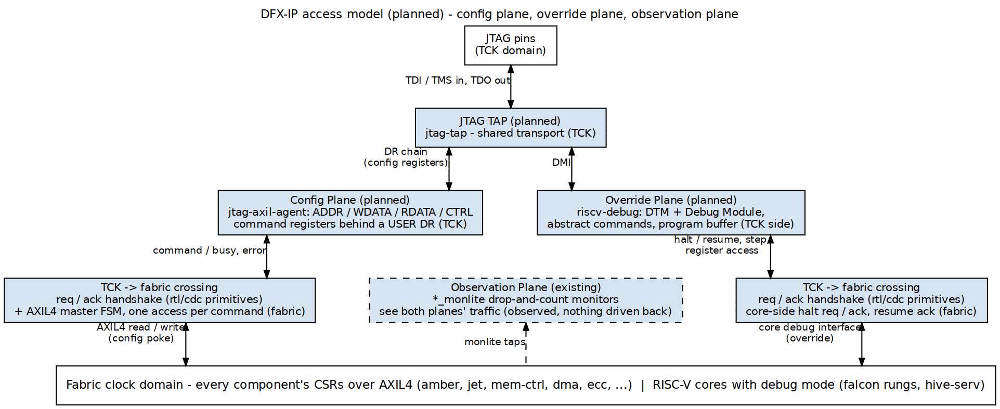

# The Access Model — Config Plane vs Override Plane

Owner ruling (2026-10-11), the seed of this architecture:

> riscv needs override control deep down. most other IP only need access
> to their configs.

Two consequences follow. First, debug capability is **tiered per
consumer**, not uniform. Second, the expensive capability — reaching deep
into a running core — is built only where a processor actually justifies
it; everything else shares one cheap fabric master.

## The three planes

### Figure 2.1: The three access planes (planned)

**Source:** [01_access_planes.dot](../assets/graphviz/01_access_planes.dot)

### Observation plane (existing)

`*_monlite` drop-and-count monitors on measured paths. Read-only,
never stalls what it watches. This plane already covers the whole house;
DFX-IP adds taps to its own blocks like any other consumer.

### Config plane (jtag-axil-agent)

A TCK-domain command register file (ADDR / WDATA / RDATA / CTRL with
busy + error) behind a USER DR chain, driving an AXIL4 master FSM: one
read or write per command. This is the whole capability most IP needs —
every component already exposes its configuration as fabric CSRs, so a
single fabric master reaches all of them with zero per-component logic.

**Consumers:** amber, jet, mem-ctrl rocks, dma (stream/rapids), ecc-ip,
timers, converters — anything whose debug story is "read a status,
change a config."

### Override plane (riscv-debug)

Per the RISC-V Debug Specification: JTAG → DTM → DM, abstract commands
against core state, program buffer for debug code sequences, plus the
core-side debug mode (EBREAK/DRET, `dcsr`/`dpc`/`dscratch`, halt/resume/
single-step). This reaches *deep down* into a core — it can stop
execution mid-stream, inspect and modify architectural state, and step
one instruction at a time.

**Consumers:** the falcon rungs (kestrel → garuda) and hive-serv's
VexRiscv + SERV cores. A core pays for the override plane only when it
implements debug mode; SERV/VexRiscv already carry their own, so
hive-serv mostly needs the transport.

## Tiering summary

| Consumer | Observation | Config poke | Core override |
|---|---|---|---|
| falcon rungs (riscv-ip) | monlite | yes (CSRs: CLINT, caches, predictors) | **yes — debug mode + DM** |
| hive-serv cores | monlite | yes | yes (core-native debug mode; house DTM/DM transport) |
| cache-ip (amber/jet/onyx) | monlite | yes (CSR config + MonBus thresholds) | no |
| mem-ctrl-ip | monlite | yes (scheduler/PHY CSRs) | no |
| dma-ip (stream/rapids) | monlite | yes | no |
| everything else on the fabric | monlite | yes | no |

## Crossing into the fabric

The TAP and its DR chains live in the **TCK domain**; everything they
drive lives in the **fabric clock domain**. Each plane crosses exactly
once, with a request/acknowledge handshake built from the house CDC
primitives (`rtl/cdc/`). TCK frequency is unconstrained relative to the
fabric — the handshake, not the clock ratio, carries the contract. The
override plane's core-side interface (halt req/ack, resume ack) follows
the same discipline.

## Safety posture (summary; ch06 owns the detail)

- Both planes are **unauthenticated fabric masters** — acceptable for
  teaching boards and bench rigs; documented as such, never silently.
- The config plane sees the full fabric address map; if a system needs a
  restricted window (e.g., config-but-not-data), the address decoder is
  the policy point.
- The override plane can halt any core it is bound to; binding is a
  per-system integration choice and must be visible in the system's MAS.
