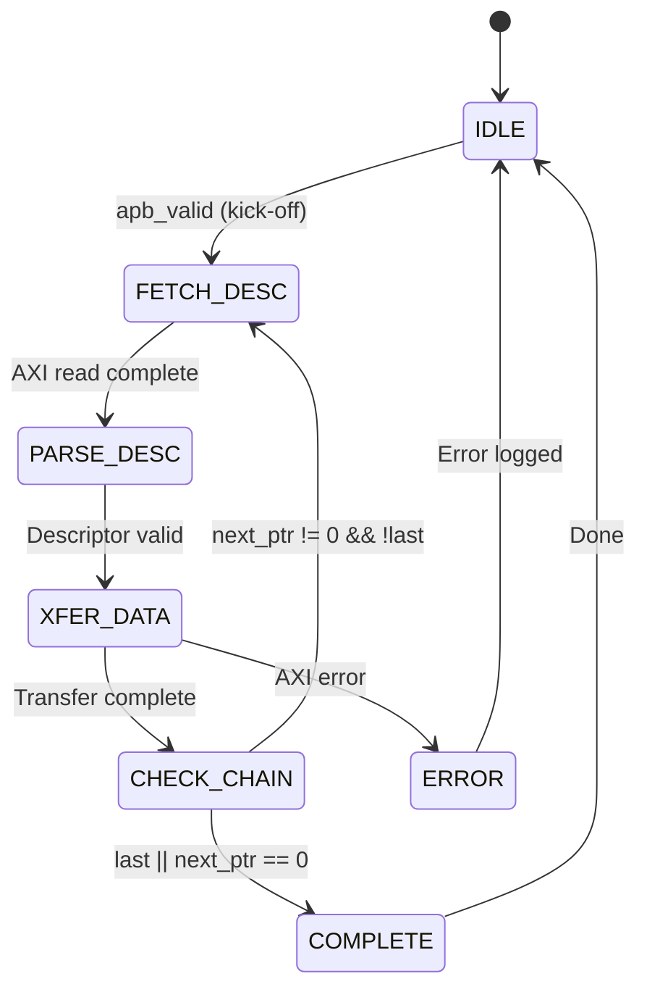

<!-- RTL Design Sherpa Documentation Header -->
<table>
<tr>
<td width="80">
  
</td>
<td>
  <strong>RTL Design Sherpa</strong> · <em>Learning Hardware Design Through Practice</em> 
  
    <a href="https://github.com/sean-galloway/RTLDesignSherpa">GitHub</a> ·
    <a href="https://github.com/sean-galloway/RTLDesignSherpa/blob/main/docs/DOCUMENTATION_INDEX.md">Documentation Index</a> ·
    <a href="https://github.com/sean-galloway/RTLDesignSherpa/blob/main/LICENSE">MIT License</a>
  
</td>
</tr>
</table>

---

<!-- End Header -->

# Key Features

## Feature Summary

### Multi-Channel Architecture

- **8 Independent Channels** with dedicated schedulers
- **Per-Channel State Machines** for concurrent operation
- **Shared AXI Infrastructure** with arbitrated access
- **Channel Isolation** prevents cross-channel interference

### Descriptor-Based Control

- **256-bit Descriptor Format** with all transfer parameters
- **Automatic Chaining** follows next_descriptor_ptr links
- **Last Descriptor Flag** terminates chain processing
- **IRQ Generation** via gen_irq descriptor flag
- **Control Descriptors** (`CTRL_READ` consumer gate / `CTRL_WRITE` producer
  doorbell) for in-memory producer/consumer synchronization without moving
  payload -- see Descriptor Format (Section 5.1)

### High-Performance Data Paths

| Path | Direction | Bandwidth | Features |
|------|-----------|-----------|----------|
| **Sink** | Network to Memory | 512-bit @ clock | SRAM buffering, AXI burst writes |
| **Source** | Memory to Network | 512-bit @ clock | AXI burst reads, SRAM buffering |

: Data Path Summary

### Monitoring and Debug

- **64-bit MonBus Packets** for all significant events
- **State Transition Reports** track FSM activity
- **Error Event Codes** for fault diagnosis
- **Performance Metrics** for throughput analysis
- **Network Monitor-Lite** in each network plane (AXIS or CXS), agents 0x09 / 0x0A

## Feature Details

### Descriptor Processing

### SRAM Buffering

Each channel has its own buffer in each data path (sink and source), `SRAM_DEPTH` beats deep:

| Parameter | Default | Range | Description |
|-----------|---------|-------|-------------|
| SRAM_DEPTH | 4096 | 64-4096 | Beats per channel, per direction (parameter of `rapids_beats_top`) |
| Data Width | 512 | 256 / 512 | Bits per beat (`DATA_WIDTH`) |
| Buffer size | 256 KB | 2 KB-256 KB | Per channel, per direction: `SRAM_DEPTH x DATA_WIDTH/8` |

: SRAM Buffer Parameters

The defaults are a simulation size. The Genesys 2 builds use 128 beats of 32 bytes, 4 KB per channel.

**Buffer Operation:**

- **Sink Path:** Fill from AXIS (from the RX network plane, AXIS or CXS), drain to AXI write engine
- **Source Path:** Fill from AXI read engine, drain to AXIS (to the TX network plane, AXIS or CXS)
- **Flow Control:** Backpressure when buffer full/empty

### AXI Burst Optimization

RAPIDS optimizes AXI transactions for maximum bandwidth:

| Feature | Implementation |
|---------|----------------|
| **Burst Length** | Up to 256 beats (AXI4 max) |
| **Outstanding Transactions** | Configurable (default 8) |
| **Address Alignment** | 64-byte aligned (beat size) |
| **4KB Boundary** | Automatic burst splitting |

: AXI Optimization Features

### Error Handling

| Error Type | Detection | Response |
|------------|-----------|----------|
| **Address Range** | Pre-fetch validation | Descriptor rejected |
| **AXI SLVERR** | Response check | Transfer aborted |
| **AXI DECERR** | Response check | Transfer aborted |
| **Timeout** | Watchdog timer | Channel reset |

: Error Handling Summary
