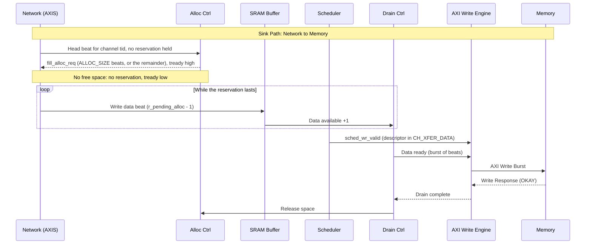
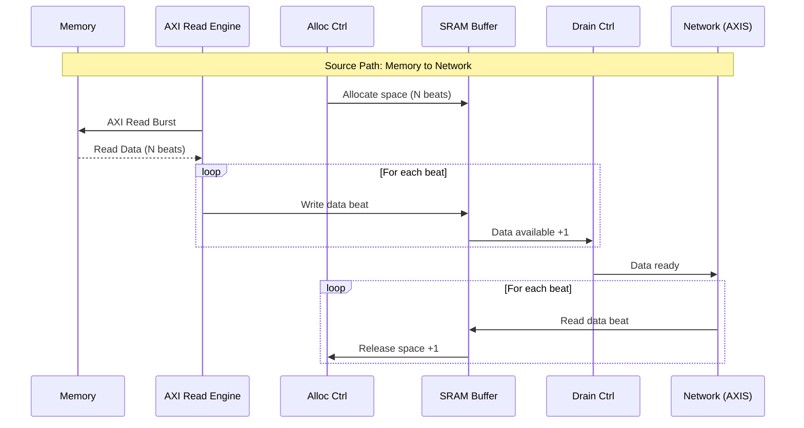

<!-- RTL Design Sherpa Documentation Header -->
<table>
<tr>
<td width="80">
  <a href="https://github.com/sean-galloway/RTLDesignSherpa">
    
  </a>
</td>
<td>
  <strong>RTL Design Sherpa</strong> · <em>Learning Hardware Design Through Practice</em><br>
  <sub>
    <a href="https://github.com/sean-galloway/RTLDesignSherpa">GitHub</a> ·
    <a href="https://github.com/sean-galloway/RTLDesignSherpa/blob/main/docs/DOCUMENTATION_INDEX.md">Documentation Index</a> ·
    <a href="https://github.com/sean-galloway/RTLDesignSherpa/blob/main/LICENSE">MIT License</a>
  </sub>
</td>
</tr>
</table>

---

<!-- End Header -->

# Data Flow

## Overview

RAPIDS Beats implements two independent data paths that can operate concurrently:

1. **Sink Path:** Network to Memory (AXIS Slave -> AXI Write)
2. **Source Path:** Memory to Network (AXI Read -> AXIS Master)

## Sink Path Data Flow

The sink accepts a beat for channel `tid` only while that channel holds an
SRAM reservation. `snk_data_path_axis_beats` drives

`s_axis_tready = fill_ready && (r_pending_alloc[tid] > 0 || fill_alloc_req)`

where `r_pending_alloc[tid]` is the number of reserved beats the channel has
not yet filled. When the head beat arrives for a channel that holds no
reservation, the wrapper raises `fill_alloc_req` in the same cycle. The request
is for `AXI_XFER_CONFIG.ALLOC_SIZE` beats, or for whatever remains when less
than that is free, and the beat is accepted on that cycle. A channel whose
partition is full, or whose last allocation is still settling into
`fill_space_free` (three cycles), gets no reservation, and `tready` stays low.

The reservation does not depend on the descriptor. Data can therefore reach a
channel's SRAM partition before its descriptor has been fetched, but only up
to the space the partition has free. After that the channel stops accepting
until the write engine drains. The write engine drains only after the
scheduler has a descriptor in `CH_XFER_DATA` and presents `sched_wr_valid`, so
a channel that is never kicked fills its partition once and then stalls.
`tready` is evaluated for the `tid` of the beat at the head of the single
`s_axis` port, so a stalled channel also blocks beats for every other channel
behind it (head-of-line blocking). The AXIS monitor-lite's skid stage in front
of the wrapper absorbs a few beats before the stall reaches the network.



### Sink Path Timing

```wavedrom
{
  "signal": [
    {"name": "clk", "wave": "p.........|........."},
    {},
    ["Network Input",
      {"name": "s_axis_tvalid", "wave": "0.1...1...|0........"},
      {"name": "fill_alloc_req", "wave": "0.10......|........."},
      {"name": "s_axis_tready", "wave": "0.1.......|0........"},
      {"name": "s_axis_tdata", "wave": "x.=...=...|x........", "data": ["D0","D1-D3"]},
      {"name": "s_axis_tlast", "wave": "0.....1...|0........"}
    ],
    {},
    ["SRAM Buffer",
      {"name": "sram_wr_en", "wave": "0.1...1...|0........"},
      {"name": "sram_wr_addr", "wave": "x.=...=...|x........", "data": ["0","1-3"]},
      {"name": "data_avail", "wave": "=.=.=.=.=.|=........", "data": ["0","1","2","3","4","4"]}
    ],
    {},
    ["AXI Write",
      {"name": "m_axi_awvalid", "wave": "0.........|1.0......"},
      {"name": "m_axi_awaddr", "wave": "x.........|=.x......", "data": ["ADDR"]},
      {"name": "m_axi_awlen", "wave": "x.........|=.x......", "data": ["3"]},
      {"name": "m_axi_wvalid", "wave": "0.........|..1111.0."},
      {"name": "m_axi_wlast", "wave": "0.........|.....1.0."},
      {"name": "m_axi_bvalid", "wave": "0.........|.......1."},
      {"name": "m_axi_bresp", "wave": "x.........|.......=.", "data": ["OK"]}
    ]
  ],
  "config": {"hscale": 1.2},
  "head": {"text": "Sink Path: 4-Beat Transfer"}
}
```

## Source Path Data Flow



### Source Path Timing

```wavedrom
{
  "signal": [
    {"name": "clk", "wave": "p.........|........."},
    {},
    ["AXI Read",
      {"name": "m_axi_arvalid", "wave": "0.1.0.....|........."},
      {"name": "m_axi_araddr", "wave": "x.=.x.....|.........", "data": ["ADDR"]},
      {"name": "m_axi_arlen", "wave": "x.=.x.....|.........", "data": ["3"]},
      {"name": "m_axi_rvalid", "wave": "0...1111..|0........"},
      {"name": "m_axi_rdata", "wave": "x...====..|x........", "data": ["D0","D1","D2","D3"]},
      {"name": "m_axi_rlast", "wave": "0......1..|0........"}
    ],
    {},
    ["SRAM Buffer",
      {"name": "sram_wr_en", "wave": "0...1111..|0........"},
      {"name": "data_avail", "wave": "=...=.=.=.|=........", "data": ["0","1","2","3","4"]}
    ],
    {},
    ["Network Output",
      {"name": "m_axis_tvalid", "wave": "0.........|1111.0..."},
      {"name": "m_axis_tready", "wave": "1.........|........."},
      {"name": "m_axis_tdata", "wave": "x.........|====.x...", "data": ["D0","D1","D2","D3"]},
      {"name": "m_axis_tlast", "wave": "0.........|...1.0..."}
    ]
  ],
  "config": {"hscale": 1.2},
  "head": {"text": "Source Path: 4-Beat Transfer"}
}
```

## Concurrent Operation

Both data paths operate independently and can run simultaneously:

```mermaid
gantt
    title Concurrent Sink and Source Transfers
    dateFormat X
    axisFormat %s

    section Sink Path
    Receive from Network    :sink1, 0, 4
    Buffer in SRAM          :sink2, 1, 5
    Write to Memory         :sink3, 5, 9

    section Source Path
    Read from Memory        :src1, 2, 6
    Buffer in SRAM          :src2, 3, 7
    Send to Network         :src3, 7, 11
```



### Deadlock Prevention

RAPIDS prevents deadlock through independent resource allocation:

| Resource | Sink Path | Source Path | Shared |
|----------|-----------|-------------|--------|
| SRAM Buffer | Dedicated | Dedicated | No |
| AXI Port | Write only | Read only | No |
| Scheduler | Per-channel | Per-channel | No |

: Resource Isolation
