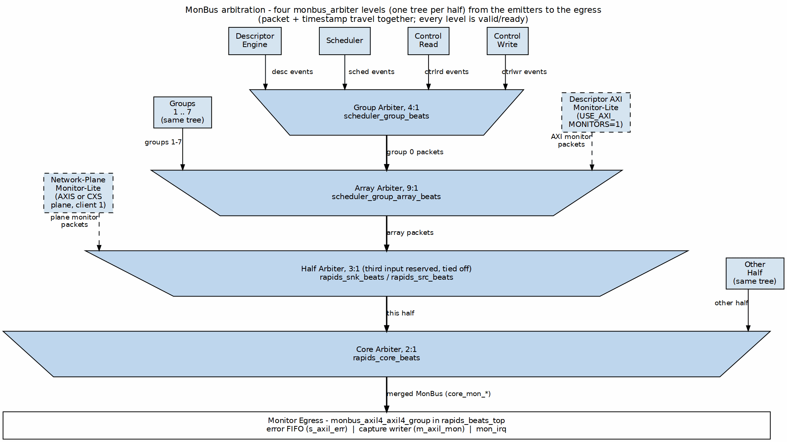

<!-- RTL Design Sherpa Documentation Header -->
<table>
<tr>
<td width="80">
  <a href="https://github.com/sean-galloway/RTLDesignSherpa">
    
  </a>
</td>
<td>
  <strong>RTL Design Sherpa</strong> · <em>Learning Hardware Design Through Practice</em><br>
  <sub>
    <a href="https://github.com/sean-galloway/RTLDesignSherpa">GitHub</a> ·
    <a href="https://github.com/sean-galloway/RTLDesignSherpa/blob/main/docs/DOCUMENTATION_INDEX.md">Documentation Index</a> ·
    <a href="https://github.com/sean-galloway/RTLDesignSherpa/blob/main/LICENSE">MIT License</a>
  </sub>
</td>
</tr>
</table>

---

<!-- End Header -->

# Monitor Bus Interface

## Overview

RAPIDS Beats outputs a 64-bit Monitor Bus (MonBus) for real-time event reporting. The MonBus provides visibility into:

- State machine transitions
- Descriptor processing events
- Error conditions
- Performance metrics

## MonBus Packet Format

### 64-bit Packet Structure

```
Bit Field          Width   Description
───────────────────────────────────────────────────────
[63:60]            4-bit   packet_type (error, completion, etc.)
[59:57]            3-bit   protocol (CORE for RAPIDS)
[56:53]            4-bit   event_code (specific event)
[52:47]            6-bit   channel_id
[46:43]            4-bit   unit_id (subsystem)
[42:35]            8-bit   agent_id (module)
[34:0]             35-bit  event_data (event-specific)
```

### Signal List

| Signal | Width | Direction | Description |
|--------|-------|-----------|-------------|
| `monbus_pkt_valid` | 1 | output | Packet valid |
| `monbus_pkt_data` | 64 | output | Packet data |
| `monbus_pkt_ready` | 1 | input | Downstream ready |

: MonBus Signals

## Packet Types

| Type | Code | Description |
|------|------|-------------|
| ERROR | 4'h0 | Error event |
| COMPLETION | 4'h1 | Transfer/operation complete |
| THRESHOLD | 4'h2 | Threshold crossed |
| TIMEOUT | 4'h3 | Timeout event |
| PERF | 4'h4 | Performance metric |
| DEBUG | 4'hF | Debug/trace event |

: MonBus Packet Types

## Agent IDs

RAPIDS modules use the following Agent IDs:

| Agent ID | Module | Description |
|----------|--------|-------------|
| 0x08 | Descriptor AXI monitor | `axi4_master_rd_monlite` on the descriptor read master (per half, `USE_AXI_MONITORS`) |
| 0x09 | Sink-ingress network monitor | The sink RX plane's monitor-lite: `axis4_slave_monlite` on `s_axis_*` (AXIS top) or `cxs_monitor_lite` in `cxs_slave_monlite` on `s_cxs_*` (CXS top) (`USE_AXI_MONITORS`; config `SNK.MON.WRMON_*`) |
| 0x0A | Source-egress network monitor | The source TX plane's monitor-lite: `axis4_master_monlite` on `m_axis_*` (AXIS top) or `cxs_monitor_lite` in `cxs_master_monlite` on `m_cxs_*` (CXS top) (`USE_AXI_MONITORS`; config `SRC.MON.RDMON_*`) |
| 0x10-0x17 | Descriptor Engine | Channels 0-7 |
| 0x20 | Control Read Engine | ctrlrd (one per half) |
| 0x21 | Control Write Engine | ctrlwr (one per half) |
| 0x30-0x37 | Scheduler | Channels 0-7 |

: RAPIDS Agent IDs

These are the values the scheduler group array and the halves pass down
(`DESC_AXI_MON_AGENT_ID`, `DESC_MON_BASE_AGENT_ID`, `CTRLRD_MON_AGENT_ID`,
`CTRLWR_MON_AGENT_ID`, `SCHED_MON_BASE_AGENT_ID`); the module defaults inside
the engines differ and are overridden at instantiation. The data paths carry no
MonBus emitters (an earlier revision listed data-path agents at 0x40-0x57,
which nothing emits). Agents 0x09 and 0x0A live in the network planes, outside
the core; their packets enter each half's 3:1 `monbus_arbiter` as client 1 on
`snk_plane_mon_*` / `src_plane_mon_*`. A CXS plane's packets carry protocol
`PROTOCOL_CXS`, which the top's monitor group filters through its AXIS mask
slot. A CXS PACKET_END completion carries the channel (`CXSSRCID`) in
`event_data[55:48]`; its `channel_id` field holds `{PRCLTYPE[2:0], TGTID[5:0]}`.

## Event Codes

### Scheduler Events (Agent 0x30-0x37)

| Event Code | Type | Description |
|------------|------|-------------|
| 0x0 | COMPLETION | Descriptor complete |
| 0x1 | COMPLETION | Chain complete |
| 0x2 | ERROR | Timeout |
| 0x3 | ERROR | AXI error |
| 0x4 | DEBUG | State transition |

: Scheduler Event Codes

The scheduler's and the descriptor engine's COMPLETION packets are reported only
while the half's `SCHED_CONFIG.COMPL_EN` is set (reset value 1). With the bit
clear the scheduler group drops them before its monitor-bus arbiter and still
acknowledges the emitters, so a channel runs identically either way; ERROR packets
are reported regardless of `ERR_EN`.

### Descriptor Engine Events (Agent 0x10-0x17)

| Event Code | Type | Description |
|------------|------|-------------|
| 0x0 | COMPLETION | Descriptor fetched |
| 0x1 | ERROR | Address range error |
| 0x2 | ERROR | AXI read error |
| 0x3 | DEBUG | Fetch started |

: Descriptor Engine Event Codes

## Timing Diagram

```wavedrom
{
  "signal": [
    {"name": "clk", "wave": "p.........."},
    {},
    {"name": "monbus_pkt_valid", "wave": "0.1.0.1.0.."},
    {"name": "monbus_pkt_ready", "wave": "1.........."},
    {"name": "monbus_pkt_data", "wave": "x.=.x.=.x..", "data": ["PKT1","PKT2"]},
    {},
    ["Decoded",
      {"name": "packet_type", "wave": "x.=.x.=.x..", "data": ["COMPL","DEBUG"]},
      {"name": "agent_id", "wave": "x.=.x.=.x..", "data": ["0x30","0x30"]},
      {"name": "event_code", "wave": "x.=.x.=.x..", "data": ["0x0","0x4"]}
    ]
  ],
  "config": {"hscale": 1.5},
  "head": {"text": "MonBus Packet Sequence"}
}
```

## Event Data Encoding

### Completion Event Data

```
[34:32] - Reserved
[31:0]  - Transfer length (beats completed)
```

### Error Event Data

```
[34:32] - Error type
[31:16] - Reserved
[15:0]  - Error details
```

### State Transition Event Data

```
[34:32] - Reserved
[31:28] - Previous state
[27:24] - New state
[23:0]  - Timestamp (lower bits)
```

## MonBus Arbitration

Multiple RAPIDS modules generate MonBus packets. Internal arbitration ensures ordered delivery:

### Figure 3.5.1: MonBus Arbitration Tree



**Source:** [ch03_monbus_arbitration.dot](../assets/graphviz/ch03_monbus_arbitration.dot)

### Arbitration Policy

- Round-robin across modules
- No packet loss (backpressure if output blocked)
- Priority boosting for ERROR packets

## Top-Level MonBus Delivery (monbus_axil4_axil4_group)

At the top level (`rapids_beats_top`, `rapids_beats_cxs_top`), the internal
MonBus is not exposed as a raw 64-bit port. Instead, when `USE_AXI_MONITORS = 1`,
the core's single merged stream (`core_mon_*`, which already carries the
descriptor-monitor and network-plane packets) feeds a `monbus_axil4_axil4_group`.
The data masters `m_axi_rd` and `m_axi_wr` carry no monitors. When
`USE_AXI_MONITORS = 0`, the group is not built and its outputs are tied off
(`mon_irq = 0`). The group presents three external interfaces:

| Interface | Signals | Purpose |
|-----------|---------|---------|
| Error-drain slave | `s_axil_err_ar*`, `s_axil_err_r*` (AXI-Lite, 32-bit read) | CPU reads captured error events from the error FIFO |
| Capture master | `m_axil_mon_aw*`, `m_axil_mon_w*` (64-bit `wdata`), `m_axil_mon_b*` | Bulk-writes the MonBus trace to system memory |
| Interrupt | `mon_irq` | Asserts on error/threshold events |

: Top-Level MonBus AXI-Lite Group

The capture region and flush behavior are configured by `cfg_mon_base_addr`,
`cfg_mon_limit_addr`, and `cfg_mon_flush_watermark`.

## Integration Notes

### Downstream Connection

Internally, MonBus output connects to:

1. **MonBus Arbiter** - Combines core + rd/wr monitor sources
2. **monbus_axil4_axil4_group** - Error-drain slave, capture master, and `mon_irq`
3. **Debug FIFO** - Buffered access for debug tools

### Packet Rate

| Scenario | Approximate Rate |
|----------|-----------------|
| Idle | 0 packets/cycle |
| Single channel active | ~1 packet/100 cycles |
| All channels active | ~1 packet/20 cycles |
| Error storm | Up to 1 packet/cycle |

: MonBus Packet Rates
